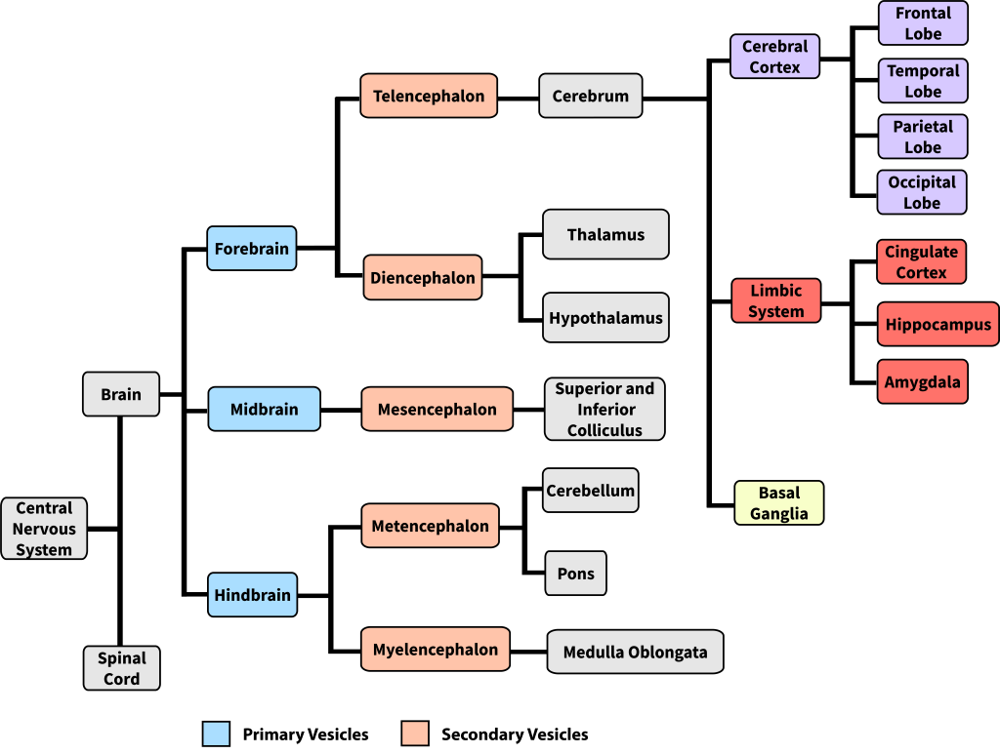
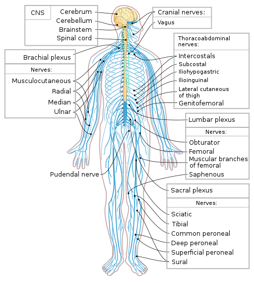
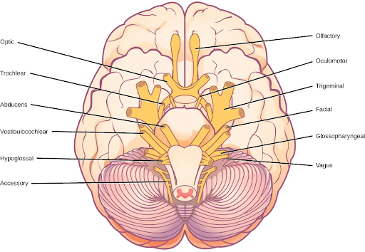
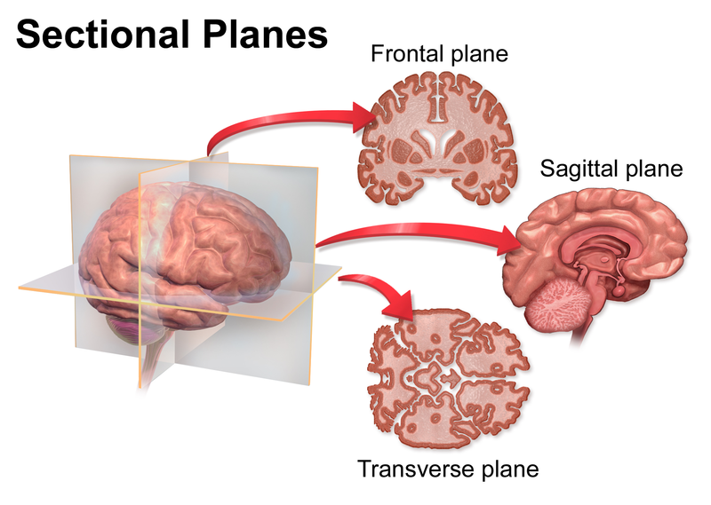
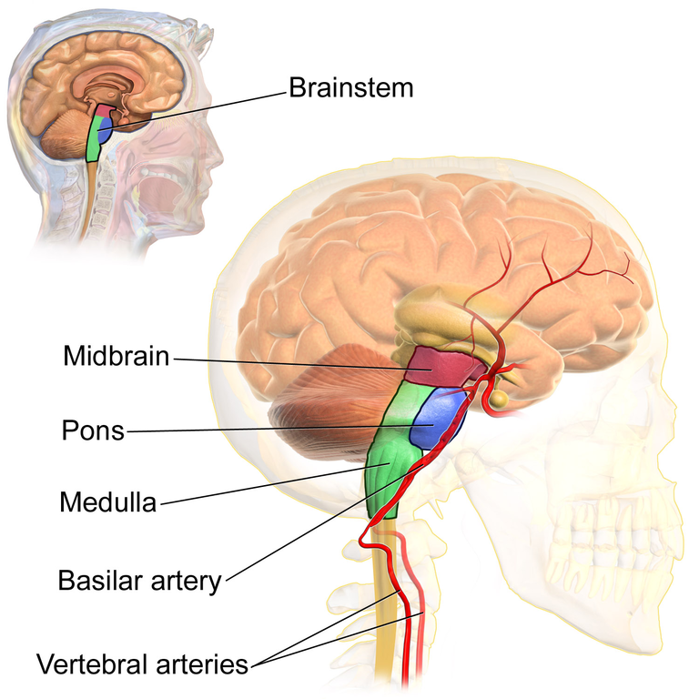
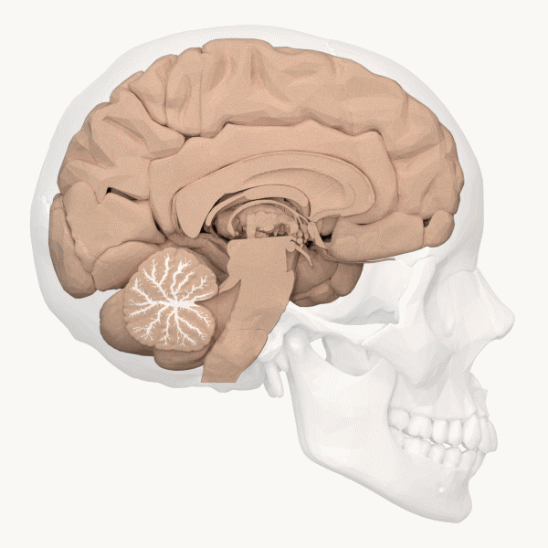
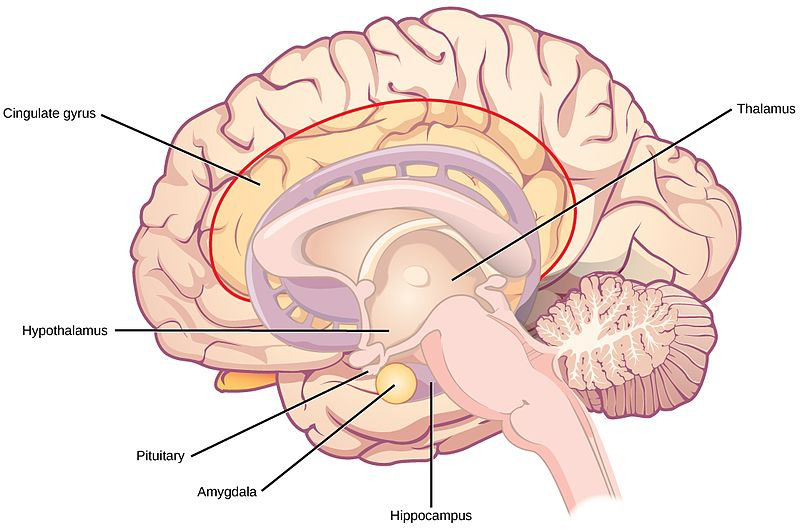

# Bản đồ não: các bộ phận lớn làm gì

## Tóm tắt

Phần nào của não quyết định bạn làm gì ngay lúc này? Câu trả lời ngắn: không phải một phần nào riêng lẻ, mà là cả một mạng lưới
nơron (neuron, tế bào thần kinh), mỗi nơron có thể nối với hàng nghìn nơron khác [S1]. Phép đếm của Azevedo và cộng sự trên não nam
giới trưởng thành cho trung bình khoảng 86 tỷ nơron [S2]. Để học được, người ta chia mạng lưới đó thành các bộ phận và đặt tên cho chúng.

Bài đi từ dưới lên. Dưới cùng là tủy sống và các dây thần kinh. Tiếp theo là thân não (brainstem), gồm hành não, cầu não và não giữa,
giữ những chức năng sống còn như thở và nhịp tim [S1]. Phía sau thân não là tiểu não (cerebellum), giúp cử động chính xác và học kỹ năng
vận động [S1]. Trên cùng là các nhân nằm sâu và vỏ não (cerebral cortex) [S1] [S3]. Thân não và tiểu não được viết kỹ nhất; tầng trên
chỉ điểm qua vì có hoặc sẽ có bài riêng (L07, L04, L08).

Nhãn mức chắc chắn: "giáo khoa" là điều các nguồn đồng thuận; "đang tranh luận" là điều có nguồn nhưng chưa ngã ngũ; "Suy luận của người
viết" là ý của người viết, không gắn nguồn; "Ví dụ của người viết" là ví dụ đời thường để dễ nhớ. Khi bằng chứng đến từ động vật, bài ghi
rõ "ở động vật".

Ví dụ của người viết: não giống một thành phố. Thân não là hệ thống điện nước, tiểu não là bộ phận điều phối giao thông, các nhân nằm sâu
là trạm trung chuyển, vỏ não là khu làm việc rộng nhất. Phép so sánh chỉ để nhớ: trong não, các "khu" nói chuyện liên tục và không khu
nào tự làm xong một việc.

Giáo trình xếp các phần não theo nguồn gốc phôi thai. Khoảng 3–4 tuần sau thụ thai, ống thần kinh phình thành ba túi: não trước
(forebrain), não giữa (midbrain), não sau (hindbrain) [S1]. Não sau về sau thành tiểu não, cầu não và hành não; não trước thành đại não
và gian não (diencephalon), tức đồi thị và vùng dưới đồi [S1].

*Các phần lớn của hệ thần kinh trung ương theo nguồn gốc phôi thai. Nhãn tiếng Anh: forebrain (não trước), midbrain (não giữa), hindbrain (não sau), cerebellum (tiểu não), pons (cầu não), medulla oblongata (hành não). Nguồn hình: Steven Martinez, CC BY-NC-SA; Hove & Martinez, Hình 9 (chương 2.6). https://rotel.pressbooks.pub/biologicalpsychology/chapter/the-brain/ [S1]*

## Hệ thần kinh trung ương và ngoại biên

Hệ thần kinh (nervous system) xử lý thông tin, chuyển tiếp tín hiệu giác quan và phối hợp hành động [S5]. Hệ thần kinh trung ương
(central nervous system) gồm não và tủy sống. Hệ thần kinh ngoại biên (peripheral nervous system) gồm các dây thần kinh nằm ngoài não và
tủy sống, nối hệ trung ương với phần còn lại của cơ thể [S5]. Mức chắc chắn: giáo khoa.

Purves và cộng sự dùng một cách chia khác, không theo phôi thai: hệ trung ương có bảy phần là tủy sống, hành não, cầu não, tiểu não, não
giữa, gian não và hai bán cầu đại não; ba phần hành não, cầu não, não giữa gộp lại là thân não [S10]. Cách gọi tên các phần não có lịch sử
dài và không hoàn toàn thống nhất giữa các sách [S1], nên khác biệt giữa hai tài liệu thường là chuyện quy ước.

*Hệ thần kinh trung ương (màu vàng) và ngoại biên (màu xanh). Nhãn tiếng Anh: brainstem (thân não), spinal cord (tủy sống), cranial nerves (dây thần kinh sọ). Nguồn hình: Wikipedia, CC0; Hove & Martinez, Hình 2 (chương 2.3). https://rotel.pressbooks.pub/biologicalpsychology/chapter/the-nervous-system/ [S5]*

### Tủy sống: hồ sơ ngắn

- **Ở đâu:** bó mô thần kinh chạy từ thân não xuống dọc cột sống, được đốt sống và dịch não tủy bảo vệ [S6].
- **Làm gì:** đưa tin từ da, cơ, nội tạng lên não (hướng tâm, afferent) và đưa lệnh từ não xuống, như lệnh co cơ (ly tâm, efferent) [S6].
- **Tự xử lý được gì:** phản xạ đơn giản như rụt tay khỏi vật nóng hay phản xạ đầu gối; vì không phải vòng lên não, giáo trình nói phản
  xạ tiết kiệm được hàng trăm mili giây [S6]. Tủy sống còn chứa bộ tạo mẫu nhịp trung ương (central pattern generator) cho cử động có nhịp
  như đi. Bằng chứng ở động vật: mèo đã bị cắt ngang tủy sống vẫn đi tương đối bình thường trên máy chạy [S6].
- **Khi tổn thương:** có thể gây liệt, mức độ tùy vị trí và tủy đứt hoàn toàn hay không; tổn thương ở cổ có thể gây liệt từ cổ trở
  xuống [S6]. Giáo trình ghi khoảng 10.000 ca tổn thương tủy sống mỗi năm ở Hoa Kỳ [S6].
- **Đừng hiểu nhầm:** tủy sống không chỉ là "dây cáp"; nó tự làm được phản xạ và cử động có nhịp.

### Nhánh thân thể và dây thần kinh

Hệ ngoại biên không được xương che chở. Nó cũng không có hàng rào máu não (blood-brain barrier), tức lớp ngăn không cho nhiều chất trong
máu đi vào mô thần kinh, nên dễ bị chất độc và chấn thương [S7]. Hệ ngoại biên có hai nhánh. Nhánh thân thể (somatic nervous system) giao
tiếp với bên ngoài: nơron cảm giác đưa tin từ da, cơ, giác quan về; nơron vận động đưa lệnh đến cơ xương [S7]. Giáo trình lấy ví dụ: bạn
nghe gọi tên, hiểu lời nói, rồi quay đầu về phía tiếng gọi [S7].

Người có 12 đôi dây thần kinh sọ (cranial nerves) đi ra từ hộp sọ. Có dây chỉ mang cảm giác (dây khứu giác), có dây gần như chỉ mang lệnh
vận động (dây vận nhãn: mở mi mắt và một số cử động mắt), có dây pha cả hai (dây thiệt hầu: vị giác và nuốt) [S7]. Có 31 đôi dây thần kinh
sống (spinal nerves), mỗi dây chứa cả sợi cảm giác lẫn vận động [S7]. Phần lớn các nhân (nucleus, cụm thân nơron) của dây thần kinh sọ nằm trong
thân não [S10] (ngoại lệ, ghi chú của người viết: dây khứu giác và dây thị giác không bắt đầu từ nhân ở thân não, nhân của dây phụ nằm ở tủy sống cổ).

*Mặt dưới não với 12 đôi dây thần kinh sọ (màu vàng cam) tụ quanh thân não. Nhãn tiếng Anh: optic (thị giác), trigeminal (sinh ba), vagus (phế vị). Nguồn hình: OpenStax, CC BY-NC-SA; Hove & Martinez, Hình 5 (chương 2.4). https://rotel.pressbooks.pub/biologicalpsychology/chapter/the-peripheral-nervous-system/ [S7]*

### Hệ thần kinh tự chủ: giao cảm và đối giao cảm

Nhánh thứ hai là hệ thần kinh tự chủ (autonomic nervous system), điều khiển phổi, tim, cơ trơn (smooth muscle, loại cơ ở thành ruột, mạch
máu) và các tuyến, phần lớn không cần ta chủ ý [S7]. Nó có hai phân nhánh thường tác dụng ngược nhau lên cùng cơ quan, theo kiểu "đẩy và
kéo" [S7]:

- **Giao cảm (sympathetic):** chuẩn bị "chiến hay chạy": tim đập nhanh, tiêu hóa bị kìm [S7]; đồng tử và phế quản giãn, máu dồn từ da và
  ruột sang cơ, tủy thượng thận (adrenal medulla, phần lõi của tuyến nằm trên thận) tiết adrenaline và noradrenaline vào máu [S8].
- **Đối giao cảm (parasympathetic):** "nghỉ và tiêu hóa": tim chậm lại, huyết áp hạ, tiêu hóa được kích thích [S7], đồng tử co [S8].

Giáo trình gợi một mẹo nhớ bằng tiếng Anh: "snake" (con rắn) và "sympathetic" cùng bắt đầu bằng s; "picnic" và "parasympathetic" cùng bắt
đầu bằng p [S7].

Hai chỗ dễ nhầm. Hệ giao cảm luôn hoạt động ở một mức nền, và nhiều phản xạ giao cảm vận hành tương đối độc lập, không bật tắt kiểu "tất
cả hoặc không" [S8]. Và không phải cơ quan nào cũng nhận cả hai: tuyến mồ hôi, tủy thượng thận, cơ dựng lông và phần lớn động mạch chỉ
nhận sợi giao cảm [S8].

Phần đối giao cảm xuất phát từ thân não và từ đoạn cùng (sacral), tức đoạn thấp nhất của tủy sống [S8]. Ở thân não có nhân Edinger-Westphal
ở não giữa (điều chỉnh đường kính đồng tử theo ánh sáng), các nhân nước bọt ở cầu não và hành não, và nhân vận động lưng của dây phế vị
(vagus) ở hành não, nơi làm chậm nhịp tim [S8]. Vậy thân não cũng là nơi xuất phát của một phần hệ tự chủ.

*Trái: đối giao cảm (co đồng tử, làm tim chậm, kích thích tiêu hóa). Phải: giao cảm (giãn đồng tử, tăng nhịp tim, kìm tiêu hóa). Nguồn hình: OpenStax, CC BY-NC-SA; Hove & Martinez, Hình 4 (chương 2.4). https://rotel.pressbooks.pub/biologicalpsychology/chapter/the-peripheral-nervous-system/ [S7]*

## Đọc bản đồ não: hướng và mặt cắt

Não là khối ba chiều, nhưng sách và ảnh chụp cho ta xem các lát hai chiều. Có ba mặt cắt (section, plane) chuẩn [S9]:

| Mặt cắt | Tên tiếng Anh | Chia não thành |
|---|---|---|
| Đứng ngang | coronal, frontal | trước và sau |
| Đứng dọc | sagittal | trái và phải |
| Nằm ngang | horizontal, axial | trên và dưới |

Mặt cắt đứng dọc ngay giữa hai bán cầu gọi là mặt cắt giữa (midsagittal); lệch ra hai bên gọi là cạnh giữa (paramedian) [S10]. Hình hệ viền
và hình tiểu não trong bài là mặt cắt giữa.

*Nhãn tiếng Anh: frontal plane (mặt cắt đứng ngang), sagittal plane (đứng dọc), transverse plane (nằm ngang). Nguồn hình: Wikimedia, giấy phép theo sách CC BY-NC-SA; Hove & Martinez, Hình 1 (chương 2.2). https://rotel.pressbooks.pub/biologicalpsychology/chapter/visualizing-and-navigating-the-human-brain/ [S9]*

Các từ chỉ hướng đi theo cặp [S9]: trước và sau (anterior, posterior); về phía đầu và về phía đuôi (rostral, caudal); về phía trên và
về phía dưới (superior, inferior); lưng và bụng (dorsal, ventral); giữa và bên (medial, lateral); đối bên và cùng bên (contralateral,
ipsilateral).

Chỗ hay gây bối rối: trục dài của hệ thần kinh trung ương ở người bị gập. Purves và cộng sự mô tả góc khoảng 120° giữa trục thân não và
trục não trước, hình thành khi loài người đứng thẳng [S10]. Hệ quả: ở thân não và tủy sống, "lưng" chỉ về phía gáy; ở não trước, "lưng"
chỉ về phía đỉnh đầu [S10].

Cặp đối bên và cùng bên cần nhớ cho các mục sau: tín hiệu chạm và lệnh vận động của mỗi bên cơ thể được xử lý chủ yếu ở bán cầu đối bên
[S1], còn tổn thương tiểu não gây lỗi cử động ở cùng bên [S14].

Suy luận của người viết: đây là hệ tọa độ để đọc mọi hình ở các bài sau. "Vỏ trước trán lưng bên" (L04) chỉ đơn giản là phần phía trước,
phía trên, phía ngoài của thùy trán.

## Nhìn vào não sống: các cách chụp não

Mỗi loại bằng chứng cho biết một điều và bỏ sót điều khác. Trước khi có máy chụp, bằng chứng đến từ bệnh nhân tổn thương não, nên mục này
bắt đầu từ đó. Mục chỉ điểm qua; fMRI trong nghiên cứu mạng xã hội: xem L06.

**Bệnh nhân tổn thương.** Phineas Gage mất một phần thùy trán trái vì một thanh sắt xuyên qua đầu; theo giáo trình, ông vẫn nói, đi, nhớ
bình thường nhưng tính cách thay đổi [S11]. L04 bàn phần còn tranh cãi của câu chuyện này. Bác sĩ Paul Broca thấy bệnh nhân mất khả năng nói
có tổn thương vỏ trán dưới bên trái; Carl Wernicke thấy tổn thương thùy thái dương trên bên trái làm hỏng khả năng hiểu lời [S11] (chi tiết:
L04). Giáo trình gọi cặp ca này là phân ly kép (double dissociation): tổn thương chỗ A làm hỏng việc X mà không hỏng việc Y, tổn thương chỗ
B thì ngược lại [S11]. Giới hạn: tổn thương mỗi người một khác và hiếm khi gọn trong một vùng; vì không thể gây tổn thương có kiểm soát trên
người, các nhà nghiên cứu dùng động vật thí nghiệm [S11].

**Chụp cấu trúc.** CT (chụp cắt lớp vi tính, computerized tomography) dùng tia X, có từ những năm 1970, nay ít dùng trong nghiên cứu vì có bức
xạ và độ phân giải thấp [S11]. MRI cấu trúc (structural magnetic resonance imaging, chụp cộng hưởng từ) cho hình chi tiết cỡ milimét [S11].
Biến thể DTI (diffusion tensor imaging, chụp khuếch tán) dựa vào cách nước di chuyển dọc sợi trục (axon, "dây" dẫn tín hiệu ra khỏi nơron)
để vẽ các bó chất trắng (white matter, mô gồm chủ yếu sợi trục có bọc myelin) [S1] [S11]. Chụp cấu trúc cho biết hình dạng, không cho biết
vùng đang làm gì.

**Chụp hoạt động.** PET (positron emission tomography, chụp cắt lớp phát xạ positron) dò chất phóng xạ tiêm vào máu, và đo được sự phân bố của
chất dẫn truyền hay thụ thể [S11]. fMRI (functional MRI, MRI chức năng) đo tín hiệu BOLD, tức thay đổi nồng độ hemoglobin mang oxy; từ đó
suy ra hoạt động nơron chứ không đo trực tiếp. Nó phân giải không gian vài milimét nhưng thời gian chỉ khoảng 2–3 giây [S11].

**Ghi điện và từ.** EEG (electroencephalography, điện não đồ) cho biết "khi nào" chính xác đến mili giây nhưng khó chỉ "ở đâu", nhất là với
nguồn nằm sâu [S11]. MEG (magnetoencephalography, từ não đồ) ghi từ trường rất yếu, ít bị xương sọ và da đầu làm méo, nên nhanh như EEG mà
định vị tốt hơn, nhưng đắt và khó vận hành [S11].

Điều quan trọng nhất: hình fMRI là dữ liệu tương quan, nên giáo trình nhấn mạnh cần bằng chứng hội tụ, ví dụ ghép fMRI với thí nghiệm nhân
quả trên động vật [S11]. Logothetis (2008) cũng cho rằng nhiều kết luận từ fMRI bỏ qua giới hạn thật của phương pháp, vì tín hiệu là tín
hiệu huyết động [S12].

## Thân não: hành não, cầu não, não giữa

Thân não được ví như "thân cây" (trunk) của não; nó chứa nhiều bó chất trắng mang tin lên xuống giữa tủy sống, dây thần kinh sọ và phần
còn lại của não, và lo những chức năng giữ ta sống như thở, nhịp tim, tiêu hóa [S1]. Theo Purves, các bó này chuyển tin cảm giác lên não
giữa và não trước, và chuyển lệnh vận động xuống [S10]. Đi từ dưới lên: hành não (medulla oblongata) nối
liền tủy sống, trên nó là cầu não (pons), trên cùng là não giữa (midbrain) [S1] [S10]. Bệnh nhân bị tổn thương thân não nặng thường phải
dùng máy hỗ trợ sự sống [S1]. Mức chắc chắn: giáo khoa.

*Từ trên xuống: midbrain (não giữa), pons (cầu não), medulla (hành não). Nguồn hình: BruceBlaus (Blausen.com) qua Wikimedia; giấy phép theo sách CC BY-NC-SA (bản trên Wikimedia ghi CC BY 3.0); Hove & Martinez, Hình 24 (chương 2.6). https://rotel.pressbooks.pub/biologicalpsychology/chapter/the-brain/ [S1]*

Ba thẻ hồ sơ dưới đây dùng cùng một khung. Chỗ nào bài chưa có nguồn mô tả riêng, thẻ ghi rõ như vậy.

### Hành não (medulla oblongata)

- **Ở đâu:** phần thấp nhất của thân não, nối liền tủy sống [S1]. Còn gọi là hành tủy.
- **Gồm những phần nào:** đường dây thần kinh nối não với tủy sống và các mạng nơron điều khiển chức năng cơ bản [S4]; nhân dây thần kinh
  sọ [S10]; nhân vận động lưng của dây phế vị [S8].
- **Vai trò chính và bằng chứng:** điều hòa thở, tiêu hóa, tim mạch, nuốt, hắt hơi [S1] [S4]. Bằng chứng chính là lâm sàng: tổn thương thân
  não nặng đe dọa tính mạng [S1].
- **Kết nối:** xuống tủy sống, lên các phần trên [S4]; qua dây phế vị đến tim, phổi, ruột [S8].
- **Chất dẫn truyền chính:** chưa có nguồn trong bài nêu một chất chính. Purves ghi có hai nhóm nơron chứa adrenaline ở phần phía đầu
  (rostral) của hành não, chức năng chưa rõ [S13].
- **Khi tổn thương:** chưa có nguồn trong bài mô tả riêng cho hành não; tổn thương thân não nặng nói chung đe dọa tính mạng [S1].
- **Đừng hiểu nhầm:** hành não không phải nơi duy nhất liên quan đến thở; Brain Facts mô tả cầu não cũng ảnh hưởng đến thở [S4].

### Cầu não (pons)

- **Ở đâu:** giữa hành não và não giữa; như cây cầu nối vỏ não với hành não, trao đổi tin giữa não và tủy sống [S1].
- **Gồm những phần nào:** các nhân cầu não (pontine nuclei) ở phần nền [S14]; hệ lưới cầu não (pontine reticular formation), một phần của
  hệ lưới (reticular formation), mạng nơron trải dọc lõi thân não (xem mục sau) [S15]; vùng raphe chứa nơron serotonin [S13].
- **Vai trò chính và bằng chứng:** chuyển tiếp tin cảm giác, vận động [S1]; ảnh hưởng đến thở và tư thế [S4]. Trong giấc ngủ REM (rapid eye
  movement, giai đoạn ngủ có cử động mắt nhanh), hệ lưới cầu não phát tín hiệu gây cử động mắt nhanh và các sóng điện lan qua đồi thị lên
  vỏ chẩm [S15].
- **Kết nối:** các nhân cầu não nhận tin từ gần như mọi vùng vỏ não, gửi sợi trục băng qua đường giữa rồi vào tiểu não qua cuống tiểu não
  giữa. Mỗi cuống có hơn 20 triệu sợi trục, trong khi dây thị giác và bó tháp chỉ khoảng một triệu [S14].
- **Chất dẫn truyền chính:** serotonin từ vùng raphe [S13]; acetylcholine từ nhóm nhân cholinergic (dùng acetylcholine) gần chỗ nối cầu não
  với não giữa [S15].
- **Khi tổn thương:** chưa có nguồn trong bài mô tả riêng cho cầu não; tổn thương thân não nặng nói chung đe dọa tính mạng [S1].
- **Đừng hiểu nhầm:** "cầu" không chỉ là đoạn dây nối; cầu não có nhân riêng cho giấc ngủ, sự tỉnh táo và đường vỏ não-tiểu não [S14] [S15].

### Não giữa (midbrain)

- **Ở đâu:** phần trên cùng của thân não [S1] [S3], nằm dưới đồi thị (thalamus, trạm trung chuyển tin giác quan lên vỏ; xem L07) [S4].
- **Gồm những phần nào:** gò trên và gò dưới (superior, inferior colliculi), chuyển tiếp tin thị giác và thính giác [S1]; chất đen
  (substantia nigra) và vùng mái bụng (ventral tegmental area, VTA) [S13]; nhân Edinger-Westphal [S8].
- **Vai trò chính và bằng chứng:** chứa tế bào sản xuất dopamine, tham gia điều hòa vận động [S1]; điều khiển một số phản xạ và là một phần
  của mạch cử động mắt [S3]; điều phối chớp mắt, điều tiết mắt và phản xạ với tiếng động lớn như cú giật mình [S4].
- **Kết nối:** chất đen gửi sợi đến thể vân (corpus striatum) [S13]; VTA gửi sợi đến nhân accumbens (nucleus accumbens, một nhân thuộc hạch
  nền, xem L07) theo đường trung não-viền (mesolimbic pathway) [S4].
- **Chất dẫn truyền chính:** dopamine [S1] [S13].
- **Khi tổn thương:** trong bệnh Parkinson, nơron dopamine của chất đen thoái hóa, gây rối loạn vận động đặc trưng [S13]; Brain Facts mô tả
  các triệu chứng như run và cứng [S4].
- **Đừng hiểu nhầm:** tên "não giữa" đến từ ba túi não của phôi thai [S1]. Và dopamine không phải "chất hạnh phúc"; xem L00 và L03.

Suy luận của người viết: ba thẻ trên cho thấy thân não có hai loại việc: việc "tại chỗ" (nhịp thở, đồng tử, dây thần kinh sọ) và việc
"phát sóng" lên toàn bộ não qua các nhóm nhân. Mục sau nói về loại thứ hai.

## Thân não: nơi xuất phát của các chất dẫn truyền

Mục này chỉ trả lời: các nhóm nhân ở **đâu** và sợi của chúng **tỏa đi đâu**. Hồ sơ đầy đủ từng chất thuộc L03. Purves và cộng sự xếp
dopamine, noradrenaline, serotonin vào nhóm amin sinh học (biogenic amines), và mô tả nhiều nhóm nơron loại này ở thân não có sợi trục
chiếu rộng lên não trước [S13]. Mức chắc chắn: giáo khoa.

| Nhóm nhân | Ở đâu | Chất | Tỏa đi đâu |
|---|---|---|---|
| Nhân raphe | vùng raphe của cầu não và phần trên thân não | serotonin | lan rộng lên não trước [S13] |
| Locus coeruleus | thân não, vùng cầu não (theo hình 6.12 của Purves) | noradrenaline | lan tỏa đến nhiều đích ở não trước [S13] |
| Chất đen và VTA | não giữa | dopamine | thể vân [S13]; từ VTA đến nhân accumbens [S4] |
| Nhân cholinergic | chỗ nối cầu não và não giữa | acetylcholine | nơron đồi thị chiếu lên vỏ [S15] |

### Locus coeruleus: hồ sơ ngắn

- **Ở đâu:** một nhân ở thân não [S13]; hình 6.12 của Purves vẽ nó ở vùng cầu não, sợi tỏa lên vỏ não, xuống tiểu não và tủy sống [S13].
- **Chất:** noradrenaline (norepinephrine); ngoài não, đây cũng là chất mà phần lớn nơron hậu hạch giao cảm giải phóng ở cơ quan đích; còn truyền tin bên trong hạch giao cảm chủ yếu dùng acetylcholine (ghi chú của người viết, theo Purves chương 21, chưa đối chiếu lại trong phiên này).
- **Tỏa đi đâu:** lan tỏa đến nhiều đích ở não trước [S13].
- **Liên quan đến:** giấc ngủ và sự tỉnh táo, chú ý, hành vi ăn [S13]; vai trò của noradrenaline: xem L03.
- **Đừng hiểu nhầm:** liên quan đến chú ý không có nghĩa nó "là" sự chú ý; nó là một trong nhiều hệ cùng điều chỉnh mạng lưới (L05).

### Hệ lưới và sự tỉnh táo

Năm 1949, Magoun và Moruzzi kích thích điện một nhóm nơron cholinergic gần chỗ nối cầu não và não giữa, và con vật đang ngủ thức dậy (bằng
chứng ở động vật, mèo); vùng này vì thế được gọi là hệ lưới hoạt hóa (reticular activating system) [S15]. Phát hiện gợi ý rằng sự thức
cần một cơ chế riêng, không chỉ là "đủ kích thích giác quan" [S15].

Theo Purves và cộng sự, các nhân cholinergic này phóng xung nhanh khi thức và trong giấc ngủ REM, gần như im lặng khi ngủ không REM; nhưng
chúng không phải nền tảng duy nhất của sự thức, vì nơron noradrenaline của locus coeruleus và nơron serotonin của nhân raphe cũng tham
gia [S15]. Brain Facts tóm lại: nhiều hệ thức tỉnh nằm ở phần trên thân não, dùng acetylcholine, noradrenaline, serotonin để nối với não
trước [S4]. Cả mạng này bị một nhóm nơron ở vùng dưới đồi (hypothalamus, xem L07) tên là VLPO (ventrolateral preoptic nucleus, nhân trước
thị bụng bên) ức chế theo chu kỳ; tổn thương VLPO gây mất ngủ [S15].

Không phải mọi hệ giữ thức đều ở thân não. Purves ghi các nơron histamine nằm ở vùng dưới đồi và cũng góp phần vào sự tỉnh táo [S13].
Giáo trình nói đồi thị, vì là trạm trung chuyển tin giác quan, góp phần chuyển giữa ngủ và thức [S1]; Purves kể thêm thí nghiệm của Hess:
kích thích đồi thị bằng xung tần số thấp làm con vật đang thức chuyển sang ngủ sóng chậm (bằng chứng ở động vật) [S15].

| Trạng thái | Hệ cholinergic | Hệ noradrenaline, serotonin |
|---|---|---|
| Thức | hoạt động | hoạt động |
| Ngủ không REM | giảm | giảm |
| Ngủ REM | tăng lại gần mức khi thức | giảm rõ |

*Bảng tóm tắt theo Purves và cộng sự, mục "Neural Circuits Governing Sleep" [S15].*

Brain Facts còn mô tả hệ lưới hoạt hóa điều khiển hệ tự chủ (nhịp tim, dòng máu, nhịp thở) để đưa cơ thể vào trạng thái sẵn sàng [S4].

Suy luận của người viết: vì vài nhóm nhân chiếu lên rất nhiều vùng, một chất tác động lên một hệ có thể ảnh hưởng cùng lúc đến giấc ngủ,
sự chú ý và hành vi ăn. Purves cũng nhận xét rằng các thuốc tác động lên amin sinh học thuộc nhóm quan trọng nhất của dược lý hiện đại
[S13]. Thuốc cụ thể: xem L03.

## Tiểu não (cerebellum)

Tiểu não (cerebellum, tiếng Latin là "não nhỏ") nằm ở phía sau não [S1]. Mặt ngoài gấp nếp rất dày; cắt dọc giữa sẽ thấy chất trắng phân
nhánh như cành cây, gọi là cây sống (arbor vitae) [S1].

*Mặt cắt đứng dọc giữa: tiểu não ở phía sau dưới, cây sống (arbor vitae) tô trắng. Khung tĩnh trích từ ảnh động. Nguồn hình: Wikipedia, CC BY-SA; Hove & Martinez, Hình 23 (chương 2.6). https://rotel.pressbooks.pub/biologicalpsychology/chapter/the-brain/ [S1]*

### Tiểu não: thẻ hồ sơ

- **Ở đâu:** phía sau não, giữa đại não và thân não [S1], dưới thùy chẩm [S4]; nối với phần còn lại qua ba cuống tiểu não (cerebellar
  peduncles) [S14].
- **Gồm những phần nào:** hai bán cầu [S4]; vỏ tiểu não và các nhân tiểu não sâu (deep cerebellar nuclei) [S14]. Theo nơi gửi tin đến, có ba
  phần: tiểu não tiền đình (vestibulocerebellum), nhận tin từ các nhân tiền đình ở thân não, lo tư thế và thăng bằng; tiểu não tủy (spinocerebellum),
  nhận tin trực tiếp từ tủy sống, gồm cả thùy giun (vermis) ở giữa, lo cử động thân mình và chân tay; tiểu não đại não (cerebrocerebellum),
  nhận tin từ vỏ đại não, phần lớn nhất ở người, lo chuỗi cử động khéo léo, kể cả lời nói [S14].
- **Vai trò chính và bằng chứng:** không khởi phát lệnh vận động mà làm cử động chính xác, đúng lúc, tinh chỉnh theo phản hồi cảm giác, và
  học vận động [S1]. Mức chắc chắn: giáo khoa.
- **Kết nối:** nhận tin từ vỏ não qua các nhân cầu não, từ nhân tiền đình và tủy sống [S14]; gửi tin qua các nhân sâu đến nơron vận động
  trên (upper motor neuron, nơron ở vỏ não và thân não phát lệnh vận động xuống) [S14].
- **Chất dẫn truyền chính:** chưa có nguồn trong bài nêu tên chất. Purves mô tả tế bào Purkinje (Purkinje cell) của vỏ tiểu não ức chế liên
  tục lên các nhân sâu, còn nhân sâu có tác dụng kích thích [S14].
- **Khi tổn thương:** cử động giật cục, thiếu chính xác (thất điều, ataxia) [S14], ở cùng bên với tổn thương [S14].
- **Đừng hiểu nhầm:** tiểu não không ra lệnh cử động, nó sửa lệnh; và "chỉ lo vận động" là quan niệm đã được xem lại (xem dưới).

### Nhỏ mà đông dân

Giáo trình ghi tiểu não chứa khoảng 80% số nơron của não, phần lớn là tế bào hạt (granule cell) nhỏ, xếp dày [S1]. Brain Facts nói tiểu
não chứa hơn một nửa số nơron [S4]. Azevedo và cộng sự đếm được chỉ khoảng 19% nơron nằm ở vỏ đại não, dù vỏ đại não chiếm 82% khối lượng
não [S2]. Các nguồn cho con số khác nhau, nhưng nhất quán ở ý chính: phần lớn nơron không nằm ở vỏ đại não. Con số "100 tỷ nơron" trước đây
không dựa trên phép đếm trực tiếp [S2].

### Tiểu não sửa lỗi như thế nào

Theo Purves và cộng sự, chức năng chính của tiểu não là phát hiện "lỗi vận động", tức độ chênh giữa cử động dự định và cử động thực tế,
rồi giảm lỗi đó; việc sửa diễn ra ngay trong lúc cử động hoặc được lưu lại thành học vận động [S14]. Hai thí nghiệm minh họa [S14]. Ở khỉ
bị làm yếu một cơ mắt (bằng chứng ở động vật), các cú liếc mắt lúc đầu bị hụt, sau vài ngày chính xác trở lại; tổn thương thùy giun làm mất
khả năng tự chỉnh này. Ở người và khỉ đeo kính phóng to hoặc thu nhỏ, phản xạ giữ mắt ổn định khi quay đầu dần được chỉnh theo kính mới,
trừ khi tiểu não bị tổn thương [S14].

Ví dụ của người viết: tập ném bóng rổ, lần đầu hụt bên trái, lần sau tay tự chỉnh sang phải. NINDS cũng lấy ví dụ chơi piano hay đánh bóng
tennis là lúc tiểu não hoạt động [S3].

### Khi tiểu não bị tổn thương

Theo Purves, lỗi xuất hiện ở cùng bên cơ thể với tổn thương và biểu hiện tùy vùng [S14]:

| Vùng tổn thương | Biểu hiện chính |
|---|---|
| Tiểu não tiền đình | khó đứng thẳng, khó giữ hướng nhìn; rung giật nhãn cầu (nystagmus) |
| Tiểu não tủy | dáng đi dạng rộng, bước nhỏ; với quá hoặc thiếu (dysmetria); run khi cử động |
| Tiểu não đại não | khó làm chuỗi cử động khéo léo đã học, như chơi nhạc cụ |

Ví dụ lâm sàng Purves nêu: nghiện rượu lâu năm có thể làm thoái hóa phần trước vỏ tiểu não, gây dáng đi loạng choạng trong khi tay ít bị
ảnh hưởng [S14]. Brain Facts thêm: bệnh nhân có thể không chạm chính xác ngón tay lên mũi, và có thể khó nói [S4].

### Ngoài vận động: một ý đã được xem lại

Giáo trình nêu như điều đã biết rằng các nghiên cứu hình ảnh cho thấy tiểu não tham gia cả ngôn ngữ và chú ý, và phần lớn tiểu não nối với
các mạng nhận thức của đại não [S1]. Randy Buckner (2013) kể rằng khi những nghiên cứu hình ảnh đầu tiên, khoảng 25 năm trước bài viết của
ông, thấy tiểu não phản ứng trong nhiệm vụ không đòi hỏi vận động, đó là quan sát gây tranh cãi vì đi ngược quan niệm tiểu não chỉ lo vận
động; các phát hiện lặp lại sau đó dẫn đến việc xem lại mô hình cũ [S16]. Theo ông, phần lớn tiểu não người ánh xạ có trật tự với các mạng
liên hợp (association networks, các mạng vỏ não không thuần cảm giác hay vận động) của đại não [S16].

Bằng chứng từ bệnh nhân: Schmahmann và Sherman (1998) khám 20 bệnh nhân có bệnh chỉ ở tiểu não. Người tổn thương thùy sau và thùy giun có
thay đổi về chức năng điều hành (executive functions: lập kế hoạch, chuyển đổi, trí nhớ làm việc), nhận thức không gian, tính cách và ngôn
ngữ; tổn thương thùy trước chỉ gây thay đổi nhỏ. Họ đặt tên "hội chứng nhận thức cảm xúc tiểu não" [S17].

Mức chắc chắn: việc tiểu não góp phần vào nhận thức nay có nhiều bằng chứng, từng là điều gây tranh cãi [S16]. Suy luận của người viết:
điều chưa thể nói là tiểu não là "trung tâm" của ngôn ngữ hay cảm xúc; một nghiên cứu 20 bệnh nhân cũng là mẫu nhỏ.

## Tầng trên: các nhân nằm sâu và vỏ não

Phía trên thân não là não trước. Mỗi thứ dưới đây có hoặc sẽ có bài riêng; ở đây chỉ để biết vị trí trên bản đồ.

- **Hệ viền (limbic system):** nằm ở đỉnh thân não, tham gia trí nhớ, cảm xúc, động lực, khứu giác; thành phần chính là hải mã
  (hippocampus), hạnh nhân (amygdala) và vỏ đai (cingulate cortex); danh sách thành phần đã được định nghĩa lại nhiều lần [S1]. Xem L07.
- **Hạch nền (basal ganglia):** các nhân dưới vỏ quan trọng cho việc chọn và điều hòa cử động có chủ ý, làm việc cùng chất đen [S1]. Xem L07.
- **Đồi thị và vùng dưới đồi:** đồi thị chuyển tin của mọi giác quan trừ khứu giác lên vỏ; vùng dưới đồi điều hòa hormone cùng tuyến yên
  [S1]. Xem L07.

*Nhãn tiếng Anh: cingulate gyrus (hồi đai, thuộc vỏ đai), thalamus (đồi thị), hypothalamus (vùng dưới đồi), amygdala (hạnh nhân), hippocampus (hải mã). Nguồn hình: Wikimedia, giấy phép theo sách CC BY-NC-SA; Hove & Martinez, Hình 19 (chương 2.6). https://rotel.pressbooks.pub/biologicalpsychology/chapter/the-brain/ [S1]*

**Vỏ não** là tấm nơron mỏng 2–4 mm, phần lớn có 6 lớp, rộng khoảng 1.800 cm² và gấp nếp để vừa hộp sọ [S1]. Các rãnh lớn chia nó thành
bốn thùy trán, đỉnh, thái dương, chẩm [S1] [S3]; thùy đảo (insula) nằm sâu trong rãnh bên, đôi khi được coi là thùy thứ năm [S1]. Thùy
trán và hai bán cầu: xem L04; thùy thái dương, đỉnh, chẩm: L08; thùy đảo: L07.

*Bốn thùy: frontal (trán), parietal (đỉnh), temporal (thái dương), occipital (chẩm); central sulcus (rãnh trung tâm). Nguồn hình: OpenStax Anatomy & Physiology 2e, giấy phép theo sách CC BY-NC-SA; Hove & Martinez, Hình 12 (chương 2.6). https://rotel.pressbooks.pub/biologicalpsychology/chapter/the-brain/ [S1]*

## Đừng hiểu "mỗi vùng một việc" quá đà

Bản đồ là cách học, không phải mô tả trọn vẹn cách não làm việc. Ba lớp bằng chứng:

**Định vị chức năng có thật, nhưng có giới hạn.** Các ca của Broca và Wernicke cho thấy tổn thương ở chỗ cụ thể gắn với khiếm khuyết cụ
thể (localization of function) [S11]; nhưng tổn thương ở người hiếm khi gọn trong một vùng [S11], và hai bán cầu thường có chức năng chồng
lấn, dự phòng cho nhau [S1]. Mức chắc chắn: giáo khoa.

**Não làm việc theo vòng và theo mạng.** Đồi thị vừa chuyển tin lên vỏ vừa nhận tin từ vỏ xuống, nên luồng "đầu vào, tính toán, đầu ra"
không đi một chiều [S1]. Khi người nằm yên trong máy fMRI, các vùng cách xa nhau vẫn dao động cùng nhịp, tạo thành các mạng lớn như mạng
chú ý hay mạng mặc định (default mode network) [S11]. Sự tỉnh táo cần nhiều hệ cùng lúc [S15]. Brain Facts viết rằng không vùng nào một
mình chịu trách nhiệm cho cảm giác đau và ngứa [S4].

**Suy ngược từ ảnh chụp là yếu.** Poldrack (2006) phân tích "suy ngược" (reverse inference): từ chuyện một vùng sáng lên mà kết luận một
quá trình tâm lý đang diễn ra. Kiểu suy luận này không chặt chẽ về logic, và càng yếu khi vùng đó sáng lên trong nhiều loại nhiệm vụ; ông
khuyên thận trọng chứ không bác bỏ hoàn toàn [S18].

Ví dụ của người viết, đã đơn giản hóa: khi nghe ai gọi tên mình, hệ lưới ở thân não giữ bạn đủ tỉnh để nghe, đồi thị chuyển tin lên vỏ
thính giác, thùy trán cân nhắc có trả lời không, vùng vận động phát lệnh quay đầu, tiểu não chỉnh cú quay cho êm. Ví dụ ghép các chức năng
đã nêu ở từng mục; trình tự là minh họa, không phải kết quả một thí nghiệm, và các bước thật sự chồng lên nhau.

Vì vậy, đọc "vùng X chịu trách nhiệm cho Y" thì hiểu là "vùng X đóng vai trò quan trọng trong mạng lưới làm Y". NINDS ví não như một nhóm
chuyên gia: các phần cùng làm việc, mỗi phần có trách nhiệm riêng [S3].

## Điều cần nhớ

1. Hệ thần kinh trung ương là não và tủy sống; hệ thần kinh ngoại biên gồm nhánh thân thể và hệ thần kinh tự chủ (giao cảm, đối giao cảm) [S5] [S7].
2. Ba mặt cắt và các cặp từ chỉ hướng là hệ tọa độ để đọc hình não [S9] [S10].
3. Mỗi cách chụp não cho biết một điều; fMRI là dữ liệu tương quan [S11].
4. Thân não gồm hành não, cầu não, não giữa: chức năng sống còn, nhân dây thần kinh sọ, đường đi của các bó dẫn truyền [S1] [S10].
5. Các nhóm nhân ở thân não (raphe, locus coeruleus, chất đen, VTA, nhân cholinergic) chiếu lên khắp não trước và góp phần giữ ta thức [S13] [S15].
6. Tiểu não sửa lỗi và học vận động; vai trò trong nhận thức có nhiều bằng chứng nhưng chưa phải "trung tâm" của việc gì [S1] [S16].
7. Định vị chức năng có thật, nhưng não làm việc theo mạng [S11] [S18].

Nối với các bài khác: dopamine ở L00 đến từ chất đen và vùng mái bụng của não giữa. Bài sau (L02) đi vào chính các nơron.

## Nguồn tham khảo

- [S1] Hove M. J. & Martinez S. A., Biological Psychology (Revised Edition), mục 2.6 "The Brain", ROTEL Pressbooks, 2024 https://rotel.pressbooks.pub/biologicalpsychology/chapter/the-brain/
- [S2] Azevedo F. A. C. và cộng sự, Equal numbers of neuronal and nonneuronal cells make the human brain an isometrically scaled-up primate brain, Journal of Comparative Neurology 513(5):532-541, 2009 https://doi.org/10.1002/cne.21974
- [S3] NINDS (NIH Hoa Kỳ), Brain Basics: Know Your Brain https://www.ninds.nih.gov/health-information/public-education/brain-basics/brain-basics-know-your-brain
- [S4] Society for Neuroscience, Brain Facts: A Primer on the Brain and Nervous System, 2018 https://www.brainfacts.org/the-brain-facts-book
- [S5] Hove M. J. & Martinez S. A., Biological Psychology (Revised Edition), mục 2.3 "The Nervous System", ROTEL Pressbooks, 2024 https://rotel.pressbooks.pub/biologicalpsychology/chapter/the-nervous-system/
- [S6] Hove M. J. & Martinez S. A., Biological Psychology (Revised Edition), mục 2.5 "The Central Nervous System", ROTEL Pressbooks, 2024 https://rotel.pressbooks.pub/biologicalpsychology/chapter/the-central-nervous-system/
- [S7] Hove M. J. & Martinez S. A., Biological Psychology (Revised Edition), mục 2.4 "The Peripheral Nervous System", ROTEL Pressbooks, 2024 https://rotel.pressbooks.pub/biologicalpsychology/chapter/the-peripheral-nervous-system/
- [S8] Purves D. và cộng sự (chủ biên), Neuroscience, 2nd edition, Sinauer, 2001, Chương 21, mục "The Sympathetic Division" và "The Parasympathetic Division of the Visceral Motor System", NCBI Bookshelf https://www.ncbi.nlm.nih.gov/books/NBK10934/ ; https://www.ncbi.nlm.nih.gov/books/NBK11149/
- [S9] Hove M. J. & Martinez S. A., Biological Psychology (Revised Edition), mục 2.2 "Visualizing and Navigating the Human Brain", ROTEL Pressbooks, 2024 https://rotel.pressbooks.pub/biologicalpsychology/chapter/visualizing-and-navigating-the-human-brain/
- [S10] Purves D. và cộng sự (chủ biên), Neuroscience, 2nd edition, Sinauer, 2001, Chương 1, mục "Some Anatomical Terminology" và "The Subdivisions of the Central Nervous System", NCBI Bookshelf https://www.ncbi.nlm.nih.gov/books/NBK10971/ ; https://www.ncbi.nlm.nih.gov/books/NBK10926/
- [S11] Hove M. J. & Martinez S. A., Biological Psychology (Revised Edition), mục 4.5 "Brain imaging, PET and MRI", 4.4 "EEG and MEG", 4.2 "Studies of Brain Damage in Humans", ROTEL Pressbooks, 2024 https://rotel.pressbooks.pub/biologicalpsychology/chapter/tools-of-cognitive-neuroscience-brain-imaging-pet-and-mri/ ; https://rotel.pressbooks.pub/biologicalpsychology/chapter/tools-of-cognitive-neuroscience-eeg-and-meg/ ; https://rotel.pressbooks.pub/biologicalpsychology/chapter/historical-methods-studies-of-brain-damage-in-humans/
- [S12] Logothetis N. K., What we can do and what we cannot do with fMRI, Nature 453:869-878, 2008 https://doi.org/10.1038/nature06976
- [S13] Purves D. và cộng sự (chủ biên), Neuroscience, 2nd edition, Sinauer, 2001, Chương 6, mục "The Biogenic Amines", NCBI Bookshelf https://www.ncbi.nlm.nih.gov/books/NBK11035/
- [S14] Purves D. và cộng sự (chủ biên), Neuroscience, 2nd edition, Sinauer, 2001, Chương 19 "Modulation of Movement by the Cerebellum": tổng quan, "Organization of the Cerebellum", "Cerebellar Circuitry and the Coordination of Ongoing Movement", "Consequences of Cerebellar Lesions", NCBI Bookshelf https://www.ncbi.nlm.nih.gov/books/NBK11132/ ; https://www.ncbi.nlm.nih.gov/books/NBK11024/ ; https://www.ncbi.nlm.nih.gov/books/NBK10840/ ; https://www.ncbi.nlm.nih.gov/books/NBK10942/
- [S15] Purves D. và cộng sự (chủ biên), Neuroscience, 2nd edition, Sinauer, 2001, Chương 28, mục "Neural Circuits Governing Sleep", NCBI Bookshelf https://www.ncbi.nlm.nih.gov/books/NBK11094/
- [S16] Buckner R. L., The cerebellum and cognitive function: 25 years of insight from anatomy and neuroimaging, Neuron 80(3):807-815, 2013 https://doi.org/10.1016/j.neuron.2013.10.044
- [S17] Schmahmann J. D. & Sherman J. C., The cerebellar cognitive affective syndrome, Brain 121(4):561-579, 1998 https://doi.org/10.1093/brain/121.4.561
- [S18] Poldrack R. A., Can cognitive processes be inferred from neuroimaging data?, Trends in Cognitive Sciences 10(2):59-63, 2006 https://doi.org/10.1016/j.tics.2005.12.004
