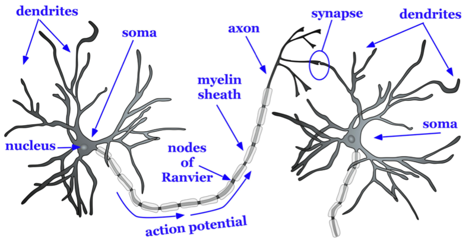
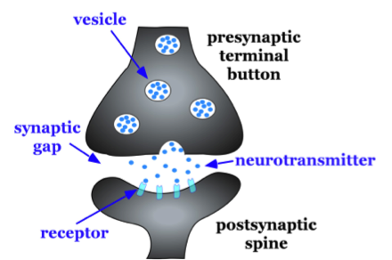

# Nơron và synapse: não truyền tin thế nào

## Tóm tắt

Làm sao hàng chục tỷ tế bào thần kinh nói chuyện được với nhau? Ở L01 ta đã biết não có khoảng 86 tỷ nơron (neuron, tế bào
thần kinh) [S4]; bài này nhìn vào cách mỗi nơron nhận và gửi tín hiệu. Có hai kiểu tín hiệu. Bên trong một nơron, tín hiệu chạy
dọc sợi trục (axon) dưới dạng xung điện (xung thần kinh, action potential). Giữa hai nơron, ở một chỗ nối gọi là synapse (khớp
thần kinh), tín hiệu thường được chuyển bằng một chất hóa học [S1] [S3]. Ví dụ của người viết: điện giống đường dây chạy nhanh
trong một nhà, hóa chất giống người đưa thư đi từ nhà này sang nhà kế bên. Hiểu hai bước này là chìa khóa để sang L03, vì các chất
dẫn truyền thần kinh (neurotransmitter) và nhiều loại thuốc tác động đúng ở synapse [S1].

## Cấu tạo một nơron

Một nơron điển hình có bốn phần [S1]:

- **Sợi nhánh (dendrite):** nhiều nhánh nhỏ nhận tín hiệu từ các nơron khác.
- **Thân tế bào (soma):** chứa nhân tế bào và tích hợp (gom lại) các tín hiệu nhận được.
- **Sợi trục (axon):** một sợi dài dẫn tín hiệu đi.
- **Đầu tận cùng (axon terminal):** nơi sợi trục kết thúc và tiếp xúc với tế bào kế tiếp.

Một nơron thường nhận tín hiệu từ nhiều nơron khác và gửi tín hiệu cho nhiều nơron khác, nên cả não là một mạng lưới
chứ không phải một dây chuyền thẳng [S1] [S3].

Để các bước sau dễ theo dõi, hãy nhớ hai cách gọi: **nơron trước** là nơron đang gửi tín hiệu, **nơron sau** là nơron đang
nhận. Một nơron có thể là "nơron sau" của nơron này và "nơron trước" của nơron khác.

*Cấu tạo cơ bản của nơron. Nhãn tiếng Anh: dendrites (sợi nhánh), soma (thân tế bào), nucleus (nhân), axon (sợi trục), myelin sheath (bao myelin), nodes of Ranvier (eo Ranvier), synapse (khớp thần kinh). Nguồn hình: Noba, giấy phép theo sách CC BY-NC-SA; Hove & Martinez, Hình 2 (chương 3). https://rotel.pressbooks.pub/biologicalpsychology/chapter/the-structure-of-the-neuron/ [S1]*

## Tín hiệu điện: xung thần kinh

Khi một nơron đủ bị kích thích, nó phát ra một xung thần kinh: một thay đổi điện chạy dọc sợi trục. Alan Hodgkin và Andrew
Huxley đã mô tả và xây dựng mô hình toán học cho cơ chế này, dựa trên các thí nghiệm với sợi trục khổng lồ của mực: xung xuất hiện
khi ion natri (hạt mang điện) chảy vào tế bào qua màng, sau đó ion kali chảy ra, rồi tế bào trở về trạng thái nghỉ [S2]. Bài
báo gốc rất kỹ thuật; người mới chỉ cần nhớ ý chính này.

Hai đặc điểm cần nhớ:

1. **Dọc sợi trục, xung theo kiểu "có hoặc không"** (all-or-none): nơron hoặc phát xung, hoặc không; không có xung "to hơn" hay
   "nhỏ hơn" [S1].
2. **Kích thích mạnh hơn thường được mã hóa chủ yếu bằng việc phát xung dày hơn**, không phải bằng xung lớn hơn [S1] [S3]. Đây là
   cách nói đơn giản; thời điểm xung và số nơron tham gia cũng góp phần.

Ví dụ của người viết: chuông cửa. Bấm nhẹ hay bấm mạnh, tiếng chuông vẫn như nhau; bấm dồn dập thì chuông vang dày hơn.

## Synapse: nơi tín hiệu chuyển thành hóa học

Giữa đầu tận cùng của nơron trước và nơron sau có một khe hẹp gọi là khe synapse (synaptic cleft). Xung điện không nhảy qua
khe này như dòng điện; ở phần lớn synapse, tín hiệu được truyền bằng hóa chất [S1] [S3]. Quá trình gồm bốn bước:

1. Xung điện tới đầu tận cùng của nơron trước.
2. Ion canxi vào đầu tận cùng, khiến các túi nhỏ chứa chất dẫn truyền thần kinh hòa vào màng và giải phóng chất ấy ra khe
   synapse [S3].
3. Chất dẫn truyền gắn vào thụ thể (receptor), những phân tử trên màng của nơron sau.
4. Thụ thể làm thay đổi hoạt động của nơron sau [S1] [S3].

*Đặc điểm của một synapse. Nhãn tiếng Anh: vesicle (túi chứa), neurotransmitter (chất dẫn truyền), synaptic gap (khe synapse), receptor (thụ thể), presynaptic terminal button (đầu tận cùng nơron trước), postsynaptic spine (gai của nơron sau). Nguồn hình: Noba, giấy phép theo sách CC BY-NC-SA; Hove & Martinez, Hình 3 (chương 3). https://rotel.pressbooks.pub/biologicalpsychology/chapter/the-structure-of-the-neuron/ [S1]*

## Thụ thể: ổ khóa và chìa

Thụ thể là những phân tử trên màng nơron sau, có hình dạng chỉ hợp với một số chất dẫn truyền nhất định [S1]. Ví dụ của người
viết: chất dẫn truyền giống chiếc chìa, thụ thể giống ổ khóa; chìa đúng thì mở được, chìa sai thì không. Khi chất dẫn truyền
gắn vào, thụ thể có thể mở một kênh ion (lỗ nhỏ cho ion đi qua màng) hoặc kích hoạt các tín hiệu bên trong tế bào [S1] [S3].

## Kích thích, ức chế và phép cộng

Cùng một nơron sau nhận tín hiệu từ nhiều synapse. Tác động của một synapse có thể là kích thích (khiến nơron sau dễ phát xung
hơn) hoặc ức chế (khiến nó khó phát xung hơn), tùy chất dẫn truyền và loại thụ thể. Nơron sau cộng gộp các tác động đó để
"quyết định" có phát xung hay không [S1] [S3].

| | Kích thích | Ức chế |
|---|---|---|
| Tác động lên nơron sau | dễ phát xung hơn | khó phát xung hơn |

Ví dụ của người viết: giống một hội đồng bỏ phiếu, có người ủng hộ, có người phản đối; nếu số ủng hộ thắng đủ nhiều thì nơron
sau phát xung. Chất dẫn truyền nào kích thích, chất nào ức chế sẽ là chủ đề của L03.

*Tóm tắt giao tiếp điện hóa trong và giữa các nơron: xung điện kiểu có hoặc không (action potential), giải phóng chất dẫn truyền (release of neurotransmitter), điện thế sau synapse kích thích hoặc ức chế (EPSP và IPSP). Nguồn hình: Noba, giấy phép theo sách CC BY-NC-SA; Hove & Martinez, Hình 9 (chương 3). https://rotel.pressbooks.pub/biologicalpsychology/chapter/communication-within-and-between-neurons/ [S1]*

## Chấm dứt tín hiệu

Một chất dẫn truyền không được ở lại khe synapse mãi. Nó được chấm dứt tác dụng bằng ba cách; thu hồi và phân hủy được trình bày trong giáo trình [S1], còn khuếch tán là kiến thức chung:

- **Thu hồi (reuptake, tái hấp thu):** được đưa ngược vào nơron trước để dùng lại.
- **Phân hủy:** bị enzym (enzyme, chất xúc tác sinh học) cắt bỏ.
- **Khuếch tán:** trôi ra khỏi khe synapse.

Ví dụ của người viết: bật công tắc thì cũng phải có cách tắt, nếu không đèn cứ sáng mãi.

## Thuốc can thiệp ở đâu

Vòng đời một chất dẫn truyền gồm các bước: tổng hợp, giải phóng, gắn thụ thể, thu hồi, phân hủy [S1]. Mỗi bước là một điểm mà
thuốc hoặc chất kích thích có thể can thiệp, nên hiểu synapse là hiểu cách nhiều thuốc tác động lên tâm lý, điều ta sẽ thấy ở L03
[S1].

## Synapse thay đổi theo kinh nghiệm

Độ mạnh của synapse có thể tăng hoặc giảm theo hoạt động. Hiện tượng này gọi là tính dẻo synapse (synaptic plasticity), và là một cơ sở
của việc học và nhớ [S3]. Ví dụ của người viết: lối đi qua bãi cỏ càng nhiều người đi thì càng thành đường mòn rõ.

## Điều cần nhớ

1. Nơron nhận tín hiệu ở sợi nhánh và gửi đi bằng sợi trục [S1].
2. Dọc sợi trục, tín hiệu là xung điện kiểu "có hoặc không"; giữa hai nơron, tín hiệu thường là hóa chất [S1] [S2] [S3].
3. Chất dẫn truyền gắn vào thụ thể và có thể kích thích hoặc ức chế nơron sau [S1] [S3].
4. Mỗi bước trong vòng đời chất dẫn truyền là điểm thuốc có thể can thiệp [S1].
5. Synapse thay đổi theo kinh nghiệm [S3].

Nối với bài trước: L01 vẽ các vùng; bài này cho thấy các vùng ấy nói chuyện bằng gì. Bài sau (L03) sẽ gặp từng chất dẫn
truyền: glutamate, GABA, dopamine, serotonin và các chất khác.

## Nguồn tham khảo

- [S1] Hove & Martinez, Biological Psychology (Revised Edition), Chương 3 "Neurons" và Chương 5 "Psychopharmacology", ROTEL Pressbooks https://rotel.pressbooks.pub/biologicalpsychology/
- [S2] Hodgkin A. L., Huxley A. F., A quantitative description of membrane current and its application to conduction and excitation in nerve, Journal of Physiology 117(4):500-544, 1952 https://doi.org/10.1113/jphysiol.1952.sp004764
- [S3] Byrne J. H. (chủ biên), Neuroscience Online: An Open-Access Neuroscience Electronic Textbook, UTHealth Houston, Chương 1-3, 5-7 https://nba.uth.tmc.edu/neuroscience/m/s1/index.htm
- [S4] Azevedo F. A. C. và cộng sự, Equal numbers of neuronal and nonneuronal cells make the human brain an isometrically scaled-up primate brain, Journal of Comparative Neurology, 2009 https://doi.org/10.1002/cne.21974
