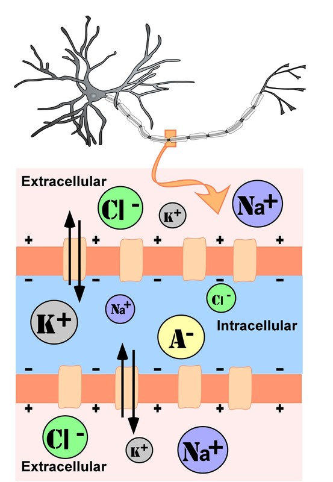
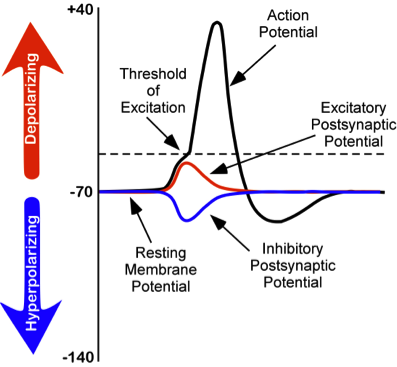

# Nơron và synapse: não truyền tin thế nào

## Tóm tắt

Làm sao hàng chục tỷ tế bào thần kinh nói chuyện được với nhau? Một nghiên cứu đếm trực tiếp ước tính não người trưởng thành có khoảng 86 tỷ nơron (neuron, tế bào thần kinh) [S4]. Chúng trao đổi thông tin bằng hai kiểu tín hiệu nối tiếp nhau. Bên trong một nơron, tín hiệu là xung thần kinh (còn gọi là điện thế hoạt động, action potential) chạy dọc sợi trục (axon). Giữa hai nơron, tại một chỗ tiếp xúc gọi là synapse (khớp thần kinh), tín hiệu thường được chuyển bằng một chất hóa học: chất dẫn truyền thần kinh (neurotransmitter) [S1] [S3].

Ví dụ của người viết: điện giống đường dây chạy rất nhanh trong một ngôi nhà, còn hóa chất giống người đưa thư đi từ nhà này sang nhà kế bên. Bài này đi theo đúng thứ tự của một tín hiệu: từ hình dạng nơron, điện thế nghỉ, xung, synapse và thụ thể, đến phép cộng, chấm dứt tín hiệu, thuốc và tính dẻo.

Về mức chắc chắn: phần cơ chế điện và hóa học dưới đây là kiến thức giáo khoa [S1] [S3]. Phần tính dẻo synapse (mục áp chót) có chỗ còn là giả thuyết, và bài sẽ ghi rõ chỗ nào. Từng chất dẫn truyền cụ thể thuộc L03, các vùng não thuộc L01 và L07, hệ thưởng thuộc L05.

## Cấu tạo một nơron

Một nơron có ba phần chính: sợi nhánh (dendrite), thân tế bào (soma) và sợi trục (axon) [S1].

- **Sợi nhánh** là những nhánh nhô ra từ thân tế bào và thường chia nhánh nhiều lần. Giáo trình mô tả chúng nhận thông tin từ hàng nghìn nơron khác và là nguồn đầu vào chính của nơron [S1].
- **Thân tế bào** chứa nhân (nucleus). Nhân chứa thông tin di truyền, điều khiển việc tổng hợp protein và cung cấp năng lượng cùng nguyên liệu mà nơron cần để hoạt động [S1].
- **Sợi trục** là nguồn đầu ra chính. Nó vươn ra khỏi thân tế bào và mang xung thần kinh đến nơron khác. Sợi trục thường được bọc bởi một chất cách điện gọi là bao myelin (myelin sheath), giúp tín hiệu chạy nhanh hơn [S1].

Sợi trục chia nhánh nhiều lần để liên lạc với nhiều nơron. Ở mỗi đầu nhánh có một nút tận cùng (terminal button), nơi hình thành synapse với các gai (spine) nhỏ nhô ra trên sợi nhánh của nơron khác. Synapse cũng có thể hình thành giữa nút tận cùng và thân tế bào hoặc sợi trục của nơron khác, nhưng giáo trình tập trung vào kiểu nút tận cùng với gai sợi nhánh [S1].

*Cấu tạo cơ bản của nơron. Nhãn tiếng Anh: dendrites (sợi nhánh), soma (thân tế bào), nucleus (nhân), axon (sợi trục), myelin sheath (bao myelin), nodes of Ranvier (eo Ranvier), synapse (khớp thần kinh). Nguồn hình: Noba, giấy phép theo sách CC BY-NC-SA; Hove & Martinez, Hình 2 (chương 3). https://rotel.pressbooks.pub/biologicalpsychology/chapter/the-structure-of-the-neuron/ [S1]*

Để các bước sau dễ theo dõi, hãy nhớ hai cách gọi. **Nơron trước** (presynaptic) là nơron đang gửi tín hiệu; **nơron sau** (postsynaptic) là nơron đang nhận [S1]. Một nơron có thể là nơron sau của nơron này và đồng thời là nơron trước của nơron khác, nên cả não là một mạng lưới chứ không phải một dây chuyền thẳng.

Nơron cũng khác nhau về chức năng và hình dạng. Theo chức năng, giáo trình chia thành nơron cảm giác (sensory neuron, giúp nhận thông tin về thế giới), nơron vận động (motor neuron, cho phép khởi phát cử động) và nơron trung gian (interneuron, xử lý thông tin cảm giác, lên kế hoạch phản ứng và nối với nơron vận động) [S1]. Theo hình dạng, có nơron đơn cực (unipolar: một sợi trục, không có sợi nhánh), lưỡng cực (bipolar: một sợi trục và một sợi nhánh) và đa cực (multipolar: một sợi trục và nhiều sợi nhánh). Loại đa cực phổ biến nhất; nơron hình tháp (pyramidal neuron) là một ví dụ nổi bật thuộc loại này [S1].

## Tế bào thần kinh đệm (glia)

Não không chỉ có nơron. Giáo trình giới thiệu tế bào thần kinh đệm (glia, hay neuroglia) là các tế bào không phải nơron, đóng vai trò hỗ trợ thiết yếu cho hoạt động của nơron [S1]. Theo mô tả nhập môn đó:

- **Tế bào ít nhánh (oligodendroglia, oligodendrocyte)** tạo bao myelin cho sợi trục trong hệ thần kinh trung ương. Một tế bào quấn myelin quanh nhiều sợi trục [S1].
- **Tế bào Schwann (Schwann cell)** làm việc tương tự trong hệ thần kinh ngoại biên, nhưng mỗi tế bào quấn quanh một sợi trục [S1].
- **Vi bào đệm (microglia) và tế bào hình sao (astrocyte)** tiêu hóa mảnh vỡ của nơron chết, mang chất dinh dưỡng từ mạch máu đến nơron và giúp điều hòa thành phần ion của dịch ngoại bào [S1].

Giáo trình cũng nêu rằng, khác với nơron, glia không dẫn tín hiệu điện và không tham gia giao tiếp từ tế bào này sang tế bào khác [S1]. Đây là cách mô tả ở mức nhập môn; bài này không đi sâu hơn mức giáo trình nói.

Có bao nhiêu tế bào mỗi loại? Quan niệm phổ biến từng cho rằng não có 100 tỷ nơron và số tế bào đệm nhiều gấp mười lần. Azevedo và cộng sự dùng phương pháp phân đoạn đẳng hướng (isotropic fractionator) để đếm và báo cáo, ở não nam giới trưởng thành, trung bình khoảng 86,1 ± 8,1 tỷ tế bào mang dấu NeuN (được coi là nơron) và 84,6 ± 9,8 tỷ tế bào không mang dấu này (tế bào không phải nơron). Họ cũng ghi nhận chỉ khoảng 19% số nơron nằm ở vỏ não [S4]. Số đếm này không khớp với quan niệm "gấp mười lần" [S4].

Tuy vậy, các nguồn chưa thống nhất. Neuroscience Online ước tính khoảng 360 tỷ tế bào đệm và 90 tỷ nơron, và nói tế bào đệm chiếm 80 đến 90% số tế bào của hệ thần kinh trung ương [S3]. Hai ước tính này khác nhau rõ rệt; đây là chỗ đang tranh luận về cách đếm, nên bài ghi cả hai và không khẳng định một tỷ lệ chắc chắn. Lưu ý: đây là trung bình của một nghiên cứu cụ thể, không phải con số cố định cho mọi người.

## Điện thế nghỉ

Muốn hiểu xung thần kinh, trước hết phải hiểu nơron lúc "yên lặng". Dịch bên trong tế bào (nội bào) và dịch bên ngoài (ngoại bào) đều giống nước muối, chứa các ion (ion, phân tử mang điện): natri (Na+), kali (K+), clorua (Cl−) và các anion (A−) [S1]. Màng tế bào là một lớp kép lipid (lipid bilayer) ngăn tế bào với bên ngoài; các protein xuyên màng tạo thành kênh ion (ion channel) cho phép từng loại ion đi qua [S1].

*Nồng độ ion trong (intracellular) và ngoài (extracellular) nơron ở đoạn sợi trục không bọc myelin; K+, Na+, Cl−, A− (anion). Nguồn hình: Noba, giấy phép theo sách CC BY-NC-SA; Hove & Martinez, Hình 7 (chương 3). https://rotel.pressbooks.pub/biologicalpsychology/chapter/communication-within-and-between-neurons/ [S1]*

Vì nồng độ và điện tích của các ion khác nhau giữa hai bên màng, hai lực cùng tác động lên chúng khi tế bào ở trạng thái nghỉ: khuếch tán (diffusion, ion có xu hướng đi từ nơi đậm đặc sang nơi loãng) và áp lực tĩnh điện (electrostatic pressure, các điện tích cùng dấu đẩy nhau, trái dấu hút nhau) [S1]. Hiệu điện thế giữa trong và ngoài màng lúc nghỉ gọi là điện thế màng nghỉ (resting membrane potential). Giáo trình nêu giá trị khoảng −70 mV (millivolt) so với bên ngoài; con số này rất nhỏ so với pin hoặc ổ điện, vốn tính bằng volt [S1]. Neuroscience Online lưu ý điện thế nghỉ thay đổi giữa các loại nơron, có thể từ khoảng −80 mV đến −40 mV, và trong ví dụ của họ là −60 mV [S3].

Giáo trình đi qua từng nhóm ion [S1]:

- **Anion (A−):** tập trung nhiều bên trong tế bào, góp phần làm bên trong âm điện; không có kênh nào cho chúng đi qua màng.
- **Kali (K+):** màng cho kali đi qua lúc nghỉ và kali tập trung nhiều bên trong. Khuếch tán đẩy kali ra ngoài, nhưng điện tích âm bên trong lại kéo kali vào; hai lực này ngược nhau.
- **Clorua (Cl−):** màng cũng cho clorua đi qua lúc nghỉ; clorua tập trung nhiều bên ngoài. Hai lực lại ngược nhau.
- **Natri (Na+):** cả khuếch tán lẫn lực tĩnh điện đều đẩy natri vào trong, nhưng màng gần như không cho natri đi qua lúc nghỉ nên natri vẫn tập trung bên ngoài.

Lượng natri nhỏ lọt vào trong được đẩy ra nhờ bơm natri-kali (sodium-potassium pump). Bơm này dùng năng lượng của tế bào (ATP, adenosine triphosphate) để đưa 3 ion Na+ ra ngoài và đổi lấy 2 ion K+ vào trong [S1]. Trạng thái nghỉ vì vậy không phải là "tắt", mà là một cân bằng được duy trì bằng năng lượng.

## Điện thế hoạt động: xung thần kinh

Hiểu biết hiện đại về tín hiệu điện trong nơron bắt nguồn từ công trình của Alan Hodgkin và Andrew Huxley. Giáo trình kể rằng họ nghiên cứu sợi trục khổng lồ của mực, to hơn khoảng 100 lần so với sợi trục trong não động vật có vú nên dễ làm thí nghiệm hơn, và công trình này giúp họ nhận giải Nobel Y học năm 1963; mô hình của họ được công bố năm 1952 [S1] [S2]. Kết quả từ động vật: các thí nghiệm này làm trên mực, không phải trên người. Bài báo gốc rất kỹ thuật; bài này dẫn nó như nguồn lịch sử và chỉ nêu những điều giáo trình kể lại về công trình ấy [S1] [S2].

*Thay đổi điện thế màng: điện thế hoạt động (action potential), ngưỡng kích thích (threshold of excitation), điện thế sau synapse kích thích (excitatory postsynaptic potential), điện thế sau synapse ức chế (inhibitory postsynaptic potential), điện thế màng nghỉ (resting membrane potential). Nguồn hình: Noba, giấy phép theo sách CC BY-NC-SA; Hove & Martinez, Hình 8 (chương 3). https://rotel.pressbooks.pub/biologicalpsychology/chapter/communication-within-and-between-neurons/ [S1]*

Diễn biến của một điện thế hoạt động, theo giáo trình [S1]:

1. Điện thế màng bị đẩy theo hướng dương hơn (khử cực, depolarization). Nếu nó đạt ngưỡng kích thích (threshold of excitation), thường quanh −50 mV, một điện thế hoạt động được kích hoạt.
2. Ở ngưỡng, các kênh natri phụ thuộc điện thế (voltage-dependent Na+ channel) mở. Natri ào vào, bên trong tế bào trở nên rất dương, lên tới khoảng +40 mV: đây là pha đi lên.
3. Các kênh natri đóng lại và rơi vào trạng thái trơ (refractory): chúng không mở lại được cho tới khi tế bào trở về điện thế nghỉ. Vì thế không thể có xung mới ngay lúc đó, và xung chỉ đi một chiều, rời xa thân tế bào.
4. Một loại kênh phụ thuộc điện thế thứ hai, cho kali đi qua, mở ra. Kali rời khỏi tế bào, kéo điện thế về mức nghỉ: pha đi xuống. Ngay sau đó có một đoạn tăng phân cực ngắn khi kênh kali đóng dần.
5. Cả quá trình trao đổi natri và kali diễn ra rất nhanh, trong chưa đầy 1 mili giây. Xung đi như một làn sóng dọc sợi trục, và chỉ các kênh ở gần xung bị ảnh hưởng.

Biên độ thay đổi điện thế của một điện thế hoạt động vào khoảng 100 mV [S1]. Hai đặc điểm cần nhớ:

**Có hoặc không (all-or-none).** Điện thế hoạt động hoặc xảy ra, hoặc không; không có xung "nhỏ hơn" hay "lớn hơn". Giáo trình ví von với mã nhị phân của máy tính chỉ có 0 hoặc 1 [S1]. Neuroscience Online dùng hình ảnh châm ngòi nổ: phải đạt một nhiệt độ tối thiểu (ngưỡng), dưới mức đó không có gì xảy ra; vượt ngưỡng thì xung có cùng biên độ dù kích thích mạnh hơn nữa [S3].

**Cường độ được mã hóa bằng tần số.** Neuroscience Online nêu rằng khi cường độ kích thích tăng, kích thước xung không đổi mà tần số xung tăng; nhìn chung, kích thích càng mạnh thì tần số phát xung càng cao [S3]. Ví dụ của người viết: chuông cửa. Bấm nhẹ hay mạnh, tiếng chuông vẫn như nhau; bấm dồn dập thì chuông vang dày hơn. Đây là cách nói đơn giản; bài không khẳng định rằng tần số là cách mã hóa duy nhất.

**Bao myelin và "nhảy cóc".** Sợi trục có bao myelin dẫn xung nhanh hơn. Bao myelin có những khoảng hở gọi là eo Ranvier (nodes of Ranvier). Dưới lớp myelin không có ion nào chảy qua màng, nên tế bào đỡ tốn năng lượng phải khôi phục điện thế nghỉ; xung suy giảm đôi chút khi đi dưới myelin nhưng vẫn đủ lớn để kích hoạt xung mới ở eo kế tiếp. Xung vì thế "nhảy" từ eo này sang eo kia: dẫn truyền nhảy cóc (saltatory conduction, saltus nghĩa là "nhảy" trong tiếng Latin) [S1]. Neuroscience Online bổ sung hai điểm: tốc độ lan truyền xung trong các dây thần kinh có thể từ khoảng 100 mét mỗi giây đến dưới một phần mười mét mỗi giây, và myelin chỉ bọc từng đoạn, chừa các eo trần vì cần các kênh natri để tạo xung [S3].

## Synapse: nơi tín hiệu chuyển thành hóa học

Giữa nút tận cùng của nơron trước và gai sợi nhánh của nơron sau có một khe hẹp gọi là khe synapse (synaptic cleft hoặc synaptic gap), rộng khoảng 5 nanomet. Để hình dung: một đồng xu mười xu của Mỹ dày 1,35 mm, tức 1.350.000 nm [S1]. Trong nút tận cùng, các túi synapse (synaptic vesicle) đóng gói các nhóm chất dẫn truyền [S1].

Điện thế hoạt động đến nút tận cùng sẽ kích hoạt việc giải phóng chất dẫn truyền vào khe synapse [S1]. Bốn bước của một synapse hóa học:

1. Xung điện tới nút tận cùng của nơron trước [S1].
2. Canxi (Ca²⁺) vào nút tận cùng. Neuroscience Online mô tả canxi là ion then chốt trong việc giải phóng chất dẫn truyền: nó tương tác với các protein gắn với túi synapse và dẫn tới giải phóng chất truyền tin. Bernard Katz và các đồng nghiệp đã khảo sát vai trò này ở synapse giữa dây thần kinh và cơ vân, không phải synapse trong não [S3].
3. Chất dẫn truyền qua khe và gắn vào các vị trí thụ thể trên nơron sau [S1].
4. Thụ thể làm thay đổi điện thế của nơron sau, tạo ra tín hiệu kích thích hoặc ức chế, và vòng này lặp lại ở tế bào kế tiếp [S1].

*Đặc điểm của một synapse. Nhãn tiếng Anh: vesicle (túi chứa), neurotransmitter (chất dẫn truyền), synaptic gap (khe synapse), receptor (thụ thể), presynaptic terminal button (nút tận cùng nơron trước), postsynaptic spine (gai của nơron sau). Nguồn hình: Noba, giấy phép theo sách CC BY-NC-SA; Hove & Martinez, Hình 3 (chương 3). https://rotel.pressbooks.pub/biologicalpsychology/chapter/the-structure-of-the-neuron/ [S1]*

Synapse hóa học là loại phổ biến nhất. Ngoài ra còn có synapse điện (electrical synapse), trong đó các cấu trúc đặc biệt gọi là cầu nối (gap junction) tạo đường nối trực tiếp giữa tế bào trước và tế bào sau, nên thay đổi điện thế ở bên này truyền thẳng sang bên kia [S3].

## Thụ thể: ổ khóa và chìa

Chất dẫn truyền gắn vào thụ thể theo kiểu "chìa và ổ khóa" (lock-and-key): thụ thể chỉ hợp với những chất dẫn truyền có hình dạng phù hợp [S1]. Ví dụ của người viết: chất dẫn truyền giống chiếc chìa, thụ thể giống ổ khóa; chìa đúng thì mở, chìa sai thì không.

Giáo trình mô tả loại thụ thể ion hướng (ionotropic receptor): đó là thụ thể nằm ngay trên một kênh ion, và khi có chất dẫn truyền thích hợp gắn vào, kênh mở ra cho một số ion đi vào hoặc ra khỏi tế bào [S1]. Kiểu tác động của synapse (kích thích hay ức chế) phụ thuộc vào loại chất dẫn truyền và độ thấm của kênh ion mà nó kích hoạt [S1]:

- Chất dẫn truyền mở kênh Na+ hoặc canxi gây điện thế kích thích. Ví dụ giáo trình nêu: thụ thể NMDA, được glutamate kích hoạt; glutamate là chất dẫn truyền kích thích chính của não [S1].
- Chất dẫn truyền mở kênh Cl− hoặc K+ gây điện thế ức chế. Ví dụ: thụ thể của axit gamma-aminobutyric (GABA), được GABA kích hoạt; GABA là chất dẫn truyền ức chế chính của não [S1].

Không phải thụ thể nào cũng là kênh ion trực tiếp. Khi giải thích tác động của các chất giống opioid, giáo trình nêu rằng chúng tác động qua các chất truyền tin thứ hai (second messenger) để thay đổi khả năng mở của kênh ion [S1]. Hồ sơ từng loại thụ thể thuộc L03.

## Kích thích, ức chế và phép cộng

Mỗi lúc, một nơron có thể nhận hàng trăm tín hiệu đầu vào từ các synapse [S1]. Giáo trình gọi hai loại tín hiệu sau synapse là điện thế sau synapse kích thích (EPSP, excitatory postsynaptic potential), một dòng khử cực đẩy điện thế màng về phía dương, gần ngưỡng hơn; và điện thế sau synapse ức chế (IPSP, inhibitory postsynaptic potential), một dòng tăng phân cực đẩy điện thế màng về phía âm, xa ngưỡng hơn [S1].

Khác với điện thế hoạt động "có hoặc không", EPSP và IPSP là các điện thế nhỏ, biến thiên theo độ mạnh (điện thế phân bậc, graded potential). Giáo trình ghi: một điện thế hoạt động đổi điện thế khoảng 100 mV, còn EPSP và IPSP chỉ đổi từ 0,1 đến 40 mV [S1].

Các EPSP và IPSP được cộng gộp (summation) theo thời gian và không gian [S1]. Neuroscience Online dùng một ví dụ ở nơron vận động tủy sống: một EPSP đơn lẻ chỉ khoảng 1 mV, chưa đủ để đạt ngưỡng; hai xung đến liên tiếp nhanh thì cộng lại thành khoảng 2 mV (cộng theo thời gian, temporal summation), và hai nơron cùng kích thích đồng thời cũng cho kết quả gấp đôi (cộng theo không gian, spatial summation) [S3]. Giáo trình mô tả thêm: hai EPSP cùng lúc cho một EPSP lớn; một EPSP nhỏ và một IPSP nhỏ cùng lúc có thể triệt tiêu nhau [S1].

*Tóm tắt giao tiếp điện hóa trong và giữa các nơron: xung điện kiểu có hoặc không (action potential), giải phóng chất dẫn truyền (release of neurotransmitter), điện thế sau synapse kích thích hoặc ức chế (EPSP và IPSP). Nguồn hình: Noba, giấy phép theo sách CC BY-NC-SA; Hove & Martinez, Hình 9 (chương 3). https://rotel.pressbooks.pub/biologicalpsychology/chapter/communication-within-and-between-neurons/ [S1]*

Nếu tổng của các EPSP đủ mạnh để đẩy điện thế màng tới ngưỡng kích thích thì một điện thế hoạt động bắt đầu [S1]. Ví dụ của người viết: một hội đồng bỏ phiếu, có người ủng hộ, có người phản đối; chỉ khi số phiếu ủng hộ thắng đủ nhiều thì nơron sau mới "ra quyết định" phát xung. Chất dẫn truyền nào kích thích, chất nào ức chế là chủ đề của L03.

## Chấm dứt tín hiệu

Một chất dẫn truyền không được ở lại khe synapse mãi. Theo giáo trình, chất dẫn truyền không gắn vào thụ thể sẽ bị enzyme (enzyme, chất xúc tác sinh học) hoặc tế bào đệm phân hủy và làm bất hoạt, hoặc được đưa ngược vào nút tận cùng của nơron trước trong quá trình gọi là thu hồi (reuptake, tái hấp thu) [S1]. Neuroscience Online mô tả thêm một cách nữa ở synapse thần kinh-cơ: chất dẫn truyền acetylcholine bị loại bỏ bằng khuếch tán, và một enzyme trong khe synapse gọi là acetylcholinesterase phân hủy nó [S3].

Ba cách chấm dứt tín hiệu, tóm lại:

- **Thu hồi:** đưa ngược vào nút tận cùng của nơron trước [S1].
- **Phân hủy:** enzyme hoặc tế bào đệm cắt bỏ chất dẫn truyền [S1].
- **Khuếch tán:** chất dẫn truyền trôi ra khỏi khe synapse; mô tả này có trong ví dụ ở synapse thần kinh-cơ của Neuroscience Online [S3].

Để thấy tốc độ cần thiết: Neuroscience Online ghi rằng một phân tử acetylcholinesterase có thể phân hủy 600.000 phân tử acetylcholine mỗi phút, và coi đây là một trong những enzyme hiệu quả nhất được biết; điện thế bản vận động (endplate potential) ở synapse thần kinh-cơ kéo dài khoảng 10 mili giây [S3]. Đây là số liệu ở synapse thần kinh-cơ vân, dùng để minh họa nguyên lý, không phải mọi synapse trong não có cùng con số. Ví dụ của người viết: bật công tắc thì cũng phải có cách tắt, nếu không đèn cứ sáng mãi.

## Thuốc can thiệp ở đâu

Giáo trình dược lý tâm thần mở đầu bằng một ý rất rộng: hầu như mọi loại thuốc làm thay đổi cảm giác đều làm vậy bằng cách thay đổi cách các nơron giao tiếp với nhau [S1]. Thuốc có thể làm tăng hoạt động ở synapse (gọi là chất chủ vận, agonist) hoặc làm giảm hoạt động ở synapse (chất đối kháng, antagonist), qua nhiều cơ chế khác nhau [S1].

Suy luận của người viết: sắp vòng đời của một chất dẫn truyền thành một chuỗi (tổng hợp, giải phóng, gắn thụ thể, thu hồi hoặc phân hủy) thì mỗi mắt xích là một điểm có thể bị can thiệp. Từ các cơ chế giáo trình mô tả, có bốn nhóm can thiệp, mỗi nhóm một dòng cơ chế (bài này cố ý không nêu tên thuốc, hoạt chất hay liều):

- **Chặn thu hồi:** ngăn việc đưa chất dẫn truyền ngược về nơron trước, nên chất ở lại khe synapse lâu hơn [S1].
- **Chặn thụ thể:** một chất gắn vào thụ thể và để lại ít thụ thể trống hơn cho chất dẫn truyền thật, nên tác dụng của chất ấy yếu đi [S1].
- **Bắt chước chất dẫn truyền:** một chất từ bên ngoài gắn vào đúng thụ thể mà chất dẫn truyền tự nhiên của cơ thể vẫn dùng [S1].
- **Ức chế enzyme phân hủy:** làm chậm việc cắt bỏ chất dẫn truyền, nên tác dụng kéo dài và mạnh hơn; Neuroscience Online mô tả một nhóm chất ức chế acetylcholinesterase làm điện thế bản vận động lớn hơn và dài hơn [S3].

Ba điều dễ hiểu nhầm. Một: "chủ vận" và "đối kháng" mô tả tác động lên synapse, không nói thuốc tốt hay xấu. Hai: cùng một nhóm cơ chế có thể cho hiệu quả khác nhau tùy mạch thần kinh mà chất dẫn truyền ấy tham gia. Ba, suy luận của người viết: một thuốc làm thay đổi triệu chứng khi tác động vào một chất dẫn truyền chưa chứng minh rằng bệnh là do thiếu chất đó. Cách các chất cụ thể tác động và các tranh luận về nguyên nhân thuộc L03.

## Synapse thay đổi theo kinh nghiệm

Synapse không cố định. Giáo trình nói học tập dựa vào tính dẻo (plasticity) của các mạch và khả năng tạo thay đổi bền vững trong truyền synapse; não lưu thông tin trong mạng các synapse đã biến đổi [S1]. Nguyên tắc đứng sau là quy tắc của Donald Hebb, nêu cách đây hơn 70 năm: nếu hai nơron cùng hoạt động thì synapse giữa chúng được tăng cường, thường tóm bằng câu "nơron nào cùng phát xung thì cùng nối dây" (fire together, wire together) [S1]. Giáo trình gọi hiện tượng tăng cường bền vững này là tăng cường dài hạn (long-term potentiation, LTP), được phát hiện vào đầu thập niên 1970 [S1].

Kết quả từ động vật: Bliss và Lømo, ở thỏ được gây mê, kích thích lặp lại các sợi của đường xuyên (perforant path) tới vùng răng cưa (dentate area) của hồi hải mã và ghi bằng điện cực ngoại bào. Ở 15 trong 18 con thỏ, đáp ứng của các tế bào hạt với một xung đơn được tăng cường trong khoảng từ 30 phút đến 10 giờ sau một hoặc nhiều chuỗi kích thích điều kiện hóa. Các tác giả đề xuất hai cơ chế độc lập: tăng hiệu quả truyền synapse ở các synapse đường xuyên, và tăng tính dễ hưng phấn của quần thể tế bào hạt [S5].

Cơ chế phân tử, theo giáo trình, còn chưa hiểu đầy đủ nhưng có một khâu chính [S1]:

1. Thụ thể NMDA ở nơron sau thường bị ion magiê (Mg²⁺) chặn.
2. Khi các tín hiệu đến dồn dập làm nơron sau bị khử cực, kênh NMDA mở và canxi đi vào.
3. Canxi khởi động một chuỗi tín hiệu khiến các thụ thể AMPA từ bên trong tế bào di chuyển lên màng.
4. Lần sau khi glutamate được giải phóng, nhiều thụ thể AMPA hơn cho ion dương vào, tạo EPSP lớn hơn, nên nơron sau dễ phát xung hơn.

Neuroscience Online mô tả cùng quá trình ở synapse CA3-CA1 của hồi hải mã: thụ thể NMDA là then chốt cho một số dạng LTP, và có thêm bằng chứng cho thấy lượng chất dẫn truyền được giải phóng cũng tăng [S3]. Bliss và Collingridge, trong bài tổng quan năm 1993, gọi LTP ở hồi hải mã là mô hình thí nghiệm chính để nghiên cứu cơ sở synapse của học tập và trí nhớ ở động vật có xương sống, và cho rằng dạng được hiểu rõ nhất khởi phát qua thụ thể NMDA, nhờ đó mang đặc tính kiểu Hebb [S6].

Synapse cũng cần yếu đi, không chỉ mạnh lên. Giáo trình mô tả suy giảm dài hạn (long-term depression, LTD) gần như ngược với LTP: canxi vào qua thụ thể NMDA khởi động một chuỗi khác, dẫn tới rút bớt thụ thể AMPA khỏi màng. Giáo trình cho rằng LTD có thể quan trọng không kém LTP với học và nhớ, vì loại bỏ các kết nối không quan trọng làm các synapse đã được tăng cường nổi bật hơn [S1]. Giáo trình cũng ghi rằng một số chất gây nghiện lợi dụng đường LTP, và sự tăng cường synapse ấy có thể dẫn tới nghiện [S1].

Mức chắc chắn: LTP và LTD là hiện tượng đã đo được; việc chúng là cơ sở của trí nhớ là một mô hình được ủng hộ rộng rãi, như tiêu đề bài tổng quan năm 1993 gọi là "mô hình synapse của trí nhớ" [S6]. Suy luận của người viết: vì phần lớn bằng chứng trực tiếp ở đây đến từ động vật và các mô hình thí nghiệm, nên không nên đọc LTP như một mô tả đã hoàn tất về cách người nhớ một việc cụ thể. Ví dụ của người viết: lối đi qua bãi cỏ càng nhiều người đi thì càng thành đường mòn rõ, và lối ít người đi thì cỏ mọc lại.

## Điều cần nhớ

1. Nơron nhận tín hiệu ở sợi nhánh, cộng gộp ở thân tế bào và gửi đi bằng sợi trục; tế bào thần kinh đệm hỗ trợ chứ không phát xung [S1].
2. Nơron lúc nghỉ giữ điện thế khoảng −70 mV nhờ chênh lệch ion và bơm natri-kali tốn năng lượng [S1].
3. Điện thế hoạt động là xung "có hoặc không": natri vào, kali ra, và cường độ được mã hóa chủ yếu bằng tần số; bao myelin giúp xung nhảy cóc nhanh hơn [S1] [S3].
4. Ở synapse hóa học, xung tới nút tận cùng, canxi vào, chất dẫn truyền được giải phóng, gắn vào thụ thể và tạo EPSP hoặc IPSP; các tín hiệu này được cộng gộp để đạt hoặc không đạt ngưỡng [S1] [S3].
5. Tín hiệu được chấm dứt bằng thu hồi, phân hủy hoặc khuếch tán; mỗi mắt xích là một điểm thuốc có thể can thiệp [S1] [S3].
6. Synapse mạnh lên (LTP) hoặc yếu đi (LTD) theo hoạt động; đó là cơ sở được đề xuất của học và nhớ, với nhiều bằng chứng từ động vật [S1] [S5] [S6].

Nối với bài trước: L01 vẽ các vùng của não; bài này cho thấy các vùng ấy nói chuyện bằng gì. Bài sau, L03, sẽ gặp từng chất dẫn truyền.

## Lưu ý

Đây là bài học giáo dục về sinh học thần kinh, không phải lời khuyên y tế. Mục "Thuốc can thiệp ở đâu" chỉ nêu các nhóm cơ chế ở mức khái niệm; bài không nêu tên thuốc, liều hay khuyến nghị dùng hoặc ngừng thuốc nào. Quyết định về thuốc phải do người có chuyên môn đưa ra.

Về mức đọc nguồn: nội dung cơ chế lấy từ giáo trình [S1] và từ Neuroscience Online [S3] (đọc chương 1, 3, 4, 5, 6, 7; chương 8 chỉ đọc các đoạn nêu số lượng tế bào đệm; chương 2 chưa đọc). Bài báo của Hodgkin và Huxley [S2] chỉ được xác minh thông tin thư mục, không đọc toàn văn; chi tiết về công trình này lấy từ phần giáo trình kể lại [S1]. Với [S4], [S5] và [S6], bài chỉ dùng điều nêu trong phần tóm tắt đã đọc. Kết quả về mực và thỏ là kết quả từ động vật; số liệu về acetylcholinesterase là của synapse thần kinh-cơ.

## Nguồn tham khảo

- [S1] Hove M. J., Martinez S. A., Biological Psychology (Revised Edition), chương 3 (mục 3.2, 3.3, 3.4), 5 (mục 5.1, 5.5) và 7 (mục 7.4), ROTEL Pressbooks, 2024, https://rotel.pressbooks.pub/biologicalpsychology/
- [S2] Hodgkin A. L., Huxley A. F., A quantitative description of membrane current and its application to conduction and excitation in nerve, Journal of Physiology 117(4):500-544, 1952, https://doi.org/10.1113/jphysiol.1952.sp004764
- [S3] Byrne J. H. (chủ biên), Neuroscience Online: An Open-Access Neuroscience Electronic Textbook, Section 1 (chương 1, 3, 4, 5, 6, 7, 8), UTHealth Houston, https://nba.uth.tmc.edu/neuroscience/m/s1/index.htm
- [S4] Azevedo F. A. C. và cộng sự, Equal numbers of neuronal and nonneuronal cells make the human brain an isometrically scaled-up primate brain, Journal of Comparative Neurology 513(5):532-541, 2009, https://doi.org/10.1002/cne.21974
- [S5] Bliss T. V. P., Lømo T., Long-lasting potentiation of synaptic transmission in the dentate area of the anaesthetized rabbit following stimulation of the perforant path, Journal of Physiology 232(2):331-356, 1973, https://doi.org/10.1113/jphysiol.1973.sp010273
- [S6] Bliss T. V. P., Collingridge G. L., A synaptic model of memory: long-term potentiation in the hippocampus, Nature 361:31-39, 1993, https://doi.org/10.1038/361031a0
