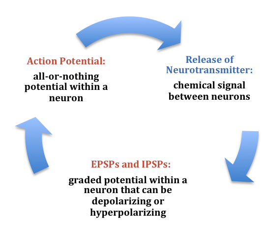

# Chất dẫn truyền thần kinh và tâm lý

## Tóm tắt

Có phải mỗi cảm xúc do một chất hóa học quyết định? Bài này trả lời: không, và giải thích vì sao bằng cách đi qua từng chất một.

Ở L02 ta đã thấy các nơron (neuron) nói chuyện với nhau ở synapse. Thông điệp đi qua khe synapse là một chất dẫn truyền thần kinh (neurotransmitter). Có rất nhiều chất như vậy; sách giáo khoa chia chúng thành các chất phân tử nhỏ, thường tác động nhanh, và các neuropeptide, thường điều chỉnh chậm và kéo dài [S11] [S12].

Bài viết mỗi chất theo cùng một **thẻ hồ sơ** chín ý: tên và loại hóa học, nơi tạo ra, đường đi, thụ thể, vai trò theo vùng, liên hệ với cảm xúc và mức bằng chứng, thuốc và chất tác động, rối loạn liên quan, điều hay bị hiểu nhầm. Tám thẻ: glutamate, GABA, dopamine, serotonin, noradrenaline, acetylcholine, endorphin (hệ opioid), oxytocin và vasopressin.

Ba ý đi suốt bài. Thứ nhất, glutamate và GABA làm phần lớn việc kích thích và ức chế [S11]; các amin như dopamine, noradrenaline và serotonin xuất phát từ vài nhóm nhân nhỏ rồi tỏa lên các vùng đích, noradrenaline phủ gần như khắp não còn dopamine hẹp hơn [S10]. Thứ hai, cùng một chất có thể gây tác động ngược nhau tùy thụ thể (receptor) mà nó gắn vào [S10]. Thứ ba, một cảm xúc huy động nhiều chất và nhiều vùng cùng lúc [S6]. Vì thế "chất này là cảm xúc kia" là quá đơn giản; hai mục cuối bài nói rõ lý do và xem thuyết "trầm cảm do thiếu serotonin" được bằng chứng ủng hộ đến đâu.

## Chất dẫn truyền khác hormone thế nào

Định nghĩa giáo khoa tối giản: hormone được tiết vào máu và đi đến các cơ quan ở xa; chất dẫn truyền thần kinh được nơron giải phóng vào khe synapse và tác động lên tế bào ngay bên cạnh. Ở synapse "cổ điển", thông tin đi một hướng, từ điểm giải phóng ở nơron trước đến cụm thụ thể ở nơron sau, và rất ít tràn sang synapse bên cạnh [S12].

Ví dụ của người viết: hormone giống loa phát thanh cả khu phố; chất dẫn truyền giống lá thư gửi tận tay người hàng xóm.

Ranh giới này mờ hơn định nghĩa. Có ba trường hợp nằm giữa:

1. **Cùng một phân tử, hai vai.** Noradrenaline là chất dẫn truyền của nơron giao cảm; tủy thượng thận (adrenal medulla) lại tiết noradrenaline và adrenaline vào máu như hormone [S10]. Nhiều neuropeptide ban đầu được mô tả là hormone rồi mới thấy cũng có trong nơron của não [S12].
2. **Dẫn truyền thể tích (volume transmission).** Phần lớn đầu tận cùng của nơron amin không có synapse cổ điển; chất lan ra tác động lên nhiều tế bào lân cận [S10]. Neuropeptide cũng ảnh hưởng một vùng quanh điểm giải phóng, hơi giống hormone peptide trong máu [S12].
3. **Hormone do não tiết.** Oxytocin được tạo ở vùng dưới đồi, phần lớn vào máu qua thùy sau tuyến yên nhưng cũng được giải phóng ngay trong não [S17].

Vì thế gọi một chất là "hormone hạnh phúc" sai ở hai chỗ: gộp hai cách làm việc làm một, và gán cho một phân tử một cảm xúc trọn vẹn. Bảng ghép chất, hormone và cảm xúc thuộc L10; ở đây chỉ cần nhớ: hỏi một chất "làm gì" phải hỏi kèm "ở đâu, qua thụ thể nào".

## Cách đọc một thẻ hồ sơ: nhóm hóa học, thụ thể và đường dẫn

Synapse và vòng đời của một chất dẫn truyền đã có ở L02; mục này chỉ thêm ba công cụ để đọc các thẻ phía sau.

**Công cụ 1: nhóm hóa học.** Trong nhóm phân tử nhỏ có **amino acid** (glutamate, GABA, glycine) [S11]; **amin sinh học** (biogenic amines): dopamine, noradrenaline, adrenaline (ba catecholamine), serotonin và histamine [S10]; và **acetylcholine**, đứng riêng một loại [S9]. Nhóm còn lại là neuropeptide [S12].

*Một synapse: vesicle (túi chứa), synaptic gap (khe synapse), receptor (thụ thể). Nguồn hình: Noba, giấy phép theo sách CC BY-NC-SA; Hove & Martinez, Hình 3 (chương 3). https://rotel.pressbooks.pub/biologicalpsychology/chapter/the-structure-of-the-neuron/ [S4]*

**Công cụ 2: hai họ thụ thể.** Với glutamate và GABA, thụ thể kênh ion (ionotropic receptor) tự nó là kênh và cho đáp ứng nhanh, còn thụ thể kết cặp protein G (G protein-coupled receptor, GPCR) cho đáp ứng chậm hơn [S11]. Kích thích hay ức chế không do bản thân chất quyết định mà do loại kênh ion mà thụ thể mở: Na+ hoặc Ca2+ vào tạo điện thế sau synapse kích thích (EPSP), Cl- vào hoặc K+ ra tạo điện thế sau synapse ức chế (IPSP) [S3]. Nơron sau cộng dồn nhiều nghìn tín hiệu như vậy, đủ ngưỡng thì phát xung [S11] [S3].

*Vòng tín hiệu: action potential (xung), release of neurotransmitter (giải phóng chất), EPSPs and IPSPs (điện thế kích thích, ức chế). Nguồn hình: Noba, giấy phép theo sách CC BY-NC-SA; Hove & Martinez, Hình 9 (chương 3). https://rotel.pressbooks.pub/biologicalpsychology/chapter/communication-within-and-between-neurons/ [S3]*

**Công cụ 3: cách chất bị dọn đi** (nhiều thuốc tác động ở đây). Acetylcholine bị enzyme acetylcholinesterase (AChE) phân hủy rất nhanh [S9]. Các amin chủ yếu bị thu hồi (reuptake) nhờ chất vận chuyển ở màng đầu tận cùng [S10]; GABA và glutamate được nơron và tế bào thần kinh đệm (glia) thu hồi [S11]. Neuropeptide khuếch tán rồi bị protease phân hủy, không có thu hồi [S12].

Thẻ ghi "nguồn → đích" theo các nghiên cứu, phần lớn vẽ trên não chuột [S10]. Bài dùng ba nhãn mức chắc chắn: **giáo khoa** (kiến thức đồng thuận trong sách), **giả thuyết** hoặc **đang tranh luận** (có nguồn, nói rõ ai tranh luận), và **Suy luận của người viết** (không gắn nguồn). Ý nào nguồn không nói, thẻ ghi "chưa rõ" hoặc bỏ.

## Glutamate

Glutamate thường được coi là chất dẫn truyền quan trọng nhất cho hoạt động bình thường của não: gần như mọi nơron kích thích trong hệ thần kinh trung ương dùng nó, và ước tính hơn một nửa số synapse trong não giải phóng nó [S8].

- **Tên và loại hóa học:** amino acid, chất kích thích chính, tạo phần lớn điện thế kích thích sau synapse (EPSP) [S11] [S3].
- **Được tạo ở nhân nào:** không có nhân riêng; nơron khắp não tự tạo. Glia lấy glutamate dư, đổi thành glutamine rồi trả lại [S11].
- **Đường đi (nguồn → đích):** có mặt khắp nơi; một nơron vỏ não nhận khoảng 10.000 synapse kích thích, thường trên gai sợi nhánh [S11].
- **Các loại thụ thể và tác dụng:** AMPA/kainate tạo phần lớn EPSP; NMDA cho Ca2+ vào, cần glycine và bị Mg2+ chặn cho đến khi màng nơron sau khử cực; thêm thụ thể protein G, chậm [S11].
- **Vai trò theo từng vùng:** vì NMDA chỉ mở khi cả hai nơron cùng hoạt động, nó được coi là cơ sở của một số dạng ghi nhớ ở synapse (giáo khoa) [S11].
- **Liên hệ với cảm xúc/hành vi và mức bằng chứng:** mạch sợ từ hạnh nhân trung tâm đến chất xám quanh cống não nhạy với glutamate [S6], nhưng glutamate có ở gần như mọi mạch nên không gán được cho một cảm xúc riêng. Suy luận của người viết: hỏi "glutamate gây cảm xúc gì" giống hỏi "điện gây ra chương trình tivi nào".
- **Thuốc và chất tác động:** rượu làm giảm tác động kích thích của glutamate ở NMDA [S1].
- **Rối loạn liên quan:** sau đột quỵ hoặc chấn thương, glutamate tràn ra và Ca2+ vào qua NMDA gây tổn thương (độc tính kích thích, excitotoxicity) [S11].
- **Đừng hiểu nhầm:** "kích thích" là kích thích điện (đẩy nơron sau gần ngưỡng phát xung), không phải "phấn khích"; và glutamate chỉ độc khi bị kẹt lại ngoài tế bào.

## GABA

GABA (gamma-aminobutyric acid) là chất ức chế chính của não, làm trung gian cho phần lớn tác động ức chế ở hệ thần kinh trung ương [S11].

- **Tên và loại hóa học:** amino acid tạo từ glutamate; khác các amino acid khác, GABA không dùng để tạo protein [S11].
- **Được tạo ở nhân nào:** không có nhân riêng; enzyme GAD (glutamic acid decarboxylase) tạo GABA từ glutamate và chỉ có trong nơron [S11].
- **Đường đi (nguồn → đích):** synapse ức chế thường nằm gần thân tế bào: nơron vỏ não nhận khoảng 10.000 synapse kích thích trên nhánh (axodendritic) nhưng chỉ 10–50 synapse ức chế trên thân (axosomatic), mà vì gần nơi phát xung nên vẫn đủ hãm [S11].
- **Các loại thụ thể và tác dụng:** GABA-A là kênh ion (Cl- vào), nhanh; GABA-B kết cặp protein G, chậm; cả hai ức chế [S11].
- **Vai trò theo từng vùng:** ở hạnh nhân, ức chế GABA không đủ có thể làm hạnh nhân hoạt động quá mức trong lo âu (giả thuyết); ở động vật, tiêm chất chủ vận GABA vào hạnh nhân làm giảm các chỉ số sợ và lo [S7].
- **Liên hệ với cảm xúc/hành vi và mức bằng chứng:** có bằng chứng từ động vật và tác dụng của thuốc, nhưng sách cũng nói serotonin, endocannabinoid và oxytocin cùng quan trọng [S7]; không phải "lo âu do thiếu GABA".
- **Thuốc và chất tác động:** nhóm benzodiazepine và nhóm barbiturate làm GABA tác động mạnh hơn ở GABA-A [S11]; rượu cũng tác động lên thụ thể GABA [S1].
- **Rối loạn liên quan:** một cách giải thích động kinh ổ là ức chế GABA tại chỗ giảm, khiến nhiều tế bào phát xung đồng loạt [S11].
- **Đừng hiểu nhầm:** "ức chế" không có nghĩa "buồn ngủ" hay "vui"; nó giúp mạng lưới chọn lọc và định nhịp. Ví dụ của người viết: glutamate là chân ga, GABA là chân phanh; xe chỉ có ga thì mất lái, chỉ có phanh thì đứng yên.

## Dopamine

Dopamine là một chất điều hòa: ít nơron, nằm gọn ở vài nhân, nhưng sợi trục tỏa đi nhiều vùng [S10]. Chi tiết hệ thưởng ở L00 và L05; thẻ này chỉ tóm tắt.

- **Tên và loại hóa học:** catecholamine (một amin sinh học), tạo từ tyrosine qua DOPA [S10].
- **Được tạo ở nhân nào:** chủ yếu ở não giữa: chất đen phần đặc (substantia nigra) và vùng mái bụng (ventral tegmental area, VTA); thêm vài nhóm ở vùng dưới đồi [S10].
- **Đường đi (nguồn → đích):** Neuroscience Online chia bốn hệ: mesostriatal (chất đen và VTA; nhánh lưng đến thể vân, nhánh bụng đến nhân accumbens), mesolimbocortical (não giữa đến cấu trúc viền), quanh não thất (periventricular: vùng dưới đồi đến đồi thị, vùng dưới đồi và tủy sống) và tuberohypophyseal (vùng dưới đồi xuống tuyến yên, hãm tiết prolactin) [S10]. "Ba đường" ở L00 là cách chia khác của cùng các nhóm tế bào.
- **Các loại thụ thể và tác dụng:** họ D1 tăng cAMP, làm tế bào đích dễ kích thích hơn; họ D2 giảm cAMP, làm khó kích thích hơn [S10].
- **Vai trò theo từng vùng:** thể vân lưng: vận động. Nhân accumbens: giai đoạn "thèm muốn" của hành vi có động cơ (động vật đói bị tổn thương accumbens không tỏ ra tìm thức ăn, còn việc ăn không bị ảnh hưởng) [S10].
- **Liên hệ với cảm xúc/hành vi và mức bằng chứng:** dopamine của các mạch trung não–viền và trung não–vỏ hoạt hóa hệ ham muốn, tạo cảm giác hào hứng và mong chờ [S6] (giáo khoa). Nơron dopamine ở linh trưởng phát tín hiệu như sai số dự đoán phần thưởng [S16] (xem L05). Berridge và Kringelbach lập luận dopamine làm tăng "muốn" (wanting) chứ không tạo "thích" (liking): chuột mất gần hết nơron dopamine vẫn "thích" vị ngọt [S15] (đang tranh luận).
- **Thuốc và chất tác động:** cocaine chặn chất vận chuyển thu hồi; nhóm chất kích thích kiểu amphetamine làm chất vận chuyển chạy ngược [S10]. Nhóm thuốc đối kháng thụ thể dopamine được dùng chống loạn thần [S10].
- **Rối loạn liên quan:** bệnh Parkinson do nơron dopamine của chất đen thoái hóa (giáo khoa); tâm thần phân liệt và nghiện (giả thuyết) [S10].
- **Đừng hiểu nhầm:** dopamine không phải "chất khoái cảm"; ngay Roy Wise, người đầu tiên đề xuất thuyết đó, sau này đã rút lại [S15].

## Serotonin

Serotonin (5-hydroxytryptamine, 5-HT) có tên như vậy vì lần đầu được tìm thấy trong huyết thanh (serum) như một chất làm tăng huyết áp [S10].

- **Tên và loại hóa học:** indolamine (một amin sinh học), tạo từ tryptophan [S10].
- **Được tạo ở nhân nào:** các **nhân raphe** (raphe nuclei) ở thân não, chia hai cụm: cụm đuôi ở hành não và cụm đầu ở não giữa [S10].
- **Đường đi (nguồn → đích):** cụm đuôi đi xuống tủy sống; cụm đầu cấp hơn 80% sợi serotonin cho não trước (gian não, hạch nền, hệ viền, vỏ não) [S10].
- **Các loại thụ thể và tác dụng:** rất nhiều loại; đều kết cặp protein G trừ 5-HT3 là kênh ion. 5-HT2 và 5-HT4 làm tăng tính dễ kích thích; nhóm 5-HT1 làm giảm, trong đó 5-HT1B và 5-HT1D chủ yếu là thụ thể tự điều (autoreceptor) hãm chính nơron serotonin [S10].
- **Vai trò theo từng vùng:** serotonin tham gia điều hòa khẩu vị, giấc ngủ và hành vi hung hăng [S10].
- **Liên hệ với cảm xúc/hành vi và mức bằng chứng:** ở động vật, giảm serotonin bằng thuốc liên tục đi kèm tăng hung hăng (bằng chứng động vật; ở người là tương quan) [S10]. Quan hệ với trầm cảm đang tranh luận, xem mục *Serotonin và trầm cảm*.
- **Thuốc và chất tác động:** nhóm ức chế thu hồi serotonin chọn lọc (SSRI) và nhóm ba vòng (tricyclic) chặn thu hồi; nhóm ức chế monoamine oxidase (MAOI) chặn enzyme phân hủy [S2].
- **Rối loạn liên quan:** trầm cảm (mục riêng); rối loạn ám ảnh cưỡng chế được điều trị bằng thuốc chặn thu hồi serotonin [S10]; hướng dẫn điều trị lo âu đề xuất nhóm SSRI hoặc SNRI [S7].
- **Đừng hiểu nhầm:** serotonin không phải "chất bình yên": nhóm 5-HT1 hãm còn 5-HT2 kích thích; tác động phụ thuộc thụ thể và vùng [S10].

*Thuốc tại synapse: nhóm ức chế thu hồi serotonin chọn lọc (SSRI) ngăn chất dẫn truyền bị thu ngược về nơron trước. Nhãn: reuptake receptor (thụ thể thu hồi), reuptake inhibitor (chất ức chế thu hồi). Nguồn hình: OpenStax Psychology 2e, giấy phép theo sách CC BY-NC-SA; Hove & Martinez, Hình 3 (chương 12). https://rotel.pressbooks.pub/biologicalpsychology/chapter/mood-disorders-depression-and-bipolar-disorder/ [S2]*

## Noradrenaline

Noradrenaline (còn gọi là norepinephrine) là chất dẫn truyền của các nơron giao cảm ngoại biên, và trong não là chất của một nhân rất nhỏ nhưng phủ gần như khắp não [S10].

- **Tên và loại hóa học:** catecholamine, tạo từ dopamine nhờ enzyme dopamine β-hydroxylase trong túi chứa [S10].
- **Được tạo ở nhân nào:** chủ yếu ở cầu não và hành não; quan trọng nhất là **locus coeruleus** (nhân lam, "đốm xanh"), mỗi bên chưa đến 2.000 tế bào (số liệu trên não chuột); ngoài ra có hệ mái bên (lateral tegmental) [S10].
- **Đường đi (nguồn → đích):** sợi của locus coeruleus đi lên gần như toàn bộ đại não và gian não, ra sau đến tiểu não, xuống tủy sống [S10].
- **Các loại thụ thể và tác dụng:** tất cả kết cặp protein G; có các họ α1, α2 và β [S10].
- **Vai trò theo từng vùng:** noradrenaline liên quan đến mức cảnh giác (vigilance): locus coeruleus gần như im lặng khi ngủ, phát xung mạnh khi có kích thích mạnh, và nhìn chung lọc bớt kích thích yếu, làm rõ kích thích vừa [S10].
- **Liên hệ với cảm xúc/hành vi và mức bằng chứng:** cảnh giác là mô tả giáo khoa [S10]. Trong rối loạn lưỡng cực, giả thuyết hiện nay là serotonin thấp cùng noradrenaline cao có thể giải thích giai đoạn hưng cảm [S2] (giả thuyết).
- **Thuốc và chất tác động:** nhóm ba vòng, MAOI và SNRI tác động cả lên noradrenaline [S2] [S7]; cocaine chặn chất vận chuyển của dopamine, noradrenaline và serotonin [S10].
- **Rối loạn liên quan:** được cho là có vai trò trong trầm cảm và lưỡng cực, một phần vì thuốc chống trầm cảm thường chặn phân hủy hoặc thu hồi nó [S10]; lập luận dựa vào thuốc này có giới hạn như với serotonin.
- **Đừng hiểu nhầm:** noradrenaline (trong não) và adrenaline (chủ yếu là hormone của tủy thượng thận) là hai chất khác nhau [S10]. "Noradrenaline là chất căng thẳng" bỏ sót vai trò chính của nó: chỉnh mức cảnh giác.

## Acetylcholine

Acetylcholine (ACh) là chất dẫn truyền được phát hiện đầu tiên; Otto Loewi gọi nó là "chất của dây phế vị" vì nó bắt chước tác dụng kích thích dây thần kinh này [S9].

- **Tên và loại hóa học:** phân tử nhỏ, không thuộc nhóm amino acid hay amin; được tạo nhờ enzyme choline acetyltransferase (ChAT) [S9].
- **Được tạo ở nhân nào:** trong não, phần lớn là nơron trung gian tại chỗ; ba đường dài xuất phát từ nhân nền Meynert (nucleus basalis of Meynert, ở não trước nền), vùng vách giữa và dải chéo, và vùng cầu não–não giữa [S9].
- **Đường đi (nguồn → đích):** nhân nền Meynert lên vỏ não và cấu trúc viền; vách giữa và dải chéo lên cấu trúc viền; cầu não–não giữa xuống phần lớn vùng dưới vỏ. Ngoài não, ACh là chất ở chỗ nối thần kinh–cơ (neuromuscular junction) và các hạch tự chủ [S9].
- **Các loại thụ thể và tác dụng:** nicotinic là kênh ion, nhanh, kích thích; muscarinic kết cặp protein G, chậm và kéo dài [S9].
- **Vai trò theo từng vùng:** ở cơ: lệnh co cơ. Thụ thể muscarinic điều chỉnh mạch vận động ở hạch nền và tham gia học và nhớ, suy ra từ hai quan sát: thuốc chẹn muscarinic gây quên, và đường ACh lên vỏ não thoái hóa trong Alzheimer đi kèm mất trí nhớ [S9].
- **Liên hệ với cảm xúc/hành vi và mức bằng chứng:** chưa rõ với một cảm xúc cụ thể; nghiện nicotine cho thấy thụ thể nicotinic liên quan đến củng cố hành vi [S9].
- **Thuốc và chất tác động:** chất ức chế AChE không hồi phục (một số thuốc trừ sâu, khí độc thần kinh) làm ACh ứ đọng và gây liệt; nhóm ức chế AChE có hồi phục dùng trong bệnh nhược cơ [S9]. Rượu gắn trực tiếp vào thụ thể ACh [S1].
- **Rối loạn liên quan:** bệnh Alzheimer có thoái hóa đường ACh từ não trước nền; bệnh nhược cơ (myasthenia gravis) do kháng thể của chính người bệnh phá thụ thể ACh [S9].
- **Đừng hiểu nhầm:** "ăn nhiều choline để tăng ACh và trí nhớ" không được nguồn ủng hộ: nghiên cứu trên động vật và người cho thấy bổ sung choline không làm tăng dẫn truyền ACh [S9].

## Endorphin và hệ opioid

Opioid nội sinh (endogenous opioids) là các chất giống thuốc phiện do chính cơ thể tạo ra và dùng làm chất dẫn truyền [S1]. Endorphin chỉ là một họ trong đó.

- **Tên và loại hóa học:** neuropeptide. Các peptide opioid (opiocortin, enkephalin, dynorphin) được cắt ra từ protein tiền chất dài hơn; beta-endorphin cắt ra từ cùng tiền chất với ACTH, một hormone của phản ứng căng thẳng [S12].
- **Được tạo ở nhân nào, đường đi:** peptide được tổng hợp ở thân tế bào rồi chuyển xuống đầu tận cùng [S12]; nhân cụ thể và một "đường" duy nhất: chưa rõ trong các nguồn đã đọc, thụ thể opioid có gần như khắp não [S1].
- **Các loại thụ thể và tác dụng:** ba loại mu, delta, kappa; gắn vào chúng làm giảm tính dễ kích thích của nơron trong một số trường hợp, và tác dụng hưng phấn của opiate được cho là qua thụ thể mu và delta [S1]. Thụ thể neuropeptide kết cặp protein G, đáp ứng chậm [S12].
- **Vai trò theo từng vùng:** điều chỉnh phản ứng với đau, đói và khát, khí sắc và miễn dịch [S1]. Ở chuột, kích thích thụ thể opioid trong một "điểm nóng khoái cảm" (hedonic hotspot) nhỏ của nhân accumbens và cầu nhạt bụng (ventral pallidum) làm phản ứng "thích" vị ngọt tăng ít nhất gấp đôi; ngay cạnh đó, cùng thuốc lại làm giảm [S15].
- **Liên hệ với cảm xúc/hành vi và mức bằng chứng:** mạch đau khổ khi xa cách (ở động vật non) nhạy với opioid, oxytocin và prolactin [S6]; phần lớn bằng chứng đến từ động vật (giả thuyết của Panksepp mà giáo trình 10.2 trình bày).
- **Thuốc, rối loạn:** heroin và morphin gắn vào chính các thụ thể của opioid nội sinh, và có thể gây nghiện [S1]; cơ chế ở mục *Thuốc và các chất tác động lên chất dẫn truyền*.
- **Đừng hiểu nhầm:** "endorphin là morphin tự nhiên nên mọi niềm vui là endorphin" là nói quá: "thích" do opioid chỉ tăng ở vài điểm nóng rất nhỏ, nằm cạnh những điểm làm giảm "thích" [S15].

## Oxytocin và vasopressin

Hai peptide này là ví dụ rõ nhất của một chất vừa là hormone vừa tác động trong não. Việc ghép chúng với gắn bó, tin tưởng và các tranh cãi thuộc L10; ở đây chỉ là thẻ hồ sơ.

- **Tên và loại hóa học:** oxytocin là peptide vòng dài chín amino acid; oxytocin và vasopressin là hai peptide họ hàng, cùng bắt nguồn từ một gen tổ tiên [S17].
- **Được tạo ở nhân nào:** oxytocin được tổng hợp ở nhân cạnh não thất (PVN), nhân trên thị (SON) và các nhân phụ của vùng dưới đồi [S17]. Giáo trình ghi cả oxytocin và vasopressin do vùng dưới đồi giải phóng [S5]; nhân cụ thể tạo vasopressin: chưa rõ trong các nguồn đã đọc.
- **Đường đi (nguồn → đích):** phần lớn oxytocin vào máu qua thùy sau tuyến yên; sợi trục có nhánh bên tới đồi thị, vỏ não, hạnh nhân, thể vân và hải mã; oxytocin cũng được giải phóng ngay trong SON và PVN [S17].
- **Các loại thụ thể và tác dụng:** thụ thể oxytocin kết cặp protein G (chủ yếu Gq), làm tăng Ca2+ trong tế bào; một phần tác dụng của oxytocin đi qua thụ thể vasopressin và ngược lại. Ở vỏ não, thụ thể nằm chủ yếu trên nơron ức chế [S17].
- **Vai trò theo từng vùng:** ngoài não, oxytocin gây co tử cung khi sinh và tiết sữa khi cho bú [S17]. Ở chuột cái, cho oxytocin làm tăng hành vi chăm con [S5]. Ở chuột đồng thảo nguyên (prairie vole), oxytocin ở con cái và vasopressin ở con đực tác động lên hệ viền và hệ thưởng; chặn thụ thể làm giảm gắn đôi [S5].
- **Liên hệ với cảm xúc/hành vi và mức bằng chứng:** bằng chứng nhân quả mạnh nhất đến từ chuột đồng; ở người, các vùng thưởng hoạt động khi nhìn ảnh con hoặc bạn đời có thụ thể oxytocin và vasopressin, nhưng đó là tương quan [S5]. Vasopressin có thể tham gia cơn giận (giả thuyết; xem L10) [S6].
- **Thuốc, rối loạn:** chưa rõ trong các nguồn đã đọc (không có nhóm thuốc điều trị tâm lý nào dựa trên hai chất này); tranh cãi về oxytocin ở người thuộc L10.
- **Đừng hiểu nhầm:** Froemke và Young viết rằng không có gì "xã hội" tự thân trong một peptide chín amino acid; oxytocin giống chất điều hòa khuếch đại tín hiệu đang đến, và bối cảnh xã hội mới cho nó vẻ "xã hội" [S17].

*Chuột đồng thảo nguyên (prairie vole) sống theo cặp; so sánh với loài họ hàng không sống theo cặp giúp tìm ra vai trò của oxytocin và vasopressin trong gắn đôi (xem L09, L10). Nguồn hình: Todd Ahern, giấy phép theo sách CC BY; Hove & Martinez, Hình 10 (chương 6). https://rotel.pressbooks.pub/biologicalpsychology/chapter/parental-behaviors/ [S5]*

## Bản đồ nguồn và đích

Các chất điều hòa có chung một kiểu tổ chức: thân tế bào gom thành cụm ở thân não hoặc vùng dưới đồi, sợi trục tỏa lên vùng rộng của não [S10]. Bảng gom các thẻ lại (bản đồ chủ yếu vẽ trên não chuột).

| Chất | Nhân nguồn | Vùng đích chính |
|---|---|---|
| Dopamine | chất đen, VTA (não giữa); vùng dưới đồi | thể vân, nhân accumbens, cấu trúc viền; tuyến yên [S10] |
| Noradrenaline | locus coeruleus (cầu não); hệ mái bên, hành não lưng | gần như toàn bộ đại não, gian não, tiểu não, tủy sống [S10] |
| Serotonin | nhân raphe: cụm đầu (não giữa), cụm đuôi (hành não) | não trước (gian não, hạch nền, hệ viền, vỏ); tủy sống [S10] |
| Acetylcholine | nhân nền Meynert; vách giữa và dải chéo; cầu não–não giữa | vỏ não; cấu trúc viền; vùng dưới vỏ [S9] |
| Histamine | vùng dưới đồi sau | phóng chiếu rộng, tương tự noradrenaline và serotonin [S10] |
| Oxytocin | PVN, SON (vùng dưới đồi) | thùy sau tuyến yên (vào máu); đồi thị, vỏ, hạnh nhân, thể vân, hải mã [S17] |
| Glutamate, GABA | không có nhân riêng: nơron khắp não [S11] | không có đích riêng như nhóm amine: tác động ở synapse của từng mạch, gần hay xa (bài không vẽ bản đồ đích cho hai chất này) |

Ba điều đọc ra từ bảng:

1. **Ít tế bào, phủ rộng.** Locus coeruleus chưa đến 2.000 tế bào mỗi bên (ở chuột) mà phủ gần hết não [S10]. Suy luận của người viết: một chất như vậy hợp để chỉnh "mức nền" của cả mạng hơn là mang một thông điệp cụ thể.
2. **Đích chồng lên nhau.** Hệ viền và vỏ não nhận đồng thời nhiều chất; sợi serotonin và noradrenaline ở não trước có thể bổ sung cho nhau [S10]. Vì thế một vùng không "thuộc về" một chất.
3. **Nhiều chất chỉnh mức tỉnh.** Histamine, ACh và noradrenaline đều có phóng chiếu rộng; thuốc kháng histamine thường gây buồn ngủ nên histamine có lẽ cũng có thụ thể trong não [S10].

## Thuốc và các chất tác động lên chất dẫn truyền

Mọi bước trong vòng đời của chất dẫn truyền (tổng hợp, đóng gói, giải phóng, gắn thụ thể, dọn dẹp) đều có thể bị thuốc tác động. Bốn thuật ngữ:

- **chất chủ vận (agonist):** gắn vào thụ thể và hoạt hóa nó [S7];
- **chất đối kháng (antagonist):** gắn vào thụ thể nhưng không hoạt hóa, chiếm chỗ chất tự nhiên; caffeine là chất đối kháng thụ thể adenosine [S1];
- **chất điều biến:** không tự mở kênh mà làm chất tự nhiên hoạt động hiệu quả hơn, như nhóm benzodiazepine với GABA-A [S11];
- **chất ức chế thu hồi** và **chất ức chế enzyme:** giữ chất dẫn truyền lâu hơn ở khe synapse [S2].

**Bốn chất trong giáo trình 5.5**, nêu chỉ để giải thích cơ chế:

- **Rượu** lên não trong vài phút và gắn trực tiếp vào thụ thể acetylcholine, serotonin, GABA và NMDA của glutamate. Tăng tác dụng của GABA cộng với giảm tác dụng của glutamate giải thích tác dụng an thần; rượu cũng làm tăng dopamine, theo cơ chế còn chưa rõ [S1].
- **Caffeine** là chất đối kháng thụ thể adenosine. Adenosine làm chậm hoạt động thần kinh và gây buồn ngủ; caffeine chiếm chỗ nó nên "phanh tự nhiên" yếu đi. Dung nạp rất ít, nhưng có lệ thuộc thể chất: triệu chứng cai (đau đầu, buồn nôn, buồn ngủ) bắt đầu trong một đến hai ngày sau khi ngừng, ở khoảng một trong hai người. Như phần lớn chất gây lệ thuộc, caffeine làm tăng sản xuất dopamine ở mạch khoái cảm; 90% người trưởng thành ở Mỹ dùng nó hằng ngày [S1].
- **Cần sa**: hoạt chất THC gắn vào thụ thể CB1, vốn là thụ thể của anandamide, một phân tử cơ thể tự tạo; kết quả chung là giảm giải phóng chất dẫn truyền và giảm tính dễ kích thích của mạng. Ở mạch thưởng, nơron dopamine bị các nơron GABA có CB1 hãm; cần sa gỡ cái hãm đó nên dopamine tăng. Dùng lâu làm giảm chú ý, trí nhớ và khả năng học [S1].
- **Nhóm opiate** (heroin, morphin) gắn vào chính các thụ thể của opioid nội sinh, gồm thụ thể mu trên nơron GABA ở VTA: GABA giảm, nơron dopamine bớt bị hãm và giải phóng nhiều dopamine ở nhân accumbens, cũng là cơ chế "hãm cái hãm" [S1].

**Thích nghi khi dùng lâu.** Uống rượu lâu ngày làm NMDA nhạy hơn và thụ thể GABA kém nhạy đi; khi ngừng uống, sự thích nghi này gây trạng thái kích thích đặc trưng của cai rượu. Với opiate, tế bào bù lại bằng cách tăng sản xuất cAMP; khi thiếu thuốc, khả năng bù này lộ ra thành tăng hoạt động thần kinh và cơn thèm [S1]. Suy luận của người viết: lệ thuộc là não đã tự chỉnh để coi chất đó là "bình thường".

**Các nhóm thuốc điều trị và cơ chế** (theo quyết định của chủ repo: chỉ nêu nhóm thuốc và cơ chế, không tên hoạt chất, không liều, không khuyến nghị):

- nhóm ức chế thu hồi serotonin chọn lọc (SSRI), nhóm ba vòng, nhóm ức chế thu hồi serotonin–noradrenaline (SNRI): chặn thu hồi [S2] [S7];
- nhóm ức chế monoamine oxidase (MAOI): chặn enzyme phân hủy noradrenaline, serotonin và dopamine [S2];
- nhóm benzodiazepine và barbiturate: làm GABA tác động mạnh hơn ở GABA-A [S11];
- nhóm đối kháng dopamine (thuốc chống loạn thần): khả năng chặn thụ thể dopamine tương quan với hiệu quả chống loạn thần [S10];
- nhóm ức chế acetylcholinesterase có hồi phục: giữ ACh lâu hơn ở synapse [S9];
- nhóm ổn định khí sắc dùng trong rối loạn lưỡng cực: giáo trình mô tả cơ chế của thuốc chủ lực trong nhóm là giảm dẫn truyền kích thích (dopamine, glutamate) và tăng dẫn truyền ức chế (GABA) [S2].

Chi tiết cho mục *Serotonin và trầm cảm*: serotonin ở synapse có thể tăng trong một giờ sau khi dùng một thuốc SSRI, nhưng triệu chứng thường vài tuần mới cải thiện, và cơ chế chính xác chưa rõ [S2].

## Vì sao "một chất, một cảm xúc" là hiểu lầm

Câu "dopamine là chất vui, serotonin là chất bình yên" nghe gọn nhưng sai vì ít nhất năm lý do, đều đã gặp trong các thẻ hồ sơ.

1. **Một chất, nhiều thụ thể ngược nhau.** Dopamine qua họ D1 làm tế bào đích dễ kích thích hơn, qua họ D2 làm khó kích thích hơn; serotonin qua nhóm 5-HT1 hãm, qua 5-HT2 kích thích [S10].
2. **Một chất, nhiều đường dẫn.** Dopamine từ não giữa có hệ điều khiển vận động, hệ liên quan đến phần thưởng, và hệ ở vùng dưới đồi điều hòa prolactin [S10].
3. **Một cảm xúc, nhiều chất.** Mạch sợ từ hạnh nhân đến chất xám quanh cống não nhạy với glutamate, yếu tố giải phóng corticotropin (CRF), ACTH và nhiều neuropeptide; đau khổ khi xa cách nhạy với opioid, oxytocin và prolactin [S6]. Trong lo âu, GABA được nghiên cứu nhiều nhưng serotonin, endocannabinoid và oxytocin cũng quan trọng [S7]. Giáo trình về hormone viết: không có quan hệ một-một giữa một hormone và một hành vi [S5].
4. **Muốn khác thích.** Theo Berridge và Kringelbach, dopamine làm tăng "muốn" mà không làm tăng "thích"; "thích" tăng khi kích thích opioid hoặc endocannabinoid trong vài điểm nóng rất nhỏ, nằm trong một mạng rộng hơn gồm cả vùng vỏ não [S15]. Giáo trình 10.2 cũng tách hai hệ này [S6]. Phần đầy đủ về "muốn" và "thích" ở L00 và L09.
5. **Chất chỉ khuếch đại, bối cảnh cho ý nghĩa.** Oxytocin không "xã hội" tự thân; nó khuếch đại tín hiệu đang đến [S17].

Ví dụ của người viết: chữ "đường" có nghĩa khác nhau trong "đường phố" và "đường cát"; cùng một chất cũng có "nghĩa" khác nhau tùy thụ thể nào, vùng nào, lúc nào. Suy luận của người viết: câu hỏi đúng không phải "chất nào gây ra cảm xúc này", mà là "mạch nào đang chạy, và các chất đang chỉnh mạch đó ra sao". Mạch của từng cảm xúc thuộc L09; bảng ghép cảm xúc với chất và hormone thuộc L10.

## Serotonin và trầm cảm: điều khoa học chưa xác nhận

Quan niệm "trầm cảm do thiếu serotonin" có một lịch sử dễ hiểu. Vào thập niên 1950, thuốc ức chế MAO (làm tăng serotonin và noradrenaline sẵn có) được dùng cho bệnh nhân lao, và tâm trạng trầm cảm của họ cũng cải thiện; từ đó serotonin và noradrenaline được gắn với trầm cảm [S2]. Giáo trình 12.3 vẫn viết rằng hoạt động thấp của hai chất này "từ lâu đã được ghi nhận như yếu tố góp phần", nhưng cũng nói cơ chế chính xác còn đang được nghiên cứu [S2].

Năm 2022, Joanna Moncrieff và cộng sự công bố một **umbrella review** (tổng quan ô dù: tổng quan của các tổng quan hệ thống, phân tích gộp và phân tích dữ liệu lớn) trên tạp chí Molecular Psychiatry. Họ đưa vào 17 nghiên cứu, trong đó 12 là tổng quan hệ thống và phân tích gộp (meta-analysis) [S13]. Kết quả theo từng hướng [S13]:

- chất chuyển hóa serotonin (5-HIAA) và serotonin huyết tương: không liên quan đến trầm cảm; serotonin thấp đi kèm việc dùng thuốc chống trầm cảm;
- thụ thể 5-HT1A và chất vận chuyển serotonin (SERT) trên ảnh chụp: bằng chứng yếu, không nhất quán, chưa loại trừ ảnh hưởng của thuốc đã dùng;
- làm giảm tryptophan (tryptophan depletion): không ảnh hưởng ở phần lớn người khỏe, bằng chứng yếu ở người có tiền sử gia đình trầm cảm;
- gen SERT: hai nghiên cứu lớn nhất và chất lượng nhất (115.257 và 43.165 người) không thấy liên quan, cũng không thấy tương tác gen × căng thẳng.

Họ kết luận: các hướng chính không cho bằng chứng nhất quán về liên quan giữa serotonin và trầm cảm, và không ủng hộ giả thuyết trầm cảm do serotonin thấp [S13]. Mục khai báo lợi ích ghi hai tác giả đồng chủ tịch Critical Psychiatry Network (nhóm tâm thần học phê phán) và một tác giả đồng sáng lập công ty giúp người ngừng thuốc chống trầm cảm an toàn [S13]; người đọc nên biết điều này.

**Bài có bị phản bác không? Có.** Năm 2023, Sameer Jauhar và cộng sự đăng phản biện trên cùng tạp chí [S14]. Họ cho rằng: cách làm không đúng chuẩn umbrella review (trộn các đơn vị nghiên cứu khác nhau, thang chấm chất lượng sửa sau khi đăng ký); bỏ sót dữ liệu làm giảm tryptophan ở người trầm cảm không dùng thuốc và các phân tích gộp về tryptophan huyết tương; diễn giải ảnh chụp thụ thể quá đơn giản [S14]. Kết luận của họ: hệ serotonin có liên quan ở người dễ bị hoặc đang bị trầm cảm [S14]. Mục khai báo lợi ích của bài này ghi một số tác giả từng nhận thù lao giảng bài hoặc tư vấn từ các hãng dược [S14]. Đây là tranh luận đang diễn ra, chưa có phán quyết cuối cùng.

**Đọc đúng phạm vi.** Dù nghiêng về bên nào, cần giữ ba ranh giới:

1. Moncrieff và cộng sự hỏi về **nguyên nhân**: có bằng chứng nhất quán rằng trầm cảm do serotonin thấp không. Bài của họ không đánh giá thuốc chống trầm cảm có hiệu quả hay không; đó là câu hỏi khác. Chính họ cũng nêu các cách giải thích khác cho tác dụng của thuốc, như hiệu ứng giả dược khuếch đại [S13].
2. "Không thấy bằng chứng nhất quán" khác với "đã chứng minh serotonin không có vai trò nào". Phe phản biện cũng không nói "trầm cảm do thiếu serotonin"; họ nói hệ serotonin "có liên quan" ở một số người [S14].
3. Thuốc có tác dụng không chứng minh được nguyên nhân bệnh. Ví dụ của người viết: thuốc giảm đau đầu giúp bạn đỡ đau không có nghĩa đau đầu do thiếu thuốc đó. Suy luận của người viết: chi tiết "serotonin tăng sau một giờ nhưng triệu chứng cải thiện sau vài tuần" [S2] gợi ý tác dụng của thuốc đi qua những thay đổi chậm hơn, mà cơ chế còn chưa rõ.

Đừng tự ngừng thuốc vì đọc một tổng quan; xem mục Lưu ý.

## Điều cần nhớ

1. Có rất nhiều chất dẫn truyền, chia thành phân tử nhỏ (nhanh) và neuropeptide (chậm, kéo dài) [S11] [S12].
2. Ranh giới hormone và chất dẫn truyền mờ: noradrenaline, oxytocin là chất hai vai [S10] [S17].
3. Kích thích hay ức chế do thụ thể và kênh ion quyết định, không do bản thân chất [S3] [S11].
4. Glutamate kích thích, GABA ức chế, cả hai có mặt khắp não; các amin xuất phát từ vài nhân nhỏ rồi tỏa lên các vùng đích [S11] [S10].
5. Dopamine liên quan đến vận động và "muốn" hơn là khoái cảm; opioid liên quan đến "thích" ở vài điểm nóng nhỏ [S10] [S15].
6. Một cảm xúc huy động nhiều chất, và một chất tham gia nhiều cảm xúc; "một chất, một cảm xúc" là hiểu lầm [S6] [S5].
7. Thuyết "trầm cảm do thiếu serotonin" chưa được ủng hộ nhất quán và đang bị tranh luận; điều đó không nói gì về việc thuốc có hiệu quả hay không [S13] [S14].

Nối bài: L02 (synapse), L07 (nhân sâu), L09 (mạch của từng cảm xúc), L10 (ghép cảm xúc với chất và hormone).

## Lưu ý

Bài này nhằm hiểu cơ chế, không phải lời khuyên y tế. Bài không nêu tên hoạt chất của thuốc điều trị, không nêu liều hay khuyến nghị dùng bất kỳ thuốc nào; các chất như rượu, caffeine, cần sa, nicotine, cocaine, heroin, morphin hay nhóm amphetamine được nêu chỉ vì nguồn dùng chúng để giải thích cơ chế, không có nghĩa là khuyến khích dùng. Không tự dùng, tự đổi liều hay tự ngừng thuốc, đặc biệt thuốc chống trầm cảm, thuốc an thần hay thuốc giảm đau; ngừng đột ngột có thể gây triệu chứng khó chịu và cần có hướng dẫn của bác sĩ. Rượu và các nhóm benzodiazepine, barbiturate đều làm tăng tác dụng của GABA [S1] [S11], nên hãy hỏi bác sĩ hoặc dược sĩ trước khi dùng chung. Nếu bạn buồn bã kéo dài, mất hứng thú với mọi việc, hoặc có ý nghĩ tự làm hại mình, hãy tìm trợ giúp ngay từ bác sĩ, chuyên gia tâm lý hoặc đường dây hỗ trợ khẩn cấp tại nơi bạn sống.

## Nguồn tham khảo

- [S1] Hove & Martinez, Biological Psychology, mục 5.5 "How Drugs Affect Neurotransmitters", 2024 https://rotel.pressbooks.pub/biologicalpsychology/chapter/how-drugs-affect-neurotransmitters/
- [S2] Hove & Martinez, Biological Psychology, mục 12.3 "Mood Disorders: Depression and Bipolar Disorder", 2024 https://rotel.pressbooks.pub/biologicalpsychology/chapter/mood-disorders-depression-and-bipolar-disorder/
- [S3] Hove & Martinez, Biological Psychology, mục 3.4 "Communication Within and Between Neurons", 2024 https://rotel.pressbooks.pub/biologicalpsychology/chapter/communication-within-and-between-neurons/
- [S4] Hove & Martinez, Biological Psychology, mục 3.2 "The Structure of the Neuron", Hình 3, 2024 https://rotel.pressbooks.pub/biologicalpsychology/chapter/the-structure-of-the-neuron/
- [S5] Hove & Martinez, Biological Psychology, mục 6.4 "Hormones and Behavior: Aggression and Parental Behaviors", 2024 https://rotel.pressbooks.pub/biologicalpsychology/chapter/parental-behaviors/
- [S6] Hove & Martinez, Biological Psychology, mục 10.2 "Basic Emotions", 2024 https://rotel.pressbooks.pub/biologicalpsychology/chapter/basic-emotions/
- [S7] Hove & Martinez, Biological Psychology, mục 12.4 "Anxiety", 2024 https://rotel.pressbooks.pub/biologicalpsychology/chapter/anxiety/
- [S8] Purves D. và cộng sự (chủ biên), Neuroscience, 2nd edition, 2001, Chương 6 "Neurotransmitters" (chỉ trích câu về glutamate; trang NCBI không đọc được toàn văn khi viết lại bài) https://www.ncbi.nlm.nih.gov/books/NBK10795/
- [S9] Waymire J. C., "Acetylcholine Neurotransmission", Chương 11, trong Byrne J. H. (chủ biên), Neuroscience Online, UTHealth Houston https://nba.uth.tmc.edu/neuroscience/m/s1/chapter11.html
- [S10] Waymire J. C., "Biogenic Amine Neurotransmitters", Chương 12, trong Byrne J. H. (chủ biên), Neuroscience Online, UTHealth Houston https://nba.uth.tmc.edu/neuroscience/m/s1/chapter12.html
- [S11] Waxham M. N., "Amino Acid Neurotransmitters", Chương 13, trong Byrne J. H. (chủ biên), Neuroscience Online, UTHealth Houston https://nba.uth.tmc.edu/neuroscience/m/s1/chapter13.html
- [S12] Waxham M. N., "Neuropeptides and Nitric Oxide", Chương 14, trong Byrne J. H. (chủ biên), Neuroscience Online, UTHealth Houston https://nba.uth.tmc.edu/neuroscience/m/s1/chapter14.html
- [S13] Moncrieff J., Cooper R. E., Stockmann T., Amendola S., Hengartner M. P., Horowitz M. A., The serotonin theory of depression: a systematic umbrella review of the evidence, Molecular Psychiatry 28: 3243–3256, bản trực tuyến 2022 (in 2023) https://doi.org/10.1038/s41380-022-01661-0
- [S14] Jauhar S. và cộng sự, A leaky umbrella has little value: evidence clearly indicates the serotonin system is implicated in depression, Molecular Psychiatry 28: 3149–3152, 2023 https://doi.org/10.1038/s41380-023-02095-y
- [S15] Berridge K. C. & Kringelbach M. L., Pleasure systems in the brain, Neuron 86(3): 646–664, 2015 https://doi.org/10.1016/j.neuron.2015.02.018
- [S16] Schultz W., Dayan P. & Montague P. R., A neural substrate of prediction and reward, Science 275(5306): 1593–1599, 1997 https://doi.org/10.1126/science.275.5306.1593
- [S17] Froemke R. C. & Young L. J., Oxytocin, neural plasticity, and social behavior, Annual Review of Neuroscience 44: 359–381, 2021 https://doi.org/10.1146/annurev-neuro-102320-102847
