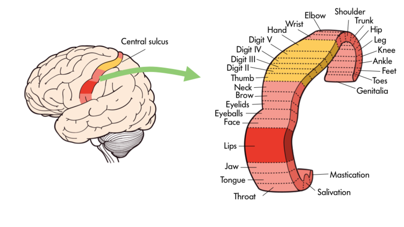
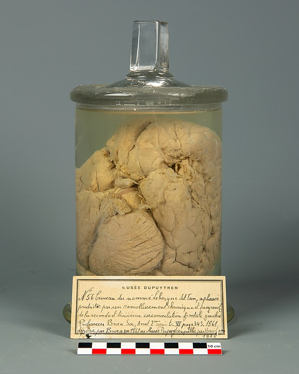

# Thùy trán, não trái và não phải

## Tóm tắt

Hai người bạn cãi nhau: một người nói "mình thiên về não trái nên giỏi toán", người kia nói "mình thiên về não phải nên vẽ đẹp". Câu đó đúng hay sai? Bài này trả lời bằng cách xem hai việc. Thứ nhất, thùy trán (frontal lobe), phần ở phía trước của vỏ não, làm gì trong cử động, lời nói, lập kế hoạch và kiểm soát bản thân. Thứ hai, hai bán cầu não (cerebral hemispheres), trái và phải, khác nhau ở đâu và nối với nhau ra sao.

Kết luận ngắn gọn có ba ý. Một: phần trước nhất của thùy trán, gọi là vỏ não trước trán (prefrontal cortex), có vai trò điều hành, gọi là kiểm soát nhận thức (cognitive control) [S1] [S4]. Hai: những việc điều hành như giữ thông tin trong đầu, kìm một phản ứng, đổi cách nghĩ là các chức năng tách được nhưng có liên quan với nhau, và chuyện "vùng nào làm việc nào" vẫn còn tranh luận [S5] [S6] [S7]. Ba: hai bán cầu thật sự có chuyên biệt hóa [S1] [S9], nhưng ở từng chức năng và từng mạng lưới, không phải ở từng con người: dữ liệu của một nghiên cứu 1.011 người không phù hợp với ý "người não trái" hay "người não phải" [S10].

Bài cũng kể lại chuyện Phineas Gage, bệnh nhân nổi tiếng nhất của thùy trán, và tách phần đã được kiểm chứng khỏi phần người đời sau thêm vào [S2] [S3].

**Mức đọc nguồn.** Giáo trình chương 2.6 và 4.2 [S1] [S2] và bài của Macmillan [S3] được đọc toàn văn trên trang gốc; bài của Nielsen và cộng sự [S10] được đọc phần tóm tắt, mở đầu và thảo luận. Sáu bài báo khoa học còn lại [S4] [S5] [S6] [S7] [S8] [S9] chỉ được đọc phần tóm tắt, nên bài này chỉ nói những điều có trong tóm tắt của chúng. Mỗi khẳng định về cơ chế mang một nhãn: giáo khoa, giả thuyết hoặc đang tranh luận, hay "Suy luận của người viết". Ví dụ đời thường được ghi là "Ví dụ của người viết". Đây là bài giáo dục, không phải lời khuyên y tế.

## Thùy trán và vỏ não trước trán

Thùy trán nằm ở phía trước mỗi bán cầu. Rãnh trung tâm (central sulcus) là ranh giới giữa thùy trán và thùy đỉnh (parietal lobe); rãnh bên (lateral sulcus) tách thùy thái dương (temporal lobe) khỏi thùy trán và thùy đỉnh [S1]. Theo giáo trình, thùy trán tham gia lập kế hoạch và thực hiện cử động, cùng các quá trình nhận thức bậc cao như chú ý, ngôn ngữ, lập luận, giải quyết vấn đề và tư duy trừu tượng [S1]. Đây là mức giáo khoa.

Thùy trán không phải một khối đồng nhất mà gồm các vùng con làm việc chuyên biệt. Đi từ sau ra trước [S1]:

1. Hồi trước trung tâm (precentral gyrus), nằm ngay trước rãnh trung tâm, là vỏ vận động chính (primary motor cortex).
2. Phía trước đó là các vùng liên quan đến cử động khác: vùng tiền vận động (premotor area), tham gia lập kế hoạch cử động, và vùng nhìn trán (frontal eye fields), tham gia tạo cử động mắt và chú ý thị giác.
3. Phía trước vỏ vận động và tiền vận động là vỏ não trước trán (prefrontal cortex, PFC), liên quan đến nhiều chức năng nhận thức và chức năng điều hành.

Trong vỏ não trước trán, giáo trình nêu ba vùng con chính. Vùng Broca nằm ở phần dưới của vỏ não trước trán, thường lệch về bên trái, liên quan đến việc tạo ra lời nói. Vùng lưng bên (dorsolateral PFC, "dorsal" là phía trên, "lateral" là phía ngoài) liên quan đến bộ nhớ làm việc, lập kế hoạch, ức chế phản ứng và linh hoạt nhận thức. Vỏ ổ mắt (orbitofrontal cortex) nằm ở tận phía trước, gần hốc mắt, liên quan đến ra quyết định phức tạp, mã hóa giá trị, cảm xúc, tính xã hội và dự đoán hệ quả của hành động [S1]. Các vùng này được đánh số theo hệ vùng Brodmann (Brodmann areas), cách chia vỏ não thành 52 vùng theo cấu trúc vi thể mà Korbinian Brodmann xây dựng đầu thế kỷ 20; vùng 4 là vỏ vận động chính [S1].

*Vỏ não trước trán (màu xanh) và các vùng con. Nhãn tiếng Anh: dorsolateral (lưng bên), ventrolateral (bụng bên), orbitofrontal (ổ mắt), premotor cortex (vỏ tiền vận động), motor cortex (vỏ vận động); các số là vùng Brodmann. Nguồn hình: Wikipedia, CC BY-SA, chỉnh bởi Hove & Martinez; Hove & Martinez, Hình 15 (mục 2.6). https://rotel.pressbooks.pub/biologicalpsychology/chapter/the-brain/ [S1]*

Giáo trình còn nêu hai ý rộng hơn. Ý thứ nhất: nhìn chung, các vùng càng nằm phía trước thì càng gắn với nhận thức "cao", ví dụ học luật ở mức trừu tượng; chữ "roughly" (đại thể) trong câu gốc cho thấy đây là xu hướng, không phải quy tắc cứng [S1]. Ý thứ hai: các vùng trước trán ở người lớn một cách không cân xứng, và đã mở rộng hoặc tổ chức lại so với những loài xa người trên cây tiến hóa [S1]. Khi thùy trán bị tổn thương, tùy vị trí và mức độ, có thể thấy thay đổi về nhân cách, nhận thức, học tập, ra quyết định, đánh giá rủi ro, ức chế hành vi và chức năng xã hội [S1].

**Đừng hiểu nhầm.** Thùy trán và vỏ não trước trán là hai khái niệm khác nhau: thùy trán gồm cả vỏ vận động, còn các nghiên cứu về "kiểm soát" mà bài này dẫn chủ yếu nói về vỏ não trước trán [S4]. Ngoài ra, cách chia vùng là công cụ để gọi tên, không có nghĩa mỗi vùng là một "cơ quan" tách rời.

### Thẻ hồ sơ: vỏ não trước trán

| Mục | Nội dung |
|---|---|
| Ở đâu | Phần trước nhất của thùy trán, phía trước vỏ vận động và tiền vận động [S1] |
| Gồm | Vùng lưng bên (vùng 9, 46), vỏ ổ mắt (vùng 10, 11), phần dưới có vùng Broca (vùng 44, 45) [S1] |
| Vai trò chính | Chức năng điều hành và nhận thức bậc cao (giáo khoa) [S1]; kiểm soát nhận thức (lý thuyết của Miller và Cohen) [S4] |
| Bằng chứng | Người bị tổn thương thùy trán, ảnh chụp não, tổng quan nhiều loại nghiên cứu [S1] [S4] |
| Kết nối | Đường dopamine từ vùng mái bụng (ventral tegmental area) lên vỏ não trước trán: xem L00 và L03 |
| Khi tổn thương | Đổi nhân cách, ra quyết định, ức chế hành vi, chức năng xã hội, tùy vị trí [S1] |

Các phần khác của vỏ não thuộc bài khác: thùy thái dương, thùy đỉnh, thùy chẩm và vùng Wernicke ở L08; hạnh nhân, hải mã, hạch nền, đồi thị ở L07; vai trò điều chỉnh cảm xúc của vỏ não trước trán, nối với mạch sợ, ở L09; hệ thưởng và căng thẳng ở L05.

## Vỏ não vận động và vùng Broca

**Vỏ vận động chính.** Hồi trước trung tâm là vỏ vận động chính, tương ứng vùng Brodmann 4. Nơron ở đây gửi lệnh xuống tủy sống để cử động các cơ xương [S1]. Các khu trong vỏ vận động chính ứng với các nhóm cơ theo một thứ tự nhất định, tạo thành một "bản đồ". Bộ phận cần điều khiển tinh vi, như ngón tay, môi và lưỡi, chiếm nhiều "bất động sản thần kinh" (neural real estate) hơn bộ phận như vai hay thân [S1]. Người ta thường gọi những bản đồ cơ thể trên vỏ não là homunculus ("người tí hon"); giáo trình có hình Sensory Homunculus cho vỏ thể cảm ở thùy đỉnh, xem L08. Mỗi bên não điều khiển và nhận tín hiệu từ bên đối diện của cơ thể: tín hiệu xúc giác và lệnh vận động của mỗi bên cơ thể được xử lý chủ yếu ở bán cầu đối bên (contralateral) [S1].

*Vỏ vận động chính trên hồi trước trung tâm, ngay trước rãnh trung tâm (central sulcus), và bản đồ các bộ phận cơ thể trên đó. Nhãn tiếng Anh: Digit (ngón), Lips (môi), Tongue (lưỡi), Jaw (hàm), Face (mặt), Hip (hông), Toes (ngón chân). Nguồn hình: Noba, giấy phép theo sách CC BY-NC-SA; Hove & Martinez, Hình 14 (mục 2.6). https://rotel.pressbooks.pub/biologicalpsychology/chapter/the-brain/ [S1]*

**Tiền vận động và vùng nhìn trán.** Phía trước vỏ vận động chính là vùng tiền vận động, liên quan đến lập kế hoạch cử động, và vùng nhìn trán, liên quan đến cử động mắt và chú ý thị giác [S1]. Suy luận của người viết để dễ hình dung: một cử động chủ động đi từ ý định ở phía trước, qua lập kế hoạch ở tiền vận động, đến lệnh ở vỏ vận động chính; sơ đồ này đã đơn giản hóa, vì giáo trình chỉ nêu vai trò của từng vùng, không vẽ một dây chuyền một chiều.

**Đừng hiểu nhầm.** Vỏ vận động chính không tự "quyết định" cử động. Nó gửi lệnh xuống tủy sống; việc lập kế hoạch nằm ở tiền vận động và các vùng phía trước hơn [S1]. Hình vẽ bản đồ cũng không có nghĩa mỗi cơ có một nút bấm riêng: giáo trình chỉ nói các khu xếp theo thứ tự ứng với nhóm cơ [S1].

**Vùng Broca.** Vùng Broca nằm ở vỏ não trước trán phần dưới, thường lệch về bên trái, và liên quan đến việc tạo ra lời nói. Tên vùng này đặt theo bác sĩ người Pháp Paul Broca, người năm 1861 ghi nhận rằng tổn thương ở đây làm hỏng việc tạo lời nói [S1]. Giáo trình kể thêm ở mục 4.2: một bệnh nhân của Broca, biệt danh "Tan", chỉ nói được một âm tiết "tan" lặp đi lặp lại. Sau khi ông mất, Broca thấy một tổn thương lớn ở thùy trán trái. Một bệnh nhân khác của Broca cũng mất khả năng nói trôi chảy và bị tổn thương cùng phần thùy trán trái. Từ đó Broca suy ra rằng việc tạo lời nói khu trú ở vùng này [S2]. Thuật ngữ thường dùng cho kiểu mất lời nói này là mất ngôn ngữ biểu đạt (expressive aphasia); giáo trình chỉ mô tả bệnh nhân "không nói trôi chảy" (aphasic).

Cùng thời, bác sĩ người Đức Carl Wernicke thấy tổn thương ở một vùng khác, phần trên của thùy thái dương trái, đi kèm việc không hiểu lời nói. Hai phát hiện đi cặp với nhau tạo thành một "phân ly kép" (double dissociation): tổn thương ở hai nơi khác nhau gây hai kiểu mất khác nhau [S2]. Mẹo nhớ của giáo trình: BROca là PROduction (tạo lời nói) ở thùy FROntal; WERnicke là perception (nhận biết lời nói) ở thùy thái dương [S2]. Vùng Wernicke thuộc L08.

*Não của bệnh nhân "Tan" của Broca, bảo quản trong lọ tại một bảo tàng ở Paris; ở phía trên bên phải của lọ có thể thấy chỗ tổn thương ở thùy trán trái. Nguồn hình: Sorbonne Université, ảnh do người dùng Selbymay đăng lên Wikimedia Commons, CC BY-SA 4.0; qua Hove & Martinez, Hình 2 (mục 4.2). https://rotel.pressbooks.pub/biologicalpsychology/chapter/historical-methods-studies-of-brain-damage-in-humans/ [S2]*

*Vùng Broca ở thùy trán trái, vùng Wernicke ở thùy thái dương trên, và bó cung (arcuate fasciculus) nối hai vùng. Nhãn tiếng Anh: Broca's area, Wernicke's area, angular gyrus (hồi góc). Nguồn hình: Noba, giấy phép theo sách CC BY-NC-SA; Hove & Martinez, Hình 16 (mục 2.6). https://rotel.pressbooks.pub/biologicalpsychology/chapter/the-brain/ [S1]*

**Điều sách nói và điều là suy luận.** Sách nói (giáo khoa): tổn thương vùng dưới thùy trán trái làm hỏng việc tạo lời nói ở các bệnh nhân của Broca [S2], và vùng Broca liên quan đến việc tạo lời nói [S1]. Suy luận: việc Broca từ đó kết luận lời nói "khu trú" ở vùng này là một bước suy ra, và chính giáo trình nêu giới hạn của loại bằng chứng này: tổn thương của mỗi bệnh nhân là riêng của họ nên khó khái quát, và hiếm khi chỉ nằm ở một vùng nên khó tách vai trò của từng cấu trúc; tổn thương của Tan còn do bệnh giang mai thần kinh (neurosyphilis) [S2]. Nielsen và cộng sự bổ sung một bức tranh hiện đại hơn: vùng Broca và vùng Wernicke tạo thành một mạng ngôn ngữ phân tán, chủ yếu nghiêng trái [S10]. Vì vậy "ngôn ngữ nằm ở vùng Broca" chỉ đúng như cách nói tắt.

## Vỏ não trước trán làm gì

Earl Miller và Jonathan Cohen đề xuất năm 2001 một lý thuyết tích hợp về chức năng của vỏ não trước trán. Họ bắt đầu từ ý rằng vỏ não trước trán từ lâu được cho là quan trọng với kiểm soát nhận thức (cognitive control): khả năng điều phối suy nghĩ và hành động theo mục tiêu bên trong. Điều họ đề xuất là kiểm soát nhận thức đến từ việc vỏ não trước trán duy trì tích cực những mẫu hoạt động biểu diễn mục tiêu và phương tiện để đạt mục tiêu. Các mẫu này gửi tín hiệu thiên lệch (bias signals) đến các cấu trúc khác, và hiệu quả chung là dẫn dòng hoạt động đi theo những đường thần kinh tạo ra đúng ánh xạ giữa đầu vào, trạng thái bên trong và đầu ra mà nhiệm vụ cần [S4]. Các tác giả xem xét nhiều loại bằng chứng: sinh lý thần kinh, sinh học thần kinh, ảnh học thần kinh và mô hình tính toán [S4]. Tóm tắt không tách rõ phần nào từ người, phần nào từ động vật; người đọc cần xem toàn văn trước khi dùng một kết quả cụ thể.

Nhãn mức chắc chắn: đây là một lý thuyết có tổng quan bằng chứng, không phải sự thật giáo khoa không ai bàn cãi. Nó cho ta một cách hình dung hữu ích: vỏ não trước trán không tự làm mọi việc mà thiên lệch hoạt động ở nơi khác theo mục tiêu [S4].

Theo cách hiểu rộng, khả năng này giúp ta giữ một mục tiêu trong đầu, chọn cách làm phù hợp và điều chỉnh khi hoàn cảnh thay đổi [S1] [S4]. Giáo trình gắn vùng lưng bên với bộ nhớ làm việc, lập kế hoạch, ức chế phản ứng, linh hoạt nhận thức, và vỏ ổ mắt với ra quyết định phức tạp, giá trị, cảm xúc, tính xã hội và dự đoán hệ quả [S1].

Ví dụ của người viết: khi bạn đang học mà điện thoại rung, khả năng "nhớ rằng mình đang học để làm gì" là việc của loại hoạt động này. Ví dụ khác của người viết: vỏ não trước trán giống người điều phối trong một nhóm, không tự làm mọi việc nhưng ảnh hưởng ai làm gì lúc nào. Đây chỉ là ví von; trong nghiên cứu, người ta dùng thuật ngữ kiểm soát nhận thức hoặc chức năng điều hành.

**Đừng hiểu nhầm.** Không nên nói "vỏ não trước trán là trung tâm điều hành" theo nghĩa một bộ chỉ huy duy nhất. Theo lý thuyết Miller và Cohen, nó gửi tín hiệu thiên lệch, tức làm việc thông qua các vùng khác [S4]; và việc một vùng đảm nhận một chức năng cố định đang là chuyện còn tranh luận, như phần sau cho thấy [S7]. Phần vai trò của vỏ ổ mắt trong cảm xúc thuộc L09.

## Chức năng điều hành: bộ nhớ làm việc, ức chế, linh hoạt

Chức năng điều hành (executive functions, EF) là tên chung của các năng lực giúp ta "chơi" với ý tưởng trong đầu, dừng lại nghĩ trước khi làm, đối phó với thử thách mới, cưỡng lại cám dỗ và giữ tập trung. Trong bài tổng quan của Adele Diamond, ba chức năng nòng cốt là [S5]:

1. **Ức chế (inhibition)**, gồm ức chế phản ứng (response inhibition: tự kiểm soát, cưỡng lại cám dỗ, không hành động bốc đồng) và kiểm soát nhiễu (interference control: chú ý chọn lọc và ức chế ở mức nhận thức).
2. **Bộ nhớ làm việc (working memory)**: giữ và xử lý thông tin trong đầu (cách gọi giản lược của người viết).
3. **Linh hoạt nhận thức (cognitive flexibility)**: nghĩ "ngoài khuôn", nhìn một việc từ góc khác, thích nghi nhanh khi hoàn cảnh đổi.

Giáo trình cũng nêu cùng bộ ba này cho vùng lưng bên của vỏ não trước trán: bộ nhớ làm việc, lập kế hoạch, ức chế phản ứng và linh hoạt nhận thức [S1]. Mức: giáo khoa ở mức phân loại, vì cả sách lẫn tổng quan nói như vậy.

Ví dụ của người viết: ức chế là không mở mạng xã hội khi đang làm bài; bộ nhớ làm việc là nhớ số điện thoại vừa nghe đủ lâu để bấm; linh hoạt nhận thức là đổi cách giải khi cách cũ bế tắc.

**Ba chức năng nhưng không hoàn toàn tách rời.** Akira Miyake và cộng sự (2000) cho 137 sinh viên đại học làm các bài tập đơn giản, mỗi bài chủ yếu đo một trong ba chức năng: chuyển đổi tập (shifting), cập nhật và theo dõi thông tin (updating), và ức chế phản ứng chiếm ưu thế (inhibition). Họ cũng cho làm các bài "thùy trán" phức hợp như Wisconsin Card Sorting Test và Tower of Hanoi. Phân tích thống kê cho thấy ba chức năng có tương quan vừa phải với nhau nhưng tách biệt rõ, và đóng góp khác nhau vào các bài phức hợp: kết quả Wisconsin liên hệ mạnh nhất với chuyển đổi tập, Tower of Hanoi với ức chế, còn bài trí nhớ vận hành (operation span) với cập nhật [S6]. Tên của chính bài báo là "tính thống nhất và tính đa dạng" của chức năng điều hành. Suy luận của người viết: "cập nhật" của Miyake gần với bộ nhớ làm việc của Diamond, nhưng hai bài dùng thuật ngữ riêng. Đây là nghiên cứu hành vi trên sinh viên đại học, không đo não; kết luận về "vùng nào" không thể rút ra từ đó.

**Ngay cả mô hình này cũng là một mô hình.** Tóm tắt của Diamond liệt kê các tranh luận còn mở: quan hệ giữa chức năng điều hành với trí thông minh lưu động, tự điều chỉnh, chú ý điều hành và kiểm soát nỗ lực, và quan hệ giữa bộ nhớ làm việc với ức chế và chú ý [S5]. Về não, Adam Aron, Trevor Robbins và Russell Poldrack viết rằng vẫn còn tranh luận liệu các chức năng nhận thức khác nhau có thể gán cho các vùng riêng biệt của vỏ não trước trán hay không. Truyền thống "khu trú" từng gắn ức chế lần lượt với vùng lưng bên, vùng dưới hoặc vùng ổ mắt. Theo họ, ảnh học thần kinh cho thấy nhiều điểm trước trán tham gia, còn bản đồ tổn thương ở người ủng hộ việc khu trú loại ức chế này ở một nơi duy nhất, là vỏ não dưới trán phải, và họ đề nghị nghiên cứu thêm [S7]. Nhãn: giả thuyết, đang tranh luận. Điều rút ra: "ba chức năng" và "một vùng một việc" đều là cách chia để mô tả, không phải bản vẽ cuối cùng của não.

## Phineas Gage: chuyện nổi tiếng và phần còn tranh cãi

**Điều đã kiểm.** Phineas Gage là bệnh nhân sách giáo khoa thường nhắc đến. Theo Malcolm Macmillan, tác giả cuốn *An Odd Kind of Fame* (2000) về trường hợp này, vào khoảng 4 giờ 30 chiều ngày 13 tháng 9 năm 1848, Gage, 25 tuổi, đang là đốc công của một đội làm đường sắt ở bang Vermont (Mỹ). Một vụ nổ đẩy thanh sắt đầm thuốc nổ (tamping iron) xuyên qua đầu ông: nó vào dưới xương gò má trái, xuyên nền sọ ngay sau hốc mắt trái, và ra ở đỉnh sọ [S3]. Giáo trình mô tả cùng đường đi và nói ông mất một phần thùy trán trái [S2]. Gage sống sót nhờ được chăm sóc, trong đó bác sĩ John Harlow xử lý một nhiễm trùng nặng; ông mất vì các cơn co giật vào ngày 21 tháng 5 năm 1860 [S3]. Giáo trình ghi ông sống thêm 12 năm [S2]; Macmillan viết "mười một năm rưỡi" [S3], hai cách làm tròn của cùng một khoảng thời gian.

**Chỉ có bốn nguồn gốc.** Macmillan nói chỉ có bốn nguồn thông tin trực tiếp về Gage: Harlow (1848), Bigelow (1850), Harlow lần nữa (1868), và J. B. S. Jackson (1870). Ông viết rằng điều gì không đến từ các nguồn này, hoặc từ nguồn được ghi chép tương đương, thì không phải là sự thật về Gage. Ngay cả bốn nguồn này cũng không hoàn toàn đáng tin: Harlow năm 1868 viết Gage mất năm 1861, trong khi hồ sơ nhà tang lễ chứng tỏ là 1860 [S3].

**Thay đổi tâm lý được ghi khi nào.** Theo Macmillan, Harlow năm 1848 không nêu cụ thể thay đổi tâm lý nào, Bigelow năm 1850 cũng không. Jackson (1849) ghi riêng một số suy giảm trí nhớ; một báo cáo vô danh cùng năm nhắc rất ngắn đến suy giảm lớn về sức mạnh tinh thần. Chi tiết đầu tiên xuất hiện trong một tạp chí cốt tướng học (phrenology) năm 1851. Chỉ đến báo cáo ít được biết của Harlow năm 1868, dưới 200 chữ, người ta mới thấy mô tả rõ: Gage thiếu kiên nhẫn với điều bó buộc, kế hoạch vừa đặt ra đã bỏ, ăn nói thô tục, và bạn bè nói ông "không còn là Gage" [S3]. Giáo trình mô tả ông sau tai nạn là thô tục, bốc đồng, không theo quy ước xã hội và khó thực hiện kế hoạch, trong khi trước đó là người có trách nhiệm và hòa nhập tốt [S2]. Hai nguồn này khớp nhau ở hướng thay đổi; điều Macmillan đặt câu hỏi là mức độ và độ dài của sự thay đổi mà hậu thế kể.

**Phần người đời sau thêm vào.** Macmillan tổng hợp cách các tác giả hiện đại hay kể: một Gage hiền lành trước tai nạn, sau đó thành kẻ nóng nảy, bạo lực, nát rượu, trở thành vật trưng bày ở các gánh xiếc và chết nghèo. Ông nhận xét rằng bức tranh sau tai nạn ấy khó có thể nhận ra là Gage thật; tuy vậy một số chi tiết, như việc ông từng đi diễn thuyết và tự trưng bày bản thân khoảng năm 1850, có trong tiểu sử Macmillan kể. Chi tiết "rối loạn tình dục" mà vài tác giả gán cho Gage không có trong các nguồn [S3]. Về dài hạn, Macmillan chỉ ra rằng ông làm việc khoảng 18 tháng cho một chủ trạm xe ngựa và sau đó nhiều năm lái xe ngựa, công việc đòi hỏi kỹ năng vận động và nhận thức phức tạp, khó khớp với hình ảnh bốc đồng suốt đời [S3]. Ông còn phỏng đoán rằng Gage có thể đã hồi phục về xã hội nhờ cuộc sống có nề nếp; đó là phỏng đoán của Macmillan, và ông viết rằng chỉ khi bổ sung hồ sơ về cuộc đời Gage sau tai nạn mới xác định được [S3].

**Tổn thương nằm ở đâu?** Không có khám nghiệm tử thi; thi thể được khai quật khoảng cuối năm 1867 và chiếc sọ đến tay Harlow đầu năm 1868, còn não thì không còn gì. Vì vậy chỉ có sọ để suy ra vùng bị tổn thương, mà chấn động, mảnh xương, chảy máu và nhiễm trùng còn phá hủy thêm mô ngoài đường đi của thanh sắt [S3]. Ba cách dựng lại bằng chụp cắt lớp vi tính (CT) từ năm 1982 cho kết quả hơi khác nhau. Nhóm của Hanna Damasio (1994) mô hình hóa vùng tổn thương thiên về phía trước và lệch phải hơn so với đề xuất trước đó; nhóm Ratiu (2004), dựng hình ba chiều từ chính chiếc sọ, thấy tổn thương ở thùy trán trái, gần như đúng như Harlow nói [S3]. Hình dưới là một bản mô phỏng của Van Horn và cộng sự (2012), không phải ảnh chụp não của ông [S2].

*Mô phỏng bằng máy tính đường đi của thanh sắt qua hộp sọ của Phineas Gage; màu sắc là các bó sợi chất trắng có thể đã bị cắt. Đây là tái dựng ước đoán, không phải ảnh chụp não của ông. Nguồn hình: Van Horn JD và cộng sự, CC BY 2.5, Wikimedia Commons; qua Hove & Martinez, Hình 1 (mục 4.2). https://rotel.pressbooks.pub/biologicalpsychology/chapter/historical-methods-studies-of-brain-damage-in-humans/ [S2]*

**Bối cảnh khoa học.** Macmillan nhắc rằng thời đó chưa có lý thuyết nào về chức năng của não ngoài cốt tướng học. Từ giữa thập niên 1860, quan sát của Broca về ngôn ngữ ở thùy trán trái và các thí nghiệm của David Ferrier trên khỉ, cho thấy tổn thương trước trán gây thay đổi nhân cách sâu sắc (kết quả từ động vật, không phải từ Gage), làm bối cảnh dần thay đổi. Chính Ferrier kéo báo cáo của Harlow ra khỏi sự bị lãng quên [S3].

**Bài học.** Gage chỉ là một ca. Giáo trình nhắc rằng nghiên cứu bệnh nhân tổn thương não có giới hạn: tổn thương của mỗi người là riêng của họ, và hiếm khi chỉ ở một vùng [S2]. Việc tổn thương thùy trán có thể ảnh hưởng đến nhân cách, ra quyết định và ức chế hành vi được giáo trình nêu cho nhiều bệnh nhân, không chỉ Gage [S1]. Macmillan kết luận rằng ta sẽ không bao giờ biết chắc Gage trước và sau tai nạn thật sự ra sao, nên giá trị chính của ông là một cột mốc lịch sử: ca đầu tiên được ghi nhận trong đó tổn thương não làm đổi nhân cách; ông cũng nói câu chuyện này cho thấy một ít sự kiện dễ biến thành huyền thoại thế nào [S3]. Suy luận của người viết: bài học thực dụng là kiểm lại câu chuyện cũ được kể nhiều lần trước khi dùng nó làm bằng chứng.

## Kiểm soát bản thân: cái phanh của não

Sức hút của phần thưởng (L00, L05), cảm xúc mạnh (hạnh nhân, L07) và thói quen đều có thể kéo ta đi một hướng. Cách nghĩ phổ biến trong khoa học thần kinh là vỏ não trước trán giúp điều chỉnh các hệ này theo mục tiêu dài hạn thay vì theo cám dỗ trước mắt [S4] [S5]. Đây là giả thuyết đã có nhiều ủng hộ, không phải điều chứng minh xong.

**Một chuỗi minh họa.** Suy luận của người viết, dựa trên ý "tín hiệu thiên lệch" [S4] và đã đơn giản hóa nhiều: có cám dỗ xuất hiện, vỏ não trước trán so nó với mục tiêu đã đặt, rồi hoặc kìm hành động lại hoặc cho phép hành động. Đây là mô hình để dễ hiểu, không phải sơ đồ chính xác từng nơron.

**Vì sao gọi là "phanh".** Aron và cộng sự viết rằng ức chế được đề xuất là một cơ chế qua đó vỏ não trước trán tác động lên các vùng dưới vỏ và vỏ não phía sau để thực hiện kiểm soát điều hành; họ đề xuất rằng chức năng ức chế ấy khu trú ở vỏ não dưới trán phải và cần kiểm chứng thêm cho các loại nhiệm vụ khác [S7]. Nhãn: giả thuyết. Gọi là "phanh" là cách ví von của bài này.

**Phanh phụ thuộc điều kiện.** Diamond viết rằng căng thẳng, thiếu ngủ, cô đơn hay thiếu vận động mỗi thứ đều làm giảm chức năng điều hành, và rằng chức năng điều hành có thể được rèn luyện, tóm tắt nhắc đến nhiều phương pháp đã thử [S5]. Amy Arnsten tổng hợp rằng vỏ não trước trán, nơi đảm nhiệm các năng lực nhận thức cao nhất, cũng là vùng não nhạy nhất với tác hại của căng thẳng: ngay căng thẳng cấp tính nhẹ nhưng không kiểm soát được cũng có thể gây mất nhanh và rõ rệt năng lực nhận thức của vỏ não trước trán, còn căng thẳng kéo dài làm đổi cấu trúc các sợi nhánh (dendrite) ở đó. Bà cũng mô tả các con đường tín hiệu trong tế bào làm trung gian cho tác động này, và gợi ý vì sao những yếu tố di truyền hoặc môi trường làm các con đường ấy bị "mất phanh" có thể dẫn đến rối loạn chức năng trước trán nặng trong bệnh tâm thần [S8]. Tôi chỉ đọc tóm tắt nên không biết mức nào của kết luận đến từ người, mức nào từ động vật; người đọc cần xem toàn văn trước khi áp vào đời thường.

Suy luận của người viết: nếu cả hai tổng quan đúng, đây có thể là một lý do khiến nhiều người thấy khó tự kiểm soát khi mệt, thiếu ngủ hoặc căng thẳng, chứ không hẳn vì "ý chí yếu"; bài chưa có bằng chứng đo trực tiếp điều này ở một cá nhân. Căng thẳng được nói kỹ ở L05; vai trò điều chỉnh cảm xúc của vỏ não trước trán ở L09. Đây không phải lời khuyên y tế.

## Hai bán cầu và thể chai

Não có hai bán cầu, trái và phải, ngăn cách bởi rãnh dọc giữa (longitudinal fissure). Hai bán cầu nối với nhau bằng thể chai (corpus callosum), một bó chất trắng lớn truyền thông tin giữa hai bên [S1]. Theo giáo trình, hai bán cầu đối xứng về cấu trúc, thường có chức năng chồng lấn và dư thừa, nhưng có chuyên biệt hóa theo bên (lateralization of function): một số chức năng được xử lý nhiều hơn ở một bán cầu. Hai ví dụ trong sách: tín hiệu xúc giác và lệnh vận động của mỗi bên cơ thể được xử lý ở bán cầu đối bên, và với đa số người, ngôn ngữ được xử lý nhiều hơn ở bán cầu trái [S1]. Mức: giáo khoa.

**Nghiên cứu bệnh nhân tách bán cầu.** Michael Gazzaniga mô tả rằng bốn mươi lăm năm trước bài báo năm 2005 của mình, ông cùng Roger Sperry và Joseph Bogen bắt đầu các nghiên cứu "não bị tách" (split-brain) hiện đại. Theo ông, các thí nghiệm này mở ra những hướng mới và tạo nên phần lớn hiểu biết về chuyên biệt hóa và tích hợp giữa hai bán cầu. Phương pháp này, dùng riêng hoặc cùng ảnh học thần kinh, cho thấy thể chai có tính đặc hiệu theo vùng và có vai trò tích hợp trong nhận thức về quan hệ nhân quả và trong cảm giác về một bản thân thống nhất [S9]. Tôi chỉ đọc tóm tắt, nên bài này không mô tả chi tiết từng thí nghiệm hay kết quả cụ thể.

Điều đáng nhớ từ cặp ý này: chuyên biệt hóa là có thật (specialization), và trong não bình thường hai bán cầu còn được nối để thông tin đi lại và hợp thành một trải nghiệm chung (integration) [S1] [S9].

## Chuyên biệt hóa có thật, nhưng ở từng chức năng

Năm 2013, Jared Nielsen và cộng sự phân tích ảnh chụp cộng hưởng từ chức năng (functional MRI, fMRI) lúc nghỉ của 1.011 người từ 7 đến 29 tuổi, lấy từ các bộ dữ liệu công khai. Với mỗi người, họ đo mức nghiêng của kết nối chức năng (functional connectivity), tức mức các vùng não hoạt động cùng nhau, cho từng cặp trong 7.266 vùng phủ chất xám, bằng cách so mức tương quan trước và sau khi lật ảnh qua mặt phẳng giữa. Họ trừ đi ảnh hưởng của khác biệt mật độ chất xám để giảm tác động của bất đối xứng về cấu trúc [S10].

Họ tìm ra chín "nút" (hub, vùng có nhiều kết nối nghiêng mạnh) nghiêng trái và 11 nút nghiêng phải [S10]:

| Bên | Ví dụ các vùng | Mạng quen thuộc | Nguồn |
|---|---|---|---|
| Nghiêng trái | Vùng Broca, vùng Wernicke; vỏ trước trán giữa, vỏ cingulate sau, chỗ nối thái dương đỉnh | Mạng ngôn ngữ; mạng chế độ mặc định (default mode network) | [S10] |
| Nghiêng phải | Rãnh nội đỉnh bên, đảo trước (anterior insula), vùng MT, vùng nhìn trán, vỏ lưng bên trước trán | Mạng chú ý (kiểm soát chú ý, mạng nổi bật) | [S10] |

Hai nhóm nút tạo thành hai mạng riêng biệt gồm các vùng cùng nghiêng một phía [S10]. Trong phần thảo luận, các tác giả mô tả mạng chế độ mặc định hoạt động mạnh hơn lúc nghỉ và được đề xuất liên quan đến chú ý đến kích thích bên trong như dòng suy nghĩ nội tâm hay tự soi xét; còn mạng nghiêng phải hoạt động mạnh hơn khi cần chú ý đến kích thích bên ngoài hoặc đánh giá độ nổi bật, mới lạ của kích thích [S10]. Họ gắn việc chú ý bên ngoài nghiêng phải với các nghiên cứu tổn thương cho thấy bỏ qua một nửa không gian (hemispatial neglect) hay gặp hơn sau tổn thương bán cầu phải [S10]; hội chứng này thuộc L08.

**Điều then chốt.** Các kết nối nghiêng mạnh về một bên chỉ có tương quan với nhau giữa các người trong những kết nối dùng chung một nút; nhóm nghiên cứu kết luận rằng mức nghiêng là đặc tính cục bộ chứ không phải đặc tính toàn bộ não, và dữ liệu của họ không phù hợp với một kiểu hình toàn não "nghiêng trái nhiều hơn" hay "nghiêng phải nhiều hơn" giữa các cá nhân. Mức nghiêng tăng nhẹ theo tuổi; không thấy khác biệt theo giới [S10].

Một ví dụ khác về chuyên biệt hóa theo chức năng, đang tranh luận: giả thuyết của Aron và cộng sự rằng ức chế phản ứng khu trú ở vỏ não dưới trán phải [S7].

**Giới hạn của chứng cứ.** Nielsen và cộng sự dùng ảnh lúc nghỉ, không cho người tham gia làm nhiệm vụ nhận thức [S10]. Suy luận của người viết: điều đó có nghĩa nghiên cứu cho ta bản đồ nghiêng trái phải của kết nối, nhưng không nói trực tiếp về cách mỗi người suy nghĩ hay làm việc; nó chỉ cho biết một ý như "người não trái" thiếu chỗ dựa trong loại dữ liệu này. Người tham gia từ 7 đến 29 tuổi, nên kết luận với người lớn tuổi hơn cần nghiên cứu khác. Bài này cũng chưa đọc được nghiên cứu nào trái chiều; đây là một nghiên cứu lớn chứ chưa phải lời cuối.

## Vì sao "người não trái, người não phải" là hiểu lầm

Chính các tác giả mô tả cách nói phổ biến: trong báo chí đại chúng, "não trái" và "não phải" được gắn với tính cách và kiểu nghĩ, người "não trái" được cho là logic, tuần tự, còn người "não phải" sáng tạo, trôi chảy, trực giác [S10]. Từ các vùng họ tìm thấy, họ gợi ý một cách nhìn nhất quán hơn: các kết nối nghiêng trái liên quan đến ngôn ngữ và nhận biết kích thích bên trong, còn kết nối nghiêng phải liên quan đến chú ý đến kích thích bên ngoài. Nhưng một bộ não cụ thể không "não trái" hay "não phải" như một đặc tính toàn bộ; mức nghiêng thuộc về từng nút hoặc từng mạng con [S10].

Ba lý do chính để coi "người não trái, người não phải" là hiểu lầm:

1. **Chuyên biệt hóa là theo mạng, không theo con người.** Người có một mạng nghiêng trái mạnh không nhất thiết có các mạng khác nghiêng trái mạnh; mối tương quan chỉ xuất hiện giữa các kết nối chung một nút [S10].
2. **Cái được đo không phải "logic hay sáng tạo".** Những chức năng được thấy nghiêng bên là ngôn ngữ, chú ý bên ngoài và mạng liên quan đến chú ý bên trong; nghiên cứu không đo "tính cách logic" hay "tính cách sáng tạo" [S1] [S10].
3. **Hai bán cầu phối hợp.** Hai bên nối bằng thể chai; chức năng thường chồng lấn và dư thừa; thể chai còn có vai trò tích hợp thông tin [S1] [S9]. Suy luận của người viết: khi nghe kể một câu chuyện, bạn dùng ngôn ngữ (nút nghiêng trái) và chú ý đến người kể (nút nghiêng phải) cùng lúc, nên một việc đời thường cũng cần cả hai bên.

Cách đọc một tin kiểu "bài kiểm tra cho biết bạn thuộc não trái hay não phải" (Suy luận của người viết): hỏi nó đo kết nối não hay chỉ hỏi sở thích; hỏi nó nói về một chức năng cụ thể hay một "kiểu người"; hỏi có nghiên cứu nào như Nielsen và cộng sự làm trên nhiều người không. Một nghiên cứu không loại trừ mọi khía cạnh: nó cho thấy dữ liệu "không phù hợp" với kiểu hình toàn não [S10], và đây là kết luận có thể được xem lại khi có nghiên cứu mới.

## Điều cần nhớ

1. Thùy trán gồm vỏ vận động, tiền vận động và vỏ não trước trán; vỏ não trước trán là nơi mà phần lớn nghiên cứu về kiểm soát nhận thức nói tới [S1] [S4].
2. Vỏ vận động chính gửi lệnh xuống tủy sống theo một bản đồ; vùng Broca liên quan đến tạo lời nói, nhưng "ngôn ngữ ở vùng Broca" chỉ là cách nói tắt [S1] [S2] [S10].
3. Chức năng điều hành gồm ức chế, bộ nhớ làm việc và linh hoạt nhận thức; ba chức năng này liên quan nhau và chuyện vùng nào làm việc nào còn tranh luận [S5] [S6] [S7].
4. Câu chuyện Phineas Gage có phần đã kiểm (tai nạn, sống sót, mô tả của Harlow năm 1868) và phần hậu thế thêm vào; mức tổn thương chính xác không biết chắc [S2] [S3].
5. Kiểm soát bản thân phụ thuộc điều kiện: căng thẳng, thiếu ngủ, cô đơn và thiếu vận động làm giảm chức năng điều hành [S5] [S8].
6. Hai bán cầu nối bằng thể chai và phối hợp; chuyên biệt hóa là có thật ở từng chức năng, còn "người não trái / não phải" không phù hợp với dữ liệu của một nghiên cứu 1.011 người [S1] [S9] [S10].

Nối với bài trước và sau: L03 nói các chất hóa học điều chỉnh mạng lưới; bài này nói vùng ở phía trước điều hành ra sao. L05 xem hệ thưởng, chú ý, cảm xúc và căng thẳng, nơi vỏ não trước trán phải cân bằng; L07 và L09 nói về hạnh nhân, hải mã và cảm xúc; L08 nói về các thùy còn lại.

## Nguồn tham khảo

- [S1] Hove & Martinez, Biological Psychology (Revised Edition), mục 2.6 The Brain, ROTEL Pressbooks, 2024, https://rotel.pressbooks.pub/biologicalpsychology/chapter/the-brain/ (mục lục sách: https://rotel.pressbooks.pub/biologicalpsychology/)
- [S2] Hove & Martinez, Biological Psychology (Revised Edition), mục 4.2 Historical Methods – Studies of Brain Damage in Humans, ROTEL Pressbooks, 2024, https://rotel.pressbooks.pub/biologicalpsychology/chapter/historical-methods-studies-of-brain-damage-in-humans/
- [S3] Macmillan M., Phineas Gage – Unravelling the myth, The Psychologist, 2008 (tác giả cũng viết cuốn An Odd Kind of Fame, MIT Press, 2000), https://bps.org.uk/psychologist/phineas-gage-unravelling-myth
- [S4] Miller E. K., Cohen J. D., An integrative theory of prefrontal cortex function, Annual Review of Neuroscience, 2001 (chỉ đọc tóm tắt), https://doi.org/10.1146/annurev.neuro.24.1.167
- [S5] Diamond A., Executive functions, Annual Review of Psychology, 2013 (chỉ đọc tóm tắt), https://doi.org/10.1146/annurev-psych-113011-143750
- [S6] Miyake A. và cộng sự, The unity and diversity of executive functions and their contributions to complex "frontal lobe" tasks: a latent variable analysis, Cognitive Psychology, 2000 (chỉ đọc tóm tắt), https://doi.org/10.1006/cogp.1999.0734
- [S7] Aron A. R., Robbins T. W., Poldrack R. A., Inhibition and the right inferior frontal cortex, Trends in Cognitive Sciences, 2004 (chỉ đọc tóm tắt), https://doi.org/10.1016/j.tics.2004.02.010
- [S8] Arnsten A. F. T., Stress signalling pathways that impair prefrontal cortex structure and function, Nature Reviews Neuroscience, 2009 (chỉ đọc tóm tắt), https://doi.org/10.1038/nrn2648
- [S9] Gazzaniga M. S., Forty-five years of split-brain research and still going strong, Nature Reviews Neuroscience, 2005 (chỉ đọc tóm tắt), https://doi.org/10.1038/nrn1723
- [S10] Nielsen J. A. và cộng sự, An evaluation of the left-brain vs. right-brain hypothesis with resting state functional connectivity magnetic resonance imaging, PLOS ONE, 2013 (đọc tóm tắt, mở đầu và thảo luận), https://doi.org/10.1371/journal.pone.0071275
