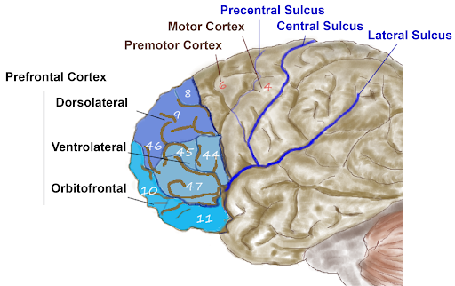
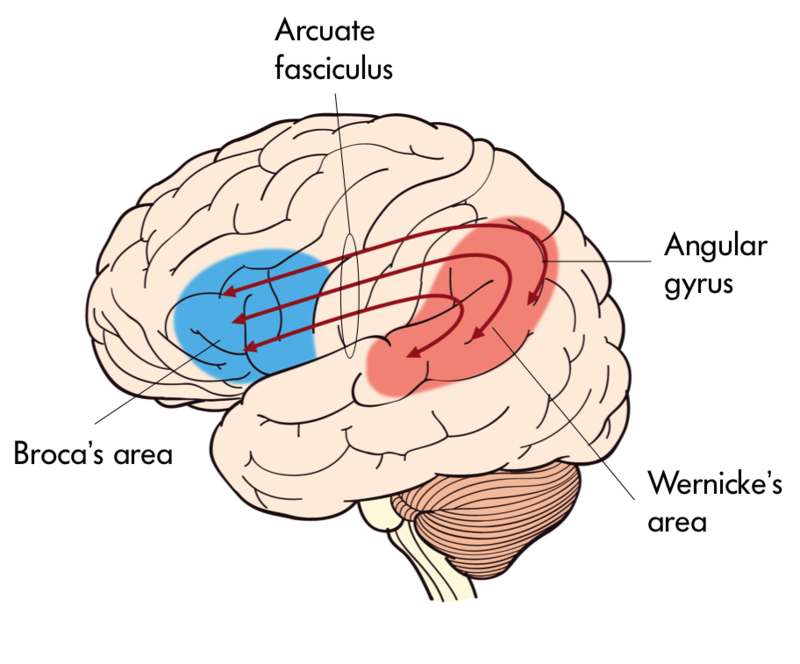
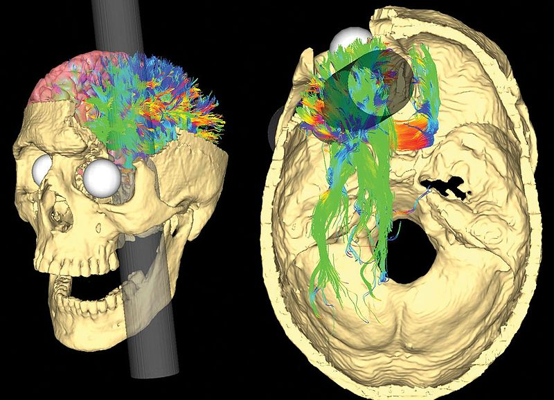

# Thùy trán, não trái và não phải

## Tóm tắt

Hai người bạn cãi nhau: một người nói "mình thiên về não trái nên giỏi toán", người kia nói "mình thiên về não phải nên vẽ đẹp". Câu đó đúng hay sai? Bài này trả lời bằng hai nửa. Nửa thứ nhất là thùy trán (frontal lobe), phần phía trước của vỏ não: nó điều khiển cử động, góp phần tạo ra lời nói, và ở phần trước nhất, gọi là vỏ não trước trán (prefrontal cortex), nó giữ mục tiêu, kìm hành động bốc đồng và đổi cách làm khi hoàn cảnh đổi [S1] [S2] [S8]. Nửa thứ hai là hai bán cầu não (cerebral hemispheres), trái và phải, nối với nhau bằng thể chai (corpus callosum): chúng thật sự chuyên biệt hóa, nhưng theo từng chức năng chứ không theo từng con người [S3] [S4].

Mỗi khẳng định mang một nhãn. **Giáo khoa** là điều giáo trình hoặc nguồn tổng quan trình bày như kiến thức đã được chấp nhận. **Giả thuyết** là đề xuất có nguồn, ghi rõ ai đề xuất, còn đang được thử và tranh luận. **Suy luận của người viết** là phần người viết tự nối các ý, không gắn nguồn như thể nguồn đã nói. Kết quả từ động vật được ghi rõ khi có. Những vùng thuộc bài khác chỉ được nhắc một dòng rồi dẫn: thùy thái dương, đỉnh, chẩm và vùng Wernicke (L08); hạnh nhân, hải mã, hạch nền, đồi thị (L07); hệ thưởng và căng thẳng (L05); vỏ não trước trán điều chỉnh cảm xúc (L09).

## Thùy trán và vỏ não trước trán

Vỏ não (cerebral cortex) là một lớp mỏng các nơron bao quanh mỗi bán cầu, và nó được gấp nhiều nếp để nhét vừa trong hộp sọ. Các nếp gấp lớn dùng làm mốc để chia vỏ não thành bốn thùy. Rãnh trung tâm (central sulcus) là ranh giới giữa thùy trán và thùy đỉnh; rãnh bên (lateral sulcus) tách thùy thái dương khỏi thùy trán và thùy đỉnh [S1]. Thùy trán là phần nằm ở phía trước, trước rãnh trung tâm và trên rãnh bên (giáo khoa).

Theo giáo trình, thùy trán tham gia lập kế hoạch và thực hiện cử động, cùng các quá trình nhận thức bậc cao như chú ý, ngôn ngữ, lý luận, giải quyết vấn đề và tư duy trừu tượng [S1]. Nó không phải một khối đồng nhất mà gồm các vùng con làm việc khác nhau. Ở phía sau, sát rãnh trung tâm, là vỏ não vận động sơ cấp (primary motor cortex) trên hồi trước trung tâm (precentral gyrus). Phía trước nó là vỏ tiền vận động (premotor cortex) và vùng mắt trước trán (frontal eye fields). Phía trước nữa mới là vỏ não trước trán [S1].

Có hai khái niệm rất hay bị gộp làm một. **Thùy trán** là cả vùng từ rãnh trung tâm ra phía trước, gồm cả vùng vận động. **Vỏ não trước trán** chỉ là phần trước nhất của thùy trán, nằm phía trước vùng vận động và tiền vận động [S1]. Các nghiên cứu về "kiểm soát" mà bài này dẫn chủ yếu nói về vỏ não trước trán, không phải về cả thùy trán [S2].

*Vỏ não trước trán (màu xanh) và các vùng con. Nhãn tiếng Anh: dorsolateral (lưng bên), ventrolateral (bụng bên), orbitofrontal (ổ mắt), premotor cortex (vỏ tiền vận động), motor cortex (vỏ vận động); các số là vùng Brodmann (Brodmann area, BA). Nguồn hình: Wikipedia, CC BY-SA, chỉnh bởi Hove & Martinez; Hove & Martinez, Hình 15 (chương 2). https://rotel.pressbooks.pub/biologicalpsychology/chapter/the-brain/ [S1]*

**Thẻ hồ sơ: thùy trán.** Ở đâu: phía trước rãnh trung tâm [S1]. Gồm: vỏ vận động sơ cấp, vỏ tiền vận động, vùng mắt trước trán, vỏ não trước trán (có vùng Broca) [S1]. Vai trò chính: vận động, kế hoạch, nhận thức bậc cao (giáo khoa) [S1]. Khi tổn thương: giáo trình nêu thay đổi tính cách, nhận thức, học tập, ra quyết định, đánh giá rủi ro, ức chế hành vi và hành vi xã hội, tùy vị trí và mức lan rộng [S1]. Kết nối: một đường dopamine đi từ vùng mái bụng (VTA) lên vỏ não trước trán, liên quan đến chú ý và lập kế hoạch (xem L00). Đừng hiểu nhầm: "thùy trán là phần làm nên con người" là nói quá. Giáo trình chỉ nói các vùng trước trán lớn hơn nhiều và được tổ chức lại ở người so với các loài, nhất là loài xa về tiến hóa [S1].

Một quy ước đại khái (giáo khoa): vùng càng ở phía trước càng gắn với nhận thức "bậc cao" [S1].

## Vỏ não vận động và vùng Broca

**Vỏ não vận động sơ cấp (giáo khoa).** Các nơron ở hồi trước trung tâm gửi lệnh xuống tủy sống để cơ vân co lại. Các vùng nhỏ của dải vỏ này ứng với các nhóm cơ khác nhau theo thứ tự có trật tự, gọi là bản đồ vận động. Bộ phận cần điều khiển tinh tế như ngón tay, môi và lưỡi chiếm "diện tích" lớn hơn nhiều so với vai hay thân [S1]. Bản đồ này thường được vẽ thành hình người tí hon méo mó gọi là homunculus; tên đó là thuật ngữ thông dụng người viết thêm, không phải điều giáo trình ghi cho vùng vận động.

*Vỏ vận động sơ cấp nằm trên hồi trước trung tâm, ngay trước rãnh trung tâm. Các nhãn chỉ nhóm cơ: Digit (ngón), Lips (môi), Tongue (lưỡi), Jaw (hàm)... Môi và các ngón chiếm dải vỏ rộng. Nguồn hình: Noba, giấy phép theo sách CC BY-NC-SA; Hove & Martinez, Hình 14 (chương 2). https://rotel.pressbooks.pub/biologicalpsychology/chapter/the-brain/ [S1]*

**Vỏ tiền vận động và vùng mắt trước trán (giáo khoa).** Vùng tiền vận động tham gia lập kế hoạch cử động; vùng mắt trước trán tham gia điều khiển cử động mắt và chú ý thị giác [S1]. Bản đồ vị trí cơ thể và vật trong không gian ở thùy đỉnh được gửi tới các vùng vận động ở thùy trán và tới vùng mắt trước trán [S1] (thùy đỉnh ở L08). Chuỗi "ý định, kế hoạch, lệnh, cơ" ở slide là cách đơn giản hóa của người viết, không phải sơ đồ giải phẫu đầy đủ.

**Vùng Broca (giáo khoa).** Nằm ở phần dưới của vỏ não trước trán, thường ở bên trái, vùng Broca (Broca's area) liên quan đến việc tạo ra lời nói. Tên vùng này đặt theo Paul Broca, bác sĩ người Pháp, người năm 1861 ghi nhận rằng tổn thương ở đây làm hỏng khả năng nói. Trên hình vỏ não, vùng này ứng với vùng Brodmann 44 và 45 [S1] [S7].

Bệnh nhân nổi tiếng nhất của Broca được gọi là "Tan", vì ông chỉ lặp lại được một âm tiết "tan". Sau khi ông mất, Broca thấy một tổn thương lớn ở thùy trán trái; một bệnh nhân khác cũng không nói trôi chảy và cũng tổn thương đúng phần đó. Broca suy ra việc tạo lời nói nằm ở vùng dưới của thùy trán trái [S7]. Giáo trình mô tả họ là "aphasic", tức mất ngôn ngữ; cụm "chứng mất ngôn ngữ biểu đạt" (Broca's aphasia) là cách gọi quen thuộc người viết dùng cho dạng mất khả năng nói trôi chảy này.

*Bộ não của bệnh nhân "Tan" (Louis Victor Leborgne) được lưu giữ trong lọ ở Paris; tổn thương ở thùy trán trái. Nguồn hình: Wikimedia, CC BY-SA, theo Hove & Martinez, Hình 2 (chương 4). https://rotel.pressbooks.pub/biologicalpsychology/chapter/historical-methods-studies-of-brain-damage-in-humans/ [S7]*

Cùng thời, bác sĩ người Đức Carl Wernicke thấy tổn thương ở thùy thái dương trên trái gắn với việc hiểu lời nói kém. Hai phát hiện thành một "phân ly kép" (double dissociation): tổn thương ở hai chỗ gây hai loại khiếm khuyết khác nhau. Mẹo nhớ của giáo trình: BROca là PROduction (tạo lời) ở FROntal; WERnicke là PERception (hiểu lời) ở thùy thái dương [S7]. Vùng Wernicke thuộc L08; hai vùng nối nhau bằng bó chất trắng gọi là bó cung (arcuate fasciculus) [S1].

*Vùng Broca ở thùy trán trái, vùng Wernicke ở thùy thái dương trên, và bó cung nối hai vùng. Nhãn tiếng Anh: Broca's area, Wernicke's area, angular gyrus (hồi góc). Nguồn hình: Noba, giấy phép theo sách CC BY-NC-SA; Hove & Martinez, Hình 16 (chương 2). https://rotel.pressbooks.pub/biologicalpsychology/chapter/the-brain/ [S1]*

**Điều sách nói và điều là suy luận.** Sách nói: vùng này "liên quan đến" việc tạo lời nói, và bệnh nhân của Broca có tổn thương ở đó [S1] [S7]. Giáo trình cũng nhắc rằng tổn thương ở người là riêng của từng bệnh nhân nên khó khái quát, và hiếm khi gói trong một vùng nên khó tách vai trò từng cấu trúc [S7]. Vì vậy bài dừng ở câu "vùng Broca tham gia tạo lời nói"; nói nó là nơi duy nhất sinh ra lời nói sẽ là suy luận vượt quá các nguồn đã đọc.

## Vỏ não trước trán làm gì

Giáo trình chia vỏ não trước trán thành các vùng con. Vùng lưng bên (dorsolateral PFC) liên quan đến bộ nhớ làm việc, lập kế hoạch, ức chế phản ứng và linh hoạt nhận thức. Vùng ổ mắt (orbitofrontal cortex) ở tận phía trước, gần hốc mắt, liên quan đến ra quyết định phức tạp, mã hóa giá trị, cảm xúc, tính xã hội và dự đoán hậu quả hành động. Vùng Broca nằm ở phần dưới [S1]. Giáo trình dùng chữ "liên quan đến" chứ không viết "là nơi của" (giáo khoa, ở mức nhãn vùng).

**Giả thuyết kiểm soát nhận thức.** Earl Miller và Jonathan Cohen (2001) đề xuất rằng vỏ não trước trán giữ chủ động các mẫu hoạt động biểu diễn mục tiêu và phương tiện để đạt mục tiêu. Các mẫu đó gửi tín hiệu thiên lệch (bias signals) tới những cấu trúc não khác, dẫn dòng hoạt động theo những đường thần kinh nối đúng giữa đầu vào, trạng thái bên trong và đầu ra mà nhiệm vụ cần. Năng lực này họ gọi là kiểm soát nhận thức (cognitive control) [S2]. Mức chắc chắn: **giả thuyết** do chính họ đề xuất; họ dẫn các nghiên cứu sinh lý thần kinh, hình ảnh học và mô hình tính toán ủng hộ, nhưng đó là một lý thuyết, không phải mô tả mọi người đã đồng ý. Người viết chỉ đọc tóm tắt bài này nên không dẫn thí nghiệm nào trong đó [S2].

Ví dụ của người viết: điện thoại rung khi bạn đang học; khả năng nhớ "mình đang học để làm gì" và đưa sự chú ý trở lại là loại hoạt động mà lý thuyết này nói đến. Ví von "người điều phối trong nhóm, không tự làm mọi việc nhưng quyết định ai làm gì lúc nào" cũng là hình ảnh của người viết; "trung tâm điều hành" chỉ là cách ví von, thuật ngữ trong nghiên cứu là kiểm soát nhận thức hay chức năng điều hành.

**Thẻ hồ sơ: vỏ não trước trán.** Ở đâu: phần trước nhất của thùy trán [S1]. Gồm: vùng lưng bên, vùng ổ mắt, vùng dưới có vùng Broca [S1]. Vai trò chính: chức năng điều hành và nhận thức bậc cao (giáo khoa); cơ chế "tín hiệu thiên lệch" là giả thuyết [S1] [S2]. Kết nối: nhận đường dopamine từ VTA (L00); nối với mạch cảm xúc và mạch sợ (L09). Khi tổn thương: đổi tính cách, nhận thức, quyết định, ức chế hành vi, xã hội [S1]. Đừng hiểu nhầm: không có "một vùng một việc"; cùng một vùng con tham gia nhiều chức năng, và một chức năng cần nhiều vùng (xem L09).

## Chức năng điều hành: bộ nhớ làm việc, ức chế, linh hoạt

Chức năng điều hành (executive functions, EF) là tên chung cho nhóm năng lực giúp ta "chơi" với ý nghĩ trong đầu, nghĩ trước khi làm, đáp ứng thử thách mới, cưỡng lại cám dỗ và giữ tập trung. Adele Diamond (2013), trong bài tổng quan ở *Annual Review of Psychology*, nêu ba chức năng lõi [S8]:

1. **Ức chế (inhibition):** gồm ức chế phản ứng, tức tự kiểm soát để không hành động bốc đồng, và kiểm soát nhiễu, tức chú ý chọn lọc và ức chế nhận thức.
2. **Bộ nhớ làm việc (working memory):** giữ và xử lý thông tin trong đầu một lúc ngắn.
3. **Linh hoạt nhận thức (cognitive flexibility):** nhìn một việc từ góc khác và đổi cách làm khi hoàn cảnh đổi.

Lời giải thích đời thường ở từng ý là của người viết; điều [S8] nêu là tên ba chức năng và các ý trong ngoặc của ức chế.

Mức chắc chắn: **cách phân loại phổ biến**, kèm lưu ý của chính Diamond rằng còn tranh luận, ví dụ về quan hệ giữa chức năng điều hành với trí thông minh linh hoạt, hay giữa bộ nhớ làm việc với ức chế [S8]. "Ức chế, trí nhớ làm việc, linh hoạt" là cách chia thuận tiện để nói, không phải ba ngăn vẽ sẵn trong não.

**Chúng có tách nhau thật không?** Akira Miyake và cộng sự (2000) cho 137 sinh viên đại học làm các bài đơn giản đo chuyển đổi (shifting), cập nhật (updating) và ức chế, cùng vài nhiệm vụ "kiểu thùy trán" như Wisconsin Card Sorting Test, Tháp Hà Nội, sinh số ngẫu nhiên và bài đo trí nhớ làm việc. Ba chức năng tương quan vừa phải nhưng tách biệt rõ. Bài phân loại thẻ liên quan nhất đến chuyển đổi, Tháp Hà Nội đến ức chế, sinh số ngẫu nhiên đến ức chế và cập nhật, bài trí nhớ làm việc đến cập nhật; làm hai việc cùng lúc không liên quan đến cả ba [S9]. Tác giả kết luận cần nhìn cả "thống nhất lẫn đa dạng" [S9]. Giới hạn: mẫu là sinh viên đại học; người viết chỉ đọc tóm tắt.

Giáo trình gắn vùng lưng bên với bộ nhớ làm việc, lập kế hoạch, ức chế phản ứng và linh hoạt nhận thức [S1]. Đọc câu này dè dặt: các nguồn chỉ nói vùng đó **liên quan** đến những việc ấy, không nguồn nào nói mỗi chức năng "nằm" trong một vùng riêng. Chức năng điều hành là một mô hình để mô tả và đo hành vi; giả thuyết của Miller và Cohen là một cách giải thích cách vỏ não trước trán thực hiện nó [S2] [S8]. Ngay mô hình ba chức năng cũng chỉ là một mô hình, vẫn còn tranh luận về cách tách và gọi tên (suy luận của người viết từ phần tranh luận Diamond nêu [S8]).

## Phineas Gage: chuyện nổi tiếng và phần còn tranh cãi

**Điều giáo trình kể.** Phineas Gage là công nhân đường sắt đặt thuốc nổ. Tia lửa làm thuốc nổ nổ sớm, thanh sắt dài khoảng một mét bắn qua mặt ông, đi sau mắt trái, ra ở đỉnh đầu và rơi xa chừng 80 feet. Ông sống sót, mất một phần thùy trán trái nhưng không có khiếm khuyết rõ rệt về lời nói, vận động, trí nhớ hay trí thông minh; giáo trình ghi ông sống thêm 12 năm. Tính cách ông đổi hẳn: từ có trách nhiệm, hòa nhập xã hội thành thô lỗ, bốc đồng, không theo phép tắc và khó thực hiện kế hoạch [S7].

*Mô phỏng bằng máy tính đường đi của thanh sắt qua hộp sọ của Phineas Gage; màu sắc là các bó sợi chất trắng có thể bị cắt. Đây là tái dựng ước đoán, không phải ảnh chụp não của ông. Nguồn hình: Van Horn JD và cộng sự, CC BY 2.5, Wikimedia Commons; qua Hove & Martinez, Hình 1 (chương 4). https://rotel.pressbooks.pub/biologicalpsychology/chapter/historical-methods-studies-of-brain-damage-in-humans/ [S7]*

**Điều Macmillan đã kiểm.** Malcolm Macmillan, tác giả cuốn *An Odd Kind of Fame* (2000), viết năm 2008 trên *The Psychologist* rằng phần nhiều điều viết về Gage là sai. Theo ông, nguồn gốc đáng tin chỉ có bốn: báo cáo của bác sĩ John Harlow năm 1848, của Henry Bigelow năm 1850, của Harlow năm 1868 và của J. B. S. Jackson năm 1870; điều không đến từ các nguồn này hoặc nguồn có tài liệu tương tự thì không phải sự thật đã biết về Gage [S5]. Các mốc ông ghi:

- Tai nạn xảy ra chiều thứ Tư, 13/9/1848. Thanh sắt vào dưới xương gò má trái, xuyên nền sọ sau hốc mắt trái, ra ở đỉnh sọ, hơi phía trước và lệch trái so với điểm bregma [S5].
- Báo cáo 1848 của Harlow và báo cáo 1850 của Bigelow không nêu cụ thể thay đổi tâm lý; một ghi chép riêng năm 1849 của Jackson có nhắc trí nhớ suy giảm. Chỉ đến báo cáo 1868 của Harlow mới có mô tả rõ, như "irreverent" (bất kính) và "no longer Gage" (không còn là Gage) [S5].
- Không có khám nghiệm tử thi. Gage mất ngày 21/5/1860 sau một loạt cơn co giật; chỉ còn hộp sọ, não không còn, nên hộp sọ là cứ liệu duy nhất để suy ra tổn thương [S5].
- Harlow ghi năm mất là 1861, nhưng hồ sơ nhà tang lễ cho thấy là 1860; giáo trình ghi 12 năm sống sót, Macmillan tính 11 năm rưỡi [S5] [S7]. Khác biệt nhỏ, nhưng cho thấy các con số quen thuộc cũng cần kiểm.

**Phần hậu thế thêm vào chưa có chứng cứ.** Macmillan mô tả bức tranh phổ biến ngày nay: một Gage trước tai nạn hiền lành, được quý mến, sau tai nạn thành kẻ nát rượu, hung hăng, lang thang trưng bày bản thân và chết nghèo. Ông cho rằng ở phần sau tai nạn, bức tranh ấy "hầu như không nhận ra" so với ghi chép gốc; một số chi tiết, như thay đổi về tình dục, không có trong nguồn nào [S5]. Ông chỉ ra rằng Gage làm khoảng 18 tháng cho một chủ tiệm xe ngựa rồi lái xe ngựa nhiều năm ở Chile, việc đòi hỏi nhiều kỹ năng, khó khớp với hình ảnh một người bốc đồng, thiếu tin cậy suốt đời. Ông tự nói phần này mới là suy đoán từ ghi chép ít ỏi, đặt câu hỏi liệu công việc có cấu trúc ấy có giúp Gage hồi phục xã hội phần nào không, và nói cần thêm tư liệu mới biết [S5].

**Đường đi của thanh sắt cũng chưa chắc.** Harlow cho rằng thùy trán trái bị phá; nhóm Damasio (1994) dựng một hộp sọ "giống Gage" và đặt tổn thương lệch về phía phải và phía trước hơn các ước tính trước; Ratiu và cộng sự (2004), dùng CT lát mỏng trên chính hộp sọ, cho rằng tổn thương ở thùy trán trái, gần như Harlow nói [S5]. Giáo trình dùng một tái dựng khác (Van Horn và cộng sự) để vẽ các bó chất trắng có thể bị cắt [S7]. Mức tổn thương chính xác vì thế vẫn là điều được suy ra, chưa chắc chắn (theo [S5]).

**Bài học rút ra.** Giáo trình dùng Gage làm ví dụ cổ điển rằng tổn thương trước trán có thể liên quan đến đổi hành vi [S7]; Macmillan cho rằng Gage nên được nhớ là trường hợp đầu tiên được báo cáo mà tổn thương não làm đổi tính cách, còn mức hồi phục có thể còn chờ khám phá [S5]. Giáo trình thêm giới hạn chung của nghiên cứu tổn thương: mỗi ca là riêng, và tổn thương hiếm khi chỉ ở một vùng [S7]. Suy luận của người viết: một câu chuyện cũ kể đi kể lại cần được kiểm lại bằng nguồn gốc trước khi tin hoàn toàn.

## Kiểm soát bản thân: cái phanh của não

Sức hút của phần thưởng (L00, L05), cảm xúc mạnh (L07, L09) và thói quen đều có thể kéo ta đi một hướng. Cách nghĩ phổ biến là vỏ não trước trán giúp điều chỉnh các hệ này theo mục tiêu dài hạn thay vì cám dỗ trước mắt [S2] [S8]. "Cái phanh" chỉ là ẩn dụ, và chỉ là một phần của bức tranh: Diamond xếp ức chế phản ứng, tức tự kiểm soát để cưỡng lại cám dỗ và không hành động bốc đồng, là một trong ba chức năng điều hành lõi [S8].

Một chuỗi minh họa do người viết dựng, rất đơn giản, dựa trên ý "tín hiệu thiên lệch" của Miller và Cohen [S2]: một cám dỗ xuất hiện; vỏ não trước trán so nó với mục tiêu đã đặt; rồi hoặc kìm hành động lại, hoặc cho phép. Đó là mô hình để dễ hiểu, không phải sơ đồ từng nơron, và không nguồn nào mô tả từng bước như vậy (suy luận của người viết).

**Khi "người điều phối" yếu đi.** Amy Arnsten (2009) tổng hợp rằng vỏ não trước trán, mà bà gọi là vùng tiến hóa nhất và đảm nhận các năng lực nhận thức cao nhất, cũng là vùng nhạy nhất với tác hại của căng thẳng. Căng thẳng cấp tính không kiểm soát được, dù khá nhẹ, có thể làm mất nhanh và rõ các năng lực nhận thức của vùng này; căng thẳng kéo dài gây thay đổi cấu trúc ở các nhánh (dendrite) của nơron trước trán. Bà cũng mô tả các đường truyền tín hiệu trong tế bào làm trung gian cho hiệu ứng ấy; khi các đường này mất ức chế thì có thể dẫn đến triệu chứng rối loạn trước trán nặng trong bệnh tâm thần [S6]. Mức chắc chắn: **tổng quan do một chuyên gia viết**; người viết chỉ đọc tóm tắt nên không biết kết quả nào đến từ người, kết quả nào từ động vật.

Diamond (2013) cũng nêu rằng căng thẳng, thiếu ngủ, cô đơn hay thiếu vận động đều làm yếu chức năng điều hành, và bài có bàn việc rèn luyện chức năng này [S8]. Suy luận của người viết: đó có thể là một lý do nhiều người khó tự kiểm soát khi căng thẳng hay mất ngủ. Bài không đưa lời khuyên rèn luyện vì người viết chưa đọc đủ để nói cách nào chắc chắn hiệu quả; căng thẳng gặp lại ở L05, cảm xúc ở L09.

## Hai bán cầu và thể chai

Một rãnh lớn chạy dọc giữa não, gọi là khe dọc (longitudinal fissure), tách não thành hai bán cầu trái và phải. Hai bán cầu nối với nhau bằng thể chai, một bó chất trắng lớn truyền thông tin giữa hai bên. Giáo trình mô tả hai bán cầu đối xứng về cấu trúc và thường có chức năng chồng lấn, dư thừa, nhưng có một mức chuyên biệt hóa (lateralization): một số chức năng được xử lý nhiều ở một bên hơn bên kia. Ví dụ, tín hiệu chạm và lệnh vận động của mỗi nửa cơ thể được xử lý ở bán cầu bên đối diện (đối bên, contralateral), và ngôn ngữ ở đa số người được xử lý nhiều hơn ở bán cầu trái [S1] (giáo khoa).

**Thẻ hồ sơ: thể chai.** Là gì và làm gì: bó chất trắng lớn nối hai bán cầu, truyền thông tin giữa hai bên [S1]. Bằng chứng chính: các nghiên cứu "não tách đôi" (split-brain) ở bệnh nhân bị cắt thể chai, do Roger Sperry, Joseph Bogen và Michael Gazzaniga mở đầu 45 năm trước bài viết 2005 của Gazzaniga; chúng cho nhiều hiểu biết về chuyên biệt hóa và hợp nhất giữa hai bán cầu, về tính đặc hiệu theo vùng của thể chai, và về vai trò tích hợp của nó trong nhận thức quan hệ nhân quả và cảm giác về một bản thân thống nhất [S3]. Đừng hiểu nhầm: "não tách đôi" là tình huống đặc biệt sau phẫu thuật; trong não bình thường hai bên không làm việc tách rời mà thông tin đi lại liên tục qua thể chai [S1] [S3].

Về bối cảnh: một số bệnh nhân từng được cắt thể chai để giảm cơn động kinh nặng. Đây là kiến thức nền người viết thêm; các nguồn đã đọc không nêu chi tiết lâm sàng này, nên bài không dẫn thí nghiệm cụ thể nào của nhóm Sperry. Điều tóm tắt của Gazzaniga cho biết là hướng đi chung: tách hai bán cầu cho phép thử riêng từng bên, kết quả là chuyên biệt hóa có thật và thể chai có vai trò tích hợp [S3].

## Chuyên biệt hóa có thật, nhưng ở từng chức năng

Năm 2013, Jared Nielsen và cộng sự phân tích ảnh cộng hưởng từ chức năng (functional MRI, fMRI) lúc nghỉ của 1.011 người từ 7 đến 29 tuổi, lấy từ các bộ dữ liệu công khai. Với mỗi người, họ đo mức nghiêng trái hay phải (lateralization) của kết nối chức năng giữa các cặp trong 7.266 vùng phủ chất xám, bằng cách so tương quan trước và sau khi lật ảnh qua mặt phẳng giữa, và hiệu chỉnh theo chênh lệch mật độ chất xám giữa hai bên để giảm ảnh hưởng của khác biệt cấu trúc [S4].

Kết quả là có 9 "nút" (hub) nghiêng trái và 11 nút nghiêng phải. Nút nghiêng trái gồm các vùng của mạng mặc định (default mode network): vỏ trước trán giữa, vỏ đai sau và chỗ nối thái dương - đỉnh, cùng các vùng ngôn ngữ như vùng Broca và vùng Wernicke. Nút nghiêng phải gồm các vùng của mạng kiểm soát chú ý, ví dụ: rãnh trong đỉnh bên, đảo trước, vùng MT và vùng mắt trước trán [S4]. Tóm gọn:

| Chức năng | Thường nghiêng về |
|---|---|
| Ngôn ngữ (vùng Broca, vùng Wernicke) và mạng mặc định | bán cầu trái |
| Mạng kiểm soát chú ý | bán cầu phải |

"Nghiêng trái" nghĩa là kết nối của mạng đó mạnh hơn ở bên trái. Mức chắc chắn: **kết quả của một nghiên cứu hình ảnh học trên mẫu lớn**, bằng chứng tốt nhưng chưa phải lời cuối; riêng ngôn ngữ nghiêng trái thì khớp với giáo trình [S1] [S4]. Các nút nghiêng trái và nghiêng phải lập thành hai mạng tách nhau, mỗi mạng gồm những vùng cùng nghiêng một phía [S4].

Câu hỏi then chốt: người có nút nghiêng trái mạnh ở mạng này thì có nghiêng trái mạnh ở mạng khác không? Các kết nối chỉ gồm nút nghiêng trái (hoặc chỉ nghiêng phải) có tương quan dương giữa các người, **nhưng chỉ khi các kết nối đó chung một nút**. Tác giả kết luận: nghiêng của kết nối là đặc tính cục bộ chứ không phải toàn cục của mạng não, và dữ liệu không phù hợp với một "kiểu hình toàn não" thiên trái hay thiên phải ở từng người. Mức nghiêng tăng nhẹ theo tuổi và không khác biệt theo giới [S4].

## Vì sao "người não trái, người não phải" là hiểu lầm

Ý niệm này có hai phần. "Mỗi bán cầu có chuyên môn riêng" là có thật, như đã thấy. "Mỗi người có một bán cầu trội quyết định tính cách hay cách học" là điều bài của Nielsen đã kiểm và không tìm thấy bằng chứng [S4]. Ba lý do nên nghi:

1. **Chuyên biệt hóa theo từng mạng, không theo cả con người.** Một người có thể nghiêng trái ở mạng này và nghiêng phải ở mạng khác [S4]; nghiêng mạnh ở một mạng không đảm bảo nghiêng mạnh ở mạng khác.
2. **Chức năng phức tạp cần cả hai bên.** Giáo trình nói chức năng của hai bán cầu thường chồng lấn, dư thừa; Gazzaniga nhấn mạnh vai trò hợp nhất của thể chai [S1] [S3]. Ví dụ của người viết: đọc truyện hay trò chuyện huy động nhiều mạng ở cả hai bên, từ nhận ra chữ đến hiểu ý.
3. **"Logic" và "sáng tạo" không phải chức năng được đo ở đây.** Nielsen và cộng sự đo mức nghiêng của kết nối giữa các vùng lúc nghỉ; trong các nguồn đã đọc, người viết không thấy phép đo "tính logic" hay "tính sáng tạo". Câu "toán là não trái, vẽ là não phải" vì thế không phải điều các nghiên cứu này nói (suy luận của người viết, dựa trên mô tả ở [S4]).

Trả lời hai người bạn ở đầu bài: mỗi người đúng một phần. Đúng ở mức vùng: ngôn ngữ nghiêng về bán cầu trái, mạng kiểm soát chú ý nghiêng về bán cầu phải [S4]. Sai ở mức con người: không có bằng chứng cho người "não trái" hay "não phải" [S4]. Vì sao một người giỏi toán hay vẽ đẹp cần nhiều yếu tố khác giải thích, và bài này không bàn.

## Điều cần nhớ

1. Thùy trán nằm trước rãnh trung tâm: vận động, kế hoạch, nhận thức bậc cao; vỏ não trước trán là phần trước nhất [S1].
2. Vỏ vận động sơ cấp có bản đồ cơ thể; vùng Broca, thường ở trái, liên quan đến tạo lời nói [S1] [S7].
3. Kiểm soát nhận thức là giả thuyết: vỏ não trước trán giữ mục tiêu và gửi tín hiệu thiên lệch [S2].
4. Chức năng điều hành (ức chế, bộ nhớ làm việc, linh hoạt) là một mô hình hữu ích, tách nhau vừa phải [S8] [S9].
5. Gage: nhiều chi tiết hậu thế kể không có trong ghi chép gốc [S5] [S7].
6. Căng thẳng có thể làm suy giảm vỏ não trước trán [S6]; hai bán cầu phối hợp qua thể chai [S1] [S3]; chuyên biệt hóa có thật theo từng chức năng, "người não trái / não phải" thì không có bằng chứng [S4].

Nối với bài khác: L07 và L09 xem hạnh nhân, hải mã, cảm xúc mà vỏ não trước trán điều chỉnh; L05 xem hệ thưởng và căng thẳng; L08 xem ba thùy còn lại.

## Nguồn tham khảo

- [S1] Hove & Martinez, Biological Psychology (Revised Edition), Chương 2 "The Brain and Nervous System", mục 2.6 (cấu trúc vỏ não, thùy trán, bán cầu, thể chai), ROTEL Pressbooks, sách: https://rotel.pressbooks.pub/biologicalpsychology/ chương: https://rotel.pressbooks.pub/biologicalpsychology/chapter/the-brain/
- [S2] Miller E. K., Cohen J. D., An integrative theory of prefrontal cortex function, Annual Review of Neuroscience, 2001 (đã đọc tóm tắt) https://doi.org/10.1146/annurev.neuro.24.1.167
- [S3] Gazzaniga M. S., Forty-five years of split-brain research and still going strong, Nature Reviews Neuroscience, 2005 (đã đọc tóm tắt) https://doi.org/10.1038/nrn1723
- [S4] Nielsen J. A. và cộng sự, An evaluation of the left-brain vs. right-brain hypothesis with resting state functional connectivity magnetic resonance imaging, PLOS ONE, 2013 (đã đọc tóm tắt) https://doi.org/10.1371/journal.pone.0071275
- [S5] Macmillan M., Phineas Gage – Unravelling the myth, The Psychologist, 2008 (đã đọc toàn bài; tác giả cũng viết An Odd Kind of Fame, MIT Press, 2000) https://bps.org.uk/psychologist/phineas-gage-unravelling-myth
- [S6] Arnsten A. F. T., Stress signalling pathways that impair prefrontal cortex structure and function, Nature Reviews Neuroscience, 2009 (đã đọc tóm tắt) https://doi.org/10.1038/nrn2648
- [S7] Hove & Martinez, Biological Psychology (Revised Edition), Chương 4 "Research Methods in Biological Psychology", mục 4.2 (nghiên cứu tổn thương não: Gage, Broca, Wernicke), ROTEL Pressbooks https://rotel.pressbooks.pub/biologicalpsychology/chapter/historical-methods-studies-of-brain-damage-in-humans/
- [S8] Diamond A., Executive functions, Annual Review of Psychology, 2013 (đã đọc tóm tắt) https://doi.org/10.1146/annurev-psych-113011-143750
- [S9] Miyake A. và cộng sự, The unity and diversity of executive functions and their contributions to complex "frontal lobe" tasks: a latent variable analysis, Cognitive Psychology, 2000 (đã đọc tóm tắt) https://doi.org/10.1006/cogp.1999.0734
