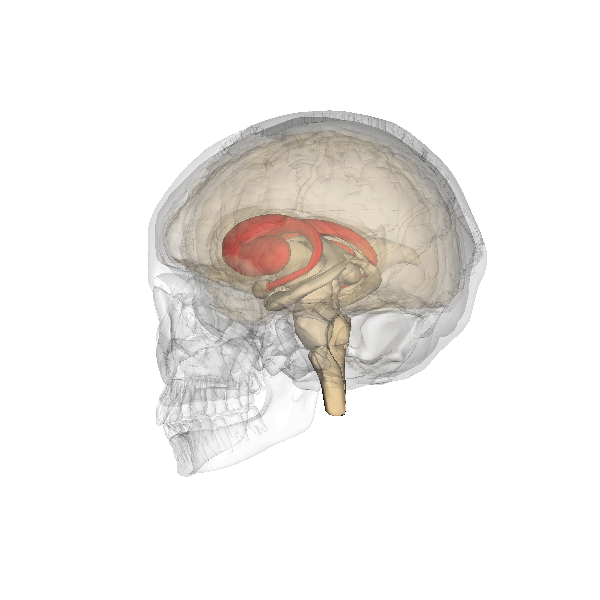
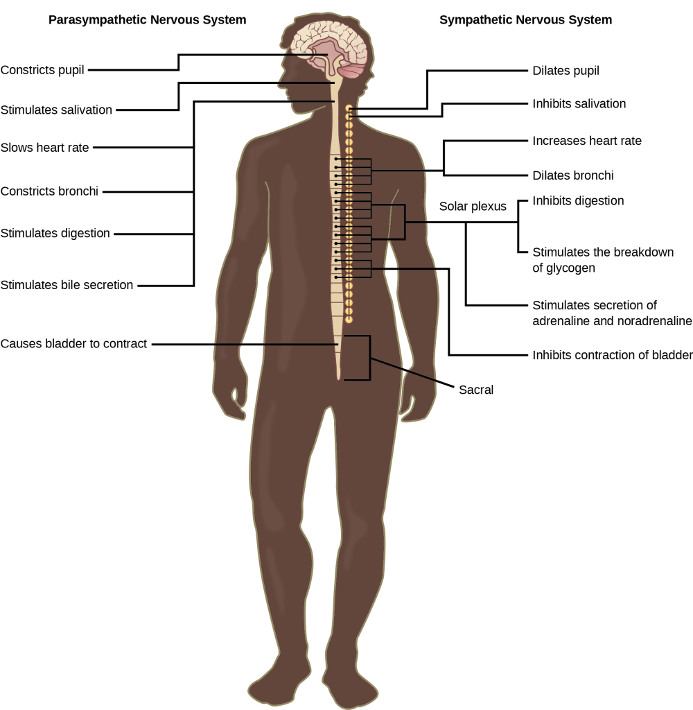

# Hệ thưởng, chú ý và căng thẳng

## Tóm tắt

Vì sao ta bị cuốn vào thứ không quan trọng? Bài này trả lời bằng ba hệ thống của não, mỗi hệ trả lời một câu hỏi riêng.

- **Hệ thưởng (reward system)** trả lời câu hỏi "thứ gì đáng theo đuổi?". Đó là một mạch gồm vỏ não trước trán, thể vân bụng (trong đó có
  nhân accumbens) và các nơron dopamine ở não giữa, nằm trong mạng lưới vỏ não – hạch nền [S12].
- **Chú ý (attention)** trả lời câu hỏi "nhìn vào đâu?". Có một hệ theo mục tiêu và một hệ bị kích thích nổi bật hoặc bất ngờ kéo đi [S13].
- **Phản ứng căng thẳng (stress response)** trả lời câu hỏi "cơ thể nên chuẩn bị thế nào?". Có đường thần kinh giao cảm và đường hormone qua trục
  dưới đồi – tuyến yên – thượng thận [S2] [S16].

Ba hệ không làm việc riêng rẽ. Tín hiệu thưởng có thể kéo chú ý [S14], căng thẳng làm đổi cách vỏ não trước trán điều khiển hành vi [S17], và
não là nơi quyết định điều gì đáng sợ, đáng căng thẳng [S15]. Bài đọc sau L10; các khái niệm đã có ở bài khác chỉ nhắc một dòng: ba đường
dopamine ở L00, hồ sơ dopamine và noradrenaline ở L03, cấu trúc hạnh nhân, hải mã, accumbens, vùng dưới đồi ở L07, vỏ não trước trán ở L04,
cảm xúc (gồm "thích" như một cảm xúc) ở L09, ghép cortisol với cảm xúc ở L10, thiết kế mạng xã hội ở L06.

Cách đọc nhãn mức chắc chắn trong bài: **Giáo khoa** là điều các nguồn tổng quan và giáo trình cùng nêu; **Đang tranh luận** là một quan điểm có
nguồn nhưng có người phản bác, bài nói rõ ai; **Suy luận của người viết** là điều người viết nối lại, không gắn [Sn] như thể nguồn đã nói;
**Ví dụ của người viết** là tình huống đời thường để dễ hình dung. Kết quả từ động vật được ghi rõ là từ động vật.

## Hệ thưởng: các vùng và đường dẫn

### Ở đâu: một mạch, không phải một điểm

Nhãn: **Giáo khoa.** Suzanne Haber và Brian Knutson tổng hợp giải phẫu ở khỉ và ảnh chụp não người, viết rằng nhiều vùng não có tế bào đáp ứng
với phần thưởng, nhưng trái tim của hệ thưởng là mạch vỏ não – hạch nền (cortico-basal ganglia circuit) [S12]. Các cấu trúc chính là vỏ vòng đai
trước (anterior cingulate cortex), vỏ trán ổ mắt (orbital prefrontal cortex), thể vân bụng (ventral striatum), cầu nhạt bụng (ventral pallidum)
và các nơron dopamine ở não giữa [S12]. Các vùng khác như vỏ trán lưng, hạnh nhân, hải mã, đồi thị, nhân cương bên (lateral habenula) và một
số nhân ở thân não (nhân cuống cầu, nhân raphe) là những thành phần điều chỉnh mạch [S12].

Vì sao người ta hay chỉ nói "VTA và accumbens"? Theo Haber và Knutson, từ thí nghiệm của Olds và Milner (chuột chịu bấm cần để được kích thích
điện vào một số điểm trong não), dựa trên các nghiên cứu tự kích thích, dược lý và sinh lý, nhân accumbens (nucleus accumbens) và các nơron
dopamine của vùng mái bụng (VTA, ventral tegmental area) được coi là trung tâm của mạch [S12]. Nghiên cứu về sau cho thấy vùng liên quan đến
thưởng rộng hơn: toàn bộ thể vân bụng, và cả nơron dopamine của liềm đen (substantia nigra) [S12].

Giáo trình *Biological Psychology* mô tả cùng hệ ấy dưới tên "ham muốn" (desire): các vùng của hệ gồm vùng dưới đồi bên, hạnh nhân, nhân accumbens
và vỏ não trán; dopamine từ các mạch trung não – viền (mesolimbic) và trung não – vỏ (mesocortical) kích hoạt các vùng này [S1]. Ba đường dopamine
đã được trình bày ở L00, cấu trúc của accumbens ở L07; ở đây chỉ cần biết accumbens là một phần của thể vân bụng.

### Gồm những phần nào: thể vân bụng và nhân accumbens

Thể vân (striatum) gồm nhân đuôi (caudate nucleus) và bèo sẫm (putamen); giáo trình nêu nó quan trọng cho trí nhớ thói quen (procedural memory)
và cho phần thưởng trong học tập [S3]. Ví dụ trong giáo trình: chuột học rẽ trái hoặc phải trong một mê lộ hình chữ T theo âm báo để được thức
ăn; chuột bị tổn thương thể vân làm kém bài này nhưng không kém các bài dựa vào loại trí nhớ khác [S3]. Đây là kết quả từ động vật.

*Thể vân (tô đỏ), gồm nhân đuôi và bèo sẫm, tham gia trí nhớ thói quen và học theo phần thưởng. Đây là một khung tĩnh lấy từ ảnh động của sách.
Nguồn hình: Wikipedia, giấy phép theo sách CC BY-SA; Hove & Martinez, Hình 8 (chương 8). [S3]*

Theo Haber và Knutson, ở người và khỉ thể vân bụng gồm nhân accumbens cộng với phần nối liền nhân đuôi và bèo sẫm ở phía bụng, cùng vài vùng nhỏ
lân cận; không có ranh giới mô học rõ giữa thể vân bụng và thể vân lưng, nên cách tốt nhất để định nghĩa nó là theo nguồn tín hiệu đi vào [S12].
Nhân accumbens chỉ là một phần nhỏ ở phía trong – bụng của thể vân trước [S12]. Một đặc điểm quan trọng: chỉ thể vân bụng nhận một bó tín hiệu
dày từ hạnh nhân và hải mã [S12].

### Tín hiệu đi thế nào: một vòng khép kín

Nhãn: **Giáo khoa** (giải phẫu chủ yếu từ khỉ). Thể vân bụng nhận tín hiệu vỏ não chính từ vỏ trán ổ mắt và vỏ vòng đai trước, và nhận một lượng
lớn dopamine từ não giữa [S12]. Thể vân bụng chiếu tới cầu nhạt bụng và tới VTA và liềm đen; các vùng này lại gửi tín hiệu trở về vỏ não trước
trán qua nhân lưng giữa (medial dorsal nucleus) của đồi thị [S12]. Như vậy mạch là một vòng: vỏ não → thể vân bụng → cầu nhạt bụng → đồi thị →
vỏ não, có dopamine điều chỉnh ở giữa.

Một ví dụ về chi tiết điều chỉnh: ở khỉ, tế bào nhân cương bên bị ức chế bởi dấu hiệu báo trước phần thưởng và phát xung khi có tín hiệu "không
có thưởng"; kích thích nhân này làm ức chế tế bào dopamine [S12]. Nói cách khác, hệ thưởng có cả một "bộ báo tin xấu".

Số lượng: Wolfram Schultz ước tính não người có khoảng một triệu nơron dopamine, khỉ khoảng 200.000 và chuột khoảng 20.000; sợi trục của chúng
tỏa tới thể vân, vỏ não trán, hạnh nhân và nhiều vùng khác [S9]. Ông cũng nêu khoảng một nửa số điểm mà kích thích điện khiến chuột tự bấm cần có
liên hệ với nơron dopamine [S9].

### Làm gì, và bằng chứng gì

Theo giáo trình, khi hệ ham muốn được kích hoạt, sinh vật tỏ ra hăng hái, quan tâm và tò mò, đi tìm thức ăn ngon, bạn tình và các kích thích dễ
chịu khác; dopamine trong hệ này tạo cảm giác hào hứng, có ý nghĩa và mong đợi [S1]. Phần lớn bằng chứng đến từ thí nghiệm kích thích não ở động
vật: đặt điện cực vào vùng dưới đồi bên, con vật chịu bấm cần để được kích thích [S1]. Các vùng này cũng nhạy với cocaine và amphetamine [S1].

*Giáo trình dùng ảnh này để nói rằng nhìn hình món ăn hấp dẫn làm tăng hoạt động vỏ não trán trái; nghiên cứu trên người và động vật cho thấy vỏ
trán trái hoạt động mạnh hơn vỏ trán phải khi ham muốn và quan tâm. Nguồn hình: Noba, giấy phép theo sách Public Domain; Hove & Martinez, Hình 3
(chương 10). [S1]*

Ở người, ảnh chụp chức năng (fMRI) cho thấy khi chờ một phần thưởng (tiền, vị ngon), nhân accumbens và não giữa cùng hoạt động; khi phần thưởng đến,
các phần khác của thể vân (nhân đuôi trong, bèo sẫm) được huy động [S12]. Haber và Knutson nêu bằng chứng rằng hoạt động chờ đợi ở accumbens có thể
dự đoán hành vi tiến tới, còn hoạt động ở vỏ đảo dự đoán hành vi né tránh, trong các tình huống chấp nhận rủi ro tài chính, cờ bạc và mua hàng [S12].

### Đừng hiểu nhầm

- **"Hệ thưởng chỉ là ham muốn."** Haber và Knutson viết rằng để thắng một ván bài, ham muốn là chưa đủ: phải hiểu luật, nhớ quân đã ra, và kìm
  được ý muốn đánh quá sớm; phần thưởng không làm việc một mình mà nối với các mạch nhận thức và vận động [S12].
- **"Accumbens là trung tâm khoái cảm."** Accumbens là một phần nhỏ của một mạch lớn [S12], và các nhà nghiên cứu "thích" chỉ ra rằng, ở chuột, phần lớn
  accumbens không làm tăng khoái cảm khi được kích thích (chi tiết ở L09) [S11].
- **"Dopamine là hormone hạnh phúc."** Đây là cách nói sai; dopamine chủ yếu là chất dẫn truyền (L03), và vai trò của nó trong khoái cảm đang bị
  nghi ngờ (mục "Muốn khác thích").

## Sai số dự đoán phần thưởng

### Định nghĩa

Sai số dự đoán phần thưởng (reward prediction error) là hiệu giữa phần thưởng nhận được và phần thưởng đã dự đoán [S9]. Phần thưởng tốt hơn dự
đoán cho sai số dương, đúng như dự đoán cho sai số bằng không, kém hơn dự đoán cho sai số âm [S9]. "Sai số" ở đây không có nghĩa ai đó làm sai;
nó chỉ là độ chênh [S9].

Schultz mở bài tổng quan năm 2016 bằng chính trải nghiệm của ông, tóm tắt như sau. Đứng trước một máy bán nước ở Nhật mà không đọc được chữ, ông
bấm đại một nút và lon ra đúng loại ông thích: một bất ngờ dễ chịu, tức sai số dương, và lần sau ông bấm lại nút đó [S9]. Bấm mãi ra cùng một lon
thì không còn bất ngờ, không còn gì để học [S9]. Vài tuần sau nút ấy ra lon khác: một bất ngờ khó chịu, tức sai số âm, và ông phải thử nút khác [S9].

### Thí nghiệm: ba trường hợp

Nhãn: **Giáo khoa** về hiện tượng (lặp lại ở nhiều loài); cách giải thích ý nghĩa thì xem mục "Muốn khác thích".

Schultz, Peter Dayan và Read Montague (1997) tổng hợp các ghi điện từ nơron dopamine ở khỉ (động vật linh trưởng) và nêu rằng tín hiệu dao động của
chúng dường như báo hiệu thay đổi hoặc sai số trong dự đoán các sự kiện có thưởng sắp đến [S7]. Bài tổng quan năm 2016 của Schultz mô tả ba trường
hợp, đo tại thời điểm phần thưởng, với hình gốc lấy từ bài năm 1997 [S7] [S9]:

1. **Phần thưởng bất ngờ** (nhiều hơn dự đoán): nơron dopamine phát xung mạnh lên.
2. **Phần thưởng đã được báo trước** (đúng như dự đoán): không có đáp ứng thêm, hoạt động giữ ở mức nền.
3. **Phần thưởng đã báo mà không đến** (ít hơn dự đoán): hoạt động giảm xuống dưới mức nền.

Đáp ứng ấy còn **dời về trước**: khi một ánh đèn, hình hay âm thanh báo trước phần thưởng, đáp ứng chuyển sang thời điểm của dấu hiệu, và cuối cùng
sang dấu hiệu báo trước sớm nhất [S9]. Khoảng chờ giữa dấu hiệu và phần thưởng càng dài thì đáp ứng càng nhỏ, phù hợp với việc phần thưởng ở xa có
giá trị chủ quan thấp hơn (giảm giá theo thời gian, temporal discounting) [S9]. Các đáp ứng này có ở khỉ, và cũng được tìm thấy ở nơron dopamine của
người và loài gặm nhấm [S9].

### Vì sao quan trọng cho học tập

Nhãn: **Giáo khoa** về mô hình; **Đang tranh luận** về việc dopamine có thật là "tín hiệu dạy" hay không.

Học tập dựa trên sai số dự đoán: sai số dương khiến ta làm lại hành vi vừa đem đến phần thưởng; sai số âm khiến ta tránh; không có sai số thì không
đổi hành vi, không học thêm [S9]. Đáp ứng của dopamine khớp khá tốt với các mô hình học tính toán như mô hình Rescorla–Wagner và học sai biệt thời
gian (temporal difference learning) [S9]. Từ đó Schultz đề xuất tín hiệu sai số của dopamine có thể là một "tín hiệu dạy" tác động lên tính mềm dẻo
của nơron ở thể vân, vỏ não trán và hạnh nhân [S9]. Bài năm 1997 cũng nêu rằng các kết quả này có thể hiểu bằng các lý thuyết định lượng về điều khiển
thích nghi [S7].

Bài tổng quan năm 2000 của Schultz nhấn mạnh rằng, ở khỉ, chỉ một số ít cấu trúc não có nơron mang tín hiệu cụ thể về phần thưởng đã qua và sắp tới,
và đó là bước đầu để hiểu phần thưởng ảnh hưởng đến hành vi trước khi nhận được như thế nào [S8]. Năm 2016, ông nêu rằng thể vân, hạnh nhân và vỏ não
trán cũng có mã hóa sai số dự đoán, nhưng chỉ ở một phần nơron [S9].

### Hai chi tiết dễ bỏ sót

- **Đáp ứng có hai thành phần.** Schultz mô tả một thành phần đầu, không chọn lọc, xuất hiện với mọi kích thích nổi bật, kể cả kích thích trung tính
  hoặc khó chịu, rồi tắt sau vài chục đến vài trăm mili giây khi nơron nhận ra giá trị thật; sau đó mới là thành phần chỉ mang thông tin phần thưởng [S9].
  Ông cho rằng thành phần đầu có tính chất của chú ý và giúp xử lý thông tin thưởng phía sau [S9].
- **Ở người, ảnh chụp não không luôn thấy "sai số âm".** Haber và Knutson nêu rằng trong các nghiên cứu fMRI dùng nước quả và tiền, hoạt động ở não
  giữa không giảm rõ khi phần thưởng chờ đợi không đến; điều này phù hợp với tín hiệu dự đoán nhưng chưa chắc là tín hiệu sai số [S12]. Họ cũng nêu
  não giữa khó chụp (nhỏ, gần ranh giới mô và động mạch cảnh) [S12], nên chưa rõ đây là giới hạn của kỹ thuật hay khác biệt thật.

### Khi chất gây nghiện "chen ngang"

Nhãn: **Giáo khoa** rằng nhiều chất kích thích quá mức hệ dopamine; **Đang tranh luận** về cơ chế dẫn đến nghiện.

Schultz viết rằng cocaine, amphetamine, methamphetamine, nicotine và rượu kích thích quá mức cơ chế dopamine; vì thuốc tác động thẳng lên não qua
mạch máu và không được so với một dự đoán, nó giống một sai số dương kéo dài, điều mà dự đoán bình thường đã chặn lại [S9]. Ông cho rằng một số não
không chịu được sự kích thích quá mức này và trở nên nghiện [S9]. Một giải thích khác, của Berridge và Robinson, đặt trọng tâm vào "muốn" bị nhạy cảm
hóa (mục sau).

## Muốn khác thích

### Ba thành phần của một phần thưởng

Kent Berridge và Morten Kringelbach chia phần thưởng thành ba thành phần: **thích** (liking, phản ứng cốt lõi với khoái cảm), **muốn** (wanting, quá
trình động lực gọi là incentive salience, "sức hút của động cơ") và **học** (các liên hệ học được) [S11]. Ba thành phần có thể xảy ra cùng lúc, nhưng
"muốn" chiếm ưu thế ở pha tìm kiếm ban đầu, "thích" chiếm ưu thế ở pha tiêu thụ, còn học diễn ra suốt chu trình [S11].

Giáo trình nói rõ: mức ham muốn một phần thưởng không nhất thiết khớp với mức thích nó, và các cấu trúc thần kinh tạo ra sự thích khác với các cấu
trúc tạo ra ham muốn [S1]. Ở trẻ nhỏ và động vật, "thích" được đo bằng tốc độ liếm, kiểu đưa lưỡi và nét mặt vui khi nếm vị ngọt; "muốn" được đo bằng
mức sẵn sàng bỏ công để có phần thưởng [S1].

### Thí nghiệm then chốt (ở chuột)

Nhãn: **Đang tranh luận** (một quan điểm có bằng chứng mạnh, không phải đồng thuận).

Năm 1998, Berridge và Terry Robinson hỏi: dopamine tạo ra khoái cảm, hay giúp học dự đoán phần thưởng, hay làm việc khác? [S10] Họ làm giảm dopamine
ở nhân accumbens và thể vân của chuột tới 99% bằng chất độc 6-hydroxydopamine, rồi đo phản ứng nét mặt khi nếm [S10]. Chuột vẫn có phản ứng "thích"
với đường và "ghét" với quinine bình thường, vẫn học được giá trị khoái cảm mới (sau khi một vị bị ghép với khó chịu), và vẫn tăng khoái cảm khi được
cho thuốc không qua dopamine [S10]. Kết luận của họ: dopamine không cần cho khoái cảm, cũng không cần cho việc học các "thích" và "ghét" mới, mà quan
trọng hơn cho việc gán incentive salience, tức "muốn" [S10].

Năm 2015, Berridge và Kringelbach viết thêm: "muốn" được tạo bởi một hệ lớn và phân tán, còn "thích" do một tập nhỏ các "điểm nóng" khoái cảm trong
hệ viền tạo ra [S11]. Ở điểm nóng trong accumbens, kích thích dopamine làm tăng "muốn" ăn mà không làm tăng "thích" vị ngọt [S11]. Bản đồ các điểm
nóng và mạch "thích" là nội dung của L09.

### Tranh luận với ai

- **Giả thuyết "dopamine là khoái cảm"** (dopamine hedonia) do Roy Wise đưa ra năm 1980; theo Berridge và Kringelbach, đến giữa thập niên 1990 chính
  Wise đã rút lại, và ngày nay ít nhà nghiên cứu dopamine còn khẳng định dopamine gây khoái cảm [S11].
- **Giả thuyết "dopamine là tín hiệu dạy"** qua sai số dự đoán, của Schultz và cộng sự năm 1997, được Berridge và Kringelbach gọi là phương án thay
  thế chính [S11]. Họ nêu rằng trong thực tế rất khó tách việc học dự đoán khỏi động lực, vì giá trị học được và sức hút thường đi cùng nhau, và họ
  cho rằng nhiều thí nghiệm giữ trạng thái cơ thể cố định (ví dụ khỉ luôn hơi khát) nên chỉ còn việc học quyết định giá trị của dấu hiệu [S11].
  Họ cũng thừa nhận vấn đề vẫn đang được bàn và có thể sẽ đi đến đồng thuận rõ hơn [S11].

Suy luận của người viết: hai quan điểm không nhất thiết loại trừ nhau. Một tín hiệu vừa có thể giúp cập nhật dự đoán, vừa làm cho thứ được dự đoán
trở nên hấp dẫn; điều chưa rõ là phần nào là chính. Bài này không chọn phe.

### Muốn mà không thích: ví dụ và hiểu nhầm

Giáo trình dẫn rằng người nghiện thường vẫn thèm ma túy dù biết liều có sẵn sẽ không đem lại khoái cảm [S1]. Giả thuyết nhạy cảm hóa động cơ
(incentive-sensitization) của Robinson và Berridge (1993), theo Berridge và Kringelbach, cho rằng dùng lặp lại có thể làm hệ dopamine nhạy hơn ở một số
người, phóng đại "muốn" do dấu hiệu gợi ra, ngay cả khi thuốc đã bớt dễ chịu [S11]. Đây là giả thuyết, không phải kết luận đã đóng.

Ví dụ của người viết: bạn mở một ứng dụng lần thứ mười trong một giờ, và lần nào mở xong cũng không thấy vui hơn. Sức kéo trước khi mở ("muốn") và
cảm giác khi đã mở ("thích") là hai thứ khác nhau.

Đừng hiểu nhầm: "muốn" theo nghĩa incentive salience không đồng nghĩa với mong muốn có ý thức. Berridge và Kringelbach dùng dấu ngoặc ('wanting',
'liking') để chỉ các quá trình đo được, có thể có hoặc không đi kèm cảm giác chủ quan [S11].

## Chú ý: hệ theo mục tiêu và hệ theo kích thích

### Định nghĩa và hai hệ

Chú ý là việc não chọn một số thông tin để xử lý sâu hơn và bỏ qua phần còn lại. Brian Anderson và cộng sự mô tả chú ý ưu tiên kích thích theo hai
cách: tự nguyện, theo mục tiêu của tình huống (như tìm chìa khóa xe), và không tự nguyện, bị kéo bởi độ nổi bật vật lý (như quay về phía một tiếng
động đột ngột) [S14].

Nhãn: **Giáo khoa** về hai mạng (mô hình được dẫn rộng rãi); chi tiết ranh giới vẫn được nghiên cứu.

Maurizio Corbetta và Gordon Shulman (2002) tổng hợp bằng chứng về hai mạng vùng não tách biệt một phần [S13]:

1. **Hệ lưng (dorsal), theo mục tiêu (goal-directed, top-down).** Gồm một phần vỏ đỉnh trong rãnh (intraparietal cortex) và vỏ trán trên (superior
   frontal cortex); chuẩn bị và áp dụng việc chọn kích thích và phản ứng theo mục tiêu [S13]. Hệ này cũng chịu ảnh hưởng khi phát hiện kích thích [S13].
2. **Hệ bụng (ventral), theo kích thích (stimulus-driven).** Gồm vỏ thái dương – đỉnh (temporoparietal cortex) và vỏ trán dưới (inferior frontal cortex),
   phần lớn nghiêng về bán cầu phải; hệ này không tham gia chọn lọc theo mục tiêu mà chuyên phát hiện các kích thích liên quan đến hành vi, nhất là khi
   chúng nổi bật hoặc bất ngờ [S13].

### Hai hệ tương tác thế nào

Corbetta và Shulman gọi hệ bụng là một "cầu dao" (circuit breaker) cho hệ lưng: nó ngắt hướng chú ý hiện tại để chuyển sang sự kiện nổi bật [S13].
Hai hệ tương tác trong lúc nhìn bình thường, và cả hai cùng bị rối loạn trong chứng lãng quên nửa không gian (unilateral spatial neglect), khi người bệnh
sau tổn thương não bỏ qua một nửa thế giới [S13].

Ví dụ của người viết: bạn đang đọc sách trong thư viện (hệ lưng giữ chú ý vào trang sách), thì có tiếng sách rơi (hệ bụng ngắt mạch), và bạn ngẩng lên dù
không định. Nếu tiếng động không liên quan, hệ lưng kéo bạn trở lại trang sách.

L04 nêu một mạng kiểm soát chú ý nghiêng về bên phải; chưa rõ mạng ấy trùng với hệ bụng đến đâu, bài này không gộp hai khái niệm.

### Phần thưởng cũng kéo chú ý

Nhãn: **Giáo khoa** về hiện tượng đo được trong phòng thí nghiệm; mức khái quát ra đời thực **chưa rõ**.

Anderson, Patryk Laurent và Steven Yantis (2011) cho người tham gia một buổi luyện ngắn, trong đó một loại vật được ghép với tiền thưởng; sau đó, khi tìm một mục
tiêu nổi bật, sự có mặt của vật ấy, dù không nổi bật và không liên quan nhiệm vụ, vẫn làm chậm việc tìm [S14]. Họ kết luận rằng kích thích trung tính,
khi đã được gán giá trị qua học liên kết, kéo chú ý mạnh và dai dẳng, kể cả khi không còn thưởng, độc lập với mục tiêu và độ nổi bật [S14]. Mức bị kéo khác
nhau giữa người, đi cùng với dung lượng trí nhớ làm việc và tính bốc đồng [S14].

Đây là cách thứ ba, nằm giữa hai hệ: không do mục tiêu, cũng không do độ nổi bật vật lý, mà do lịch sử phần thưởng. Kết quả này cũng hợp với nhận xét của
Schultz rằng đáp ứng đầu của dopamine mang tính chất chú ý [S9]; việc nối hai kết quả là **suy luận của người viết**, không phải điều hai nhóm tác giả cùng
chứng minh.

### Đừng hiểu nhầm

- **"Chú ý hoàn toàn do ý chí."** Một phần chú ý bị kích thích và lịch sử phần thưởng kéo đi trước khi ta quyết định [S13] [S14].
- **"Hệ bụng là thứ xấu cần tắt."** Hệ bụng giúp ta phát hiện điều quan trọng mà ta không tìm; mất nó (như trong lãng quên nửa không gian) là bệnh [S13].

## Căng thẳng: phản ứng nhanh và phản ứng chậm

### Não là cơ quan trung tâm

Nhãn: **Giáo khoa.** Bruce McEwen viết rằng não là cơ quan then chốt của phản ứng căng thẳng, vì não quyết định điều gì là đe dọa, tức có thể gây căng
thẳng, và quyết định các phản ứng sinh lý và hành vi, có thể thích nghi hoặc gây hại [S15]. Căng thẳng là liên lạc hai chiều giữa não với hệ tim mạch,
miễn dịch và các hệ khác qua đường thần kinh và đường nội tiết [S15].

Sean Smith và Wylie Vale nêu rằng căng thẳng thường được định nghĩa là trạng thái bị đe dọa thật hoặc cảm thấy bị đe dọa đối với cân bằng nội môi (homeostasis);
tập hợp các phản ứng của hệ nội tiết, thần kinh và miễn dịch để giữ cân bằng được gọi là phản ứng căng thẳng [S16].

### Đường nhanh: hệ giao cảm và adrenaline

Hệ thần kinh tự chủ (autonomic nervous system) điều khiển tim, phổi, cơ trơn và các tuyến mà phần lớn không cần ý thức; nó có hai nhánh thường tác dụng
ngược nhau [S2]:

- **Hệ giao cảm (sympathetic)** chịu trách nhiệm phản ứng "đánh hay chạy" (fight or flight) khi gặp nguy hiểm: tim đập nhanh, tiêu hóa bị ức chế, chuẩn bị
  cơ thể cho gắng sức [S2]. Hình của sách ghi thêm: giãn đồng tử, giãn phế quản, kích thích tiết adrenaline và noradrenaline [S2].
- **Hệ đối giao cảm (parasympathetic)** cho phép "nghỉ và tiêu hóa" (rest and digest): làm tim chậm lại, hạ huyết áp, kích thích tiêu hóa, và đưa cơ quan về
  trạng thái cũ sau khi hệ giao cảm hoạt động; hai nhánh làm việc theo kiểu đẩy – kéo [S2].

*Hệ đối giao cảm (trái) và giao cảm (phải) thường có tác dụng ngược nhau trên cùng một cơ quan. Nhãn tiếng Anh: dilates pupil (giãn đồng tử), increases heart
rate (tăng nhịp tim), inhibits digestion (ức chế tiêu hóa), stimulates secretion of adrenaline and noradrenaline (kích thích tiết adrenaline và noradrenaline),
slows heart rate (làm chậm nhịp tim), stimulates digestion (kích thích tiêu hóa). Nguồn hình: OpenStax, giấy phép theo sách CC BY-NC-SA; Hove & Martinez,
Hình 4 (chương 2). [S2]*

Trong não, nhân lục (locus coeruleus) chứa cụm nơron noradrenaline lớn nhất và được nhiều loại căng thẳng kích hoạt; các nơron noradrenaline ở thân não và
mạch giao cảm – tủy thượng thận (sympathetic adrenomedullary circuits) cùng góp vào phản ứng căng thẳng [S16]. Hồ sơ của noradrenaline ở L03.

### Đường chậm: trục HPA và cortisol

Nhãn: **Giáo khoa.** Trục dưới đồi – tuyến yên – thượng thận (HPA, hypothalamic-pituitary-adrenal axis) gồm nhân cạnh não thất (paraventricular nucleus) của
vùng dưới đồi, thùy trước tuyến yên và tuyến thượng thận [S16]. Chuỗi tín hiệu theo Smith và Vale [S16]:

1. Khi căng thẳng, vùng dưới đồi tiết yếu tố giải phóng corticotropin (CRF) vào mạch máu đi tới tuyến yên.
2. Tuyến yên tiết hormone hướng vỏ thượng thận (ACTH) vào máu.
3. ACTH tới vỏ thượng thận, kích thích tạo và tiết glucocorticoid: **cortisol** ở người, corticosterone ở loài gặm nhấm.
4. Glucocorticoid tác động lên nhiều mô qua thụ thể trong tế bào, đồng thời **ức chế ngược** chính trục HPA; hai vị trí then chốt của sự ức chế ngược này là vùng dưới đồi và hải mã.

Giáo trình xếp cortisol vào nhóm hormone steroid (glucocorticoid) do tuyến thượng thận tạo, có vai trò điều hòa phản ứng căng thẳng; hormone đi trong máu và
có thể tác động xa hơn, lâu hơn chất dẫn truyền [S6].

### "Nhanh" và "chậm" nghĩa là gì

Đường thần kinh truyền tín hiệu qua sợi thần kinh, còn đường hormone phải qua một chuỗi tuyến và máu; giáo trình nêu hormone tác động xa hơn và lâu hơn chất
dẫn truyền [S6]. Các nguồn đã đọc cho bài này không cho số giây, số phút cụ thể, nên bài không nêu con số; "nhanh" và "chậm" ở đây là so sánh tương đối.

Hai đường không tách rời. Smith và Vale mô tả các nơron noradrenaline ở thân não là một lực kích thích chính lên trục HPA, và có tương tác giữa CRF và nơron
noradrenaline [S16].

### Ai bật, ai tắt trục HPA

Hạnh nhân được cho là kích hoạt trục HPA, trong khi hải mã và vỏ não trước trán ức chế nó; ví dụ, ở động vật, tổn thương hải mã làm glucocorticoid nền cao
hơn và kéo dài phản ứng với căng thẳng [S16]. Các vùng viền này phần lớn tác động gián tiếp, qua các nơron trung gian [S16]. Ghi nhớ chi tiết này: nó giải
thích mục "Căng thẳng thay đổi não".

### Đừng hiểu nhầm

- **"Cortisol là hormone xấu."** Phản ứng căng thẳng tăng tỉnh táo, cải thiện nhận thức và giảm đau trong ngắn hạn, đồng thời tạm ngừng các chức năng như tiêu
  hóa, tăng trưởng, sinh sản và miễn dịch [S16]; tác dụng của glucocorticoid thường là thích nghi, chỉ khi trục hoạt động quá ít hoặc quá nhiều mới góp phần
  gây bệnh [S16].
- **"Căng thẳng là chuyện của cơ thể."** Não quyết định cái gì là đe dọa [S15]. Ghép cortisol với từng cảm xúc là nội dung của L10.

## Căng thẳng ngắn hạn và mãn tính

### Allostasis: ổn định bằng cách thay đổi

Nhãn: **Giáo khoa** (khung khái niệm của McEwen, được dùng rộng rãi).

McEwen viết rằng hormone căng thẳng bảo vệ cơ thể trong ngắn hạn và thúc đẩy thích nghi, quá trình ông gọi là allostasis [S15]. Có thể hiểu allostasis là giữ
ổn định bằng cách thay đổi: tim đập nhanh hơn, đường huyết tăng, chú ý tập trung, để vượt qua một thử thách rồi trở lại.

Arnsten nêu một điểm quan trọng về căng thẳng cấp tính: các nghiên cứu đầu cho thấy căng thẳng làm kém các việc đòi hỏi suy nghĩ phức tạp, linh hoạt, nhưng
có thể làm tốt hơn các việc đơn giản hoặc đã luyện thuộc [S17]. Cảm giác kiểm soát cũng quan trọng: người cảm thấy làm chủ được tình huống, kể cả khi đó chỉ là
ảo tưởng, thường không bị suy giảm như người cảm thấy mất kiểm soát [S17].

### Allostatic load: cái giá của việc thích nghi mãi

McEwen phân biệt phản ứng "đánh hay chạy" với căng thẳng cấp tính và các sự kiện đời thường tạo ra một kiểu căng thẳng mãn tính, theo thời gian gây hao mòn cơ
thể, gọi là gánh nặng allostatic (allostatic load) [S15]. Cùng một hệ hormone vừa bảo vệ vừa có thể gây hại, tùy thời gian và mức độ [S15].

Ví dụ của người viết: căng thẳng ngắn hạn giống chạy nước rút, nhanh, có ích, rồi nghỉ. Căng thẳng mãn tính giống một cỗ máy chạy không nghỉ: từng lúc nó vẫn
làm được việc, nhưng các bộ phận mòn dần.

### Điều gì làm gánh nặng nặng hơn hoặc nhẹ đi

Theo McEwen, các sự kiện sớm trong đời ảnh hưởng đến kiểu cảm xúc và mức phản ứng căng thẳng suốt đời, và làm đổi tốc độ lão hóa của não và cơ thể [S15]. Ông
cũng viết rằng, bên cạnh điều trị bằng thuốc, các biện pháp xã hội và hành vi như vận động đều đặn và được hỗ trợ xã hội giúp giảm gánh nặng căng thẳng mãn
tính, có lợi cho sức khỏe và khả năng phục hồi của não và cơ thể [S15].

Arnsten tổng hợp kết quả từ động vật: căng thẳng nhẹ, kiểm soát được ở đầu đời (như khỉ con học rằng mẹ sẽ quay lại sau một lúc xa) có vẻ thúc đẩy khả năng phục
hồi khi trưởng thành, còn căng thẳng nặng làm phản ứng căng thẳng về sau mạnh hơn [S17].

### Đừng hiểu nhầm

- **"Mọi căng thẳng đều có hại."** Căng thẳng ngắn hạn là cơ chế thích nghi [S15].
- **"Chỉ những biến cố lớn mới đáng kể."** McEwen nhấn mạnh chính các sự kiện đời thường lặp lại tạo ra gánh nặng [S15].

## Căng thẳng thay đổi não

### Hải mã: vùng đầu tiên được biết là mục tiêu

Nhãn: **Giáo khoa** rằng căng thẳng làm đổi cấu trúc các vùng này; chi tiết tế bào chủ yếu từ động vật.

McEwen viết rằng não là mục tiêu của căng thẳng, và hải mã là vùng não đầu tiên, ngoài vùng dưới đồi, được nhận ra là mục tiêu của glucocorticoid; căng thẳng
và hormone căng thẳng tạo ra cả hiệu ứng thích nghi lẫn có hại cho vùng này suốt đời [S15]. Ông tổng hợp rằng hải mã, hạnh nhân và vỏ não trước trán đều trải
qua tái cấu trúc do căng thẳng, làm đổi phản ứng hành vi và sinh lý [S15]. Cấu trúc của hải mã và hạnh nhân như bộ phận là nội dung của L07.

### Vỏ não trước trán co lại, hạnh nhân nở ra

Amy Arnsten tổng hợp rằng vỏ não trước trán là vùng nhạy nhất với tác hại của căng thẳng: căng thẳng cấp tính dù nhẹ, nếu không kiểm soát được, có thể làm mất
nhanh các khả năng nhận thức của vùng này [S17]. Ở chuột, căng thẳng mãn tính làm các nơron lớp II/III của vỏ trước trán mất bớt nhánh: chiều dài, độ phân nhánh
và mật độ gai đuôi gai đều giảm, đi kèm kém khả năng chuyển hướng chú ý [S17]. Những thay đổi này dần đảo ngược khi căng thẳng qua đi [S17].

Ngược lại, đuôi gai trong hạnh nhân nở rộng khi căng thẳng mãn tính [S17]. Arnsten tóm lại: căng thẳng mãn tính làm yếu các cấu trúc có nhiệm vụ hãm phản ứng
căng thẳng và làm mạnh các cấu trúc thúc đẩy nó [S17]. Đặt cạnh mục trước (hải mã và vỏ trước trán ức chế trục HPA, hạnh nhân kích hoạt nó [S16]), đây là một
vòng tự củng cố.

### Từ suy nghĩ chậm sang phản xạ nhanh

Trong căng thẳng, nồng độ cao của catecholamine (noradrenaline, dopamine) và glucocorticoid làm mạnh chức năng của hạnh nhân, như học nỗi sợ và củng cố thông tin
mang tính cảm xúc, nhưng làm yếu vỏ trước trán; Arnsten mô tả đó là việc điều phối não chuyển từ vỏ trước trán sang hạnh nhân [S17]. Căng thẳng cấp tính nặng
cũng tiếp tục làm mạnh thói quen vận động do thể vân đảm nhận [S17].

Giáo trình bổ sung một cơ chế trí nhớ: ở vùng hạnh nhân bên – đáy, hormone căng thẳng và nhất là noradrenaline tăng cường việc củng cố ký ức cảm xúc; ở loài gặm
nhấm, tiêm noradrenaline vào vùng này làm ký ức cảm xúc mạnh hơn [S3]. Cơ chế này bình thường giúp tạo ký ức cảm xúc mạnh, nhưng trong căng thẳng sang chấn hoặc
mãn tính có thể góp phần gây lo âu và giữ lại ký ức sang chấn [S3].

### Hình minh họa: các vùng liên quan đến PTSD

*Các vùng não thường được liên hệ với rối loạn căng thẳng sau sang chấn (PTSD): vỏ não trước trán, hải mã, vỏ vòng đai và hạnh nhân. Nhãn tiếng Anh: prefrontal
cortex (vỏ não trước trán), medial prefrontal cortex (vỏ trước trán trong), anterior cingulate cortex (vỏ vòng đai trước), amygdala (hạnh nhân), hippocampus (hải mã).
Nguồn hình: Wikipedia, giấy phép theo sách CC BY; Hove & Martinez, Hình 9 (chương 12). [S4]*

Hình này dùng để chỉ vị trí của đúng các vùng vừa nói. Giáo trình nêu rằng người có PTSD có thể tích một số phần của hải mã nhỏ hơn, và sau điều trị hiệu quả thì
kích thước hải mã tăng [S4]. PTSD là một rối loạn cần chẩn đoán chuyên môn; bài này không bàn sâu (dự kiến ở một bài riêng về rối loạn).

### Đừng hiểu nhầm

- **"Căng thẳng làm hỏng não vĩnh viễn."** Ở chuột, thay đổi đuôi gai ở vỏ trước trán dần đảo ngược khi căng thẳng qua đi [S17]; McEwen nêu hiệu ứng có cả
  thích nghi lẫn có hại [S15].
- **"Hạnh nhân to ra là xấu."** Hạnh nhân làm mạnh là để học nhanh điều nguy hiểm; vấn đề là khi cân bằng với vùng hãm bị lệch kéo dài [S17].

## Các hệ gặp nhau trong một tình huống

Ví dụ của người viết, đã đơn giản hóa nhiều: bạn đang làm một bản báo cáo khó thì điện thoại sáng lên một thông báo. Các nguồn dưới đây hỗ trợ **khái niệm ở
từng bước**, không có nghiên cứu nào trong bài đo đúng kịch bản này.

1. **Chú ý bị ngắt.** Ánh sáng và âm thanh bất ngờ là kiểu kích thích mà hệ bụng chuyên phát hiện; nó ngắt chú ý theo mục tiêu đang dồn vào bản báo cáo [S13].
2. **Lịch sử phần thưởng kéo thêm.** Nếu biểu tượng thông báo từng đi kèm những tin vui, nó có thể kéo chú ý dù không nổi bật và không liên quan mục tiêu, như
   các kích thích được gán giá trị trong thí nghiệm của Anderson [S14].
3. **"Muốn" trỗi dậy trước khi biết nội dung.** Một dấu hiệu báo trước phần thưởng có thể tạo đáp ứng dopamine ngay lúc dấu hiệu xuất hiện [S9], và quan điểm
   incentive salience cho rằng dopamine làm dấu hiệu ấy trở nên hấp dẫn [S10]. Việc áp hai kết quả này vào thông báo điện thoại là suy luận của người viết.
4. **Nếu tin nhắn đáng lo**, hệ căng thẳng tham gia: hạnh nhân là một thành phần quan trọng của hệ thống học và thể hiện nỗi sợ [S18], và nó có thể kích hoạt trục
   HPA [S16]. Cảm xúc sợ và các cảm xúc khác được trình bày ở L09.

*Giáo trình nhấn mạnh rằng cảm xúc không nằm ở một cấu trúc duy nhất mà là hoạt động của các mạng, gần như khắp não; hình chỉ một số cấu trúc. Nhãn tiếng Anh:
amygdala (hạnh nhân), nucleus accumbens (nhân accumbens), orbital frontal cortex (vỏ não trán ổ mắt), hypothalamus (vùng dưới đồi), thalamus (đồi thị).
Nguồn hình: Noba, giấy phép theo sách CC BY-NC-SA; Hove & Martinez, Hình 2 (chương 10). [S5]*
5. **Vỏ não trước trán so với mục tiêu** "đang làm báo cáo" để kìm lại hoặc mở xem (L04). Nếu bạn đang căng thẳng kéo dài, việc kìm này có thể khó hơn, vì căng
   thẳng làm yếu vỏ trước trán và đẩy điều khiển về các mạch thói quen và cảm xúc [S17].

Suy luận của người viết: không bước nào trong chuỗi này là "lỗi" của bạn; chúng là cách não được cấu tạo. Biết chúng có thật giúp ta thiết kế môi trường (tắt bớt
thông báo, để điện thoại ở phòng khác) thay vì trông vào ý chí mỗi lần. Thiết kế của mạng xã hội và ứng dụng được bàn ở L06.

## Điều cần nhớ

1. Hệ thưởng là một mạch vỏ não – hạch nền gồm vỏ trán ổ mắt, vỏ vòng đai trước, thể vân bụng (có nhân accumbens), cầu nhạt bụng và nơron dopamine ở não giữa (VTA,
   liềm đen), khép vòng qua đồi thị [S12].
2. Nơron dopamine báo reward prediction error: tăng khi bất ngờ, đứng yên khi đúng dự đoán, giảm khi phần thưởng không đến, và dời đáp ứng sang dấu hiệu báo trước [S7] [S9].
3. "Muốn" (incentive salience) khác "thích"; quan điểm dopamine gắn với "muốn" hơn "thích" có bằng chứng mạnh từ động vật nhưng vẫn đang tranh luận với giả thuyết
   "tín hiệu dạy" [S10] [S11].
4. Chú ý có hệ lưng theo mục tiêu và hệ bụng theo kích thích, hệ bụng như cầu dao [S13]; vật từng gắn với phần thưởng cũng kéo chú ý [S14].
5. Căng thẳng có đường giao cảm (adrenaline, noradrenaline) và trục HPA (CRF → ACTH → cortisol) [S2] [S16]; não quyết định điều gì là đe dọa [S15].
6. Allostasis là thích nghi ngắn hạn; allostatic load là hao mòn khi căng thẳng kéo dài [S15].
7. Căng thẳng mãn tính làm yếu vỏ trước trán và hải mã, làm mạnh hạnh nhân; ở động vật, phần lớn thay đổi ở vỏ trước trán đảo ngược được [S15] [S17].

## Lưu ý

Bài này nhằm hiểu cơ chế, không phải lời khuyên y tế. Căng thẳng kéo dài, lo âu nhiều, mất ngủ, mất hứng thú với mọi việc, hoặc thấy khó kiểm soát một hành vi (dùng
chất, cờ bạc, dùng điện thoại) có thể là dấu hiệu cần được chăm sóc chuyên môn; khi đó hãy gặp bác sĩ hoặc chuyên gia tâm lý. Nếu bạn từng trải qua sang chấn và có ký
ức xâm nhập, né tránh hoặc giật mình quá mức kéo dài, hãy tìm trợ giúp chuyên môn. Không tự dùng hay tự ngừng thuốc. Nhiều kết quả trong bài (giảm dopamine, điểm nóng
khoái cảm, thay đổi đuôi gai) đến từ động vật, nên không thể áp trực tiếp cho một người cụ thể.

## Nguồn tham khảo

- [S1] Hove & Martinez, Biological Psychology (Revised Edition), Chương 10, mục 10.2 "Basic Emotions" (Desire, "Liking"), Hình 3 (hình minh họa), ROTEL Pressbooks https://rotel.pressbooks.pub/biologicalpsychology/chapter/basic-emotions/
- [S2] Hove & Martinez, Biological Psychology (Revised Edition), Chương 2, mục 2.4 "The Peripheral Nervous System" (The Autonomic Nervous System), Hình 4 (hình minh họa), ROTEL Pressbooks https://rotel.pressbooks.pub/biologicalpsychology/chapter/the-peripheral-nervous-system/
- [S3] Hove & Martinez, Biological Psychology (Revised Edition), Chương 8, mục 8.3 "Brain Structures in Memory" (Striatum, Amygdala), Hình 8 (hình minh họa), ROTEL Pressbooks https://rotel.pressbooks.pub/biologicalpsychology/chapter/8-3-brain-structures-in-memory/
- [S4] Hove & Martinez, Biological Psychology (Revised Edition), Chương 12, mục 12.6 "Post-Traumatic Stress Disorder", Hình 9 (hình minh họa), ROTEL Pressbooks https://rotel.pressbooks.pub/biologicalpsychology/chapter/post-traumatic-stress-disorder/
- [S5] Hove & Martinez, Biological Psychology (Revised Edition), Chương 10, mục 10.1 "Affective Neuroscience: What is it?", Hình 2 (hình minh họa), ROTEL Pressbooks https://rotel.pressbooks.pub/biologicalpsychology/chapter/affective-neuroscience-what-is-it/
- [S6] Hove & Martinez, Biological Psychology (Revised Edition), Chương 6, mục 6.1 "Introduction" (hormone và cortisol), ROTEL Pressbooks https://rotel.pressbooks.pub/biologicalpsychology/chapter/introduction-5/
- [S7] Schultz W., Dayan P., Montague P. R., A neural substrate of prediction and reward, Science, 1997 https://doi.org/10.1126/science.275.5306.1593
- [S8] Schultz W., Multiple reward signals in the brain, Nature Reviews Neuroscience, 2000 https://doi.org/10.1038/35044563
- [S9] Schultz W., Dopamine reward prediction error coding, Dialogues in Clinical Neuroscience, 2016 https://doi.org/10.31887/DCNS.2016.18.1/wschultz
- [S10] Berridge K. C., Robinson T. E., What is the role of dopamine in reward: hedonic impact, reward learning, or incentive salience?, Brain Research Reviews, 1998 https://doi.org/10.1016/S0165-0173(98)00019-8
- [S11] Berridge K. C., Kringelbach M. L., Pleasure systems in the brain, Neuron, 2015 https://doi.org/10.1016/j.neuron.2015.02.018
- [S12] Haber S. N., Knutson B., The reward circuit: linking primate anatomy and human imaging, Neuropsychopharmacology, 2010 https://doi.org/10.1038/npp.2009.129
- [S13] Corbetta M., Shulman G. L., Control of goal-directed and stimulus-driven attention in the brain, Nature Reviews Neuroscience, 2002 https://doi.org/10.1038/nrn755
- [S14] Anderson B. A., Laurent P. A., Yantis S., Value-driven attentional capture, Proceedings of the National Academy of Sciences, 2011 https://doi.org/10.1073/pnas.1104047108
- [S15] McEwen B. S., Physiology and neurobiology of stress and adaptation: central role of the brain, Physiological Reviews, 2007 https://doi.org/10.1152/physrev.00041.2006
- [S16] Smith S. M., Vale W. W., The role of the hypothalamic-pituitary-adrenal axis in neuroendocrine responses to stress, Dialogues in Clinical Neuroscience, 2006 https://doi.org/10.31887/DCNS.2006.8.4/ssmith
- [S17] Arnsten A. F. T., Stress signalling pathways that impair prefrontal cortex structure and function, Nature Reviews Neuroscience, 2009 https://doi.org/10.1038/nrn2648
- [S18] LeDoux J. E., Emotion circuits in the brain, Annual Review of Neuroscience, 2000 https://doi.org/10.1146/annurev.neuro.23.1.155
