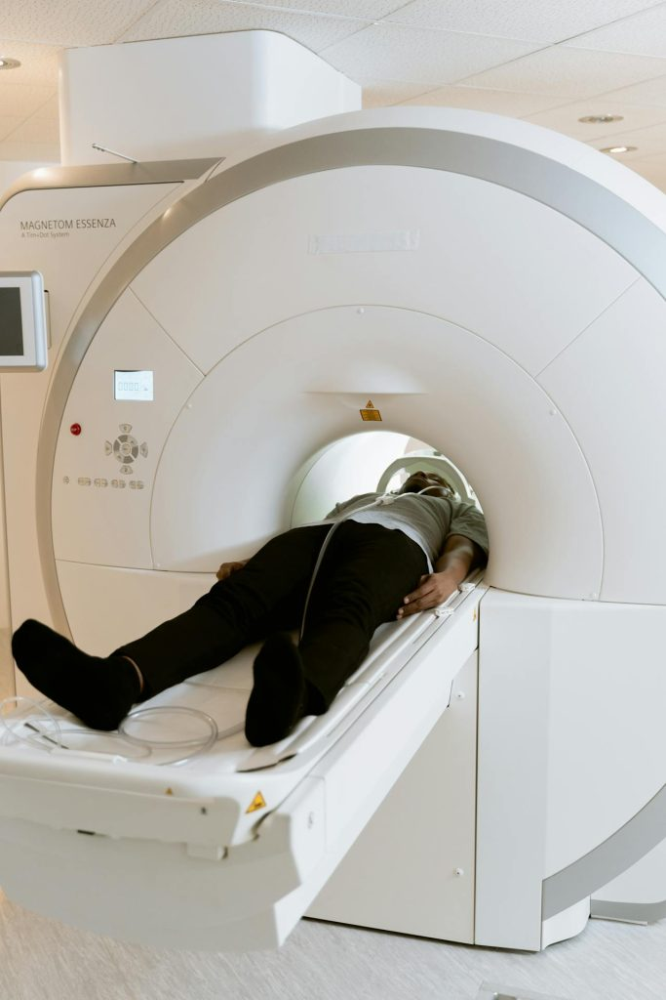
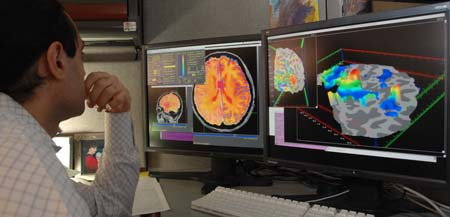

# Mạng xã hội và truyền thông tác động lên não

## Tóm tắt

Mạng xã hội có "thao túng" não của bạn không? Bài này không trả lời gọn "có" hay "không", mà tách câu hỏi thành ba tầng, vì mỗi tầng chắc chắn
một mức khác nhau.

1. **Cơ chế của não** (hệ thưởng, chú ý, sai số dự đoán, "muốn" khác "thích") đã được nghiên cứu lâu năm, phần lớn bằng thí nghiệm trên động vật và
   người, ngoài mạng xã hội [S5] [S6] [S7]. Các bài L00 và L05 đã dạy kỹ phần này.
2. **Một số thí nghiệm và quan sát trên chính mạng xã hội**: một thí nghiệm chụp não thiếu niên khi xem ảnh mô phỏng Instagram có số lượt thích
   thay đổi [S2], và một phân tích hơn nửa triệu thông điệp trên Twitter về những chủ đề gây chia rẽ [S4]. Cả hai đều hẹp và có giới hạn rõ.
3. **Tác hại cho sức khỏe tinh thần**: một nghiên cứu lớn, dựa trên dữ liệu quan sát, thấy mối liên hệ giữa dùng công nghệ số và trạng thái khỏe mạnh của
   thiếu niên là tiêu cực nhưng nhỏ, giải thích tối đa 0,4% biến thiên [S3]. Hướng nhân quả và nhiều điều khác vẫn chưa rõ.

Chỗ nối giữa tầng 1 và các tính năng cụ thể của ứng dụng (thông báo, cuộn vô tận, nút bấm thích) phần lớn là **suy luận của người viết**. Bài gắn nhãn
rõ chỗ nào là suy luận, và không dùng chữ "nghiện" như một chẩn đoán.

Các nhãn dùng trong bài:

- **Thực nghiệm**: người nghiên cứu chủ động thay đổi một điều kiện (ví dụ số lượt thích hiển thị) rồi đo kết quả.
- **Dữ liệu quan sát (tương quan)**: người nghiên cứu ghi lại điều đã xảy ra; hai thứ đi cùng nhau chưa chứng minh thứ này gây ra thứ kia.
- **Cơ chế nền**: điều đã trình bày ở bài trước (giáo khoa hoặc kết quả từ động vật, bài ghi rõ).
- **Suy luận của người viết**: điều người viết nối lại, không gắn [Sn] như thể nguồn đã nói điều đó.
- **Ví dụ của người viết**: tình huống đời thường để minh họa.

Mức đã đọc của từng nguồn được ghi ở cuối mục sau. Ngay đây: toàn văn của [S2], [S4], [S8]; chỉ phần tóm tắt của [S1], [S3], [S5], [S6], [S7]. Với những nguồn chỉ
đọc tóm tắt, bài chỉ nêu điều tóm tắt nói.

## Mạng xã hội chạm vào những cơ chế nào

### Bài ứng dụng, không dạy lại cơ chế

L06 là bài ứng dụng: nối các cơ chế đã học vào mạng xã hội. Vì vậy bài chỉ nhắc một dòng rồi dẫn, không giảng lại.

- Hệ thưởng (reward system), sai số dự đoán phần thưởng, "muốn" khác "thích", chú ý và căng thẳng: xem L05; dopamine nói chung: xem L00.
- Các mạch cảm xúc như sợ, giận, gắn bó, cô đơn: xem L09; hormone và cảm xúc: xem L10.
- Vỏ não trước trán và kiểm soát bản thân: xem L04.

Nếu bạn chưa đọc các bài đó, không sao: mỗi chỗ cần, bài này nhắc lại đúng một câu.

### Một tổng quan về lĩnh vực

Dar Meshi, Diana Tamir và Hauke Heekeren viết một bài tổng quan có tựa "The emerging neuroscience of social media" (khoa học thần kinh đang nổi lên về mạng xã hội). Theo phần tóm
tắt, bài làm ba việc: phác ra các động cơ xã hội khiến người ta dùng mạng xã hội; đề xuất những hệ thần kinh nâng đỡ việc dùng đó; và mô tả các cách nhà thần kinh học có thể
nghiên cứu với mạng xã hội. Cuối bài, các tác giả nêu những hướng nghiên cứu sắp tới và các cân nhắc đạo đức [S1].

Người viết chỉ đọc được phần tóm tắt, nên bài này không nói hệ thần kinh nào được đề xuất và không mượn kết luận chi tiết của tổng quan. Điều rút ra được từ tóm tắt là khiêm tốn
nhưng quan trọng: đây là một lĩnh vực còn mới, và chính các tác giả xếp việc nghiên cứu mạng xã hội cùng với các cân nhắc đạo đức [S1].

### Bốn nhóm cơ chế mà bài nối vào mạng xã hội

1. **Phần thưởng xã hội**: được chú ý, được tán thành có thể hoạt động như một phần thưởng. Nguồn: thí nghiệm của Sherman và cộng sự [S2].
2. **Ảnh hưởng của bạn bè**: số lượt thích hiển thị ảnh hưởng đến việc ta bấm thích. Nguồn: [S2].
3. **Chú ý**: hai hệ chú ý, theo mục tiêu và theo kích thích, và việc "muốn" tách khỏi "thích". Nguồn: [S6] [S7]; phần nối vào ứng dụng là suy luận.
4. **Nội dung đạo đức-cảm xúc**: loại ngôn từ này được chia sẻ nhiều hơn trong dữ liệu Twitter. Nguồn: [S4].

### Ba cấp bằng chứng, và vì sao phải phân biệt

| Cấp | Câu trả lời cho câu hỏi gì | Ví dụ trong bài |
|---|---|---|
| Thực nghiệm | Thay đổi X có làm đổi Y không? | Đổi số lượt thích hiển thị rồi đo việc bấm thích và hoạt động não [S2] |
| Dữ liệu quan sát (tương quan) | X và Y có đi cùng nhau không? | Từ có nghĩa đạo đức-cảm xúc và số lượt chia sẻ lại [S4]; dùng công nghệ số và trạng thái khỏe mạnh [S3] |
| Suy luận của người viết | Nếu cơ chế A có thật, tính năng B có thể tận dụng nó không? | Bảng "từ cơ chế đến thiết kế" ở mục sau |

Ba cấp này không xếp hạng "đúng" và "sai". Chúng cho biết bạn được phép kết luận đến đâu. Ví dụ của người viết: thấy ngày nào bán nhiều kem cũng là ngày có nhiều người đuối nước chỉ là dữ liệu
quan sát; kết luận "kem gây đuối nước" vượt quá dữ liệu, vì cả hai cùng tăng khi trời nóng.

### Mỗi nguồn được đọc đến đâu

- **Toàn văn**: Sherman và cộng sự 2016 [S2] (bản lưu trữ miễn phí trên PubMed Central), Brady và cộng sự 2017 [S4] (cũng trên PubMed Central), giáo trình chương 4 [S8].
- **Chỉ phần tóm tắt và trang bài**: Meshi và cộng sự 2015 [S1], Orben và Przybylski 2019 [S3] (toàn văn nằm sau tường phí), Schultz và cộng sự 1997 [S5], Corbetta và Shulman 2002 [S6], Berridge và Robinson 1998 [S7].

Với [S5], [S6], [S7], cơ chế đã được trình bày ở L05; bài này chỉ dùng điều tóm tắt của chúng nói. Khi bài viết "không nguồn nào ở đây", ý là trong phần người viết đã đọc.

## Phần thưởng xã hội: được chú ý như một phần thưởng

### Ý tưởng

Hệ thưởng (xem L05) không chỉ phản ứng với đồ ăn hay tiền. Một giả thuyết hợp lý là tín hiệu xã hội, như được bạn bè tán thành, cũng có thể kéo hệ này vào cuộc. Trên mạng xã hội, sự
tán thành ấy được đếm thành số: lượt thích. Sherman và cộng sự đặt thẳng câu hỏi đó: họ mô phỏng Instagram trong máy chụp cộng hưởng từ chức năng (functional MRI, fMRI) và xem não phản ứng
ra sao với số lượt thích hiển thị bên dưới ảnh [S2]. Chi tiết thí nghiệm ở mục sau; mục này nói về một câu hỏi đi trước: **fMRI đo được gì**.

### fMRI đo gì

Giáo trình chương 4 giải thích: khi một vùng não hoạt động mạnh hơn, nó dùng nhiều oxy hơn và máu giàu oxy chảy tới vùng ấy trong vài giây sau đó. fMRI đo sự thay đổi nồng độ hemoglobin
mang oxy, gọi là tín hiệu phụ thuộc mức oxy trong máu (blood-oxygen-level-dependent, BOLD). Từ tín hiệu này, các nhà nghiên cứu **suy ra** hoạt động nơron trong vùng; fMRI không đo trực tiếp
hoạt động nơron [S8]. fMRI có độ phân giải không gian cao, ảnh gồm các khối vài milimét, nhưng độ phân giải thời gian kém, mỗi ảnh chụp trung bình trong khoảng hai đến ba giây [S8].
Giáo trình nói thêm: fMRI là dữ liệu **tương quan**, không giải thích đầy đủ vai trò nhân quả của từng vùng, nên cần được bổ sung bằng bằng chứng khác, ví dụ thí nghiệm trên động vật [S8].

*Máy chụp cộng hưởng từ (MRI) với một người nằm trong lòng máy. Ảnh minh họa chung, không phải ảnh của nghiên cứu ở trên. Nguồn hình: Mart Production (Pexels), CC0; qua Hove & Martinez, Hình 9 (chương 4). https://rotel.pressbooks.pub/biologicalpsychology/chapter/tools-of-cognitive-neuroscience-brain-imaging-pet-and-mri/ [S8]*

*Nhà nghiên cứu xem ảnh quét não; vùng hoạt động cao hơn mức nền thường được tô màu nóng (đỏ, cam). Ảnh minh họa chung, không phải ảnh của nghiên cứu ở trên. Nguồn hình: Wikimedia Commons, giấy phép theo sách CC BY-SA; Hove & Martinez, Hình 11 (chương 4). https://rotel.pressbooks.pub/biologicalpsychology/chapter/tools-of-cognitive-neuroscience-brain-imaging-pet-and-mri/ [S8]*

### Từ "vùng sáng" đến "phần thưởng": mỗi bước một mức chắc chắn

Hệ quả cho nghiên cứu mạng xã hội là một chuỗi, và mỗi mắt xích có mức chắc chắn khác nhau:

1. **Đo được**: khi ảnh có nhiều lượt thích, tín hiệu BOLD ở một số vùng, trong đó có nhân accumbens (nucleus accumbens, một phần của thể vân bụng, xem L07), cao hơn so với ảnh ít lượt thích [S2].
2. **Diễn giải của các tác giả**: nhân accumbens là một đầu mối của mạch thưởng, nên kết quả gợi ý rằng nhận tán thành xã hội có liên quan đến xử lý phần thưởng [S2].
3. **Suy luận của người viết**: từ "vùng này sáng" sang "người ấy thấy được thưởng" là một bước suy diễn ngược, vì một vùng não thường tham gia nhiều việc. Trong ghi chú của bài, các tác giả cho biết các vùng sáng giống bản đồ của từ "reward" trong một cơ sở dữ liệu mà bài tự mô tả là phân tích suy luận ngược (reverse inference) tổng hợp [S2]; tức là diễn giải cũng dựa một phần vào kiểu suy diễn này.
4. **Không được suy ra**: "dopamine tăng". fMRI đo tín hiệu oxy trong máu, không đo chất dẫn truyền [S8]. Bài này không viết "dopamine tăng khi được thích", vì không nguồn nào ở đây đo dopamine trên người xem mạng xã hội. Chuyện dopamine thật sự làm gì trong hệ thưởng đã có ở L00 và L05.

Mức bằng chứng: bước 1 là kết quả thực nghiệm (nhưng chỉ là tương quan giữa điều kiện và tín hiệu não); bước 2 là diễn giải của tác giả; bước 3 và 4 là giới hạn người viết đặt ra.

### Đừng hiểu nhầm

- **"Vùng thưởng sáng nghĩa là người ấy sướng."** Hoạt động ở vùng thưởng và cảm giác khoái cảm là hai thứ khác nhau; xem "muốn" và "thích" ở L05 và L09.
- **"fMRI cho thấy dopamine."** Không: fMRI đo máu và oxy [S8].
- **"Một lượt thích chắc chắn gây ra một phản ứng thưởng trong đời thật."** Nghiên cứu là mô phỏng trong máy quét; điều này bàn thêm ở mục sau.

## Bấm thích và ảnh hưởng của bạn bè

### Thí nghiệm được dựng thế nào

Lauren Sherman, Ashley Payton, Leanna Hernandez, Patricia Greenfield và Mirella Dapretto tuyển 34 thiếu niên bình thường, từ 13 đến 18 tuổi, 18 em nữ; hai em bị loại khỏi phân tích fMRI (một em do
máy báo lỗi, một em do cử động quá nhiều), nên phân tích fMRI dùng 32 em [S2]. Các tác giả ghi rằng cỡ mẫu là số tối đa họ tuyển được theo kinh phí và thời gian [S2].

Quy trình, theo phần Phương pháp của bài [S2]:

1. Các em được báo rằng nghiên cứu xem não phản ứng thế nào khi dùng mạng xã hội, và được nhờ nộp ảnh từ tài khoản Instagram của chính mình.
2. Các em được báo rằng khoảng 50 thiếu niên khác đã xem bộ ảnh này và đã bấm thích. Trên thực tế, **số lượt thích hiển thị do nhóm nghiên cứu ấn định**, không phải do người thật bấm.
3. Trong máy quét, mỗi em xem 148 ảnh, mỗi ảnh hiện 3 giây, kèm số lượt thích và hai nút: "Like" (bấm thích) hoặc "Next" (qua ảnh khác). Gồm 66 ảnh trung tính do nhóm nghiên cứu chọn, 42 ảnh về hành vi nguy cơ (rượu, thuốc lá, cần sa, cử chỉ thô tục, ăn mặc khêu gợi) và 40 ảnh của chính em đó.
4. Mỗi ảnh được gán số lượt thích **nhiều** (23 đến 45) hoặc **ít** (0 đến 22); phần lớn rơi vào khoảng 30 đến 45 hoặc 0 đến 15 để hai nhóm khác nhau rõ. Có hai phiên bản của bộ ảnh, với mức "nhiều" và "ít" đảo ngược, và mỗi em xem một phiên bản. Nhờ đó cùng một ảnh được thấy với nhiều lượt thích ở nửa số em và ít lượt thích ở nửa còn lại, nên nội dung và chất lượng ảnh được giữ như nhau khi chỉ thay đổi mức "nổi tiếng".

Nhãn: **thực nghiệm**, vì số lượt thích hiển thị được người nghiên cứu thay đổi có kiểm soát.

### Kết quả hành vi: bấm theo số đông

Các em bấm thích những ảnh có nhiều lượt thích nhiều hơn mức ngẫu nhiên, và điều này đúng với cả ba loại ảnh [S2]. Mức ý nghĩa của ảnh trung tính và ảnh nguy cơ (p = 0,03 mỗi loại) yếu hơn nhiều so với ảnh của chính các em (p < 0,00001), và ảnh của chính các em cho hiệu ứng lớn hơn cả hai loại kia [S2]. Các tác giả cho rằng
điều này có thể phản ánh tầm quan trọng của việc tự thể hiện ở tuổi thiếu niên [S2]; đó là diễn giải của họ, nghiên cứu không kiểm tra riêng điều này.

### Kết quả não: khác nhau theo loại ảnh

Phân tích toàn não so sánh "nhiều lượt thích" với "ít lượt thích" [S2]:

- **Ảnh của chính em**: hoạt động cao hơn ở nhiều vùng gắn với nhận thức xã hội (tiền chêm, vỏ trước trán giữa, cực thái dương, hải mã...) và ở các vùng gắn với học theo phần thưởng và động cơ (nhân accumbens, nhân đuôi, bèo sẫm, đồi thị, vùng bụng của não giữa, thân não) [S2].
- **Ảnh trung tính của "bạn bè"**: hoạt động cao hơn ở vỏ thị giác kéo tới tiền chêm, và ở tiểu não [S2]. Các tác giả cho rằng các em có thể đã quan sát kỹ hơn những ảnh được ưa chuộng [S2].
- **Ảnh nguy cơ**: chỉ một cụm vỏ trán trái sáng hơn [S2].
- Chiều ngược lại (ít lượt thích hơn nhiều lượt thích) không cho vùng nào khác biệt có ý nghĩa ở cả ba loại ảnh [S2].

Phân tích riêng vùng nhân accumbens (xác định từ trước, dựa trên một nhiệm vụ thưởng tiền ở nhóm người trẻ độc lập) cho kết quả hẹp hơn lời tóm tắt thường kể: nhân accumbens trái hoạt động mạnh hơn với ảnh trung tính nhiều lượt thích; cả hai bên mạnh hơn với ảnh của chính em; **với ảnh nguy cơ, số lượt thích không có tác dụng** ở vùng này [S2]. Các tác giả nêu một lý do có thể: một số em cho biết chưa có kinh nghiệm với rượu hay chất gây nghiện, nhưng đó chỉ là khả năng, chưa được kiểm tra [S2].

### Hai kết quả dễ bị trộn lẫn

Bài báo có hai phép so sánh khác nhau, và hai kết luận khác nhau:

- **Nhiều lượt thích so với ít lượt thích** (cùng ảnh): đo ảnh hưởng của số lượt thích [S2].
- **Ảnh nguy cơ so với ảnh trung tính**: đo ảnh hưởng của nội dung ảnh. Khi xem ảnh nguy cơ, một mạng vùng gắn với kiểm soát nhận thức và ức chế phản ứng (vỏ đai trước lưng, vỏ trước trán hai bên, vỏ đỉnh bên) ít hoạt động hơn so với khi xem ảnh trung tính [S2]. Các tác giả suy đoán rằng việc thấy bạn bè làm điều nguy cơ có thể "nới" kiểm soát nhận thức, nhưng cũng nhấn mạnh rằng chỉ xem ảnh trên mạng tự nó không phải là một nguy cơ [S2].

Gộp hai kết quả này thành "lượt thích làm giảm kiểm soát" là sai: phép so sánh về kiểm soát nhận thức không phụ thuộc số lượt thích.

### Giới hạn của thí nghiệm

- Mẫu nhỏ (32 em trong phân tích fMRI), và các tác giả nói mẫu là mức tối đa họ tuyển được [S2].
- Là mô phỏng trong máy quét, không phải mạng xã hội thật; các tác giả viết rằng nghiên cứu không cho so sánh trực tiếp giữa ảnh hưởng của bạn bè ngoài đời và trên mạng [S2].
- Số lượt thích là do nhóm nghiên cứu ấn định; các em được nói rằng đó là lượt thích thật của bạn bè [S2].
- Chỉ đo phản ứng ngắn hạn trong lúc xem; không đo điều gì xảy ra sau đó với hành vi hay cảm xúc.
- Với ảnh nguy cơ, vùng nhân accumbens không phân biệt nhiều với ít lượt thích [S2], nên không thể nói "lượt thích kéo thiếu niên vào hành vi nguy cơ qua hệ thưởng".

Mức bằng chứng: **thực nghiệm**, nhưng ở quy mô nhỏ và trong điều kiện nhân tạo. Nó cho thấy cơ chế có thể xảy ra (các tác giả dùng cụm "possible mechanisms" trong phần tóm tắt [S2]); chưa chứng minh tác động trong đời thường.

## Chú ý, thông báo và cuộn vô tận

### Hai hệ chú ý ở mức mô hình

Maurizio Corbetta và Gordon Shulman tổng hợp bằng chứng về các mạng vùng não tách biệt một phần, đảm nhận những chức năng chú ý khác nhau [S6]. Một hệ, gồm các phần của vỏ đỉnh trong rãnh và vỏ trán trên, tham gia
chuẩn bị và áp dụng việc chọn kích thích và phản ứng theo mục tiêu (từ trên xuống, top-down) [S6]. Hệ kia, gồm vỏ thái dương-đỉnh và vỏ trán dưới, phần lớn nghiêng về bán cầu phải, không tham gia chọn lọc theo mục tiêu, mà chuyên phát hiện
các kích thích liên quan đến hành vi, nhất là khi chúng nổi bật hoặc bất ngờ; các tác giả gọi hệ này là một "cầu dao" (circuit breaker) cho hệ kia, hướng chú ý tới sự kiện nổi bật [S6]. Chi tiết và cách hai hệ
tương tác ở L05; ở đây chỉ giữ ý chính, ở mức mô hình tổng quan.

### Ví dụ của người viết: một thông báo đi qua hai hệ

Bạn đang viết báo cáo (hệ theo mục tiêu giữ chú ý vào trang giấy). Điện thoại rung và sáng màn hình: một kích thích nổi bật và bất ngờ. Theo mô hình trên, đây đúng loại kích thích mà hệ thứ hai chuyên phát hiện [S6]. Bạn nhìn sang màn hình dù không định.

Nhãn: **suy luận của người viết**. Mô hình của [S6] là về chú ý nói chung; tóm tắt của nó không bàn về điện thoại hay thông báo, và không nguồn nào trong bài này đo xem thông báo có thật sự hoạt động theo cách ấy trong não hay không.

### "Muốn" khác "thích", và vì sao điều đó đáng chú ý

Kent Berridge và Terry Robinson xem lại tài liệu và làm một thí nghiệm ở chuột: họ làm giảm dopamine ở nhân accumbens và thể vân (neostriatum) tới 99%. Chuột vẫn cho thấy phản ứng thích thú bình thường với vị ngọt (sucrose) so với vị đắng (quinine), và vẫn học giá trị khoái cảm mới [S7]. Họ kết luận hệ dopamine không cần cho việc thích, mà cần cho việc **muốn** (sức hút động cơ, incentive salience) [S7].

Nhãn: đây là một quan điểm có bằng chứng từ động vật (chuột), không phải đồng thuận; L05 trình bày cuộc tranh luận. Điều cần cho bài này chỉ là một ý: "muốn tiếp tục" và "thích điều đang xem" có thể tách nhau. Ví dụ của người viết: mở một ứng dụng ba mươi phút rồi đóng lại mà không nhớ mình đã thích điều gì. Nhưng không nguồn nào ở đây đo việc này trên người dùng thật.

### Cuộn vô tận: suy luận của người viết

Một luồng nội dung không điểm dừng (cuộn vô tận, video kế tiếp tự chạy) khác với một tờ báo có trang cuối. **Suy luận của người viết**: khi giao diện không tự dừng, quyết định "dừng lại" chuyển từ một lần (cuối trang) thành lặp lại mỗi lần cuộn, và việc kiểm soát bản thân (vỏ não trước trán, xem L04) phải thắng lần này qua lần khác. Đây là ý nối từ L04, không phải kết quả đo trong bất kỳ nguồn nào của bài. Trong những gì người viết đọc được, không nguồn nào kiểm tra cuộn vô tận.

### Điều có nguồn và điều là suy luận ở mục này

- Có nguồn (cơ chế nền): có hai hệ chú ý tách biệt một phần [S6]; ở chuột, dopamine cần cho "muốn" hơn "thích" [S7].
- Suy luận của người viết: thông báo tận dụng hệ phát hiện kích thích nổi bật; cuộn vô tận kéo dài "muốn"; thiếu điểm dừng làm kiểm soát bản thân khó hơn.
- Chưa có trong các nguồn đã đọc: thí nghiệm đo tác động của thông báo hay cuộn vô tận lên não hoặc hành vi.

## Nội dung đạo đức-cảm xúc được chia sẻ nhiều hơn

### Nghiên cứu làm gì

William Brady, Julian Wills, John Jost, Joshua Tucker và Jay Van Bavel phân tích 563.312 thông điệp Twitter về ba chủ đề chính trị gây chia rẽ ở Mỹ: kiểm soát súng (102.328 thông điệp), hôn nhân đồng giới (47.373) và biến đổi khí hậu (413.611) [S4]. Họ đếm số từ thuộc ba nhóm, dựa trên hai từ điển đã được kiểm định từ trước: từ **đạo đức** (như "duty", 329 từ), từ **cảm xúc** (như "fear", 819 từ) và từ **đạo đức-cảm xúc** (như "hate", 159 từ) nằm trong cả hai từ điển [S4]. "Lan truyền" (contagion) được đo bằng số lần một thông điệp được đăng lại (retweet) [S4].

### Kết quả

Trong cả ba chủ đề, thêm một từ đạo đức-cảm xúc vào thông điệp đi cùng mức đăng lại dự kiến tăng 19% (kiểm soát súng), 17% (hôn nhân đồng giới) và 24% (biến đổi khí hậu); trung bình khoảng 20% cho mỗi từ, sau khi đã điều chỉnh theo từ thuần đạo đức, từ thuần cảm xúc và các yếu tố khác [S4]. Từ thuần đạo đức không tạo khác biệt ở hai chủ đề đầu và chỉ nhỏ ở chủ đề thứ ba; từ thuần cảm xúc có tác động ở hai trong ba chủ đề [S4].

Các tác giả còn thấy hiệu ứng này bị giới hạn bởi nhóm: ngôn từ đạo đức-cảm xúc làm tăng sự lan truyền mạnh hơn **bên trong** nhóm cùng khuynh hướng chính trị (tự do hoặc bảo thủ) so với **giữa** các nhóm [S4]. Họ suy đoán rằng đây có thể là một quá trình góp phần vào phân cực, và các thông điệp như vậy dễ giống "buồng vang" (echo chamber) hơn [S4]; đó là suy đoán của các tác giả, chưa phải điều dữ liệu chứng minh.

### Đọc kết quả thận trọng

1. **Dữ liệu quan sát (tương quan).** Từ ngữ trong thông điệp đi cùng số lần đăng lại; chưa chứng minh từ ngữ gây ra việc đăng lại. Chính các tác giả viết rằng cần thí nghiệm có kiểm soát hơn, đặc biệt để kiểm tra ảnh hưởng nhân quả của việc tiếp xúc với ngôn từ đạo đức-cảm xúc lên thái độ và hành vi [S4].
2. **Một nền tảng, ba chủ đề, bối cảnh chính trị Mỹ.** Không đủ để nói về mọi mạng xã hội hay mọi chủ đề.
3. **Đo từ ngữ, không đo cảm xúc của người đọc.** Nghiên cứu đếm từ trong thông điệp bằng từ điển và đếm lần đăng lại; tóm tắt và phần kết quả không đo người đọc cảm thấy gì hay não họ làm gì. Vì vậy bài không dùng nghiên cứu này để nói về cơ chế não.
4. **Lan truyền không đồng nghĩa thuyết phục.** Số lần đăng lại không cho biết ai đổi quan điểm.
5. **Độ lớn không đồng đều.** Các tác giả ghi rằng ước tính cho chủ đề hôn nhân đồng giới, tuy cùng hướng, là ước tính biến động nhất giữa các phân tích độ nhạy [S4].

Mức bằng chứng: **dữ liệu quan sát**, mẫu lớn, ghi lại hành vi thật trên mạng. Điều nó cho phép nói: trong dữ liệu này, ngôn từ đạo đức-cảm xúc đi cùng sự lan truyền nhiều hơn. Điều nó không cho phép nói: ngôn từ ấy khiến người ta chia sẻ, hay mạng xã hội khiến người ta phẫn nộ.

## Từ cơ chế đến thiết kế: bảng suy luận

### Bảng

Bảng sau là **suy luận của người viết**: nó ghép một tính năng quen thuộc của ứng dụng với một cơ chế có nguồn. Cột giữa có nguồn; cột phải cho biết mức bằng chứng của việc ghép.

| Tính năng | Cơ chế có thể liên quan | Mức bằng chứng cho việc ghép |
|---|---|---|
| Thông báo, âm thanh, đèn | Hệ phát hiện kích thích nổi bật, bất ngờ [S6] | Cơ chế có nguồn; tác động của từng ứng dụng là suy luận |
| Số lượt thích hiển thị | Tín hiệu xã hội, ảnh hưởng của bạn bè, hoạt động vùng thưởng [S2] | Thực nghiệm mô phỏng ở thiếu niên, mẫu nhỏ; ảnh hưởng đến hành vi trên mạng thật là suy luận |
| Kết quả lúc có lúc không (kéo làm mới, video kế tiếp) | Hệ thưởng nhạy với điều khác dự đoán: ở linh trưởng, nơron dopamine dường như báo sai số dự đoán về sự kiện đáng thưởng [S5] | Cơ chế có nguồn từ động vật (linh trưởng); việc tính năng cụ thể gây hiệu ứng đó là suy luận |
| Luồng không điểm dừng | Quyết định dừng phải lặp lại mỗi lần (L04) | Hoàn toàn là suy luận; không nguồn nào ở đây kiểm tra |
| Nội dung đạo đức-cảm xúc được đẩy lên | Ngôn từ đạo đức-cảm xúc đi cùng nhiều lượt đăng lại hơn [S4] | Dữ liệu quan sát trên Twitter; cơ chế não không được đo |

### Một lượt mở ứng dụng, đọc theo bảng

Ví dụ của người viết, chỉ để hình dung: bạn mở điện thoại vì thấy thông báo (cơ chế chú ý, [S6]); bạn thấy bài của mình có số lượt thích tăng (tín hiệu xã hội, [S2]); bạn kéo làm mới để xem còn gì mới, mà không biết sẽ có gì (kết quả không báo trước, [S5]); bạn cuộn tiếp vì luồng không có trang cuối; bạn thấy một bài khiến mình phẫn nộ và muốn chia sẻ ngay (ngôn từ đạo đức-cảm xúc, [S4]). Mỗi bước có một cơ chế có nguồn đứng sau, nhưng **cả chuỗi** là minh họa, không phải kết quả đo.

### Ba lưu ý khi đọc bảng

1. "Tận dụng" là một giả thuyết về cơ chế, **không phải** khẳng định rằng nhà thiết kế cố ý như vậy; không nguồn nào ở đây nói về ý định của nhà thiết kế.
2. Một cơ chế có thật không bảo đảm tính năng kích hoạt nó đủ mạnh để đổi hành vi hay sức khỏe. Mức độ ấy là câu hỏi thực nghiệm, và phần lớn còn chưa được trả lời trong các nguồn đã đọc.
3. Bảng không nói "mạng xã hội xấu". Nó chỉ chỉ ra chỗ nào có nguồn và chỗ nào là nối thêm của người viết.

## Bằng chứng về tác hại: còn nhiều điều chưa rõ

### Nghiên cứu của Orben và Przybylski

Amy Orben và Andrew Przybylski mở đầu bằng một nhận xét: việc thanh thiếu niên dùng công nghệ số rộng rãi đã làm dấy lên giả thuyết rằng nó ảnh hưởng tiêu cực đến sức khỏe tinh thần; bằng chứng hiện có phần lớn dựa trên phân tích lại các bộ dữ liệu xã hội lớn, nơi sự linh hoạt trong cách phân tích có thể khiến những hiệu ứng nhỏ trông có ý nghĩa thống kê, dẫn tới dương tính giả và kết quả mâu thuẫn [S3]. Để đối phó, họ dùng phân tích đường cong đặc tả (specification curve analysis) trên ba bộ dữ liệu xã hội lớn, tổng cỡ mẫu 355.358, và xem xét bằng chứng tương quan [S3]. (Giải thích của người viết về tên phương pháp: thay vì chọn một cách phân tích, người ta chạy nhiều cách phân tích hợp lý rồi xem kết quả trải ra thế nào.)

Theo phần thông tin dữ liệu của trang bài, ba bộ dữ liệu có tên YRBS (do Trung tâm Kiểm soát và Phòng ngừa Dịch bệnh Mỹ thu), Monitoring the Future (MTF) và Millennium Cohort Study (MCS, qua dịch vụ dữ liệu của Anh) [S3]. Người viết không đọc được cách mỗi bộ đo "trạng thái khỏe mạnh" hay độ tuổi cụ thể, nên bài không nêu.

Kết quả, theo tóm tắt: mối liên hệ giữa dùng công nghệ số và trạng thái khỏe mạnh (well-being) của thiếu niên là **tiêu cực nhưng nhỏ**, giải thích **tối đa 0,4%** biến thiên về trạng thái khỏe mạnh [S3]. Nói bằng lời: nếu có 1.000 phần khác biệt giữa các em về trạng thái khỏe mạnh, công nghệ số được ước tính giải thích tối đa khoảng 4 phần. Các tác giả kết luận rằng những hiệu ứng này quá nhỏ để biện minh cho thay đổi chính sách [S3].

### Điều bài này không nói

Người viết chỉ đọc được phần tóm tắt và trang bài, nên **không nêu** các phân tích chi tiết nằm trong toàn văn, như so sánh với các yếu tố khác trong đời sống của thiếu niên, vì không kiểm được chúng.

### Những điều còn chưa rõ

1. **Hướng nhân quả.** Tóm tắt nói rõ đây là bằng chứng tương quan [S3]. Dùng công nghệ có làm đổi trạng thái khỏe mạnh, hay ngược lại, hay một yếu tố thứ ba tác động cả hai, thì dữ liệu này không cho biết (giải thích chuẩn về hạn chế của dữ liệu tương quan).
2. **Công nghệ số nói chung, không riêng mạng xã hội hay một tính năng.** Tóm tắt nói về "digital technology use" [S3]. Bài không có số liệu riêng cho thông báo, cuộn vô tận hay nút thích.
3. **Trung bình có thể che nhóm nhỏ.** Suy luận của người viết, chưa kiểm chứng trong nguồn này: mức trung bình nhỏ không loại trừ khả năng một số người hoặc một số cách dùng chịu ảnh hưởng lớn hơn. Tóm tắt không báo cáo điều này theo nhóm.
4. **Tranh luận vẫn tiếp diễn.** Trang bài ghi có một bình luận phản biện (Matters Arising) cho bài này, công bố ngày 17/4/2020; người viết chưa đọc nó nên không dùng. Bài này chỉ dẫn một nghiên cứu cho một phía của cuộc tranh luận [S3].
5. **Hai nghiên cứu về mạng xã hội trong bài không đo tác hại.** [S2] đo phản ứng ngắn hạn trong máy quét; [S4] đo việc lan truyền ngôn từ. Không nghiên cứu nào nối từ "lượt thích" hay "ngôn từ" tới sức khỏe tinh thần.
6. **Người lớn và theo thời gian dài.** Tóm tắt nói về thiếu niên; các nguồn đã đọc không cho biết gì về người lớn hay tác động qua nhiều năm.

Vì vậy bài này không kết luận mạng xã hội vô hại, cũng không kết luận nó gây hại lớn. Một mức liên hệ trung bình nhỏ và một cơ chế có thể xảy ra là hai mảnh khác nhau của bức tranh, và còn thiếu mảnh nối chúng.

### Đối chiếu nhanh các nguồn

| Nguồn | Loại bằng chứng | Nói được gì về tác hại? |
|---|---|---|
| [S2] Sherman 2016 | Thực nghiệm, mẫu nhỏ, mô phỏng | Chưa gì: chỉ cơ chế có thể xảy ra |
| [S4] Brady 2017 | Dữ liệu quan sát, Twitter | Chưa gì: chỉ về lan truyền ngôn từ |
| [S3] Orben & Przybylski 2019 | Dữ liệu quan sát, ba bộ dữ liệu lớn | Liên hệ âm, nhỏ, tối đa 0,4% biến thiên; không biết nhân quả |
| [S5] [S6] [S7] | Cơ chế nền (khỉ, mô hình tổng quan, chuột) | Không đo mạng xã hội |

## Cách tự bảo vệ (gợi ý suy ra từ cơ chế)

Những gợi ý sau **suy ra từ cơ chế**, không phải biện pháp đã được kiểm chứng trong thử nghiệm nào của các nguồn đã đọc. "Có thể giúp" nghĩa là giả thuyết hợp lý.

1. **Tắt thông báo không cần thiết.** Cơ chế: kích thích nổi bật, bất ngờ kéo chú ý đi [S6]. Việc tắt thông báo có thực sự giúp hay không thì các nguồn ở đây chưa kiểm chứng. Suy luận của người viết.
2. **Đặt điểm dừng từ trước.** Nếu luồng không tự dừng, quyết định dừng phải đến từ ta (L04). Đặt giới hạn trước, ví dụ hẹn giờ hoặc đóng ứng dụng sau khi xong một việc, có thể làm quyết định ấy nhẹ hơn. Suy luận của người viết.
3. **Tự hỏi: mình đang muốn hay đang thích?** Dựa trên ý rằng "muốn" có thể tách khỏi "thích" [S7] (kết quả từ chuột; L05). Đây là câu hỏi để quan sát bản thân, không phải phép đo.
4. **Chậm lại trước khi chia sẻ nội dung khiến mình phẫn nộ.** Trong dữ liệu Twitter, ngôn từ đạo đức-cảm xúc đi cùng nhiều lượt đăng lại hơn, nhất là trong nhóm cùng quan điểm [S4]. Một nhịp chờ trước khi bấm chia sẻ là gợi ý suy luận, không phải kết quả đã kiểm chứng.
5. **Chú ý đến nền tảng sức khỏe và quan hệ ngoài mạng.** Căng thẳng và hỗ trợ xã hội đã được nói ở L05 và L10. Áp dụng cho việc dùng mạng xã hội là suy luận của người viết; các nguồn đã đọc ở bài này không đo điều đó.

Đây là chuyện thiết kế môi trường hơn là chuyện ý chí. Không có nguồn nào ở đây cho thấy dùng mạng xã hội nhiều là lỗi của ai; vì thế bài không quy trách nhiệm cho thiếu niên hay cha mẹ.

## Điều cần nhớ

1. Các cơ chế thưởng, chú ý và ảnh hưởng xã hội là có thật và đã được nghiên cứu, phần lớn ngoài bối cảnh mạng xã hội [S5] [S6] [S7].
2. Trong một thí nghiệm mô phỏng, thiếu niên có xu hướng bấm thích ảnh đã có nhiều lượt thích, và não phản ứng khác theo số lượt thích; nhưng fMRI đo tín hiệu oxy trong máu chứ không đo dopamine [S2] [S8].
3. Trong dữ liệu Twitter, ngôn từ đạo đức-cảm xúc đi cùng nhiều lượt đăng lại hơn, nhất là trong nhóm cùng quan điểm; đó là dữ liệu quan sát [S4].
4. Mối liên hệ trung bình giữa dùng công nghệ số và trạng thái khỏe mạnh của thiếu niên là âm nhưng nhỏ, tối đa 0,4% biến thiên, và hướng nhân quả chưa rõ [S3].
5. Phần nối từ cơ chế sang tính năng cụ thể (thông báo, cuộn vô tận) phần lớn là suy luận; các gợi ý tự bảo vệ cũng vậy.

Nối với các bài trước: đây là bài ứng dụng của L00 đến L05, L09 và L10. Hiểu cách não hoạt động không làm ta miễn nhiễm, nhưng giúp ta nhìn ra khi nào mình đang bị kéo đi, và khi nào lời kết luận vượt quá bằng chứng.

## Lưu ý

Bài này nhằm hiểu cơ chế, không phải lời khuyên y tế và không chẩn đoán ai. Bài không coi "dùng mạng xã hội nhiều" là một bệnh và không dùng chữ "nghiện" như một chẩn đoán.
Nếu việc dùng mạng xã hội làm bạn mất ngủ, lo âu, buồn bã kéo dài hoặc khó kiểm soát dù đã cố gắng, hãy trao đổi với bác sĩ hoặc chuyên gia tâm lý. Đừng dùng bài này để quy lỗi cho thiếu niên hay phụ huynh.

## Nguồn tham khảo

- [S1] Meshi D., Tamir D. I., Heekeren H. R., The emerging neuroscience of social media, Trends in Cognitive Sciences, 2015 https://doi.org/10.1016/j.tics.2015.09.004
- [S2] Sherman L. E., Payton A. A., Hernandez L. M., Greenfield P. M., Dapretto M., The power of the Like in adolescence: effects of peer influence on neural and behavioral responses to social media, Psychological Science, 2016 https://doi.org/10.1177/0956797616645673
- [S3] Orben A., Przybylski A. K., The association between adolescent well-being and digital technology use, Nature Human Behaviour, 2019 https://doi.org/10.1038/s41562-018-0506-1
- [S4] Brady W. J., Wills J. A., Jost J. T., Tucker J. A., Van Bavel J. J., Emotion shapes the diffusion of moralized content in social networks, PNAS, 2017 https://doi.org/10.1073/pnas.1618923114
- [S5] Schultz W., Dayan P., Montague P. R., A neural substrate of prediction and reward, Science, 1997 https://doi.org/10.1126/science.275.5306.1593
- [S6] Corbetta M., Shulman G. L., Control of goal-directed and stimulus-driven attention in the brain, Nature Reviews Neuroscience, 2002 https://doi.org/10.1038/nrn755
- [S7] Berridge K. C., Robinson T. E., What is the role of dopamine in reward: hedonic impact, reward learning, or incentive salience?, Brain Research Reviews, 1998 https://doi.org/10.1016/S0165-0173(98)00019-8
- [S8] Hove & Martinez, Biological Psychology (Revised Edition), Chương 4 "Research Methods in Biological Psychology", mục 4.5, Hình 9 và 11 (hình minh họa), ROTEL Pressbooks https://rotel.pressbooks.pub/biologicalpsychology/ ; chương 4: https://rotel.pressbooks.pub/biologicalpsychology/chapter/tools-of-cognitive-neuroscience-brain-imaging-pet-and-mri/
