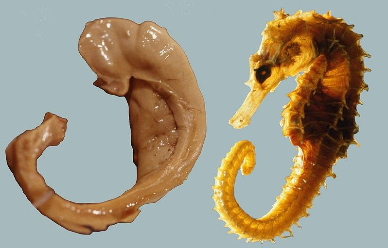
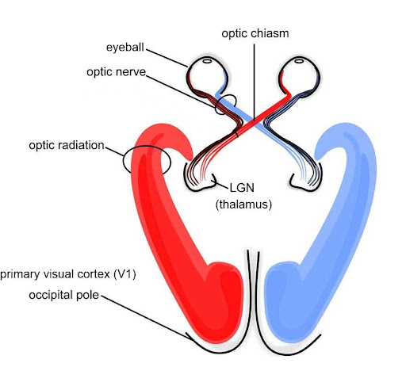
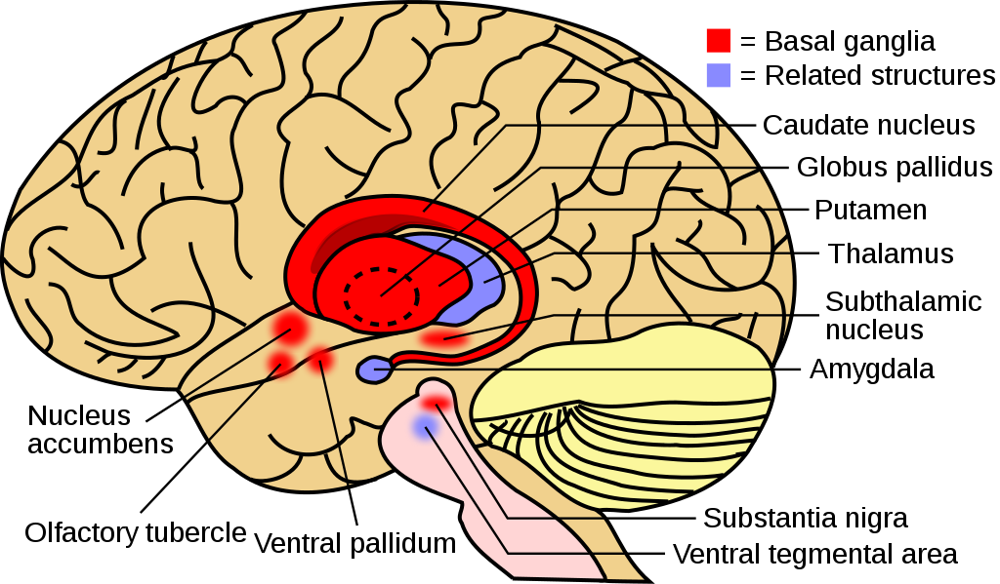
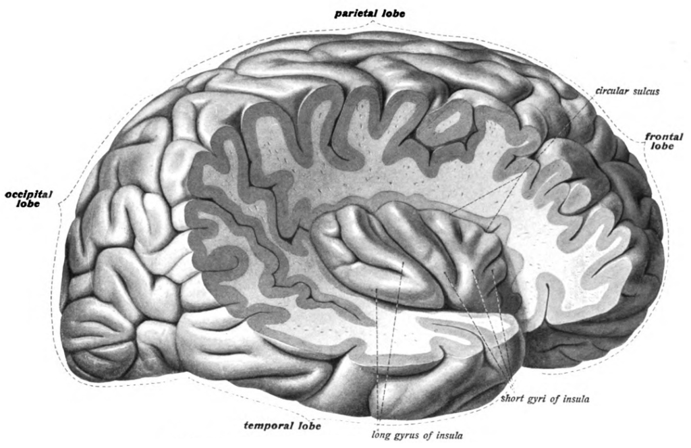
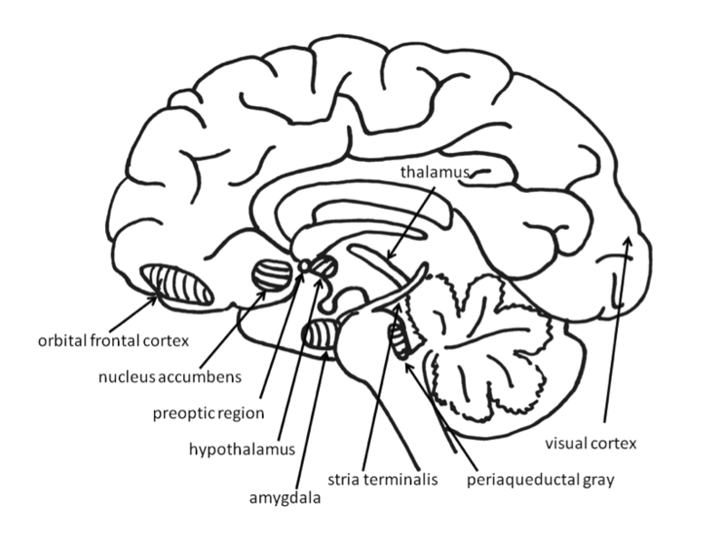

# Hệ viền và các nhân nằm sâu của não

## Tóm tắt

Vì sao vài khối nhỏ nằm sâu trong não lại dính đến nỗi sợ, trí nhớ, cơn đói và thói quen? Câu trả lời ngắn: các khối ấy là những nút
giao, nhận tín hiệu từ nhiều nơi và gửi tín hiệu đi nhiều nơi, nên tham gia nhiều việc cùng lúc [S1] [S4].

Bài đi qua bảy bộ phận: hạnh nhân (amygdala), hải mã (hippocampus), đồi thị (thalamus), vùng dưới đồi (hypothalamus) cùng tuyến yên, hạch
nền (basal ganglia) với nhân accumbens (nucleus accumbens), thùy đảo (insula), và hồi đai (cingulate gyrus) với vỏ vòng đai trước (anterior
cingulate cortex) [S1]. Mỗi bộ phận theo một khung bảy ý: ở đâu, gồm gì, vai trò và bằng chứng, kết nối, chất dẫn truyền, khi tổn thương,
đừng hiểu nhầm. Mỗi khẳng định được gắn mức chắc chắn: **giáo khoa**, **giả thuyết** (nói rõ ai đề xuất) hoặc **suy luận của người viết**.
Bài nói ở mức cấu trúc; nơron ở L02, chất dẫn truyền ở L03, thân não ở L01, hệ thưởng ở L05, mạch cảm xúc ở L09.

## Hệ viền là gì và vì sao chỉ là một quy ước

**Định nghĩa (giáo khoa).** Hệ viền (limbic system) là tập hợp các cấu trúc, có cái nằm dưới vỏ não (subcortical) và có cái thuộc vỏ não
(cortical), ở phía trên thân não [S1]. Tên gọi đến từ nhà giải phẫu Paul Broca ở thế kỷ 19: ông mô tả một dãy cấu trúc gần ranh giới giữa
thân não và hai bán cầu; "limbus" trong tiếng Latin nghĩa là "đường viền" [S1]. Hệ viền liên quan đến trí nhớ, cảm xúc, hành vi, động lực
và khứu giác [S1].

**Danh sách thay đổi theo thời gian.** Danh sách cấu trúc của hệ viền đã đổi qua nhiều lần; ba thành phần chính là hải mã,
hạnh nhân và vỏ vòng đai (cingulate cortex), còn hình của giáo trình ghi thêm đồi thị, vùng dưới đồi và tuyến yên [S1].

*Mặt cắt giữa não. Nhãn tiếng Anh: cingulate gyrus (hồi đai), thalamus (đồi thị), hypothalamus (vùng dưới đồi), pituitary (tuyến yên),
amygdala (hạnh nhân), hippocampus (hải mã). Nguồn hình: Wikimedia, giấy phép theo sách CC BY-NC-SA; Hove & Martinez, Hình 19 (chương 2.6).
https://rotel.pressbooks.pub/biologicalpsychology/chapter/the-brain/ [S1]*

**Vì sao các tài liệu xếp khác nhau.** Giáo trình nhắc rằng não có thể được chia theo nhiều cách, nên trong lịch sử giải phẫu thần kinh có
những quy ước gọi tên không nhất quán (giáo trình dẫn Swanson, 2000) [S1]. Chia theo phát triển phôi, đồi thị và vùng dưới đồi thuộc não
trung gian (diencephalon), còn hải mã, hạnh nhân và hạch nền là cấu trúc dưới vỏ của đại não (cerebrum) [S1]. Chia theo chức năng, người ta
gom những cấu trúc hay cùng tham gia cảm xúc và trí nhớ: hai danh sách khác nhau, không cách nào sai.

**Vỏ hay nhân.** Vỏ (cortex) là một tấm mỏng nơron xếp thành lớp; nhân (nucleus, số nhiều nuclei) là một cụm thân tế bào thần kinh [S1].
Thùy đảo và vỏ vòng đai là vỏ; hạnh nhân, đồi thị, vùng dưới đồi và hạch nền là những tập hợp nhân.

**Vì sao vẫn dùng chữ này.** Suy luận của người viết: "hệ viền" có ích như cái nhãn chỉ khu vực, giống chữ "miền Trung" dù mỗi người vẽ
ranh giới một kiểu; nó có hại khi bị hiểu là "bộ não cảm xúc" tách khỏi phần còn lại.

## Hạnh nhân (amygdala)

**Ở đâu.** Hạnh nhân được đặt tên theo hình quả hạnh, nằm cạnh hải mã, bên dưới vỏ não [S1], trong vùng thùy thái dương giữa (medial
temporal lobe) [S2]. Hai bên não mỗi bên có một hạnh nhân.

*Lát cắt đứng ngang (coronal) của não người; mũi tên chỉ hạnh nhân (amygdala) được tô tím. Nguồn hình: Henry Gray, Anatomy of the Human
Body (1918), Public Domain; Hove & Martinez, Hình 10 (chương 8.3). https://rotel.pressbooks.pub/biologicalpsychology/chapter/8-3-brain-structures-in-memory/ [S2]*

**Gồm những phần nào.** Hạnh nhân là một "phức hợp" (complex): ở linh trưởng không phải người, nó chia được thành 13 nhân và vùng vỏ (giáo
trình dẫn Freese & Amaral, 2009) [S4]. Vài phần hay được nhắc: nhân bên (lateral amygdala); vùng đáy bên (basolateral amygdala, BLA); nhân
trung tâm (central nucleus), gửi tín hiệu xuống thân não cho biểu hiện cảm xúc và phản ứng sinh lý; nhân đáy (basal nucleus), nối với thể vân
cho hành động như chạy đến chỗ an toàn [S2] [S4].

**Vai trò chính và bằng chứng.** Giáo trình mô tả hạnh nhân xử lý cảm xúc, tạo các phản ứng như sợ, lo âu và hung hăng, và giúp học cảm xúc
như điều kiện hóa sợ (fear conditioning) [S1]. Ba loại bằng chứng:

- *Động vật (giáo khoa).* LeDoux tổng hợp rằng hạnh nhân là một thành phần quan trọng của hệ thống tiếp nhận, lưu giữ và thể hiện ký ức sợ,
  chủ yếu nhờ thí nghiệm điều kiện hóa sợ [S6]. Ở chuột đã học sợ một âm thanh đi kèm sốc nhẹ, làm chết tế bào nhân bên của hạnh nhân thì ký
  ức sợ mờ đi (giáo trình kể lại Josselyn, 2010) [S2].
- *Bệnh nhân tổn thương (giáo khoa).* Bechara và cộng sự (1995) mô tả một phân ly kép (double dissociation): người bị tổn thương chọn lọc hạnh
  nhân hai bên không học được phản ứng tự động có điều kiện, nhưng vẫn kể lại được hình ảnh hay âm thanh nào đã được ghép với kích thích gây
  phản ứng; người bị tổn thương hải mã hai bên thì ngược lại; người tổn thương cả hai không học được cả hai [S8]. Feinstein và cộng sự (2011)
  nghiên cứu SM, một phụ nữ 44 tuổi có tổn thương khu trú ở hạnh nhân hai bên: với rắn, nhện, một ngôi nhà ma và phim gây xúc động, bà không
  lần nào biểu hiện sợ và chỉ báo cáo mức sợ tối thiểu, trong khi vẫn cảm nhận được các cảm xúc khác [S7].
- *Ảnh chụp não ở người (đang tranh luận).* Phân tích gộp (meta-analysis) của Lindquist và cộng sự (2012) thấy hạnh nhân tăng hoạt động khi
  người ta nhận ra nỗi sợ (fear perception), nhưng hoạt động ấy không đặc hiệu cho nỗi sợ [S17].

**Kết nối với vùng nào (giáo khoa).** Hạnh nhân nhận tín hiệu từ vỏ cảm giác, vỏ trước trán, hải mã và thân não, nên ghép được tình huống, bối
cảnh, ký ức và trạng thái cơ thể [S1]. Nó gửi tín hiệu tới thùy trán, hải mã, hạch nền, đồi thị và vùng dưới đồi [S1]. Nhờ vậy một kích thích
từng đi với hình phạt có thể đổi việc tiết hormone qua vùng dưới đồi, gây đứng sững (freezing) và kích hoạt hệ thần kinh giao cảm (sympathetic
nervous system) qua thân não [S1]. Mạch sợ đầy đủ: xem L09.

**Chất dẫn truyền chính ở đó.** Noradrenaline, giải phóng khi có sự kiện cảm xúc: ở chuột, tiêm noradrenaline vào vùng đáy bên, nhưng không
phải phần lân cận, làm ký ức cảm xúc được củng cố mạnh hơn (động vật) [S2]. Xem L03.

**Khi tổn thương hoặc rối loạn.** Tổn thương hạnh nhân có thể làm giảm biểu hiện cảm xúc ("cảm xúc phẳng", flat affect) và làm khó học về
kích thích đáng sợ [S1]. Trong căng thẳng kéo dài hay sang chấn, cơ chế củng cố trên có thể góp phần vào lo âu và việc giữ lại ký ức sang chấn
như trong rối loạn căng thẳng sau sang chấn (PTSD) [S2].

**Đừng hiểu nhầm.** Hạnh nhân không phải "trung tâm sợ hãi" theo nghĩa nơi duy nhất chứa nỗi sợ: nó còn hoạt động khi không chắc chắn và với
cảm xúc tích cực [S4].

## Hải mã (hippocampus)

**Ở đâu.** Hải mã nằm sâu trong thùy thái dương giữa, ở mặt dưới và mặt trong của não, mỗi bên một cái [S2]. Tên của nó lấy từ tiếng Hy Lạp
nghĩa là "cá ngựa", vì hình dạng giống con vật này [S2].

*Hải mã người đã được bóc tách (trái) đặt cạnh một con cá ngựa (phải). Nguồn hình: Laszlo Seress, giấy phép theo sách CC BY-SA; Hove & Martinez,
Hình 4 (chương 8.3). https://rotel.pressbooks.pub/biologicalpsychology/chapter/8-3-brain-structures-in-memory/ [S2]*

**Gồm những phần nào.** Thùy thái dương giữa gồm hải mã, vỏ khứu trong (entorhinal cortex), vỏ quanh khứu (perirhinal cortex) và vỏ cạnh hải
mã (parahippocampal cortex); cả cụm quan trọng cho củng cố và lưu trữ trí nhớ tường thuật (declarative memory), tức trí nhớ về sự việc và kiến
thức mà ta kể lại được [S2]. Các tiểu vùng đóng góp khác nhau vào mã hóa vật và bối cảnh,
hồi tưởng và cảm giác quen [S2].

**Vai trò chính và bằng chứng.** Hải mã tham gia trí nhớ, học tập và xử lý không gian [S1]: củng cố trí nhớ, gắn thông tin với bối cảnh không
gian hay thời gian (gắn kết quan hệ, relational binding), và tạo bản đồ trong đầu về thế giới [S2]. Bằng chứng:

- *Bệnh nhân H.M. (giáo khoa).* Henry Molaison (1926–2008) bị động kinh nặng, thuốc không đỡ. Năm 1953,
  bác sĩ phẫu thuật William Scoville cắt bỏ khoảng 8 cm thùy thái dương giữa hai bên, gồm một phần hạnh nhân và phần lớn hải mã [S2]. Ông bị quên
  thuận chiều (anterograde amnesia): không tạo được trí nhớ tường thuật mới sau cuộc mổ, như nghĩa của từ mới "granola" [S2]. Nhiều ký ức hai năm
  trước mổ mất hẳn, còn ký ức thời thơ ấu còn nguyên: mất trí nhớ có phân bậc theo thời gian [S2]. Trí thông minh và ngôn ngữ không suy giảm. Brenda
  Milner cho ông tập vẽ theo hình trong gương: qua nhiều ngày ông làm nhanh hơn mười lần và giữ kỹ năng đến một năm, dù lần nào cũng quên đã gặp
  bà [S2].
- *Động vật (giáo khoa).* Trong mê cung nước Morris (Morris water maze), chuột bị bất hoạt hay cắt bỏ hải mã tìm bệ ẩn kém [S2]. Ở chuột cống và
  chuột nhắt, nhiều nơron hải mã là "tế bào vị trí" (place cells), phát xung khi con vật đi qua một chỗ nhất định [S1].
- *Bệnh nhân so sánh (giáo khoa).* Trong phân ly kép của Bechara và cộng sự (mục trước), tổn thương hải mã cho kết quả ngược với hạnh nhân [S8].

**Kết nối với vùng nào.** Hải mã kết nối với nhiều vùng vỏ và dưới vỏ, hai chiều với hạnh nhân [S1], và gửi tín hiệu dày đặc tới
thể vân bụng (ventral striatum) [S14].

**Chất dẫn truyền chính ở đó.** Các nguồn đã đọc không nêu riêng. Giáo trình chương 12.6 ghi một giả thuyết (giáo trình dẫn Clewett & Murty,
2019): noradrenaline giải phóng khi bị đe dọa có thể chuyển việc xử lý thông tin ra khỏi hải mã, sang các cấu trúc ký ức cảm xúc như hạnh nhân
[S5]. Xem L03.

**Khi tổn thương hoặc rối loạn.** Tổn thương hải mã gây suy giảm trí nhớ, tổn thương nhiều có thể dẫn đến quên thuận chiều; hải mã bị tổn thương
sớm trong bệnh Alzheimer [S1]. Ở người mắc PTSD, nhiều phần của hải mã có thể có thể tích nhỏ hơn, và hoạt động hải mã giảm khi bị đe dọa là
một dấu hiệu lặp lại được [S5]. Đó là quan hệ đi kèm; giáo trình không nói hải mã nhỏ gây ra PTSD.

**Đừng hiểu nhầm.** Hải mã không phải "ổ cứng" chứa mọi ký ức mãi mãi. Giáo trình kết luận rằng theo thời gian, việc lưu trữ ký ức dựa ít hơn
vào hải mã và nhiều hơn vào các mạng lưới vỏ não phân tán [S2]; Frankland và Bontempi (2005) tổng hợp cùng ý [S9]. NINDS gọi hải mã là "người
lập chỉ mục" (indexer): gửi ký ức đến đúng phần vỏ não để lưu lâu dài và lấy lại khi cần [S18].

## Đồi thị (thalamus)

**Ở đâu.** Đồi thị thuộc não trung gian, phần của não trước nằm giữa đại não và não giữa; vùng dưới đồi nằm ngay bên dưới nó [S1]. NINDS gọi đồi
thị là một "trạm thanh toán bù trừ" (clearinghouse) lớn cho thông tin đi giữa tủy sống và đại não [S18].

**Gồm những phần nào.** Đồi thị chia thành các nhân chuyên biệt, mỗi nhân lo một loại thông tin [S1]. Ví dụ: thể gối ngoài (lateral geniculate
nucleus, LGN) nhận tín hiệu thị giác từ mắt rồi gửi lên vỏ thị giác sơ cấp; thể gối trong (medial geniculate nucleus) nhận tín hiệu thính giác
qua gò dưới (inferior colliculus) rồi gửi lên vỏ thính giác [S1]. Sherman (2007) chia các nhân theo nguồn của tín hiệu chính: chuyển tiếp bậc một
(first order) nhận tín hiệu từ dưới vỏ, như võng mạc với thể gối ngoài; chuyển tiếp bậc cao (higher order) nhận tín hiệu từ một vùng vỏ rồi
chuyển sang vùng vỏ khác, ví dụ nhân pulvinar (tên này không liên quan đến các "thể gối") [S10].

*Đường thị giác: võng mạc, dây thần kinh thị giác, thể gối ngoài (LGN), vỏ thị giác sơ cấp.
Xanh: thị trường trái; đỏ: thị trường phải. Nguồn hình: Wikipedia, giấy phép theo sách CC BY-SA; Hove & Martinez, Hình 22B
(chương 2.6). https://rotel.pressbooks.pub/biologicalpsychology/chapter/the-brain/ [S1]*

**Vai trò chính và bằng chứng (giáo khoa).** Mọi giác quan trừ khứu giác đều có một nhân đồi thị chuyển tín hiệu lên vỏ sơ cấp [S1]. Các nhân đồi thị cũng nhận tín hiệu "đi xuống" từ vỏ, tạo vòng đồi thị - vỏ não (thalamo-cortical loops); các vòng này tham
gia trí nhớ, chú ý, điều khiển vận động và ra quyết định [S1]. Và vì là nút cảm giác, đồi thị góp phần chuyển giữa ngủ và thức, điều chỉnh mức
tỉnh táo và chú ý [S1].

**Kết nối với vùng nào.** Sợi thần kinh từ đồi thị tỏa lên vỏ não theo mọi hướng [S1]. Vỏ não phần lớn có sáu lớp nơron; lớp 4 nhận tín hiệu từ đồi thị,
lớp 5 và 6 gửi tín hiệu ra khỏi vỏ [S1]. Đồi thị nhận tín hiệu từ hạnh nhân và là một mắt xích
trong vòng vỏ não - hạch nền - đồi thị - vỏ não [S1].

**Chất dẫn truyền chính ở đó.** Các nguồn đã đọc không nêu riêng. Sherman ghi tín hiệu điều biến (modulatory) qua thụ thể chuyển hóa
(metabotropic) đổi kiểu phát xung của tế bào chuyển tiếp [S10]. Thụ thể: xem L02; từng chất: xem L03.

**Khi tổn thương hoặc rối loạn.** Các nguồn đã đọc không mô tả một hội chứng tổn thương đồi thị, nên phần này chưa rõ. Suy luận của người viết,
chỉ để định hướng: vì thị giác đi qua thể gối ngoài, tổn thương ở đó có thể ảnh hưởng thị giác; vì đồi thị tham gia chuyển ngủ - thức, rối loạn
ở đây có thể ảnh hưởng mức tỉnh táo.

**Đừng hiểu nhầm.** Đồi thị không chỉ chuyển tin thụ động: nó có vòng hai chiều với vỏ não [S1], và Sherman đề xuất phần lớn đồi thị là chuyển
tiếp bậc cao, có thể đặc biệt quan trọng cho việc các vùng vỏ nói chuyện với nhau; ông nói rõ đây là giả thuyết cần thêm dữ liệu [S10].

## Vùng dưới đồi (hypothalamus) và tuyến yên

**Ở đâu.** Vùng dưới đồi nằm phía trước và phía dưới đồi thị, thuộc não trung gian [S1] [S11]. NINDS ví kích thước của nó cỡ một hạt ngọc trai
[S18]. Tuyến yên (pituitary gland) treo bên dưới bằng một cuống gọi là phễu (infundibulum) [S11].

**Gồm những phần nào.** Vùng dưới đồi gồm nhiều nhân. OpenStax nêu hai nhân làm việc với thùy sau tuyến yên: nhân cạnh não thất (paraventricular
nucleus) và nhân trên thị (supraoptic nucleus) [S11]. Swanson (2000) đề xuất một "cột điều khiển hành vi" (behavior control column) gồm nhiều
nhân vùng dưới đồi, nối tiếp xuống liềm đen (substantia nigra) và vùng mái bụng (ventral tegmental area) ở não giữa [S12]. Tuyến yên có hai thùy: thùy trước tự sản
xuất hormone, thùy sau chỉ lưu trữ và tiết hormone do vùng dưới đồi làm ra [S11].

**Vai trò chính và bằng chứng.** Giáo trình mô tả vùng dưới đồi chủ yếu điều hòa hormone nội tiết cùng tuyến yên; các hormone này quan trọng cho
tâm trạng, phát triển, tăng trưởng và sinh sản [S1]. Vừa chuyển thông tin cảm giác - vận động vừa tiết hormone, nó ở vị trí tốt để điều hòa các
xung lực (drives) và động lực [S1]. Cơ chế với tuyến yên (giáo khoa, OpenStax):

- *Thùy sau.* Nơron ở nhân cạnh não thất làm ra oxytocin, nơron ở nhân trên thị làm ra hormone chống bài niệu (ADH, còn gọi vasopressin); hormone
  đi dọc sợi trục xuống thùy sau rồi được tiết vào máu [S11]. Khi mất nước, tế bào cảm nhận trong vùng dưới đồi báo cho thùy sau
  tiết ADH, giúp thận giữ nước [S11].
- *Thùy trước.* Hormone giải phóng và ức chế của vùng dưới đồi đi qua hệ cửa tuyến yên (hypophyseal portal system) tới thùy trước, nơi làm
  ra các hormone điều khiển những tuyến nội tiết khác [S11].

Về hành vi, Swanson đề xuất rằng phần trước của cột điều khiển hành vi lo ăn uống và hành vi xã hội (tự vệ, sinh sản), còn phần sau lo hành vi
khám phá, tìm kiếm cần cho mọi mục tiêu; ông ghi rõ động học của mạch còn phải xác định [S12]. Đây là giả thuyết có cơ sở giải phẫu.

**Kết nối với vùng nào.** Vùng dưới đồi nối với thân não, vỏ não, hải mã, hạnh nhân và đồi thị [S1]. Theo Swanson, hầu như mọi phần của hai bán
cầu gửi tín hiệu xuống cột điều khiển hành vi [S12]. Trục căng thẳng HPA: xem L05.

**Chất dẫn truyền chính ở đó.** Vùng dưới đồi vừa là mô thần kinh vừa tiết hormone (oxytocin, ADH) [S11]. Xem L03 và L10.

**Khi tổn thương hoặc rối loạn.** Các nguồn đã đọc không mô tả hội chứng tổn thương vùng dưới đồi; phần này chưa rõ. Suy luận của người viết: vì
vùng dưới đồi điều khiển tuyến yên và qua đó nhiều tuyến khác, rối loạn ở đây có thể kéo theo rối loạn ở nhiều tuyến cùng lúc.

**Đừng hiểu nhầm.** Vùng dưới đồi không tự "tạo ra cảm xúc". NINDS gọi nó là "một trung tâm cảm xúc quan trọng" [S18], nhưng giáo trình nói rõ
cảm xúc cụ thể không nằm ở một cấu trúc duy nhất mà là hoạt động của mạng lưới [S3].

## Hạch nền (basal ganglia) và nhân accumbens

**Ở đâu.** Hạch nền là một nhóm nhân dưới vỏ, quây quanh đồi thị [S1] [S18].

*Hạch nền (đỏ) và các cấu trúc liên quan (xanh). Nhãn tiếng Anh dịch ở phần chữ; thêm olfactory tubercle (củ khứu) và ventral pallidum
(cầu nhạt bụng). Nguồn hình: Wikimedia, giấy phép theo sách
CC BY-NC-SA; Hove & Martinez, Hình 21 (chương 2.6). https://rotel.pressbooks.pub/biologicalpsychology/chapter/the-brain/ [S1]*

**Gồm những phần nào.** Theo định nghĩa truyền thống, hạch nền gồm nhân đuôi (caudate nucleus), bèo sẫm (putamen) và cầu nhạt (globus pallidus);
chúng dựa vào các nhân liên quan như nhân dưới đồi thị (subthalamic nucleus) và liềm đen để khởi động cử động có chủ ý [S1]. Đừng lẫn nhân dưới
đồi thị, một nhân nhỏ của hệ vận động, với vùng dưới đồi (hypothalamus) ở mục trước. Nhân đuôi và bèo sẫm hợp thành thể vân [S2]. Lanciego và cộng
sự (2012) xếp cả nhân accumbens vào "nhân đầu vào" [S13]; Haber và Knutson (2010) mô tả nó là một phần nhỏ phía trước, bụng - giữa của thể vân,
thuộc thể vân bụng [S14].

Lưu ý: giáo trình không ghi nhân accumbens trong định nghĩa truyền thống, nhưng tô nó cùng màu hạch nền trong Hình 21 [S1]; đây là thêm một
ví dụ cho chuyện danh sách tùy tài liệu.

**Vai trò chính và bằng chứng.** Hạch nền thiết yếu cho việc điều chỉnh và chọn cử động có chủ ý [S1]. Thông tin đi từ nhiều vùng vỏ, qua hạch
nền và đồi thị, rồi quay lại vỏ; các vòng vỏ não - hạch nền - đồi thị - vỏ não quan trọng cho chọn hành động, khởi động và dừng hành vi, và cho
hành vi có động lực [S1]. Bằng chứng:

- *Động vật (giáo khoa).* Trong mê cung chữ T (T-maze), chuột học rẽ trái hay phải theo âm thanh để được thưởng; chuột bị tổn thương thể vân làm
  kém việc này nhưng không kém ở việc dựa vào loại trí nhớ khác [S2]. Vì vậy thể vân được xem là quan trọng cho thói quen, trí nhớ thủ tục
  (procedural memory) và phần thưởng trong học tập [S2].
- *Mô hình mạch (giáo khoa, đã được sửa nhiều lần).* Mô hình cổ điển có hai đường tác dụng ngược nhau [S13]. Đường trực tiếp làm giảm hoạt động
  ức chế thường trực của các nhân đầu ra, gồm phần trong của cầu nhạt và phần lưới của liềm đen; đường gián tiếp đi qua phần ngoài của cầu nhạt
  rồi gỡ ức chế nhân dưới đồi thị [S13]. Diễn giải của người viết theo mô hình: vì các nhân đầu ra kìm đồi thị, đường trực tiếp như "nhả phanh"
  và giúp cử động, đường gián tiếp như "đạp phanh". Mô hình đã được sửa và mở rộng, và còn những mạch song song cho chức năng
  liên hợp và cảm xúc (limbic) [S13].
- *Ảnh chụp não ở người.* Haber và Knutson tổng hợp rằng nhân accumbens hoạt động ưu tiên khi người tham gia chờ một khoản tiền thưởng, nhưng
  không khi chờ một khoản lỗ [S14].

**Kết nối với vùng nào.** Vỏ não là đầu vào chính; đồi thị là trạm quay về vỏ [S1]. Thể vân bụng nhận tín hiệu từ vỏ trước trán bụng - giữa, vỏ
ổ mắt (orbitofrontal cortex) và phần lưng của vỏ vòng đai trước, và chỉ thể vân bụng nhận tín hiệu dày đặc từ hạnh nhân và hải mã [S14]. Mạch phần thưởng: xem L05.

**Chất dẫn truyền chính ở đó.** Nơron chính của thể vân (nơron gai cỡ trung, medium spiny neurons) dùng GABA, tức ức chế [S13]. Dopamine đến từ
phần đặc của liềm đen tới thể vân [S13] và từ nơron dopamine não giữa tới thể vân bụng [S14]. Xem L03; các đường dopamine: xem L00 và L05.

**Khi tổn thương hoặc rối loạn.** Giáo trình viết rằng rối loạn mạch này làm mất cân bằng giữa kích thích và ức chế, thấy ở bệnh Parkinson, bệnh
Huntington, và cả tâm thần phân liệt, hội chứng Tourette, rối loạn ám ảnh cưỡng chế và nghiện [S1]. Với Parkinson, Lanciego và cộng sự viết rằng
thể vân thiếu dopamine do tế bào phần đặc liềm đen chết đi là nguyên nhân của các đặc điểm lâm sàng chính [S13]. NINDS mô tả các dấu hiệu: run,
cứng cơ (rigidity) và dáng đi cứng, lê bước [S18]. Đây là mức cơ chế, không phải hướng dẫn chẩn đoán.

**Đừng hiểu nhầm.** Hạch nền không chỉ lo vận động: nó còn tham gia học thói quen và hành vi có động lực [S1] [S2]. Nhân accumbens
không phải "trung tâm khoái lạc"; "muốn" khác "thích": xem L05.

## Thùy đảo (insula)

**Ở đâu.** Thùy đảo là phần vỏ não nằm gấp sâu trong rãnh bên (lateral sulcus), bên dưới một phần thùy trán, thùy thái dương và thùy đỉnh [S1].
Muốn thấy nó phải bỏ các phần vỏ phủ bên ngoài, gọi là vùng nắp (operculum) [S1].

*Thùy đảo phải lộ ra sau khi bỏ các phần vỏ trán, đỉnh, thái dương phủ bên trên (vùng nắp). Nguồn hình: Atlas giải phẫu Sobotta (1908) qua
Wikipedia, giấy phép theo sách CC BY-SA; Hove & Martinez, Hình 18 (chương 2.6). https://rotel.pressbooks.pub/biologicalpsychology/chapter/the-brain/ [S1]*

**Gồm những phần nào.** Thùy đảo đôi khi được gọi là thùy thứ năm của vỏ não [S1]. Các nguồn đã đọc toàn văn không chia tiểu vùng
của nó; Lindquist và cộng sự chỉ phân tích riêng phần trước [S17]. Phần này chưa rõ ở mức chi tiết.

**Vai trò chính và bằng chứng (giáo khoa với danh sách chức năng).** Giáo trình liệt kê một danh sách chức năng rất dài: vị giác,
cảm nhận trạng thái cơ thể như đói, đau, hưng phấn, biểu diễn cảm xúc, tự nhận thức, đồng cảm, dự đoán rủi ro, ý thức [S1]. Ý chung là thùy đảo nối các hệ thống lớn của não như một trạm trung chuyển (hub) [S1]. Hai nguồn độc lập:

- Craig (2002) tổng hợp các công trình giải phẫu chức năng ở linh trưởng và người, mô tả một hệ thần kinh hướng tâm biểu diễn mọi khía cạnh trạng
  thái sinh lý của cơ thể, gọi là cảm nhận nội tạng (interoception) [S15]. Ông đề xuất hệ này có thể là nền cho cảm nhận chủ quan, cảm xúc và tự
  nhận thức; đây là giả thuyết, chữ "có thể" là của tác giả [S15].
- Lindquist và cộng sự thấy hoạt động ở thùy đảo trước không đặc hiệu cho ghê tởm, và phù hợp hơn với cách hiểu rằng hoạt động thùy đảo đi kèm
  cảm nhận nội tạng [S17].

**Kết nối với vùng nào.** Thùy đảo có kết nối rộng tới các vùng não khác, đó là lý do nó được xem như trạm trung chuyển [S1]. Danh sách kết nối chi
tiết hơn: chưa rõ trong các nguồn đã đọc.

**Chất dẫn truyền chính ở đó.** Các nguồn đã đọc không nêu riêng. Xem L03.

**Khi tổn thương hoặc rối loạn.** Giáo trình viết thùy đảo được cho là liên quan đến rối loạn lo âu, trầm cảm, khó điều hòa cảm xúc, rối loạn phổ
tự kỷ và nghiện [S1]. Đó là mức liên quan, chưa phải cơ chế đã rõ.

**Đừng hiểu nhầm.** Thùy đảo không phải "vùng ghê tởm" [S17]. Giáo trình tự nhận nó là một trong những cấu trúc vỏ não ít được hiểu nhất [S1].

## Hồi đai và vỏ vòng đai trước

**Ở đâu.** Hồi đai (cingulate gyrus) là một nếp vỏ não ở mặt trong của bán cầu, thấy trên hình mặt cắt giữa (Hình 19) [S1]. "Hồi đai" là tên của
nếp gấp, "vỏ vòng đai" (cingulate cortex) là lớp vỏ của chính nếp ấy; hai tên chỉ cùng một vùng. Giáo trình định nghĩa vỏ vòng đai là một vùng
vỏ não mặt trong thuộc hệ viền [S1]. Phần phía trước là vỏ vòng đai trước (ACC); trên Hình 9 của chương 12.6, nó nằm cạnh vỏ trước trán giữa [S5].

*Nhãn: prefrontal cortex (vỏ trước trán), medial prefrontal cortex (vỏ trước trán giữa), anterior cingulate cortex (vỏ vòng đai trước), amygdala
(hạnh nhân), hippocampus (hải mã). Giáo trình dùng hình này để chỉ các vùng thường được liên hệ với PTSD. Nguồn hình: Wikipedia, giấy phép theo
sách CC BY; Hove & Martinez, Hình 9 (chương 12.6). https://rotel.pressbooks.pub/biologicalpsychology/chapter/post-traumatic-stress-disorder/ [S5]*

**Gồm những phần nào.** Giáo trình không chia nhỏ vỏ vòng đai. Bush, Luu và Posner (2000) tổng hợp các nghiên cứu ảnh chụp não cho thấy những vùng
riêng của vỏ vòng đai trước tham gia vào nhận thức và vào cảm xúc [S16]. Lindquist và cộng sự phân tích riêng vỏ vòng đai trước dưới gối
(subgenual), trước gối (pregenual) và vỏ vòng đai giữa phía trước (anterior midcingulate) [S17].

**Vai trò chính và bằng chứng.** Giáo trình mô tả vỏ vòng đai tham gia cảm xúc, động lực, học tập và trí nhớ [S1]. Bush, Luu và Posner kể lại: ban
đầu vùng này được gắn với cảm xúc dựa trên nghiên cứu tổn thương ở người và động vật; từ cuối thập niên 1980, ảnh chụp não thấy nó hoạt động trong
nhiều nhiệm vụ nhận thức; ghi điện não (EEG) thấy một sóng âm ngay sau khi người ta làm sai, dẫn đến ý tưởng rằng vùng này có thể là bộ phát hiện
và sửa lỗi của não [S16]. Họ cũng ghi sóng này chịu ảnh hưởng của cảm xúc và động lực [S16]. Các tác giả đề xuất vỏ vòng đai trước thuộc một mạch
chú ý giúp điều hòa cả xử lý nhận thức lẫn cảm xúc; đây là giả thuyết của họ [S16].

**Kết nối với vùng nào.** Phần lưng của vỏ vòng đai trước gửi tín hiệu tới thể vân bụng, và Haber và Knutson xếp vỏ vòng đai trước vào các cấu trúc
then chốt của mạch phần thưởng [S14].

**Chất dẫn truyền chính ở đó.** Các nguồn đã đọc không nêu riêng. Xem L03.

**Khi tổn thương hoặc rối loạn.** Các nguồn đã đọc không mô tả hậu quả tổn thương cụ thể; phần này chưa rõ. Giáo trình xếp vỏ vòng đai trong
nhóm vùng thường liên hệ với PTSD, ở mức liên quan [S5].

**Đừng hiểu nhầm.** Vỏ vòng đai trước không phải "vùng buồn": Lindquist và cộng sự không thấy các tiểu vùng của nó hoạt động nhất quán hơn khi người
ta trải qua hay nhận ra nỗi buồn [S17]. Nó tham gia cả nhận thức lẫn cảm xúc [S16].

## Các cấu trúc làm việc cùng nhau

**Một tình huống.** Ví dụ của người viết: bạn đi bộ về nhà buổi tối, bất ngờ một con chó sủa to ngay sau hàng rào. Bạn giật mình, tim đập nhanh,
đứng khựng một nhịp, rồi nhận ra đây là con chó nhà hàng xóm, bị nhốt sau rào như mọi hôm, và đi tiếp. Tối hôm sau, đến góc đó bạn tự đi chậm lại.
Cách chia bước dưới đây là suy luận của người viết; vai trò gán cho mỗi cấu trúc thì có nguồn.

1. **Âm thanh vào.** Tín hiệu thính giác qua thể gối trong của đồi thị lên vỏ thính giác [S1].
2. **Gắn nhãn "đáng chú ý".** Hạnh nhân nhận tín hiệu cảm giác [S1] và tham gia thể hiện phản ứng sợ có điều kiện [S6].
3. **Cơ thể phản ứng.** Từ hạnh nhân, tín hiệu tới vùng dưới đồi (hormone) và thân não (đứng sững, hệ giao cảm) [S1].
4. **Cảm thấy cơ thể mình.** Thùy đảo tham gia cảm nhận trạng thái cơ thể như hưng phấn [S1]; cảm giác tim đập là chi tiết của người viết.
5. **Đặt vào bối cảnh.** Hải mã gắn sự việc với bối cảnh không gian và thời gian [S2]: "con chó quen, ở sau rào".
6. **Chọn hành động.** Vỏ vòng đai trước được đề xuất là một phần của mạch chú ý điều hòa cảm xúc [S16]; hạch nền tham gia chọn, khởi động hay
   dừng hành vi [S1]. Kết quả: đi tiếp.
7. **Nhớ lâu.** Noradrenaline ở vùng đáy bên của hạnh nhân giúp củng cố ký ức cảm xúc [S2].

*Một số cấu trúc tham gia xử lý cảm xúc, từ vỏ ổ mắt trán (orbital frontal cortex) phía trước tới chất xám quanh cống
não (periaqueductal gray) ở thân não. Nguồn hình: Noba, giấy phép theo sách CC BY-NC-SA; Hove & Martinez, Hình 2 (chương 10.1).
https://rotel.pressbooks.pub/biologicalpsychology/chapter/affective-neuroscience-what-is-it/ [S3]*

**Các bước chồng lên nhau.** Suy luận của người viết: trong não các bước chồng lên nhau và có vòng ngược. Giáo trình nhấn mạnh đầu ra của một
vùng thường quay lại các cấu trúc gửi tín hiệu cho nó [S1].

**Một cấu trúc, nhiều chức năng (ở mức cấu trúc).** Nhiều cấu trúc như hạnh nhân và nhân accumbens là phức hợp gồm nhiều
nhóm nhân làm việc khác nhau, và ảnh chụp não ở người hiện chưa xem được từng nhân như kỹ thuật xâm lấn ở động vật [S4]. Khi đọc tin "vùng X
sáng lên", hãy nhớ X là cả một phức hợp. Chiều ngược lại, một
chức năng cần nhiều cấu trúc: giáo trình chương 10.1 viết rằng cảm xúc cụ thể không nằm ở một cấu trúc duy nhất mà là hoạt động của mạng lưới [S3];
trí nhớ cũng vậy, một ký ức có thể được lưu ở nhiều vùng như một bức tranh khảm [S2]. Vì sao không thể ghép một - một cảm xúc với vùng não, và các
quan điểm tranh luận quanh câu hỏi đó: xem L09.

## Những hiểu lầm thường gặp

Mỗi hiểu lầm đã được nói ở thẻ của bộ phận tương ứng; mục này gom lại kèm nguồn phản bác.

1. **"Hạnh nhân là trung tâm sợ hãi."** Hạnh nhân hoạt động cả khi không chắc chắn và với cảm xúc tích cực [S4], và trong ảnh chụp não hoạt động
   của nó không đặc hiệu cho nỗi sợ [S17]. Phần đúng cần giữ: tổn thương hạnh nhân hai bên đi kèm thiếu trạng thái sợ ở bệnh nhân SM [S7].
2. **"Hải mã là kho chứa mọi ký ức."** Ký ức lâu năm dần dựa vào mạng lưới vỏ não [S2] [S9]; H.M. vẫn nhớ thời thơ ấu và vẫn học được kỹ năng [S2].
3. **"Đồi thị chỉ là trạm chuyển tiếp."** Đồi thị có vòng hai chiều với vỏ não, tham gia trí nhớ, chú ý, vận động [S1]; Sherman đề xuất phần lớn
   đồi thị chuyển tin giữa các vùng vỏ [S10].
4. **"Hệ viền là não cảm xúc, tách khỏi vỏ não lý trí."** Hệ viền theo giáo trình có cả cấu trúc thuộc vỏ, như vỏ vòng đai [S1]; mạch cảm xúc gồm gần
   như cả bộ não [S3]; vỏ vòng đai trước tham gia cả nhận thức lẫn cảm xúc [S16].
5. **"Hạch nền chỉ lo vận động."** Các vòng qua hạch nền còn tham gia hành vi có động lực [S1], có mạch song song cho chức năng cảm xúc [S13], và
   thể vân cần cho học thói quen để được thưởng [S2].
6. **"Thùy đảo là vùng ghê tởm, vỏ vòng đai trước là vùng buồn."** Phân tích gộp của Lindquist và cộng sự không thấy hai vùng này đặc hiệu cho hai
   cảm xúc đó [S17].

**Câu nên dùng thay.** Suy luận của người viết: thay "vùng X là trung tâm của Y" bằng "vùng X tham gia vào Y, cùng nhiều vùng khác".

## Điều cần nhớ

1. "Hệ viền" là quy ước; danh sách tùy tài liệu [S1].
2. Hạnh nhân quan trọng cho học sợ và ký ức cảm xúc, nhưng không chỉ lo nỗi sợ [S4] [S7].
3. Hải mã cần cho tạo trí nhớ tường thuật mới; ký ức lâu năm dần dựa vào vỏ não [S2] [S9].
4. Đồi thị chuyển tiếp mọi giác quan trừ khứu giác và có vòng hai chiều với vỏ não [S1].
5. Vùng dưới đồi điều khiển tuyến yên, nối nhu cầu cơ thể với hormone [S11].
6. Hạch nền chọn hành động và học thói quen; thể vân thiếu dopamine gây các đặc điểm chính của Parkinson [S1] [S13].
7. Thùy đảo tham gia cảm nhận trạng thái cơ thể; vỏ vòng đai trước tham gia cả cảm xúc lẫn chú ý [S1] [S16].
8. Một cấu trúc gồm nhiều nhân, làm nhiều việc; một chức năng cần nhiều cấu trúc [S3] [S4].

## Nguồn tham khảo

- [S1] Hove M. J. & Martinez S. A., Biological Psychology (Revised Edition), mục 2.6 "The Brain" (Insula, Limbic System, Basal Ganglia, Thalamus, Hypothalamus), ROTEL Pressbooks, 2024 https://rotel.pressbooks.pub/biologicalpsychology/chapter/the-brain/
- [S2] Hove M. J. & Martinez S. A., Biological Psychology (Revised Edition), mục 8.3 "Brain Structures in Memory", ROTEL Pressbooks, 2024 https://rotel.pressbooks.pub/biologicalpsychology/chapter/8-3-brain-structures-in-memory/
- [S3] Hove M. J. & Martinez S. A., Biological Psychology (Revised Edition), mục 10.1 "Affective Neuroscience: What is it?", ROTEL Pressbooks, 2024 https://rotel.pressbooks.pub/biologicalpsychology/chapter/affective-neuroscience-what-is-it/
- [S4] Hove M. J. & Martinez S. A., Biological Psychology (Revised Edition), mục 10.4 "Brain Structures have Multiple Functions", ROTEL Pressbooks, 2024 https://rotel.pressbooks.pub/biologicalpsychology/chapter/brain-structures-have-multiple-functions/
- [S5] Hove M. J. & Martinez S. A., Biological Psychology (Revised Edition), mục 12.6 "Post-Traumatic Stress Disorder", ROTEL Pressbooks, 2024 https://rotel.pressbooks.pub/biologicalpsychology/chapter/post-traumatic-stress-disorder/
- [S6] LeDoux J. E., Emotion circuits in the brain, Annual Review of Neuroscience 23:155-184, 2000 https://doi.org/10.1146/annurev.neuro.23.1.155
- [S7] Feinstein J. S., Adolphs R., Damasio A., Tranel D., The human amygdala and the induction and experience of fear, Current Biology 21(1):34-38, 2011 https://doi.org/10.1016/j.cub.2010.11.042
- [S8] Bechara A., Tranel D., Damasio H., Adolphs R., Rockland C., Damasio A. R., Double dissociation of conditioning and declarative knowledge relative to the amygdala and hippocampus in humans, Science 269:1115-1118, 1995 https://doi.org/10.1126/science.7652558
- [S9] Frankland P. W. & Bontempi B., The organization of recent and remote memories, Nature Reviews Neuroscience 6:119-130, 2005 https://doi.org/10.1038/nrn1607
- [S10] Sherman S. M., The thalamus is more than just a relay, Current Opinion in Neurobiology 17(4):417-422, 2007 https://doi.org/10.1016/j.conb.2007.07.003
- [S11] Betts J. G. và cộng sự, Anatomy and Physiology 2e, mục 17.3 "The Pituitary Gland and Hypothalamus", OpenStax, 2022 https://openstax.org/books/anatomy-and-physiology-2e/pages/17-3-the-pituitary-gland-and-hypothalamus
- [S12] Swanson L. W., Cerebral hemisphere regulation of motivated behavior, Brain Research 886:113-164, 2000 https://doi.org/10.1016/s0006-8993(00)02905-x
- [S13] Lanciego J. L., Luquin N., Obeso J. A., Functional neuroanatomy of the basal ganglia, Cold Spring Harbor Perspectives in Medicine 2(12):a009621, 2012 https://doi.org/10.1101/cshperspect.a009621
- [S14] Haber S. N. & Knutson B., The reward circuit: linking primate anatomy and human imaging, Neuropsychopharmacology 35:4-26, 2010 https://doi.org/10.1038/npp.2009.129
- [S15] Craig A. D., How do you feel? Interoception: the sense of the physiological condition of the body, Nature Reviews Neuroscience 3:655-666, 2002 https://doi.org/10.1038/nrn894
- [S16] Bush G., Luu P., Posner M. I., Cognitive and emotional influences in anterior cingulate cortex, Trends in Cognitive Sciences 4(6):215-222, 2000 https://doi.org/10.1016/s1364-6613(00)01483-2
- [S17] Lindquist K. A., Wager T. D., Kober H., Bliss-Moreau E., Barrett L. F., The brain basis of emotion: a meta-analytic review, Behavioral and Brain Sciences 35(3):121-143, 2012 https://doi.org/10.1017/s0140525x11000446
- [S18] National Institute of Neurological Disorders and Stroke (NINDS), Brain Basics: Know Your Brain, NIH, cập nhật 2025 https://www.ninds.nih.gov/health-information/public-education/brain-basics/brain-basics-know-your-brain
