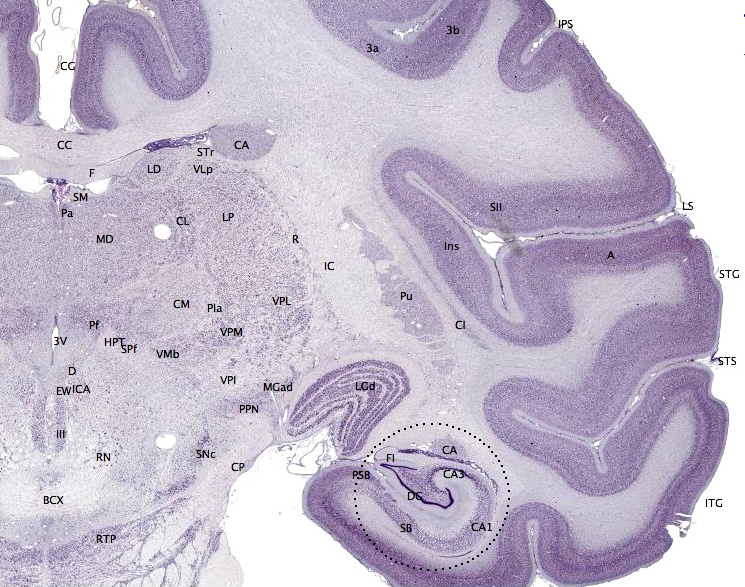
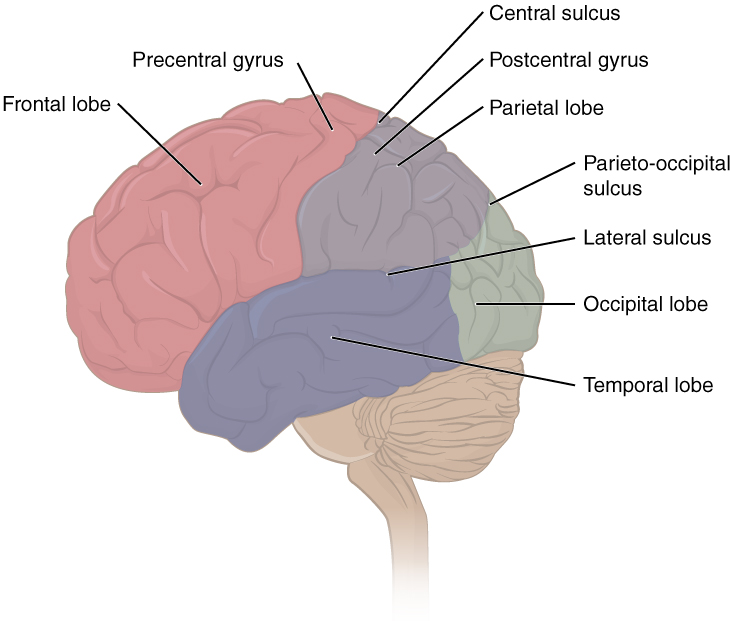
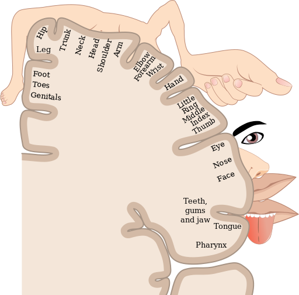

# Vỏ não và các thùy: thái dương, đỉnh, chẩm

## Tóm tắt

Nếu cắt đi một mảnh vỏ não nhỏ, người ta mất đi điều gì, và vì sao mất đúng điều đó? Câu trả lời ngắn: vỏ não là một tấm mỏng nơron gấp nếp, và các vùng của nó được gọi tên theo vị trí; mỗi vùng nhận một loại tín hiệu đầu vào và nối với những vùng khác, nên tổn thương ở đâu thường làm mất phần việc dựa nhiều vào chỗ ấy (suy luận của người viết, tổng hợp từ [S1] [S2]).

Bài đi qua ba trong bốn thùy của vỏ não: thùy thái dương (temporal lobe), thùy đỉnh (parietal lobe) và thùy chẩm (occipital lobe). Thùy trán, vỏ não trước trán và hai bán cầu đã có ở L04; thùy đảo (insula) cùng hải mã, hạnh nhân, đồi thị ở L07; bản đồ tổng ở L01. Mỗi thùy được viết theo một khung bảy ý: ở đâu, gồm những phần nào, vai trò và bằng chứng, kết nối, chất dẫn truyền, khi tổn thương, đừng hiểu nhầm. Mỗi khẳng định được gắn mức chắc chắn: **giáo khoa** (nguồn đồng thuận), **giả thuyết** (có nguồn, nói rõ ai đề xuất) hoặc **suy luận của người viết**.

Ba ý đáng mang theo. Thứ nhất, cách chia thùy là quy ước để gọi tên, lấy các rãnh làm mốc, không phải bốn cơ quan tách biệt [S1] [S3]. Thứ hai, mỗi thùy có một vài "việc đặc trưng", ví dụ thùy chẩm lo thị giác, nhưng việc thật luôn chạy qua nhiều thùy [S1] [S3]. Thứ ba, nhiều chỗ vẫn còn tranh luận; suy luận của người viết là tên kiểu "vùng của chức năng X" nên đọc như "vùng hoạt động mạnh khi làm việc X", không phải "nút duy nhất của X" [S6] [S8].

## Vỏ não và cách người ta chia thùy

**Vỏ não là gì (giáo khoa).** Vỏ não (cerebral cortex) là một tấm mỏng nơron tạo nên lớp ngoài cùng của hai bán cầu đại não. Chữ "cortex" gốc Latin nghĩa là "vỏ cây"; trong giải phẫu thần kinh, "vỏ" là một tấm nơron, còn "nhân" (nucleus) là một cụm nơron [S1]. Vỏ não là chất xám (gray matter), gồm chủ yếu thân tế bào thần kinh và các kết nối tầm ngắn; bên dưới là chất trắng (white matter), gồm chủ yếu các sợi trục bọc myelin, một lớp chất béo cách điện giúp truyền tín hiệu nhanh hơn, và các bó sợi này mang tín hiệu tới những vùng xa [S1] [S2].

*Lát cắt đứng ngang (coronal) của não khỉ macaque. Chất xám của vỏ não là lớp ngoài màu tím sẫm; chất trắng bên dưới màu nhạt hơn. Nguồn hình: Wikipedia, giấy phép theo sách CC0; Hove & Martinez, Hình 10 (chương 2.6). https://rotel.pressbooks.pub/biologicalpsychology/chapter/the-brain/ [S1]*

**Mỏng, nhiều lớp và rất rộng (giáo khoa).** Lớp vỏ chỉ dày khoảng 2 đến 4 mm [S1]; Viện NINDS (Hoa Kỳ) hình dung nó dày bằng một chồng hai hoặc ba đồng xu mười xu [S4]. Phần lớn vỏ não có sáu lớp. Lớp 1 có rất ít thân tế bào, chủ yếu là đầu của sợi nhánh và sợi trục; lớp 2 và 3 gửi và nhận tín hiệu với các vùng vỏ gần đó; lớp 4 nhận tín hiệu từ đồi thị; lớp 5 và 6 gửi tín hiệu ra khỏi vỏ [S1] [S2]. Độ dày từng lớp khác nhau theo chức năng: vùng vỏ cảm giác nhận nhiều tín hiệu vào nên lớp 4 dày, vùng vận động gửi nhiều tín hiệu ra nên lớp 5 và 6 dày [S2]. Các nơron cùng một "cột" thẳng đứng xuyên qua các lớp thường đáp ứng với cùng một loại kích thích [S2].

**Một con số cần cẩn thận.** Giáo trình viết rằng vỏ não người rộng khoảng 1.800 cm², tức vỏ của mỗi bán cầu cỡ một chiếc bánh pizza đế mỏng cỡ vừa, và nhờ gấp nếp mà nhét vừa hộp sọ [S1]. Một sách giáo khoa miễn phí khác nói nếu bóc vỏ ra trải phẳng thì diện tích "xấp xỉ một mét vuông" [S3]. Hai tài liệu ghi hai con số khác nhau; giáo trình dẫn Van Essen và cộng sự (2018) cho con số của mình; bài này chưa đọc nguồn gốc ấy, nên chỉ nói lại con số như giáo trình ghi và không khẳng định con số một mét vuông.

**Gấp nếp và các mốc để chia thùy (giáo khoa).** Các nếp gấp tạo hồi (gyrus, số nhiều gyri) là gờ nổi và rãnh (sulcus, số nhiều sulci) là chỗ lõm giữa hai hồi; rãnh to và sâu gọi là khe (fissure) [S1]. Hầu hết các loài khác, kể cả thú nhỏ, có vỏ não nhẵn; vỏ người gấp nếp nhiều [S1]. Gấp nếp giúp nhét thêm chất xám vào khoang sọ hạn chế bởi kích thước ống sinh [S3]. Dựa vào các hồi, rãnh, khe chính làm mốc, người ta chia vỏ não thành bốn thùy lớn [S1] [S3]:

- **Rãnh trung tâm** (central sulcus) là ranh giới giữa thùy trán và thùy đỉnh.
- **Rãnh bên** (lateral sulcus, còn gọi khe Sylvius) tách thùy thái dương khỏi thùy trán và thùy đỉnh.
- **Thùy chẩm** không có ranh giới giải phẫu rõ ở mặt ngoài của não; nhìn từ mặt trong (medial), **rãnh đỉnh–chẩm** (parieto-occipital sulcus) tách thùy đỉnh khỏi thùy chẩm.

*Các thùy của vỏ não nhìn từ bên ngoài và các rãnh làm mốc (central sulcus: rãnh trung tâm; lateral sulcus: rãnh bên; parieto-occipital sulcus: rãnh đỉnh–chẩm; precentral gyrus: hồi trước trung tâm; postcentral gyrus: hồi sau trung tâm). Nguồn hình: OpenStax, giấy phép theo sách CC BY-NC-SA; Hove & Martinez, Hình 12 (chương 2.6). https://rotel.pressbooks.pub/biologicalpsychology/chapter/the-brain/ [S1]*

**Bản đồ Brodmann (giáo khoa).** Năm 1909, nhà giải phẫu người Đức Korbinian Brodmann xem kỹ cấu trúc vi thể của vỏ não (cytoarchitecture) và chia nó thành 52 vùng, gọi là các vùng Brodmann (Brodmann areas), đến nay vẫn dùng để gọi tên vị trí trong vỏ não [S1] [S2]. Nhiều vùng Brodmann khớp với một chức năng riêng, ví dụ vùng 4 là vùng vận động chính [S1], vùng 17 là vùng thị giác chính [S2] [S3]. Điều này gọi là "định vị chức năng" (localization of function) [S1].

**Từ vùng chính đến vùng liên hợp (giáo khoa).** Thông tin giác quan đi vào vùng vỏ cảm giác chính (primary sensory cortex) trước, rồi được xử lý tiếp ở các vùng cảm giác thứ cấp; vùng nào xử lý cùng lúc nhiều loại thông tin (ví dụ cả nghe lẫn nhìn) được gọi là vỏ liên hợp (association cortex) [S2]. Vỏ cảm giác chính được tổ chức theo bản đồ: các vùng da kề nhau được biểu diễn ở các vùng vỏ kề nhau (tổ chức theo vị trí cơ thể, somatotopic), các vùng võng mạc kề nhau ở các vùng vỏ thị giác kề nhau (tổ chức theo võng mạc, retinotopic) [S2].

**Quy ước, không phải bốn cơ quan.** Sách OpenStax nhận xét rằng việc thùy chẩm không có ranh giới giải phẫu rõ với thùy đỉnh và thùy thái dương khớp với việc các vùng này có chức năng liên quan với nhau [S3]. Một số liệu đáng nhớ về mạng nối: khoảng 80% các kết nối trong vỏ não tới những nơron ở cùng một vùng, và chỉ khoảng 5% là kết nối đường dài tới vùng xa hoặc sang bán cầu bên kia [S2]. Suy luận của người viết: cách chia thùy giống chia quận của một thành phố, có ích để chỉ đường chứ không phải bốn thành phố riêng.

**Hai điều giao cho bài khác.** Ranh giới giữa hai bán cầu và sự chuyên biệt hóa trái–phải thuộc L04; thùy đảo, nằm ở chỗ gặp nhau của các thùy, thuộc L07. Ở đây chỉ nhớ một điều: tín hiệu cảm giác và lệnh vận động của mỗi bên cơ thể phần lớn được xử lý ở bán cầu đối bên [S1] [S2].

## Thùy thái dương (temporal lobe)

**Ở đâu.** Thùy thái dương nằm ở phần bên của mỗi bán cầu, ngay dưới thái dương (do đó có tên "temporal") [S1]. Nó nằm trước vùng thị giác và nép dưới thùy đỉnh và thùy trán [S4], với ranh giới trên là rãnh bên [S1].

**Gồm những phần nào.** Giáo trình kể bốn khu vực chính [S1]:
- vỏ thính giác (auditory cortex) ở phần trên của thùy, vùng Brodmann 41 và 42 theo OpenStax [S1] [S3];
- vùng Wernicke (Wernicke's area) ở phần sau của hồi thái dương trên, liên quan đến hiểu ngôn ngữ [S1];
- mặt dưới của thùy, nhận tín hiệu thị giác từ vỏ thị giác, chứa vùng nhận mặt ở hồi thoi (fusiform face area) và vùng nhận nơi chốn và khung cảnh (parahippocampal place area) [S1];
- phần trong của thùy thái dương (medial temporal lobes; "medial" nghĩa là phía trong, gần đường giữa của não, không phải "ở giữa" thùy), quan trọng cho việc mã hóa trí nhớ dài hạn [S1]. Phần này gồm hải mã và hạnh nhân [S3], thuộc L07.

**Vai trò chính và bằng chứng.**

*Nghe (giáo khoa).* Vỏ thính giác ở phần trên của thùy nhận thông tin từ tai [S1] [S4].

*Hiểu và nói (giáo khoa với một chỗ giả thuyết).* Vùng Wernicke nối với vùng Broca ở thùy trán, vùng lo việc tạo ra lời nói, qua một bó chất trắng là bó cung (arcuate fasciculus) [S1].

*Vùng Broca (Broca's area) ở thùy trán, vùng Wernicke (Wernicke's area) ở hồi thái dương trên, hồi góc (angular gyrus) và bó cung (arcuate fasciculus) nối chúng. Nguồn hình: Noba, giấy phép theo sách CC BY-NC-SA; Hove & Martinez, Hình 16 (chương 2.6). https://rotel.pressbooks.pub/biologicalpsychology/chapter/the-brain/ [S1]*

Một mô hình nhìn khác (**giả thuyết**, do Hickok và Poeppel đề xuất năm 2007): xử lý tiếng nói đi theo hai "dòng". Dòng bụng (ventral) biến tín hiệu âm thanh thành sự hiểu, và phần lớn được tổ chức ở cả hai bán cầu; dòng lưng (dorsal) nối âm thanh tiếng nói với mạng vận động phát âm ở thùy trán, và nghiêng mạnh về bán cầu trái [S8]. Mô hình này đưa ra để giải quyết khó khăn của việc lập bản đồ vùng tiếng nói khi không tính đến loại nhiệm vụ mà người ta làm trong thí nghiệm [S8].

*Nhận mặt và nhận nơi chốn (bằng chứng ảnh chụp não và bệnh nhân).* Trong một nghiên cứu chụp cộng hưởng từ chức năng (fMRI), Kanwisher, McDermott và Chun (1997) tìm thấy ở hồi thoi của 12 trong 15 người một vùng hoạt động mạnh hơn khi người xem nhìn khuôn mặt so với khi nhìn các đồ vật thường gặp; sau đó các tác giả chạy thêm nhiều phép thử trên cùng vùng ấy (ví dụ mặt nhìn thẳng so với nhà, mặt ba phần tư so với bàn tay) và kết luận vùng này chọn lọc cho việc nhìn mặt [S5]. Đây là bằng chứng ở người, bằng ảnh chụp não. Từ tổn thương, giáo trình nêu rằng tổn thương ở mặt dưới thùy thái dương, ví dụ do đột quỵ, có thể làm hỏng những khả năng cụ thể, như mất nhận mặt (prosopagnosia), tức không nhận ra và xác định được khuôn mặt [S1].

*Trí nhớ (giáo khoa).* Mặt dưới của mỗi thùy thái dương đóng vai trò quan trọng trong việc tạo và gợi lại ký ức, kể cả ký ức về âm nhạc [S4]. Điều dễ hiểu sai là "ký ức nằm trong thùy thái dương": OpenStax viết rằng các cấu trúc ở thùy thái dương chịu trách nhiệm tạo trí nhớ dài hạn, nhưng nơi lưu cuối cùng của ký ức thường là vùng xử lý giác quan tương ứng [S3]. Chi tiết về hải mã ở L07.

**Kết nối với vùng nào.** Vùng Wernicke nối với vùng Broca qua bó cung [S1]. Mặt dưới thùy thái dương nhận tín hiệu thị giác từ vỏ thị giác; "dòng bụng" của thị giác đi tới phần dưới của thùy thái dương để nhận ra vật [S1].

**Chất dẫn truyền chính.** Giáo trình không nêu chất dẫn truyền đặc thù cho các vùng này; hồ sơ từng chất ở L03.

**Khi tổn thương hoặc rối loạn.** Tổn thương mặt dưới thùy thái dương có thể gây mất nhận mặt [S1]. Tổn thương phần trong của thùy thái dương ảnh hưởng đến mã hóa trí nhớ dài hạn (xem L07) [S1].

**Đừng hiểu nhầm.** Một: vùng Wernicke có lẽ không phải là "trung tâm hiểu lời nói" duy nhất; mô hình hai dòng của Hickok và Poeppel mô tả phần hiểu dựa vào một dòng tổ chức chủ yếu ở cả hai bán cầu [S8] (đây là giả thuyết, không phải sự thật đã đóng; kết luận về vùng Wernicke là suy luận của người viết từ mô hình, vì tóm tắt của bài báo không nhắc tên vùng này). Hai: vùng nhận mặt là vùng hoạt động mạnh hơn với mặt, không phải "nút nhận mặt" duy nhất; chính các tác giả tổng quan mô tả một cuộc tranh luận lâu dài giữa cách giải thích bằng cơ chế chuyên biệt cho mặt và cách giải thích bằng cơ chế đa dụng, dù họ nghiêng về phía chuyên biệt [S6]. Ba: ký ức không nằm gọn trong thùy thái dương [S3].

## Thùy đỉnh (parietal lobe)

**Ở đâu.** Thùy đỉnh nằm phía trên thùy thái dương và phía sau thùy trán [S1], tức ngay sau rãnh trung tâm [S1] [S3].

**Gồm những phần nào.** Phần trước thùy đỉnh là hồi sau trung tâm (postcentral gyrus), nằm ngay sau rãnh trung tâm, nơi có vỏ thể cảm chính (primary somatosensory cortex, S1), tương ứng các vùng Brodmann 1, 2 và 3 [S1] [S3]. Phần sau thùy đỉnh (posterior parietal cortex) là vùng "liên hợp": không thuần cảm giác cũng không thuần vận động [S1].

**Vai trò chính và bằng chứng.**

*Cảm giác cơ thể (giáo khoa).* Vỏ thể cảm xử lý các giác quan về da và cơ thể: chạm, áp lực, đau, ngứa, rung, và các giác quan chung về cơ thể gồm cảm nhận tư thế (proprioception, biết các bộ phận cơ thể đang ở đâu) và cảm nhận chuyển động (kinesthesia) [S1] [S3]. NINDS thêm rằng thùy đỉnh còn hỗ trợ đọc và làm tính [S4].

*Bản đồ cảm giác cơ thể trên vỏ thể cảm (sensory homunculus, "người lùn cảm giác"): các bộ phận nhạy cảm như ngón tay, môi, lưỡi chiếm vùng vỏ lớn hơn chân và thân. Nguồn hình: Wikipedia, giấy phép theo sách CC BY-SA; Hove & Martinez, Hình 17 (chương 2.6). https://rotel.pressbooks.pub/biologicalpsychology/chapter/the-brain/ [S1]*

Vỏ thể cảm được tổ chức như một bản đồ: các vùng da kề nhau ứng với các vùng vỏ kề nhau, và những bộ phận nhạy cảm vì có nhiều thụ thể trên da, như ngón tay và môi, chiếm vùng vỏ lớn hơn chân và thân [S1] [S2]. Lịch sử lập bản đồ này gắn với Penfield và Boldrey, những người năm 1937 nghiên cứu sự biểu diễn vận động và cảm giác cơ thể trên vỏ não người bằng cách kích thích điện [S10].

*Bản đồ không gian và phối hợp cảm giác (giáo khoa).* Vùng đỉnh sau kết hợp tín hiệu từ xúc giác, cảm nhận tư thế, thị giác, thính giác, cùng tín hiệu từ vùng vận động và vùng trước trán. Sự kết hợp này tạo ra bản đồ không gian để dẫn dắt chú ý và chuyển động [S1]. Ví dụ giáo trình nêu: muốn nắm một vật, vị trí của nó phải được dịch từ tọa độ trên võng mạc sang tọa độ trong không gian, và phép dịch này phụ thuộc vào hướng của mắt và đầu [S1]. Các bản đồ ấy gửi tín hiệu tới vùng vận động ở thùy trán để lập kế hoạch cử động, và tới vùng điều khiển mắt ở thùy trán (frontal eye fields) để hướng mắt và chú ý [S1].

*Chú ý (giả thuyết, từ bài tổng quan).* Corbetta và Shulman (2002) tổng hợp bằng chứng cho hai hệ chú ý tách một phần. Một hệ gồm một phần vỏ trong rãnh đỉnh (intraparietal) và vỏ trán trên, lo việc chọn lọc có chủ đích kích thích và phản ứng. Hệ kia gồm vỏ thái dương–đỉnh (temporoparietal) và vỏ trán dưới, lệch nhiều về bán cầu phải, không lo chọn lọc có chủ đích mà chuyên phát hiện kích thích quan trọng với hành vi, nhất là kích thích nổi bật hoặc bất ngờ, và đóng vai trò "cầu dao" cho hệ kia [S9].

**Kết nối với vùng nào.** Vùng đỉnh sau gửi tín hiệu tới vùng vận động và vùng điều khiển mắt ở thùy trán [S1]. "Dòng lưng" của thị giác đi từ vỏ thị giác tới vùng đỉnh [S1] [S7].

**Chất dẫn truyền chính.** Giáo trình không nêu chất dẫn truyền đặc thù cho các vùng này; xem L03.

**Khi tổn thương hoặc rối loạn.** Tổn thương vùng đỉnh sau có thể làm hỏng động tác với tay được dẫn bằng mắt và nhận thức không gian [S1]. Nó cũng có thể gây bỏ rơi nửa không gian (hemispatial neglect): người bệnh mất nhận biết một bên của không gian. Ví dụ giáo trình nêu: đột quỵ ở vùng đỉnh sau bên phải có thể khiến người bệnh hành xử như thể nửa không gian bên trái không tồn tại, bỏ qua thức ăn ở phía trái đĩa, hoặc khi chép một bức tranh thì chỉ vẽ nửa bên phải [S1]. Bài tổng quan của Corbetta và Shulman cho biết cả hai hệ chú ý đều bị rối loạn trong chứng bỏ rơi nửa không gian một bên [S9].

**Đừng hiểu nhầm.** Một: bản đồ cơ thể trên vỏ thể cảm không vẽ theo kích thước cơ thể mà theo độ nhạy: bàn tay và môi to ra vì có nhiều thụ thể, không phải vì chúng "lớn" [S1]. Hai: nên đọc bỏ rơi nửa không gian như một rối loạn chú ý và nhận biết chứ không như mù một nửa: các nguồn gắn nó với thùy đỉnh, chú ý và nhận biết [S1] [S9], còn mù do tổn thương thị giác được NINDS nêu ở thùy chẩm [S4]. Cách nói "không phải mù một nửa" là suy luận của người viết; giáo trình cũng mô tả người bệnh như không nhận thấy nửa thị trường bên trái [S1].

## Thùy chẩm (occipital lobe)

**Ở đâu.** Thùy chẩm nằm ở phía sau của não [S1] [S4]. Ở mặt ngoài nó không có ranh giới giải phẫu rõ với thùy đỉnh và thùy thái dương; ở mặt trong, rãnh đỉnh–chẩm tách nó khỏi thùy đỉnh [S1] [S3].

**Gồm những phần nào.** Điểm tín hiệu từ mắt vào vỏ não là vỏ thị giác chính (primary visual cortex, V1) ở phần sau cùng của thùy chẩm [S1]. Các vùng Brodmann 17 và 18 ở thùy chẩm chịu trách nhiệm tri giác thị giác chính [S3]; vùng 17 chính là V1 [S2]. Từ V1, tín hiệu đi tới nhiều vùng thị giác khác trong và ngoài thùy chẩm [S1].

**Vai trò chính và bằng chứng.**

*Đường đi của tín hiệu (giáo khoa).* Tín hiệu từ mắt đi theo dây thần kinh thị giác tới nhân gối ngoài (lateral geniculate nucleus, LGN) ở đồi thị, rồi tới vỏ thị giác [S1] [S2].

*Đường thị giác từ mắt (eyeball) qua dây thần kinh thị giác (optic nerve), giao thoa thị giác (optic chiasm), nhân gối ngoài ở đồi thị (LGN, thalamus), bó tia thị (optic radiation) tới vỏ thị giác chính (V1) ở cực chẩm (occipital pole). Nguồn hình: Wikipedia, giấy phép theo sách CC BY-SA; Hove & Martinez, Hình 22B (chương 2.6). https://rotel.pressbooks.pub/biologicalpsychology/chapter/the-brain/ [S1]*

*Bản đồ trên võng mạc (giáo khoa).* V1 tổ chức theo võng mạc: những vùng võng mạc kề nhau ứng với những vùng vỏ thị giác kề nhau [S1] [S2]. Từ V1, tín hiệu đến các vùng chuyên xử lý các đặc điểm khác nhau của ảnh như màu, cạnh, hướng, kết cấu và chuyển động [S1].

*Đi lên và đi xuống (giáo khoa).* Các vùng thị giác nối với nhau dày đặc và hai chiều: có tín hiệu đi lên theo thang xử lý, và cũng có tín hiệu phản hồi đi ngược xuống [S1]. NINDS mô tả thùy chẩm xử lý hình ảnh từ mắt và liên kết nó với hình ảnh đã lưu trong trí nhớ [S4].

*Hai dòng thị giác (giáo khoa, kèm giả thuyết).* Giáo trình mô tả hai dòng chính: dòng bụng (ventral, "cái gì", what) đi xuống thùy thái dương dưới để nhận ra vật; dòng lưng (dorsal, "ở đâu", where) đi lên vùng đỉnh để lập bản đồ vị trí vật, nhất là cho cử động của mắt và tay [S1]. Goodale và Milner (1992) đề xuất một cách diễn giải khác về cùng hai dòng: dòng bụng, từ vỏ thị giác tới vỏ thái dương dưới, giữ vai trò chính trong việc nhận diện vật; dòng lưng, tới vùng đỉnh sau, làm các phép biến đổi cảm giác–vận động cần cho hành động được dẫn bằng mắt nhằm vào vật ấy, tức "nhận biết" so với "hành động" [S7]. Đó là một đề xuất dựa trên bằng chứng thần kinh–tâm lý, điện sinh lý và hành vi; hai cách gọi (cái gì/ở đâu và nhận biết/hành động) nhìn cùng một cấu trúc từ hai hướng.

**Kết nối với vùng nào.** Nhận tín hiệu từ nhân gối ngoài của đồi thị [S1]. Gửi tín hiệu theo dòng bụng tới thùy thái dương dưới và theo dòng lưng tới thùy đỉnh [S1] [S7].

**Chất dẫn truyền chính.** Giáo trình không nêu chất dẫn truyền đặc thù cho các vùng này; xem L03.

**Khi tổn thương hoặc rối loạn.** NINDS cho biết tổn thương thùy chẩm có thể gây mù [S4].

**Đừng hiểu nhầm.** "Nhìn" không diễn ra chỉ ở thùy chẩm: OpenStax nhấn mạnh thông tin thị giác phức tạp nên còn được xử lý ở thùy thái dương và thùy đỉnh [S3], và hai dòng thị giác kể trên đi ra khỏi thùy chẩm [S1] [S7].

## Các thùy làm việc cùng nhau

Phần này chỉ ghép những gì các mục trên đã nói; các bước và cách chia bước là suy luận của người viết, còn vai trò gán cho mỗi thùy ở mỗi bước đều có nguồn.

**Ví dụ của người viết: nghe ai gọi tên, quay lại và chào.** Bạn đứng ở sân ga, nghe có tiếng gọi tên mình từ phía sau, quay lại, nhận ra khuôn mặt một người bạn và giơ tay chào.

1. *Nghe thấy tiếng gọi.* Tín hiệu từ tai tới vỏ thính giác ở phần trên của thùy thái dương [S1] [S4].
2. *Hiểu đó là tên mình.* Việc hiểu lời nói dựa vào vùng Wernicke theo mô tả của giáo trình, hoặc theo mô hình hai dòng, vào một dòng tổ chức chủ yếu ở cả hai bán cầu [S1] [S8].
3. *Quay về hướng tiếng gọi.* Chú ý bị kéo về kích thích quan trọng, bất ngờ; theo bài tổng quan, việc phát hiện kích thích quan trọng hoặc bất ngờ là của hệ thái dương–đỉnh lệch về bán cầu phải [S9]; áp vào một tiếng gọi là suy luận của người viết, vì bài tổng quan không nói riêng về âm thanh.
4. *Thấy hình ảnh.* Tín hiệu từ mắt qua nhân gối ngoài tới V1 ở thùy chẩm [S1] [S4].
5. *Nhận ra mặt bạn.* Dòng bụng đưa thông tin tới mặt dưới thùy thái dương, nơi có vùng hoạt động mạnh hơn khi xem mặt [S1] [S5] [S6].
6. *Giơ tay, bắt tay.* Dòng lưng và vùng đỉnh sau lập bản đồ vị trí của tay và của người bạn, rồi gửi sang vùng vận động ở thùy trán (xem L04) [S1] [S7].

Các bước chồng lên nhau, không chạy lần lượt như dây chuyền. Một cách nhìn mà OpenStax gợi ra: vì ranh giới giữa các thùy không rõ nên không có gì lạ khi chức năng của chúng đan xen [S3]. Chính vùng vỏ nhận tín hiệu cảm giác đầu tiên cũng chỉ là bước đầu: sau đó thông tin đi qua vùng thứ cấp và vùng liên hợp [S2].

**Hai cách nghĩ về hai dòng thị giác.** Cách nghĩ "cái gì/ở đâu" trong giáo trình và cách nghĩ "nhận biết/hành động" của Goodale và Milner cùng chỉ ra một điều: tín hiệu thị giác tách đường tới thùy thái dương và thùy đỉnh, mỗi đường làm một việc [S1] [S7]. Cái nào gọi tên đúng hơn vẫn là chuyện của nghiên cứu, và nguồn trong bài này không đủ để phân xử.

## Những hiểu lầm thường gặp

Mỗi hiểu lầm dưới đây đi kèm điều nguồn nói. Chỉ những hiểu lầm có nguồn phản bác mới được đưa vào; chỗ nào là suy luận của người viết thì ghi rõ.

1. **"Mỗi thùy làm đúng một việc."** Mỗi thùy có "việc đặc trưng", nhưng OpenStax nhắc rằng thông tin thị giác còn được xử lý ở thùy thái dương và thùy đỉnh, và ranh giới giữa thùy chẩm với hai thùy kia không rõ [S3]. Hai dòng thị giác đi từ thùy chẩm sang thùy thái dương và thùy đỉnh [S1].
2. **"Vùng Wernicke là trung tâm hiểu lời nói."** Giáo trình gắn vùng này với hiểu ngôn ngữ [S1]; mô hình hai dòng (giả thuyết) mô tả phần hiểu dựa vào một dòng tổ chức chủ yếu ở cả hai bán cầu, còn dòng nối âm thanh với phát âm mới nghiêng mạnh về trái [S8]; kết luận về vùng Wernicke là suy luận của người viết từ mô hình.
3. **"Đã có một vùng nhận mặt, hết tranh cãi."** Vùng ở hồi thoi hoạt động mạnh hơn với mặt trong thí nghiệm có nhiều phép thử [S5]; bài tổng quan của chính các tác giả mô tả một cuộc tranh luận giữa cơ chế chuyên biệt và cơ chế đa dụng, dù họ nghiêng về phía chuyên biệt [S6].
4. **"Ký ức nằm trong thùy thái dương."** Thùy thái dương quan trọng cho tạo và gợi lại ký ức [S4], nhưng nơi lưu cuối cùng của ký ức thường là vùng xử lý giác quan tương ứng [S3].
5. **"Vỏ não trải phẳng ra bằng một mét vuông."** Giáo trình ghi khoảng 1.800 cm², còn một sách miễn phí khác ghi xấp xỉ một mét vuông [S1] [S3]. Bài này không khẳng định số sau.
6. **"Bản đồ cơ thể trên vỏ não vẽ theo kích thước cơ thể."** Vùng vỏ rộng hay hẹp theo độ nhạy của bộ phận, vì nơi nhiều thụ thể chiếm nhiều vỏ hơn [S1] [S2].
7. **"Bỏ rơi nửa không gian là mù một nửa."** Suy luận của người viết, đặt cạnh các nguồn: giáo trình gắn nó với thùy đỉnh, vai trò chú ý và nhận biết [S1]; bài tổng quan nói cả hai hệ chú ý đều rối loạn trong chứng này [S9]; mù do tổn thương thị giác được NINDS nêu ở thùy chẩm [S4]. Không nguồn nào nói thẳng "đây không phải mù", và giáo trình cũng mô tả người bệnh như không nhận thấy nửa thị trường bên trái [S1].

## Điều cần nhớ

- Vỏ não là tấm nơron mỏng (khoảng 2–4 mm), thường sáu lớp, gấp nếp; bốn thùy là cách gọi tên theo các rãnh làm mốc [S1] [S3].
- Thùy thái dương: nghe, hiểu ngôn ngữ, nhận mặt và nơi chốn, trí nhớ; chi tiết hải mã ở L07 [S1] [S4].
- Thùy đỉnh: cảm giác cơ thể (bản đồ theo độ nhạy), bản đồ không gian, chú ý; tổn thương có thể gây bỏ rơi nửa không gian [S1] [S9].
- Thùy chẩm: thị giác, V1 tổ chức theo võng mạc; từ đó hai dòng đi tới thùy thái dương và thùy đỉnh [S1] [S7].
- Việc thật chạy qua nhiều thùy cùng lúc; nhiều chỗ còn tranh luận (vùng nhận mặt [S6], mô hình hai dòng cho tiếng nói [S8]) và hai dòng thị giác có hai cách gọi tên [S1] [S7].

## Nguồn tham khảo

- [S1] Hove & Martinez, Biological Psychology (Revised Edition), mục 2.6 The Brain, 2024, https://rotel.pressbooks.pub/biologicalpsychology/chapter/the-brain/
- [S2] Hall, C. N., Introduction to Biological Psychology, chương 2 Exploring the brain, University of Sussex Library, 2023, https://openpress.sussex.ac.uk/introductiontobiologicalpsychology/chapter/exploring-the-brain-a-tour-of-the-structures-and-cells-of-the-nervous-system/
- [S3] Betts, J. G. và cộng sự, Anatomy and Physiology 2e, mục 13.2 The Central Nervous System, OpenStax, 2022, https://openstax.org/books/anatomy-and-physiology-2e/pages/13-2-the-central-nervous-system
- [S4] NINDS, Brain Basics: Know Your Brain, https://www.ninds.nih.gov/health-information/public-education/brain-basics/brain-basics-know-your-brain
- [S5] Kanwisher, McDermott & Chun, The fusiform face area: a module in human extrastriate cortex specialized for face perception, J Neurosci, 1997, https://doi.org/10.1523/JNEUROSCI.17-11-04302.1997
- [S6] Kanwisher & Yovel, The fusiform face area: a cortical region specialized for the perception of faces, Phil Trans R Soc B, 2006, https://doi.org/10.1098/rstb.2006.1934
- [S7] Goodale & Milner, Separate visual pathways for perception and action, Trends Neurosci, 1992, https://doi.org/10.1016/0166-2236(92)90344-8
- [S8] Hickok & Poeppel, The cortical organization of speech processing, Nat Rev Neurosci, 2007, https://doi.org/10.1038/nrn2113
- [S9] Corbetta & Shulman, Control of goal-directed and stimulus-driven attention in the brain, Nat Rev Neurosci, 2002, https://doi.org/10.1038/nrn755
- [S10] Penfield & Boldrey, Somatic motor and sensory representation in the cerebral cortex of man as studied by electrical stimulation, Brain, 1937, https://doi.org/10.1093/brain/60.4.389
