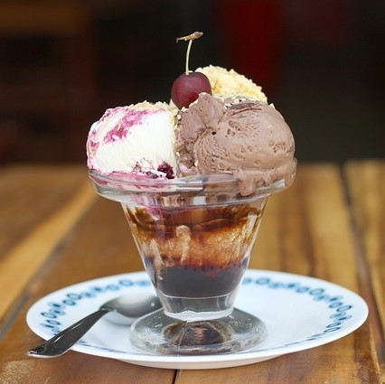
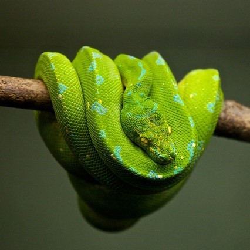
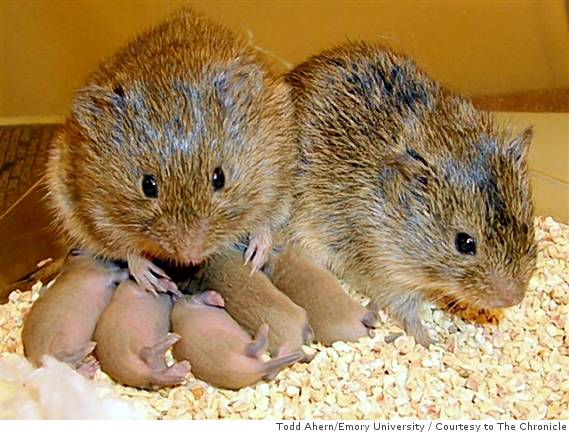
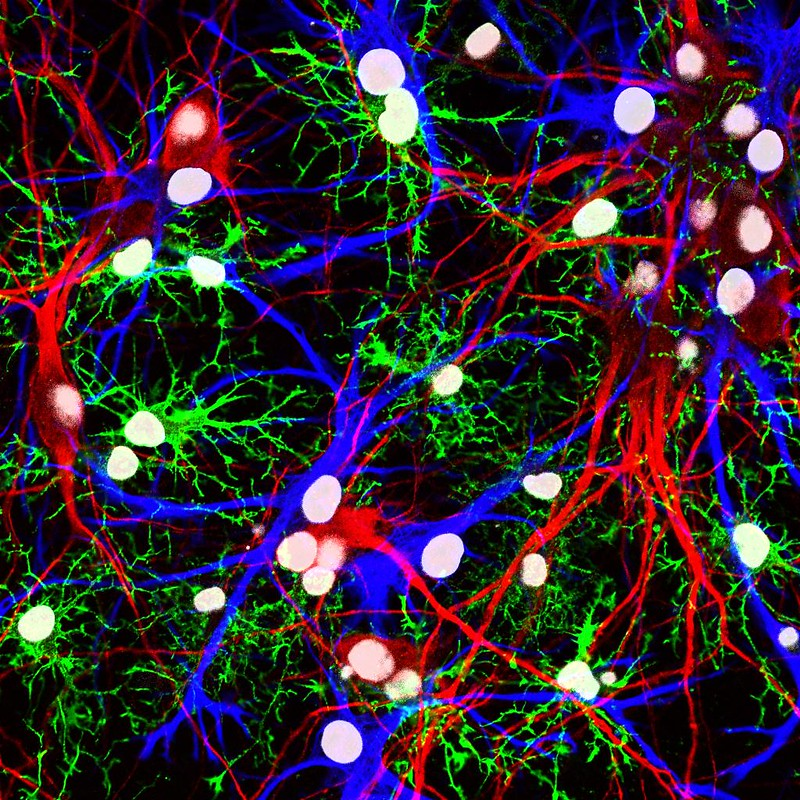

# Cảm xúc cơ bản và mạch thần kinh

## Tóm tắt

Khi bạn sợ, giận hay nhớ một người, trong não có gì đang chạy? Bài này trả lời câu hỏi đó theo cách của khoa học thần kinh
cảm xúc (affective neuroscience): ngành tìm hiểu não và hệ thần kinh tạo ra phản ứng cảm xúc như thế nào [S1]. Giáo trình nền của
bài (Hove & Martinez, chương 10) mô tả sáu hệ cảm xúc cơ bản: ham muốn (desire), thích (liking), sợ (fear), giận (rage), yêu thương và gắn
bó (love), đau buồn và cô đơn (grief) [S2]. Mỗi hệ được viết theo cùng một thẻ hồ sơ bảy ý để bạn so sánh được: cảm xúc đó là gì, mạch
thần kinh chính, chất liên quan, vai trò thích nghi, khi mất cân bằng, nó khác cảm giác chủ quan thế nào, và điều đừng hiểu nhầm.

Ba ý xuyên suốt bài. Thứ nhất, không có cảm xúc nào nằm gọn trong một cấu trúc: mỗi phản ứng cảm xúc huy động một mạng lưới, và các
mạch liên quan đến cảm xúc trải gần như khắp não [S1]. Thứ hai, ngay câu hỏi "có cảm xúc cơ bản hay không" vẫn đang được tranh luận:
Jaak Panksepp cho rằng có các hệ cảm xúc bẩm sinh dưới vỏ não [S7], còn Lisa Feldman Barrett và cộng sự cho rằng não kiến tạo từng
cảm xúc từ những thành phần chung hơn [S8] [S9]. Thứ ba, các mạch này không cố định: kinh nghiệm sống có thể "chỉnh lại" cùng một vùng
não từ chỗ tạo ham muốn sang chỗ tạo sợ hãi, ít nhất là ở chuột [S3] [S14].

Cách đọc nhãn mức chắc chắn trong bài: **giáo khoa** là điều các nguồn tổng quan đồng thuận; **đang tranh luận** là điều có nguồn
nhưng còn người phản bác (bài nói rõ ai); **suy luận của người viết** là ý của người viết, không gắn [Sn]. Phần lớn bằng chứng về mạch
đến từ động vật; chỗ nào như vậy, bài ghi rõ.

## Khoa học thần kinh nghiên cứu cảm xúc thế nào

**Cảm xúc là gì, theo nghĩa làm việc.** Trong tâm lý học, "affect" chỉ trải nghiệm cảm xúc, tâm trạng và cảm giác. Giáo trình dùng
định nghĩa của Izard: cảm xúc là hiện tượng tâm lý gồm thay đổi trên cơ thể (như nét mặt), thay đổi hoạt động của hệ thần kinh tự chủ
(autonomic nervous system), trạng thái cảm nhận chủ quan, và thôi thúc hành động theo một hướng nhất định (động cơ) [S1]. Mức chắc chắn:
giáo khoa. Định nghĩa này dùng để làm gì? Nó cho ta bốn thứ đo được thay vì một từ mơ hồ.

**Đo bằng gì ở người.** Nghiên cứu cảm xúc ở người chủ yếu dựa vào kỹ thuật không xâm lấn như điện não đồ (EEG) và cộng hưởng từ chức
năng (fMRI), cùng các nghiên cứu trên người bị tổn thương não do tai nạn hoặc bệnh [S1]. Các kỹ thuật này cho biết vùng nào hoạt động
cùng lúc với cảm xúc, nhưng độ phân giải của chúng có giới hạn: fMRI chưa xem được từng nhân nhỏ bên trong một cấu trúc như cách nghiên
cứu xâm lấn ở động vật làm được [S4].

**Vì sao nghiên cứu trên động vật.** Các kỹ thuật xâm lấn (cấy điện cực, gây tổn thương có chủ đích, đưa hormone vào) mạnh hơn nhưng
chỉ dùng được trên động vật [S1]. Giáo trình lập luận rằng mạch cảm xúc ở các loài có vú sống theo bầy như chuột, chó, khỉ vận hành
tương tự mạng cảm xúc ở người, nên động vật là mô hình có giá trị [S1]. Vì vậy chương này dùng chữ "cơ thể sống" (organism) cho cả
chuột, khỉ lẫn người khi nói về một phản ứng chung [S1].

**Kích thích điện não.** Một công cụ chính là kích thích điện có định vị (electrical stimulation of the brain). Panksepp tổng hợp rằng
kích thích điện vào các vùng cổ dưới vỏ não dễ dàng gây ra phản ứng cảm xúc mạnh, chưa qua học tập; con vật chủ động tìm hoặc tránh
những kích thích đó, nghĩa là chúng có giá trị thưởng hoặc phạt [S7]. Ông cũng dẫn rằng ở người, kích thích chất xám quanh cống não
(periaqueductal gray, PAG) gây cảm giác mạnh và tắt nhanh khi ngừng kích thích [S7]. Mức chắc chắn: phương pháp là giáo khoa; việc diễn
giải "con vật cảm thấy gì" thì đang tranh luận (xem mục sau).

**Mạng lưới, không phải điểm.** Giáo trình nhấn mạnh: cảm xúc không nằm ở một cấu trúc; phản ứng cảm xúc huy động mạng lưới, với nhiều
phần của não cùng hoạt động, và các mạch liên quan đến cảm xúc gần như là cả bộ não [S1]. Các mạch nằm sâu dưới vỏ não được xem là chủ
yếu chịu trách nhiệm tạo ra cảm xúc cơ bản [S1]. Giáo trình cũng thừa nhận nghiên cứu trước đây tập trung vào vài cấu trúc cụ thể, và
nghiên cứu sau có thể tìm thêm vùng quan trọng [S1].

*Một số trong nhiều cấu trúc tham gia xử lý cảm xúc. Nhãn tiếng Anh: orbital frontal cortex (vỏ não trán ổ mắt), nucleus accumbens (nhân accumbens), preoptic region (vùng trước thị), hypothalamus (vùng dưới đồi), amygdala (hạnh nhân), stria terminalis (dải tận), periaqueductal gray (chất xám quanh cống não), thalamus (đồi thị), visual cortex (vỏ não thị giác). Nguồn hình: Noba, giấy phép theo sách CC BY-NC-SA; Hove & Martinez, Hình 2 (chương 10). [S1]*

Các cấu trúc trong hình (hạnh nhân, vùng dưới đồi, nhân accumbens, đồi thị) có thẻ hồ sơ riêng ở L07; bài này chỉ nói chúng làm gì trong
từng mạch cảm xúc.

**Cảm xúc (emotion) khác cảm giác (feeling).** Đây là chỗ dễ nhầm nhất. Berridge và Kringelbach phân biệt phản ứng khoái cảm khách
quan, đo được trên hành vi hay thần kinh, với cảm nhận khoái cảm có ý thức; hai thứ thường đi cùng nhau nhưng có thể tách rời, ví dụ
phản ứng "thích" có thể xảy ra mà người đó không nhận ra mình đang thích [S10]. LeDoux đi xa hơn: ông đề nghị gọi các mạch chung giữa
người và động vật là "mạch sinh tồn" (survival circuits), và cho rằng hoạt động của chúng không trực tiếp gây ra cảm giác, dù góp phần
vào cảm giác [S12]. Craig thì mô tả một hệ thần kinh hướng tâm báo về tình trạng sinh lý của cơ thể (cảm nhận nội thân, interoception),
và cho rằng hệ này có thể là nền cho cảm giác chủ quan [S15]. Mức chắc chắn: phân biệt hai cấp độ là đồng thuận; cảm giác sinh ra từ đâu
thì đang tranh luận.

Ví dụ của người viết: tim đập nhanh, lòng bàn tay ướt và cơ căng lên khi một chiếc xe phanh gấp sát người là phần "cảm xúc" đo được. Câu
bạn tự nói sau đó, "suýt chết, sợ quá", là phần "cảm giác". Một máy đo nhịp tim thấy được phần đầu; chỉ bạn kể được phần sau.

**Cảm xúc dùng để làm gì.** Ở mọi loài, phản ứng cảm xúc được tổ chức quanh nhu cầu sống còn và sinh sản; cảm xúc ảnh hưởng đến tri
giác, suy nghĩ và hành vi để giúp cơ thể sống tồn tại và phát triển [S1]. Đó là lý do mỗi thẻ hồ sơ bên dưới có ý "vai trò thích nghi".

## Hai cách nhìn: cảm xúc cơ bản hay cảm xúc được kiến tạo

Trước khi đi vào sáu cảm xúc, cần biết rằng chính cách chia "sáu hệ" là một lập trường, không phải sự thật đã xong. Mục này trình bày hai
cách nhìn chính và một cách nhìn thứ ba, nói rõ ai nói gì. Bài không phân xử thay bạn.

**Cách nhìn hệ cảm xúc cơ bản (Panksepp).** Panksepp cho rằng mọi loài có vú có các mạng cảm xúc mang giá trị dương và âm, tập trung ở
những vùng não tương đồng giữa các loài; ông mô tả bảy hệ và viết tên bằng chữ in hoa để tránh lẫn với từ thường: SEEKING (tìm kiếm),
RAGE (giận dữ), FEAR (sợ), LUST (dục), CARE (chăm sóc), PANIC/GRIEF (hoảng sợ chia ly/đau buồn) và PLAY (chơi) [S7]. Bằng chứng ông nêu:
kích thích điện các vùng dưới vỏ gây ra những phản ứng đó; mạch nằm ở vùng tương đồng ở mọi động vật có xương sống đã thử; các thôi
thúc cảm xúc nguyên thủy, kể cả chơi đùa, vẫn còn sau khi vỏ não mới bị cắt bỏ từ sớm [S7]. Mức chắc chắn: đây là giả thuyết của Panksepp,
có nhiều người ủng hộ và cũng có người phản bác.

**Ba tầng xử lý.** Panksepp không nói vỏ não vô dụng. Ông chia ba tầng: tầng sơ cấp là các hệ cảm xúc bẩm sinh dưới vỏ; tầng thứ cấp là
học tập và ghi nhớ (như điều kiện hóa nỗi sợ); tầng tam cấp là suy nghĩ và tự điều chỉnh, tập trung ở vỏ não trán giữa [S7]. Theo ông,
vai trò chính của vỏ não là điều chỉnh cảm xúc: duy trì nó bằng nghiền ngẫm hoặc làm dịu nó bằng các cách ức chế [S7]. Ông còn viết rằng
cảm xúc phức tạp hơn có thể được "kiến tạo" qua các hành vi khái niệm, nhưng đó không phải toàn bộ câu chuyện [S7].

**Giáo trình nền của bài dựa trên dòng nào.** Mục 10.2 của Hove & Martinez dẫn nhiều lần Panksepp (1998) và Panksepp & Biven (2012), và cả
chương được chuyển thể từ bài "Affective neuroscience" của Harmon-Jones & Harmon-Jones trong bộ Noba [S2]. Sáu hệ của giáo trình không trùng
khít bảy hệ của Panksepp: giáo trình tách "thích" thành một hệ riêng theo Berridge & Kringelbach, và không có mục riêng cho LUST và PLAY
[S2]. Suy luận của người viết: vì vậy "sáu cảm xúc cơ bản" trong bài nên hiểu là cách chia của một giáo trình, không phải danh sách chuẩn
mà mọi nhà khoa học đồng ý.

**Cách nhìn kiến tạo (Barrett).** Barrett gọi cách nhìn cổ điển là bắt đầu từ các từ chỉ cảm xúc quen thuộc (giận, buồn, sợ, ghê) rồi đi tìm
"dấu vân tay" sinh học cho từng từ, thường ở dưới vỏ [S9]. Lý thuyết cảm xúc kiến tạo (theory of constructed emotion) của bà đi ngược lại:
não dùng các khái niệm cảm xúc để phân loại cảm giác, và việc phân loại đó tạo ra một trường hợp cảm xúc [S9]. Theo bà, "sợ" là một
phạm trù chứa những trường hợp rất khác nhau, không cần chung một nhóm nơron [S9]. Bà dẫn khái niệm thoái hóa (degeneracy): nhiều bộ
nơron khác nhau có thể tạo ra cùng một loại cảm xúc, nên một bệnh nhân mất mạch viền do viêm não vẫn còn cảm xúc [S9].

**Phân tích gộp của Lindquist và cộng sự (2012).** Nhóm này gộp các nghiên cứu hình ảnh não về cảm xúc ở người và so hai giả thuyết: "định
vị" (mỗi cảm xúc ứng với một vùng riêng, ổn định) và "kiến tạo tâm lý" (cảm xúc dựng từ các mạng chung) [S8]. Kết quả: ít bằng chứng rằng
từng loại cảm xúc định vị được nhất quán và đặc hiệu vào một vùng riêng; thay vào đó, một tập vùng não tương tác, cũng tham gia nhiều
việc không phải cảm xúc, hoạt động trên nhiều loại cảm xúc [S8]. Ví dụ, hạnh nhân hoạt động nhất quán hơn khi nhìn nét mặt sợ, nhưng
những điểm đó cũng hoạt động với các cảm xúc khác, nên không đặc hiệu cho sợ [S8].

**Chính nhóm Lindquist cũng nêu cách hiểu khác.** Họ viết rằng fMRI có giới hạn không gian và thời gian, nên vẫn có thể có chuyên biệt ở
mức mạch nhỏ hơn mà fMRI không thấy [S8]. Họ cũng thừa nhận có mạch giải phẫu rõ cho từng hành vi ở thú như kêu, chăm con, đứng im
(freezing), giật mình, tấn công, nhưng xem đó là các "thao tác cơ bản" chứ không phải bằng chứng cho mạch riêng của phạm trù phức tạp như
sợ hay giận [S8].

**Cách nhìn thứ ba (LeDoux).** LeDoux, người có công lớn trong nghiên cứu mạch sợ, đề nghị tách hẳn "mạch sinh tồn" chung giữa các loài
(phòng vệ, sinh sản, cân bằng năng lượng...) khỏi "cảm giác" có ý thức [S12]. Ông phê bình việc suy từ hành vi giống nhau sang cảm giác
giống nhau, và nêu đích danh Panksepp: rất ít nhà khoa học bị thuyết phục vì không có cách kiểm chứng khách quan con vật trải nghiệm gì
[S12]. Theo LeDoux, cảm giác có ý thức xuất hiện khi trạng thái toàn cơ thể do mạch sinh tồn khởi động được biểu diễn trong "không gian
làm việc" nhận thức, được phân loại nhờ trí nhớ và gắn nhãn bằng từ ngữ [S12].

**Đọc tranh luận này thế nào.** Ba bên đồng ý vài điều: có những mạch dưới vỏ chung giữa các loài, chúng quan trọng cho sống còn, và vỏ
não tham gia vào trải nghiệm có ý thức [S7] [S8] [S12]. Họ khác nhau ở chỗ gọi các mạch đó là gì: "hệ cảm xúc có cảm nhận" (Panksepp),
"thao tác cơ bản" để kiến tạo cảm xúc (Lindquist, Barrett), hay "mạch sinh tồn" không phải cảm xúc (LeDoux). Suy luận của người viết: khi
bài gọi tên "mạch sợ" hay "mạch giận" ở các mục sau, hãy hiểu là "mạch tạo ra hành vi mà các nhà nghiên cứu gọi là sợ, giận ở động vật",
không phải "nơi chứa cảm giác sợ".

## Ham muốn (desire)

**1. Cảm xúc đó là gì.** Ham muốn là cảm xúc của sự thèm, của việc đi tìm phần thưởng. Các nhà nghiên cứu gọi quá trình này bằng nhiều
tên: "muốn" (wanting) theo Berridge & Kringelbach, "tìm kiếm" (seeking) theo Panksepp & Biven, hay "độ nhạy kích hoạt hành vi" theo Gray
[S2]. Khi hệ này được kích hoạt, cơ thể sống tỏ ra hăng hái, quan tâm, tò mò; nó thúc con vật di chuyển trong môi trường để tìm thức ăn
ngon, bạn tình và các kích thích dễ chịu khác [S2]. Mức chắc chắn: giáo khoa (mô tả hành vi).

**2. Mạch thần kinh chính.** Nhiều bằng chứng đến từ kích thích điện trực tiếp ở động vật: khi cấy điện cực vào vùng dưới đồi bên (lateral
hypothalamus), hoặc các vùng vỏ và não giữa nối với vùng dưới đồi, con vật nhấn cần để tự kích thích, gợi ý rằng chúng thấy kích thích đó
dễ chịu [S2]. Hệ này còn gồm hạnh nhân, nhân accumbens và vỏ não trán [S2]. Dopamine sinh ra trong các đường dopamine trung não - viền
(mesolimbic) và trung não - vỏ (mesocortical) hoạt hóa các vùng này [S2]. Ở người và động vật, vỏ não trán trái hoạt động mạnh hơn vỏ
trán phải trong cảm xúc hướng tới như ham muốn và hứng thú [S2]. Mức chắc chắn: phần mạch là giáo khoa từ động vật; phần trán trái/phải
là kết quả lặp lại nhiều lần nhưng ở mức tương quan.

**3. Chất dẫn truyền và hormone liên quan.** Dopamine là chất chính được giáo trình nêu cho hệ này [S2]. Hồ sơ của dopamine ở L03; ghép
chất với cảm xúc ở L10. Cơ chế dopamine báo "sai số dự đoán phần thưởng" thuộc L05 và L00, bài này không nhắc lại.

**4. Vai trò thích nghi.** Hệ ham muốn đẩy con vật ra khỏi chỗ đứng yên để đi tìm thứ nó cần [S2]. Các vùng này tạo cảm giác hào hứng,
có ý nghĩa và mong chờ [S2]. Ví dụ của người viết: trước khi mở hộp quà, bạn thấy háo hức; sự háo hức đó khiến bạn hành động (mở hộp),
dù chưa biết bên trong có gì.

**5. Khi mất cân bằng.** Khi hệ ham muốn bị kích hoạt quá yếu, con vật trông chán nản và bất lực [S2]. Theo hướng ngược lại, các cấu trúc
này nhạy với cocaine và amphetamine, những chất có tác động giống dopamine [S2]. Berridge & Kringelbach mô tả bệnh nhân Parkinson dùng liều
cao thuốc đồng vận dopamine có thể nảy sinh thôi thúc cưỡng bức (cờ bạc, mua sắm...), nhưng thường không báo cảm giác khoái cảm mạnh [S10].
Ở người tổn thương não, các nhà nghiên cứu đầu tiên ghi nhận tổn thương vỏ trán trái đi kèm trầm cảm, còn tổn thương trán phải đi kèm hưng
cảm (Goldstein, 1939, theo giáo trình) [S2]. Mức chắc chắn: quan sát lâm sàng cũ, cần đọc thận trọng.

*Giáo trình nêu rằng chỉ nhìn hình món ăn hấp dẫn cũng có thể làm tăng hoạt động vỏ não trán trái. Nguồn hình: Noba, giấy phép Public Domain theo sách; Hove & Martinez, Hình 3 (chương 10). [S2]*

**6. Nó khác cảm giác chủ quan thế nào.** Bằng chứng ở người chủ yếu là tương quan đo bằng EEG và fMRI: trẻ sơ sinh 2 đến 3 ngày tuổi tăng
hoạt động trán trái khi được nhỏ nước đường lên lưỡi; người lớn đang đói cũng vậy khi xem hình món tráng miệng [S2]. Đây là hoạt động não
đi kèm, không phải bản thân cảm giác "thèm". Ở động vật, "muốn" được đo bằng việc con vật chịu làm việc vất vả bao nhiêu để có phần
thưởng [S2], tức là đo hành vi.

**7. Đừng hiểu nhầm.** "Điện cực khoái cảm" kinh điển chưa chắc tạo ra khoái cảm. Berridge & Kringelbach xem lại các ca cấy điện cực ở
người từ những năm 1950 đến 1960: bệnh nhân tự kích thích liên tục, nhưng nhận định "sướng" chủ yếu là mô tả của người làm thí nghiệm, ít
khi là lời bệnh nhân [S10]. Hai tác giả cho rằng các điện cực này có lẽ tạo ra "muốn" nhiều hơn "thích" [S10]. Mức chắc chắn: đang tranh
luận, đây là cách diễn giải của hai tác giả. Vì thế đừng đồng nhất ham muốn với khoái cảm; mục sau tách hai thứ đó.

## Thích (liking) và khoái cảm

**1. Cảm xúc đó là gì.** "Thích" là khoái cảm khi nhận được phần thưởng: vị ngọt ngon, mùi dễ chịu. Điều đáng ngạc nhiên là mức ham muốn
một phần thưởng không nhất thiết tương ứng với mức thích nó, và cấu trúc não lo việc thưởng thức khác với cấu trúc lo việc ham muốn [S2].
Ở trẻ nhỏ và động vật, "thích" được đo bằng tốc độ liếm, động tác thè lưỡi và nét mặt vui; còn "muốn" đo bằng mức sẵn sàng làm việc để có
phần thưởng [S2]. Berridge & Kringelbach dùng dấu ngoặc kép cho "thích" để chỉ phản ứng khách quan, dù có kèm cảm giác có ý thức hay
không [S10]. Phần "muốn khác thích" như cơ chế dopamine của hệ thưởng thuộc L05; ở đây ta nhìn khoái cảm như một cảm xúc với mạch riêng.

**2. Mạch thần kinh chính.** Nghiên cứu tập trung vào một vùng nhỏ trong nhân accumbens và nửa sau của nhạt cầu bụng (ventral pallidum)
[S2]. Berridge & Kringelbach gọi đó là các "điểm nóng khoái cảm" (hedonic hotspots): ở chuột, mỗi điểm khoảng 1 mm³; điểm nóng trong nhân
accumbens chỉ chiếm khoảng 10% thể tích nhân này [S10]. Kích thích opioid loại mu ở điểm nóng này có thể làm tăng ít nhất gấp đôi phản ứng
"thích" với vị ngọt; ngay cạnh đó lại có "điểm lạnh" (coldspot), nơi cùng kích thích làm giảm "thích" [S10]. Điểm nóng còn được tìm thấy ở
nhân cạnh cánh tay (parabrachial nucleus) của cầu não, và có thể ở vỏ não trán ổ mắt và thùy đảo [S10]. Ở người và khỉ, vỏ não trán ổ mắt
(orbitofrontal cortex) hoạt động với kích thích dễ chịu như tiền, mùi thơm, khuôn mặt hấp dẫn [S2]. Mức chắc chắn: điểm nóng là kết quả
từ chuột, do một nhóm nghiên cứu chính tìm ra và tổng hợp.

**3. Chất dẫn truyền và hormone liên quan.** Các vùng "thích" nhạy với opioid và endocannabinoid [S2]. Opioid loại mu, delta và kappa đều
tăng "thích" ở điểm nóng nhân accumbens, và anandamide (một endocannabinoid) cũng vậy ở vùng chồng lấn [S10]. Hồ sơ endorphin và opioid ở
L03.

**4. Vai trò thích nghi.** Berridge & Kringelbach viết rằng khoái cảm có chức năng thích nghi và được tạo bởi mạch vỏ - viền phát triển tốt
[S10]. Ảnh chụp não người cho thấy những khoái cảm rất khác nhau (thức ăn, tình dục, chất gây nghiện, bạn bè và người thân, âm nhạc, nghệ thuật) kích hoạt các mạch giống nhau đến bất ngờ,
gợi ý một "đồng tiền chung" của khoái cảm [S10]. Mức chắc chắn: phần "đồng tiền chung" là diễn giải của hai tác giả.

**5. Khi mất cân bằng.** Mất khoái cảm (anhedonia) hoặc cảm xúc tiêu cực kéo dài (dysphoria) trong các rối loạn cảm xúc có thể bắt nguồn từ
sự trục trặc của hệ khoái cảm [S10]. Ở chuột, tổn thương hoặc bất hoạt tạm thời điểm nóng nhạt cầu bụng sau làm mất phản ứng "thích" với vị
ngọt và thay bằng phản ứng ghê tởm (há miệng, lắc đầu) [S10]. Trong nghiện, người nghiện thường vẫn thèm ma túy dù biết thứ có sẵn sẽ không
đem lại khoái cảm [S2]; giáo trình giải thích rằng người ta tiếp tục theo đuổi cocaine, thuốc phiện, cờ bạc hay tình dục dù không còn thấy
sướng do đã quen (habituation) [S2].

**6. Nó khác cảm giác chủ quan thế nào.** Trẻ sơ sinh ngay ngày đầu đã có nét mặt "thích" với vị ngọt và "ghê" với vị đắng; khỉ và chuột
có nét mặt tương đồng [S10]. Đó là phản ứng khách quan. Berridge & Kringelbach dẫn các nghiên cứu cho thấy phản ứng "thích" có thể xảy ra
vô thức ở người bình thường, với kích thích rất ngắn hoặc rất nhẹ, và vẫn thay đổi hành vi dù người đó không nhận ra [S10]. Ngược lại, điểm
số "tôi thích bao nhiêu" có thể bị lệch do cách đặt câu hỏi [S10].

**7. Đừng hiểu nhầm.** Dopamine không phải "chất khoái cảm". Chuột bị phá gần hết nơron dopamine (còn khoảng 1% mức bình thường) vẫn giữ
nguyên phản ứng "thích" với vị ngọt; bệnh nhân Parkinson thiếu dopamine nhiều vẫn chấm điểm thích vị ngọt bình thường; tăng dopamine làm
tăng "muốn" mà không tăng "thích" [S10]. Mức chắc chắn: kết quả lặp lại ở nhiều nghiên cứu theo tổng quan của Berridge & Kringelbach; người
đề xuất giả thuyết "dopamine là khoái cảm", Roy Wise, sau này cũng rút lại theo hai tác giả [S10].

## Sợ (fear)

**1. Cảm xúc đó là gì.** Sợ là cảm xúc khó chịu thúc đẩy né tránh những tình huống có thể gây hại [S2]. Ở động vật, kích thích nhẹ vùng não
liên quan đến sợ làm con vật đứng im (freezing), kích thích mạnh làm nó bỏ chạy [S2]. Mức chắc chắn: giáo khoa (hành vi ở động vật).

**2. Mạch thần kinh chính.** Mạch sợ đi từ nhân trung tâm của hạnh nhân (central amygdala) đến chất xám quanh cống não ở não giữa [S2].
LeDoux tổng kết rằng hạnh nhân là một thành phần quan trọng của hệ thống tiếp nhận, lưu giữ và thể hiện ký ức sợ, chủ yếu nhờ thí nghiệm
điều kiện hóa nỗi sợ (fear conditioning) [S11]. Chi tiết hơn ở loài gặm nhấm: thông tin cảm giác vào nhân bên (lateral nucleus) của hạnh nhân,
đi qua các kết nối bên trong tới nhân trung tâm, rồi tới phần bụng bên của chất xám quanh cống não, nơi điều khiển hành vi đứng im [S12].
Mối đe dọa bẩm sinh như mùi kẻ săn mồi đi đường khác: qua hạnh nhân giữa (medial amygdala) và các nhân vùng dưới đồi tới phần lưng của chất
xám quanh cống não [S12]. Cấu trúc hạnh nhân và vùng dưới đồi xem L07.

**Hai con đường vào hạnh nhân.** Có lẽ vì sợ quan trọng cho sống còn nên có hai đường đưa tín hiệu từ giác quan đến hạnh nhân [S2]. Khi bạn
thấy một con rắn, thông tin đi từ mắt tới đồi thị rồi tới vỏ não thị giác, vỏ não gửi tiếp đến hạnh nhân; nhưng đồi thị cũng gửi thông tin
thẳng tới hạnh nhân để cơ thể phản ứng trước khi kịp nhận thức rõ con rắn [S2]. Đường đồi thị - hạnh nhân nhanh nhưng kém chính xác hơn
đường đi qua vỏ não [S2].

*Giáo trình dùng hình con rắn để minh họa rằng não có thể "nhận ra" kích thích đáng sợ trước khi ta nhận thức được nó. Nguồn hình: Noba, giấy phép Public Domain theo sách; Hove & Martinez, Hình 4 (chương 10). [S2]*

**3. Chất dẫn truyền và hormone liên quan.** Các cấu trúc của mạch sợ nhạy với glutamate, yếu tố giải phóng corticotropin (CRF), hormone
hướng vỏ thượng thận (ACTH) và một số neuropeptide; benzodiazepine và các thuốc an thần khác ức chế hoạt động ở đây [S2]. Ở phần đáy bên của
hạnh nhân, noradrenaline giúp củng cố ký ức cảm xúc [S6]. Hồ sơ các chất ở L03; căng thẳng và trục hormone ở L05.

**4. Vai trò thích nghi.** Sợ báo cho ta biết có điều đe dọa [S2]. Điều kiện hóa nỗi sợ cho phép một kích thích vô nghĩa (một âm thanh) trở
thành tín hiệu nguy hiểm khi nó đi kèm một kích thích gây hại; sau đó chỉ riêng âm thanh cũng khởi động phản ứng phòng vệ bẩm sinh [S12].
Giáo trình cũng dẫn một nghiên cứu trên chuột: sau khi học sợ một âm thanh, nếu làm chết các tế bào ở nhân bên hạnh nhân thì ký ức sợ đó
phai đi [S6].

**5. Khi mất cân bằng.** Tổn thương hạnh nhân hoặc phần bụng hải mã làm hỏng điều kiện hóa nỗi sợ ở cả người và động vật [S2]. Theo chiều
ngược lại, cơ chế noradrenaline giúp ghi nhớ mạnh sự kiện cảm xúc có thể góp phần gây lo âu và giữ ký ức sang chấn khi căng thẳng kéo dài
hoặc sang chấn, như trong rối loạn căng thẳng sau sang chấn (PTSD) [S6]. Mức chắc chắn: cơ chế ở động vật là giáo khoa; liên hệ với PTSD ở
người là giả thuyết được giáo trình nêu.

**6. Nó khác cảm giác chủ quan thế nào.** Phần lớn bằng chứng là đứng im ở chuột, không phải cảm giác sợ. LeDoux nhấn mạnh rằng nghiên cứu sợ
thành công vì đã tập trung vào một mặt được định nghĩa rõ (điều kiện hóa) và tránh khái niệm mơ hồ như "cảm giác cảm xúc" [S11]. Về sau ông
viết rằng hoạt động của mạch phòng vệ không trực tiếp gây ra cảm giác sợ [S12]. Lindquist và cộng sự dẫn các ví dụ: chuẩn bị phát biểu trước
đám đông, một tình huống đáng sợ không có hình ảnh nổi bật, lại làm giảm hoạt động hạnh nhân; và không phải mọi hành vi phòng vệ ở chuột đều
cần hạnh nhân [S8].

**7. Đừng hiểu nhầm.** Hạnh nhân không phải "trung tâm sợ hãi". Nó hoạt động cả khi bất định và khi có cảm xúc tích cực [S4]; theo cách nhìn
kiến tạo, nó báo kích thích nào đáng chú ý, mới lạ hay khó đoán, chứ không đặc hiệu cho sợ [S8]. Thêm nữa, đứng im chủ yếu xảy ra ở không gian
hẹp không có lối thoát [S12], nên "sợ = đứng im" cũng là cách nói quá gọn.

## Giận (rage)

**1. Cảm xúc đó là gì.** Giận là cảm xúc khó chịu, làm cơ thể hưng phấn, thúc đẩy tiến tới và tấn công [S2]. Nó có thể bị khơi lên khi mục
tiêu bị cản trở, khi đau thể xác hoặc khi bị giữ chặt; ở động vật có lãnh thổ, giận nổi lên khi kẻ lạ xâm nhập [S2]. Mức chắc chắn: giáo khoa.

**2. Mạch thần kinh chính.** Mạng của giận và sợ nằm gần nhau nhưng tách riêng [S2]. Mạch giận đi từ hạnh nhân giữa, qua những phần nhất
định của vùng dưới đồi, đến chất xám quanh cống não [S2]. Mạch giận nối với mạch ham muốn, nên khi phần thưởng mong đợi không đến, con vật có
thể nổi giận [S2]. Khi người ta giận, vỏ não trán trái hoạt động tăng, ủng hộ ý rằng giận là cảm xúc "hướng tới" (approach) giống ham muốn,
dù mang giá trị khó chịu [S2]. Mức chắc chắn: mạch là từ động vật; trán trái ở người là tương quan.

**3. Chất dẫn truyền và hormone liên quan.** Giáo trình nói thẳng: các chất dẫn truyền của giận chưa được hiểu rõ; chất P (substance P),
cũng liên quan đến đau và căng thẳng, có thể đóng vai trò quan trọng; testosterone và arginine-vasopressin có thể tham gia [S2]. Một số chất
ức chế hệ giận: opioid và liều cao thuốc chống loạn thần như chlorpromazine [S2]. Chương hormone còn nói cortisol, corticosterone và
vasopressin cũng liên quan đến gây hấn, và không có quan hệ một - một giữa hormone và hành vi [S5]. Ghép chất và hormone với cảm xúc xem L10.

**4. Vai trò thích nghi.** Gây hấn xuất hiện khi lợi ích các cá thể xung đột, thường về tài nguyên có hạn như lãnh thổ, thức ăn hay bạn tình
[S5]. Nhiều xung đột được giải quyết bằng tư thế phục tùng hoặc đấu theo nghi thức mà không gây thương tích [S5]. Ở chuột đồng thảo nguyên,
vasopressin cần cho hành vi "canh giữ bạn đời", tức gây hấn có chọn lọc với cá thể lạ sau khi đã kết đôi [S13].

**5. Khi mất cân bằng.** Ở chuột nhắt, việc tiếp xúc androgen quanh lúc sinh và khi trưởng thành cùng quyết định mức gây hấn [S5]. Ở người,
nam giới nói chung gây hấn thể chất nhiều hơn nữ, nhưng nguyên nhân (hormone, cách não được "lắp" trước sinh, hay nuôi dạy) vẫn đang tranh
luận mạnh và khó tách bạch [S5]. Mức chắc chắn: đang tranh luận, giáo trình nói rõ điều này.

**6. Nó khác cảm giác chủ quan thế nào.** Phần lớn bằng chứng là hành vi tấn công ở động vật khi kích thích điện hoặc khi bị xâm phạm lãnh
thổ. Giáo trình có nhắc rằng kích thích điện một số vùng não ở người từng làm họ bộc phát hành vi hung hăng [S5]. Suy luận của người viết:
hành vi tấn công và cảm giác "tôi đang bực" là hai thứ; người ta có thể giận mà không tấn công, và động vật có thể tấn công vì săn mồi mà không
"giận".

**7. Đừng hiểu nhầm.** Testosterone không phải "hormone giận dữ": giáo trình chỉ nói nó "có thể" liên quan đến giận, và nhấn mạnh không có
quan hệ một - một giữa hormone và hành vi [S2] [S5]. Giận cũng không phải mặt trái của sợ: hai cảm xúc có mạch gần nhau nhưng tách riêng, và
giận lại gần ham muốn ở chỗ cùng là cảm xúc hướng tới [S2].

## Yêu thương và gắn bó (love)

**1. Cảm xúc đó là gì.** Với động vật xã hội như con người, sự gắn bó với cá thể cùng loài tạo ra các cảm xúc tích cực: yêu thương, ấm áp,
trìu mến [S2]. Giáo trình phân biệt hai loại: cảm xúc thúc đẩy chăm sóc (như mẹ chăm con) và cảm xúc thúc đẩy ở gần người mình gắn bó để
được chăm sóc và bảo vệ (như con bám mẹ) [S2]. Mức chắc chắn: giáo khoa.

**2. Mạch thần kinh chính.** Vùng quan trọng cho hành vi chăm con của mẹ gồm vùng trước thị lưng (dorsal preoptic area) và nhân giường của dải
tận (bed nucleus of the stria terminalis); các vùng này chồng lấn với vùng của ham muốn tình dục [S2]. Ở chuột, hành vi làm mẹ cần vùng trước
thị giữa của vùng dưới đồi; vùng này có thể bị hạnh nhân và phản ứng sợ ức chế, và hormone quanh lúc sinh có lẽ làm giảm hoạt động hạnh nhân
để cho phép hành vi làm mẹ [S5]. Với gắn bó đôi lứa ở chuột đồng thảo nguyên, Walum & Young mô tả thụ thể oxytocin dày ở nhân accumbens và vỏ
não trước trán giữa, thụ thể vasopressin dày ở nhạt cầu bụng, tức các vùng của hệ thưởng [S13]. Mức chắc chắn: giáo khoa ở động vật.

*Chuột đồng thảo nguyên (prairie vole) sống chung một đôi sau giao phối và cùng chăm con; đây là loài được nghiên cứu nhiều nhất về cơ sở sinh học của gắn bó. Nguồn hình: Todd Ahern, giấy phép CC BY theo sách; Hove & Martinez, Hình 10 (chương 6). [S5]*

**3. Chất dẫn truyền và hormone liên quan.** Oxytocin, arginine-vasopressin và opioid nội sinh (endorphin, enkephalin) [S2]; ở chuột đồng
thảo nguyên còn có dopamine [S13]. Ở chuột đồng thảo nguyên, oxytocin và vasopressin được vùng dưới đồi tiết ra khi giao phối và tác động lên hệ viền và hệ thưởng [S5].
Hồ sơ hai chất ở L03; tranh cãi "oxytocin làm tăng tin tưởng" ở người thuộc L10.

**4. Vai trò thích nghi.** Hành vi chăm con quyết định sự sống của con non ở động vật có vú [S5]. Ở chuột đồng thảo nguyên, cho oxytocin làm
con cái gắn bó hơn, chặn thụ thể oxytocin làm giảm gắn bó; ở con đực, vasopressin có tác dụng tương tự [S5]. Khi tăng số thụ thể vasopressin ở
nhạt cầu bụng của chuột đồng cỏ (meadow vole, loài không kết đôi), chúng trở nên gắn bó giống chuột đồng thảo nguyên [S13]. Walum & Young đề
xuất mô hình: kết đôi là do tính dẻo synapse nối tín hiệu nhận diện bạn đời với hệ thưởng, làm bạn đời trở thành phần thưởng bền vững [S13].

**5. Khi mất cân bằng.** Ở chuột đồng thảo nguyên, mức thụ thể oxytocin ở nhân accumbens khác nhau nhiều giữa các cá thể và liên quan đến
việc con non bị cách ly hằng ngày có còn kết đôi được về sau hay không [S13]. Ở người, gắn bó không an toàn và xung đột trong quan hệ tình
cảm có liên quan đến trầm cảm và sức khỏe kém hơn, theo tổng quan của Walum & Young [S13]. Mức chắc chắn: tương quan ở người, không phải
nhân quả.

**6. Nó khác cảm giác chủ quan thế nào.** Ở người, fMRI cho thấy vùng liên quan đến thưởng hoạt động mạnh hơn khi xem ảnh con hay người yêu
so với ảnh bạn bè [S5]. Walum & Young cho rằng kết đôi là tiền thân tiến hóa của tình yêu lãng mạn, nhưng tình yêu ở người còn gồm khả năng
nhớ lại quá khứ chung và nghĩ về tương lai, nhờ vỏ não phức tạp riêng của người; họ cũng viết mô hình của mình chỉ nên xem là gợi ý để kiểm
chứng, không phải sự thật [S13].

*Giáo trình nhắc rằng giới khoa học ngày nay phân biệt tình yêu lãng mạn với tình thương cha mẹ, cũng như người Hy Lạp cổ dùng hai chữ "eros" và "storge". Nguồn hình: Flickr, giấy phép CC BY theo sách; Hove & Martinez, Hình 5 (chương 10). [S2]*

**7. Đừng hiểu nhầm.** Oxytocin không phải "hormone tình yêu" hay "hormone hạnh phúc". Ở chuột đồng thảo nguyên, cùng oxytocin nhưng hiệu quả
phụ thuộc thụ thể nằm ở đâu và nhiều hay ít [S13]; ở con đực, vasopressin quan trọng hơn [S5]. Kết quả từ chuột không chuyển thẳng sang
người được.

## Đau buồn và cô đơn (grief)

**1. Cảm xúc đó là gì.** Các mạng thần kinh của gắn bó cũng nhạy với chia ly; chúng tạo ra cảm xúc đau đớn của đau buồn, hoảng loạn và cô đơn
[S2]. Khi con non của người hay thú có vú khác bị tách khỏi mẹ, chúng phát ra tiếng kêu đau khổ hoặc khóc [S2]. Panksepp gọi hệ này là
PANIC/GRIEF [S7]. Mức chắc chắn: hành vi là giáo khoa; việc xếp hoảng loạn và đau buồn chung một hệ là giả thuyết của Panksepp.

**2. Mạch thần kinh chính.** Giáo trình định nghĩa mạch gắn bó là các mạch làm con vật phát tiếng kêu đau khổ khi bị kích thích điện [S2].
Hệ này bắt đầu ở chất xám quanh cống não, rất gần vùng tạo phản ứng đau thể xác, gợi ý rằng nó có thể đã tiến hóa từ mạch đau (theo Panksepp)
[S2]. Tiếng kêu chia ly cũng có thể được gợi lên khi kích thích đồi thị lưng giữa, vách bụng, vùng trước thị lưng và nhân giường của dải tận,
gần mạch tình dục và chăm con [S2].

**3. Chất dẫn truyền và hormone liên quan.** Các vùng này nhạy với opiate nội sinh, oxytocin và prolactin; cả ba ngăn đau khổ chia ly [S2].
Testosterone cũng giảm đau khổ chia ly, có lẽ do giảm nhu cầu gắn bó [S2]. Ở chuột đồng thảo nguyên, hệ CRF (yếu tố giải phóng corticotropin)
và oxytocin ở nhân accumbens tương tác khi mất bạn đời [S13]. Ghép chi tiết với L10.

**4. Vai trò thích nghi.** Tiếng kêu khi bị tách khỏi mẹ giúp con non được tìm lại. Walum & Young đề xuất rằng cảm giác khó chịu khi xa bạn
đời là một cơ chế giữ mối gắn bó: nó thúc cá thể đang lang thang quay về với bạn đời, kiểu "củng cố âm" [S13]. Mức chắc chắn: giả thuyết của
hai tác giả.

**5. Khi mất cân bằng.** Chuột đồng thảo nguyên bị tách khỏi bạn đời đã kết đôi có hành vi đối phó thụ động (giống trầm cảm trong các bài test
ở chuột), tăng hoạt động trục căng thẳng và nhạy đau hơn; tách khỏi anh em ruột thì không gây ra điều đó [S13]. Giáo trình cũng nêu rằng cơn
hoảng loạn (panic attack) có vẻ là một dạng đau khổ chia ly dữ dội do hệ gắn bó khởi động, và có thể được opiate làm dịu [S2]. Mức chắc chắn:
phần chuột là thực nghiệm; phần cơn hoảng loạn là giả thuyết của dòng Panksepp mà giáo trình nhắc lại, chưa phải đồng thuận.

**6. Nó khác cảm giác chủ quan thế nào.** Chuột không kể được nỗi nhớ; ta chỉ đo tiếng kêu, sự bất động và hormone. Suy luận của người viết:
chữ "đau buồn" ở người còn gồm ký ức, ý nghĩa của mất mát và văn hóa tang lễ, những tầng mà nghiên cứu trên chuột không chạm tới; Panksepp
cũng xếp chúng vào các tầng xử lý cao hơn [S7].

**7. Đừng hiểu nhầm.** Giáo trình viết rằng opiate như morphin, heroin và cả nicotine tạo ra cảm giác dễ chịu giống cảm giác của giao tiếp xã hội
tích cực, và điều này "có thể" giải thích vì sao chúng gây nghiện [S2]. Đó là giả thuyết, không phải bằng chứng rằng người nghiện thiếu tình cảm.
Giáo trình cũng ghi cơn hoảng loạn phổ biến ở nữ hơn nam và đặt cạnh tác dụng của testosterone [S2]; đây là một liên hệ được nêu ra, không
phải giải thích đã được chứng minh.

## Một cấu trúc, nhiều chức năng

**Một "cấu trúc" thật ra là một tổ hợp.** Nhiều nghiên cứu nói về cả khối như hạnh nhân hay nhân accumbens, nhưng chính xác hơn phải gọi
chúng là tổ hợp (complex), gồm nhiều nhóm nhân làm việc khác nhau [S4]. Ví dụ, hạnh nhân ở linh trưởng không phải người có thể chia thành 13
nhân và vùng vỏ [S4]. Nhân trung tâm gửi tín hiệu xuống thân não, tạo biểu hiện cảm xúc bẩm sinh và phản ứng sinh lý đi kèm; nhân đáy nối với
thể vân, tham gia hành động như chạy đến chỗ an toàn [S4]. Mức chắc chắn: giáo khoa.

**Không thể ghép một - một cảm xúc với vùng não.** Giáo trình viết rõ: không thể lập bản đồ một - một giữa cảm xúc và vùng não [S4]. Hạnh
nhân được nghiên cứu nhiều về sợ, nhưng nó cũng hoạt động khi bất định và khi có cảm xúc tích cực [S4]. Đây là điều mà cả giáo trình (theo
dòng cảm xúc cơ bản) lẫn phân tích gộp của Lindquist và cộng sự (theo dòng kiến tạo) cùng thừa nhận [S4] [S8].

**Ví dụ: một vùng xuất hiện trong nhiều cảm xúc.** Đọc lại sáu mục trên, ta thấy cùng một vùng xuất hiện nhiều lần. Hạnh nhân có mặt trong
ham muốn, sợ và giận (phần giữa); chất xám quanh cống não có mặt trong sợ, giận và đau buồn; nhân giường của dải tận có trong chăm con và đau
khổ chia ly; nhân accumbens có trong ham muốn, thích và gắn bó [S2] [S13]. Nhân accumbens còn chứa cả vùng tạo ham muốn lẫn vùng tạo sợ hãi,
xếp theo trục trước - sau như các phím đàn ("bàn phím cảm xúc", affective keyboard) [S10].

**Ví dụ: một chất làm nhiều việc.** Opioid tăng "thích" ở điểm nóng, ức chế hệ giận, và ngăn đau khổ chia ly [S2]. Vasopressin liên quan đến
cả giận lẫn gắn bó đôi lứa [S2] [S13]. Suy luận của người viết: vì vậy câu hỏi "chất X làm ta cảm thấy gì" thường sai từ cách hỏi; câu đúng
hơn là "chất X ở vùng Y, gắn thụ thể Z, trong hoàn cảnh nào".

**Ví dụ: cùng một phản ứng, nhiều mạch.** Barrett dẫn ca bệnh nhân mất mạch viền vì viêm não do virus herpes vẫn có cảm xúc, và cặp sinh đôi
cùng trứng cùng bị vôi hóa phần đáy bên hạnh nhân nhưng khả năng cảm xúc khác hẳn nhau [S9]. Bà dùng các ca này để minh họa thoái hóa: nhiều
mạch khác nhau có thể tạo ra cùng một loại cảm xúc [S9]. Mức chắc chắn: các ca bệnh là dữ kiện; cách diễn giải là của Barrett.

**Vì sao điều này quan trọng.** Câu "vùng X là trung tâm của cảm xúc Y" xuất hiện nhiều trên báo chí. Mục này cho ba lý do để nghi ngờ nó:
mỗi vùng là nhiều nhân khác việc nhau; một vùng góp mặt trong nhiều cảm xúc; và một cảm xúc dùng được nhiều mạch [S4] [S8] [S9]. Bài L07 sẽ
cho từng cấu trúc một thẻ hồ sơ đầy đủ, với ý "đừng hiểu nhầm" riêng.

## Kinh nghiệm làm đổi não

**Ý chính.** Phản ứng của một vùng não cụ thể có thể bị kinh nghiệm thay đổi [S3]. Giáo trình minh họa bằng câu "nơron cùng phát xung thì nối với
nhau" (neurons that fire together, wire together): khi một cảm xúc thường đi kèm một bối cảnh, ta học liên kết hai thứ đó [S3]. Cơ chế synapse
của tính dẻo xem L02.

*Ảnh hiển vi huỳnh quang các nơron và tế bào thần kinh đệm (glia), minh họa cho ý "nơron cùng phát xung thì nối với nhau". Nguồn hình: Flickr, giấy phép CC BY theo sách; Hove & Martinez, Hình 6 (chương 10). [S3]*

**Thí nghiệm "bàn phím" ở nhân accumbens.** Phần vỏ (shell) phía trước của nhân accumbens thường tham gia hành vi hướng tới như ăn, phần vỏ phía
sau tham gia hành vi phòng vệ do sợ [S3]. Reynolds & Berridge làm gián đoạn tín hiệu liên quan glutamate tại từng điểm nhỏ trong vỏ giữa của
nhân accumbens ở chuột: điểm phía trước thường gây hành vi thèm ăn mạnh, càng lùi về sau càng gây hành vi sợ [S14]. Ảnh chụp não người cũng
thấy sự phân chia trước - sau này [S3].

**Môi trường chỉnh lại bàn phím.** Khi chuột ở môi trường căng thẳng, vùng tạo sợ lan về phía trước, chiếm khoảng 90%
phần vỏ; khi chuột ở môi trường quen thuộc ưa thích như "nhà", vùng tạo sợ co lại và vùng tạo ham muốn lan về phía sau, cũng chiếm khoảng 90%
[S3] [S14]. Hai tác giả kết luận rằng môi trường cảm xúc đã chỉnh lại cách mạch vỏ - viền tạo ra động lực [S14]. Mức chắc chắn: kết quả thực
nghiệm ở chuột; giáo trình và bài gốc nói cùng một điều.

Ví dụ của người viết: hãy hình dung nhân accumbens như một bàn phím đàn, đầu trái là phím "thèm", đầu phải là phím "sợ". Kinh nghiệm không
đổi số phím, nhưng đổi chỗ ranh giới giữa hai vùng: sống lâu trong căng thẳng, phần lớn phím phát ra nốt "sợ".

**Ví dụ khác từ chương hormone.** Chuột trưởng thành vốn né chuột con vì sợ mùi và sợ cái mới, nhưng nếu được tiếp xúc hằng ngày thì dần có hành
vi chăm sóc [S5]. Đây là một ví dụ nữa về việc kinh nghiệm làm đổi cân bằng giữa sợ và chăm sóc.

**Nối với ký ức cảm xúc.** Ở người và động vật, sự kiện gây xúc động thường được nhớ mạnh, và phần đáy bên của hạnh nhân cùng noradrenaline giúp
củng cố những ký ức đó [S6]. Cùng cơ chế ấy, khi căng thẳng kéo dài hoặc sang chấn, có thể góp phần gây lo âu [S6]. Ảnh hưởng của căng thẳng
lên cấu trúc não thuộc L05.

**Điều không nên suy ra.** Suy luận của người viết: kết quả "90%" là ở chuột, trong điều kiện thí nghiệm, trên một vùng nhỏ; nó cho thấy mạch cảm xúc có
tính dẻo, nhưng không cho biết một người sống trong môi trường căng thẳng sẽ thay đổi bao nhiêu, hay thay đổi có đảo ngược được không.

## Điều cần nhớ

1. Khoa học thần kinh cảm xúc nghiên cứu cảm xúc như một gói đo được: thay đổi cơ thể, hệ tự chủ, cảm nhận chủ quan và thôi thúc hành động [S1].
2. Không cảm xúc nào nằm gọn trong một cấu trúc; mạch cảm xúc trải gần khắp não, phần tạo cảm xúc cơ bản nằm sâu dưới vỏ [S1] [S4].
3. Có cảm xúc cơ bản hay không là tranh luận đang mở: Panksepp nói có các hệ bẩm sinh [S7]; Lindquist và Barrett thấy cảm xúc dựng từ mạng chung
   [S8] [S9]; LeDoux tách mạch sinh tồn khỏi cảm giác [S12].
4. Ham muốn (dopamine, hệ rộng) khác thích (opioid và endocannabinoid ở vài điểm nóng nhỏ) [S2] [S10].
5. Sợ đi từ hạnh nhân đến chất xám quanh cống não; giận ở gần nhưng tách riêng và gần ham muốn hơn [S2].
6. Yêu thương và đau buồn dùng chung mạch gắn bó; opioid, oxytocin và prolactin làm dịu đau khổ chia ly [S2].
7. Kinh nghiệm có thể chỉnh lại mạch cảm xúc: ở chuột, môi trường căng thẳng làm vùng tạo sợ chiếm phần lớn vỏ nhân accumbens [S3] [S14].

Nối với bài trước và sau: L03 cho hồ sơ từng chất được nhắc ở đây; L07 cho hồ sơ từng cấu trúc; L10 ghép chất, hormone và cảm xúc lại với nhau và
xét tranh cãi về oxytocin; L05 nói về hệ thưởng và căng thẳng.

## Lưu ý

Bài này nhằm hiểu cơ chế, không phải lời khuyên y tế hay tâm lý. Phần lớn mạch trong bài được tìm thấy ở chuột và các loài khác; không dùng nó để
tự chẩn đoán. Không tự dùng opioid, benzodiazepine hay bất kỳ thuốc nào để "chỉnh" cảm xúc: các chất này được nhắc ở đây chỉ để mô tả mạch, và
có nguy cơ lệ thuộc. Nếu bạn có cơn hoảng loạn, nỗi sợ hay cơn giận khó kiểm soát, đau buồn kéo dài sau mất mát, hoặc có ý nghĩ tự làm hại mình
hay người khác, hãy tìm trợ giúp ngay từ bác sĩ, chuyên gia tâm lý hoặc đường dây hỗ trợ khẩn cấp tại nơi bạn sống.

## Nguồn tham khảo

- [S1] Hove M. J. & Martinez S. A., Biological Psychology (Revised Edition), Chương 10, mục 10.1 "Affective Neuroscience: What is it?", Hình 2, ROTEL Pressbooks, 2024 https://rotel.pressbooks.pub/biologicalpsychology/chapter/affective-neuroscience-what-is-it/
- [S2] Hove M. J. & Martinez S. A., Biological Psychology (Revised Edition), Chương 10, mục 10.2 "Basic Emotions", Hình 3, 4, 5, ROTEL Pressbooks, 2024 https://rotel.pressbooks.pub/biologicalpsychology/chapter/basic-emotions/
- [S3] Hove M. J. & Martinez S. A., Biological Psychology (Revised Edition), Chương 10, mục 10.3 "Plasticity: Experiences Can Alter the Brain", Hình 6, ROTEL Pressbooks, 2024 https://rotel.pressbooks.pub/biologicalpsychology/chapter/plasticity-experiences-can-alter-the-brain/
- [S4] Hove M. J. & Martinez S. A., Biological Psychology (Revised Edition), Chương 10, mục 10.4 "Brain Structures have Multiple Functions", ROTEL Pressbooks, 2024 https://rotel.pressbooks.pub/biologicalpsychology/chapter/brain-structures-have-multiple-functions/
- [S5] Hove M. J. & Martinez S. A., Biological Psychology (Revised Edition), Chương 6, mục 6.4 "Hormones and Behavior: Aggression and Parental Behaviors", Hình 10, ROTEL Pressbooks, 2024 https://rotel.pressbooks.pub/biologicalpsychology/chapter/parental-behaviors/
- [S6] Hove M. J. & Martinez S. A., Biological Psychology (Revised Edition), Chương 8, mục 8.3, phần "Emotional Memories—Amygdala", ROTEL Pressbooks, 2024 https://rotel.pressbooks.pub/biologicalpsychology/chapter/8-3-brain-structures-in-memory/
- [S7] Panksepp J., Cross-species affective neuroscience decoding of the primal affective experiences of humans and related animals, PLoS ONE 6(9): e21236, 2011 https://doi.org/10.1371/journal.pone.0021236
- [S8] Lindquist K. A., Wager T. D., Kober H., Bliss-Moreau E. & Barrett L. F., The brain basis of emotion: a meta-analytic review, Behavioral and Brain Sciences 35(3): 121-143, 2012 https://doi.org/10.1017/S0140525X11000446
- [S9] Barrett L. F., The theory of constructed emotion: an active inference account of interoception and categorization, Social Cognitive and Affective Neuroscience 12(1): 1-23, 2017 https://doi.org/10.1093/scan/nsw154
- [S10] Berridge K. C. & Kringelbach M. L., Pleasure systems in the brain, Neuron 86(3): 646-664, 2015 https://doi.org/10.1016/j.neuron.2015.02.018
- [S11] LeDoux J. E., Emotion circuits in the brain, Annual Review of Neuroscience 23: 155-184, 2000 https://doi.org/10.1146/annurev.neuro.23.1.155
- [S12] LeDoux J., Rethinking the emotional brain, Neuron 73(4): 653-676, 2012 https://doi.org/10.1016/j.neuron.2012.02.004
- [S13] Walum H. & Young L. J., The neural mechanisms and circuitry of the pair bond, Nature Reviews Neuroscience 19: 643-654, 2018 https://doi.org/10.1038/s41583-018-0072-6
- [S14] Reynolds S. M. & Berridge K. C., Emotional environments retune the valence of appetitive versus fearful functions in nucleus accumbens, Nature Neuroscience 11(4): 423-425, 2008 https://doi.org/10.1038/nn2061
- [S15] Craig A. D., How do you feel? Interoception: the sense of the physiological condition of the body, Nature Reviews Neuroscience 3: 655-666, 2002 https://doi.org/10.1038/nrn894
