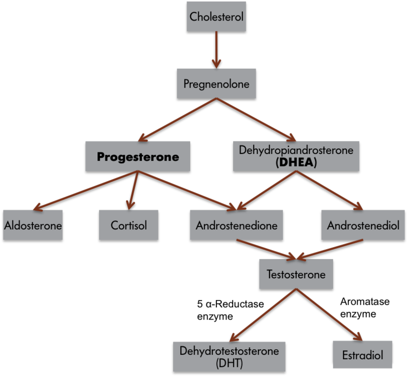
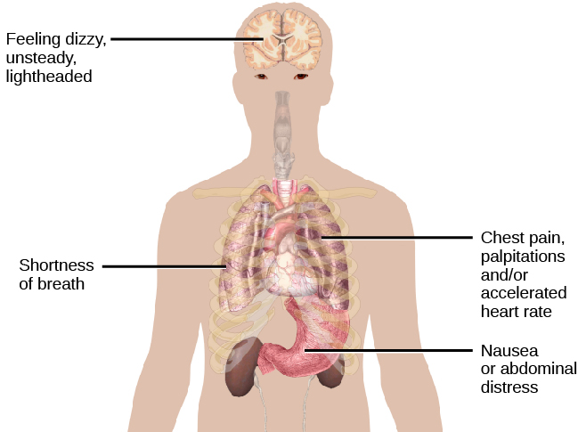

# Chất dẫn truyền, hormone và cảm xúc

## Tóm tắt

Có thật có "hormone hạnh phúc", "hormone tình yêu", "hormone căng thẳng" không? Bài này trả lời bằng cách đặt từng cảm xúc của
L09 cạnh các chất hóa học liên quan đến nó, rồi hỏi một câu ít khi được hỏi: bằng chứng cho mỗi mối liên hệ mạnh đến đâu.

Cơ thể có hai hệ truyền tin hóa học. Chất dẫn truyền thần kinh (neurotransmitter) đi qua khe synapse rất hẹp, tác động nhanh và tại
chỗ; hormone (hormone) được tuyến nội tiết tiết vào máu, đi xa hơn và tác động lâu hơn [S1]. Một số chất, như oxytocin (oxytocin)
và vasopressin (vasopressin), làm việc ở cả hai vai [S1].

Phần trọng tâm là một bảng ghép: mỗi hàng một cảm xúc (ham muốn, thích, sợ, giận, gắn bó, đau buồn), các cột là mạch thần kinh, chất
dẫn truyền, hormone và **mức bằng chứng** (level of evidence). Đọc bảng cho đúng cần bốn phân biệt: tương quan khác nhân quả, động vật
khác người, một nghiên cứu khác một tổng quan, đo trong máu khác đo trong não.

Năm thẻ hồ sơ tiếp theo (cortisol; oxytocin và vasopressin; testosterone; dopamine và opioid; serotonin và noradrenaline) cho thấy cùng
một khuôn mẫu: chất nào cũng liên quan đến nhiều hành vi, cảm xúc nào cũng dùng nhiều chất, và nhiều kết luận nổi tiếng yếu hơn tiếng
tăm của chúng. Ví dụ, thí nghiệm nổi tiếng "oxytocin làm tăng tin tưởng" đã không lặp lại được trong một nghiên cứu lặp lại lớn [S9],
và phân tích gộp về testosterone và gây hấn ở người chỉ thấy các mối liên hệ yếu [S12]. Mục cuối giải thích vì sao các nhãn kiểu
"hormone hạnh phúc" sai ở cả tên gọi lẫn nội dung.

## Hai hệ truyền tin: chất dẫn truyền và hormone

### Hormone là gì

Giáo trình định nghĩa hormone là chất truyền tin hóa học hữu cơ do các tuyến nội tiết (endocrine gland) chuyên biệt sản xuất và giải
phóng [S1]. Các cấu trúc tiết hormone chính gồm tuyến yên, tuyến tùng, tuyến giáp, tuyến thượng thận, vùng dưới đồi và tuyến sinh dục
(tinh hoàn, buồng trứng) [S1]. Hormone vào máu và có thể đi đến tác động lên các cấu trúc đích ở xa nơi nó được tạo ra [S1].

Hormone chia thành hai nhóm lớn. Hormone steroid (steroid hormone) thường được tổng hợp từ cholesterol ở tuyến sinh dục và tuyến
thượng thận; ví dụ testosterone (testosterone), estradiol, progesterone và cortisol (cortisol) [S1]. Hormone protein và peptide là chuỗi
amino acid; ví dụ oxytocin, vasopressin, prolactin và leptin [S1]. Mức chắc chắn: giáo khoa.

*Từ cholesterol, cơ thể tạo ra progesterone, cortisol, testosterone; testosterone lại có thể đổi thành DHT hoặc thành estradiol nhờ enzyme
aromatase. Nhãn tiếng Anh: cholesterol, cortisol, testosterone, estradiol, aromatase enzyme (enzyme aromatase). Nguồn hình: Noba,
giấy phép theo sách CC BY-SA; Hove & Martinez, Hình 1 (chương 6, mục 6.1). https://rotel.pressbooks.pub/biologicalpsychology/chapter/introduction-5/ [S1]*

Hình này dùng để làm gì: nó cho thấy cortisol và testosterone là "họ hàng" hóa học, cùng đi ra từ cholesterol. Giáo trình nhấn mạnh
một điểm dễ bỏ qua: testosterone thường được chuyển thành estradiol, nên nhiều hành vi kiểu "đực" thật ra gắn với tác động của estrogen
[S1]. Nhãn "hormone nam" và "hormone nữ" vì vậy cũng là cách nói đơn giản hóa.

### Khác nhau ở đâu

Giáo trình so sánh hai cách truyền tin theo bốn điểm [S1]:

- **Đi được đến đâu.** Hormone theo máu nên đến được mọi tế bào có máu nuôi, khoảng cách tới hàng mét. Tín hiệu thần kinh chỉ đi theo
  các đường đã có sẵn, và chất dẫn truyền chỉ vượt khe synapse khoảng 20 nanomét [S1].
- **Nhanh hay chậm.** Điện thế hoạt động bật tắt trong mili giây; tác động của hormone có thể diễn ra trong vài giây đến vài giờ [S1].
- **Dùng vào việc gì.** Tín hiệu thần kinh lo các thay đổi nhanh như cử động; hormone lo các quá trình dài như lớn lên, phát triển,
  sinh sản và chuyển hóa [S1].
- **Có tự điều khiển được không.** Ta cử động tay theo ý muốn dễ dàng, nhưng gần như không thể "muốn" để đổi lượng hormone tuyến giáp
  [S1].

Giữa hai cực còn một cách thứ ba: điều biến thần kinh (neuromodulation). Chất điều biến được thả vào khoảng ngoài tế bào và tác động lên
nhiều nơron cùng lúc, không chỉ một nơron sau synapse; tác động kéo dài từ hàng trăm mili giây đến vài phút [S1]. Giáo trình xếp vào
nhóm này một số chất dẫn truyền (dopamine, serotonin, acetylcholine) và các hormone thần kinh tạo trong não như oxytocin và vasopressin
[S1]. Cấu trúc synapse và thụ thể được giải thích ở L02; hồ sơ từng chất ở L03.

Ví dụ của người viết: chất dẫn truyền giống một tin nhắn gửi riêng cho người ngồi cạnh; chất điều biến giống lời nói to trong một căn
phòng; hormone giống loa phát thanh của cả khu phố. Cùng một "giọng nói" (một phân tử) có thể dùng cả ba cách.

### Không phải tế bào nào cũng nghe

Một hormone chỉ tác động trực tiếp lên tế bào có thụ thể (receptor) dành cho nó, gọi là tế bào đích [S1]. Phải có đủ thụ thể thì hormone
mới có tác dụng: giáo trình nêu ví dụ một người có testosterone bình thường mà ham muốn tình dục thấp có thể do thiếu thụ thể, nên bổ
sung thêm hormone sẽ không hiệu quả [S1]. Điều này dùng để làm gì: nó giải thích vì sao đo nồng độ một hormone trong máu chưa đủ để biết
nó đang làm gì trong não.

### Hai chiều: hormone đổi hành vi, hành vi đổi hormone

Chiều thứ nhất quen thuộc: chim sẻ vằn (zebra finch) đực bị cắt tinh hoàn thì ít hót, và hót lại khi được cấy lại tinh hoàn hoặc được
cho testosterone hay estradiol [S1]. Chiều thứ hai ít được nhắc: chuột và khỉ đực thua một trận đánh thì testosterone giảm trong nhiều
ngày đến nhiều tuần; ở người, testosterone tăng ở người thắng và giảm ở người thua trong các giải cờ vua khu vực [S1].

Giáo trình kể một nghiên cứu nhỏ: cổ động viên Brazil và Ý xem trận chung kết World Cup 1994; sau trận, 11 trên 12 cổ động viên Brazil
(đội thắng) có testosterone tăng và 9 trên 9 cổ động viên Ý giảm [S1]. Ngay cả việc chờ đợi một hoạt động cũng đổi được hormone:
testosterone ở phụ nữ cao hơn trước khi quan hệ tình dục so với các thời điểm khác [S1]. Hệ quả cho cả bài: khi thấy một hormone đi cùng
một cảm xúc, chưa biết cái nào gây ra cái nào.

## Bảng ghép cảm xúc, mạch, chất và hormone

Bảng dưới đây ghép sáu cảm xúc cơ bản của L09 với mạch thần kinh chính, chất dẫn truyền và hormone mà nguồn nêu tên. Cột cuối là
**mức bằng chứng**, dùng bốn nhãn: *giáo khoa* (nguồn đồng thuận), *có bằng chứng ở người*, *chủ yếu từ động vật*, *đang tranh luận*.
Ô nào nguồn không nói thì ghi "chưa rõ". Mạch chi tiết của từng cảm xúc thuộc L09; cấu trúc từng vùng thuộc L07.

| Cảm xúc | Mạch chính (xem L09) | Chất dẫn truyền | Hormone | Mức bằng chứng |
|---|---|---|---|---|
| Ham muốn (desire, "wanting") | vùng dưới đồi bên, hạnh nhân, nhân accumbens, vỏ trán [S3] | dopamine của mạch trung não–viền và trung não–vỏ [S3] | chưa rõ | chủ yếu từ động vật (kích thích điện); có bằng chứng ở người về "muốn" khác "thích" [S13] |
| Thích (liking) | vùng nhỏ trong nhân accumbens, nửa sau pallidum bụng, vỏ ổ mắt trán [S3] | opioid nội sinh, endocannabinoid [S3] [S13] | chưa rõ | chủ yếu từ động vật (các "điểm nóng" ở chuột) [S13] |
| Sợ (fear) | hạnh nhân trung tâm đến chất xám quanh cống não [S3] | glutamate, CRF, các neuropeptide [S3] | ACTH [S3]; cortisol qua ký ức cảm xúc [S15] | giáo khoa với vai trò hạnh nhân [S3]; vai trò hormone căng thẳng: tổng quan [S15] |
| Giận (rage) | hạnh nhân giữa, vùng dưới đồi, chất xám quanh cống não [S3] | chưa hiểu rõ; chất P có thể quan trọng [S3] | testosterone, vasopressin "có thể" [S3]; cortisol [S2] | đang tranh luận; ở người liên hệ yếu [S12] |
| Gắn bó, chăm sóc (care, attachment) | vùng trước thị lưng, nhân giường vân tận [S3]; hệ thưởng [S2] | dopamine [S11], opioid nội sinh [S3] | oxytocin, vasopressin, prolactin [S2] [S3] | chủ yếu từ động vật (chuột đồng) [S11]; ở người chủ yếu tương quan [S2] |
| Đau buồn, cô đơn (grief, panic) | chất xám quanh cống não, đồi thị lưng giữa, vách bụng [S3] | opioid nội sinh [S3] | oxytocin, prolactin; testosterone làm giảm [S3] | chủ yếu từ động vật (tiếng kêu khi tách mẹ) [S3] |

Ghi chú về các ô. CRF (corticotropin-releasing factor, yếu tố giải phóng corticotropin) và ACTH (adrenocorticotropic hormone, hormone
hướng vỏ thượng thận) là hai mắt xích đầu của trục căng thẳng; giáo trình nói các cấu trúc của mạch sợ nhạy với chúng [S3]. Trục đầy đủ
(vùng dưới đồi, tuyến yên, tuyến thượng thận) thuộc L05.

### Đọc hàng "muốn" và "thích" cùng nhau

Hai hàng đầu cho thấy vì sao bảng cần tách chất. Giáo trình nói lượng ham muốn với một phần thưởng không nhất thiết khớp với mức thích
nó, và hai việc dùng cấu trúc khác nhau [S3]. Kích thích các vùng khác của hệ thưởng làm tăng "muốn" mà không tăng "thích", có khi còn
giảm "thích" [S3]. Mục 8 xem kỹ bằng chứng này.

### Đọc hàng "gắn bó" và "đau buồn" cùng nhau

Theo giáo trình, mạng lưới gắn bó của con non cũng nhạy với chia ly; kích thích điện các vùng này làm con non phát tiếng kêu đau khổ
[S3]. Các vùng ấy nhạy với opioid nội sinh, oxytocin và prolactin, và cả ba chất đều ngăn được nỗi đau khi bị tách khỏi mẹ [S3]. Giáo
trình còn nêu giả thuyết hệ gắn bó có thể bắt nguồn từ mạch đau thể chất, vì nó bắt đầu ở chất xám quanh cống não, sát vùng tạo phản ứng
đau [S3]. Mức chắc chắn: giả thuyết, dựa phần lớn vào công trình của Panksepp trên động vật mà giáo trình dẫn.

### Một chất xuất hiện ở nhiều hàng

Đọc theo cột thay vì theo hàng sẽ thấy một điều quan trọng. Opioid nội sinh có mặt ở hàng "thích", "gắn bó" và "đau buồn"; giáo trình
còn nói opioid ức chế mạch giận [S3]. Testosterone có ở hàng "giận" và hàng "đau buồn" [S3]. Vasopressin có ở "giận" và "gắn bó" [S2]
[S3]. Giáo trình kết luận ngay trong mục về gây hấn: không có quan hệ một đối một giữa một hormone và một hành vi [S2].

## Đọc bảng cho đúng: mức bằng chứng

Một ô trong bảng chỉ có giá trị bằng nguồn phía sau nó. Bốn phân biệt dưới đây giúp đọc ô đó cho đúng, mỗi phân biệt kèm một ví dụ có
nguồn.

### Tương quan khác nhân quả

Ví dụ: testosterone và gây hấn ở người. Geniole và cộng sự (2020) gộp ba loại nghiên cứu. Testosterone nền (đo lúc nghỉ) liên hệ với gây
hấn rất yếu, hệ số tương quan khoảng 0,05; thay đổi testosterone liên hệ mạnh hơn một chút, khoảng 0,11 [S12]. Còn khi các nhà nghiên cứu
chủ động cho người tham gia dùng testosterone, tức là kiểm tra nhân quả, tác động còn yếu hơn và không có ý nghĩa thống kê, khoảng 0,05
[S12]. Thêm vào đó, mục 2 đã cho thấy hành vi cũng làm đổi testosterone [S1]: thấy hai thứ đi cùng nhau chưa nói được thứ nào là nguyên
nhân.

### Động vật khác người

Ví dụ: oxytocin, vasopressin và gắn đôi. Ở chuột đồng thảo nguyên (prairie vole), cho oxytocin làm tăng gắn đôi và chặn thụ thể oxytocin
làm giảm gắn đôi; đó là thí nghiệm can thiệp, cho bằng chứng nhân quả [S2]. Ở người, giáo trình dẫn các nghiên cứu fMRI: vùng liên quan đến
phần thưởng hoạt động mạnh hơn khi người tham gia nhìn ảnh con hoặc bạn đời so với ảnh bạn bè [S2]. Đó là tương quan. Giáo trình cũng nói
rõ lý do: ở người không thể tiêm hormone và kiểm soát chặt môi trường như ở động vật, nên tác động của hormone lên hành vi được nghiên cứu
trên mô hình động vật [S2].

### Một nghiên cứu khác một tổng quan

Ví dụ: oxytocin và lòng tin. Một thí nghiệm năm 2005 báo cáo oxytocin xịt mũi làm tăng lòng tin rõ rệt [S7]. Mười năm sau, một tổng quan
phê phán kết luận phát hiện ấy "đã không lặp lại tốt" [S8]. Năm 2020, một nghiên cứu lặp lại lớn, đăng ký trước, không thấy tác động của
oxytocin lên hành vi tin tưởng [S9]. Một nghiên cứu nổi bật là điểm bắt đầu để kiểm tra, chưa phải kết luận.

### Đo trong máu khác đo trong não

Ví dụ: oxytocin và serotonin trong máu. Nave và cộng sự chỉ ra các bằng chứng dựa trên oxytocin trong huyết tương có lỗi ở chính cách đo
oxytocin trong dịch cơ thể ngoại biên [S8]. Với serotonin, tổng quan của Moncrieff ghi nhận nồng độ serotonin trong huyết tương thấp hơn
liên quan đến việc đang dùng thuốc chống trầm cảm, tức là bản thân con số trong máu có thể bị thuốc làm đổi [S16]. Nhóm phản biện của
Jauhar còn cho rằng tryptophan huyết tương liên quan đến chức năng serotonin trong não nhiều hơn hẳn so với serotonin đo trong dịch cơ thể [S17]. Một con số
trong máu hay nước bọt không phải là ảnh chụp những gì xảy ra ở synapse.

### Bốn câu hỏi trước khi tin một ô

Suy luận của người viết, rút từ bốn ví dụ trên: trước khi tin một câu "chất X gây cảm xúc Y", hãy hỏi (1) đây là tương quan hay can thiệp,
(2) ở người hay động vật, (3) một nghiên cứu hay nhiều nghiên cứu đã gộp, (4) đo ở đâu. Một ô "chủ yếu từ động vật" không có nghĩa là sai
ở người, chỉ có nghĩa là chưa biết đủ.

## Cortisol: khi căng thẳng gặp cảm xúc

Trục vùng dưới đồi, tuyến yên, tuyến thượng thận (trục HPA) và hệ căng thẳng nói chung thuộc L05. Mục này chỉ xem phần cortisol gặp cảm
xúc: sợ, ký ức cảm xúc, chăm sóc.

### Thẻ hồ sơ: cortisol

- **Loại:** hormone steroid nhóm glucocorticoid, tổng hợp từ cholesterol ở tuyến thượng thận [S1]. Giáo khoa.
- **Làm gì trong cơ thể:** tăng chuyển hóa carbohydrate và làm trung gian cho phản ứng căng thẳng [S1]. Giáo khoa.
- **Cảm xúc, hành vi liên quan:** sợ và ký ức cảm xúc [S15]; chăm sóc con ở người mẹ [S2]; gây hấn [S2].
- **Cơ chế:** hải mã là vùng não đầu tiên, ngoài vùng dưới đồi, được nhận ra là đích của glucocorticoid [S14]. Hải mã, hạnh nhân và vỏ não
  trước trán thay đổi cấu trúc dưới tác động của căng thẳng [S14].
- **Mức bằng chứng:** vai trò sinh lý là giáo khoa; tác động lên ký ức cảm xúc có tổng quan [S15]; liên hệ với chăm sóc ở người mẹ là
  tương quan [S2].
- **Đừng hiểu nhầm:** cortisol không phải "chất xấu"; ngắn hạn nó bảo vệ cơ thể và giúp thích nghi [S14].

### Cortisol và ký ức cảm xúc

Roozendaal, McEwen và Chattarji (2009) tổng quan một quan sát quen thuộc: những trải nghiệm có ý nghĩa cảm xúc thường được nhớ rất tốt,
và hạnh nhân giữ vai trò then chốt trong việc đó [S15]. Nhưng cơ chế ghi nhớ hiệu quả này có thể trở nên có hại: căng thẳng nặng thường
biến ký ức cảm xúc thành nguồn lo âu mạn tính [S15]. Các tác giả tổng hợp những thay đổi về cấu trúc và chức năng hạnh nhân do căng thẳng
gây ra, từ cơ chế tế bào đến hậu quả hành vi [S15].

Ví dụ của người viết: bạn có thể quên bữa trưa thứ Ba tuần trước, nhưng nhớ rất rõ lần suýt bị xe đâm. Ký ức thứ hai được "đóng dấu" mạnh
hơn; ở người đã trải qua căng thẳng nặng, chính con dấu ấy có thể làm nỗi lo kéo dài. Trí nhớ cảm xúc chi tiết sẽ thuộc một bài sau.

### Cortisol giúp hay hại: cả hai, tùy thời gian

McEwen (2007) gọi tên hai mặt. Hormone liên quan đến căng thẳng bảo vệ cơ thể trong ngắn hạn và thúc đẩy thích nghi, gọi là allostasis
(cân bằng qua thay đổi) [S14]. Nhưng các sự kiện hằng ngày có thể tạo căng thẳng mạn tính, theo thời gian gây hao mòn cho cơ thể, gọi là
gánh nặng allostatic (allostatic load) [S14]. Bộ não vừa quyết định điều gì là đe dọa, vừa là đích của căng thẳng [S14]. Tổng quan cũng
nêu rằng hoạt động thể chất đều đặn và hỗ trợ xã hội làm giảm gánh nặng căng thẳng mạn tính [S14].

### Cortisol trong chăm sóc và trong hỗ trợ xã hội

Ở người mẹ, giáo trình nói nồng độ cortisol tương quan thuận với các hành vi âu yếm và trò chuyện với con, nhất là ở những người mẹ có
thái độ tích cực trước khi sinh [S2]. Giáo trình giải thích rằng cortisol có lẽ tăng chăm sóc một cách gián tiếp, bằng cách làm người mẹ
tỉnh táo và nhạy hơn với tín hiệu của con [S2]. Đây là một phản ví dụ tốt cho nhãn "hormone căng thẳng": cùng một chất đi cùng cả lo âu
lẫn sự quan tâm.

Chiều ngược lại cũng có: quan hệ xã hội làm giảm cortisol. Trong thí nghiệm của Heinrichs và cộng sự (2003), 37 nam giới khỏe mạnh trải
qua một bài kiểm tra gây căng thẳng xã hội; người có bạn thân hỗ trợ lúc chuẩn bị có cortisol nước bọt thấp hơn [S10]. Mục 6 nói tiếp
về phần oxytocin của thí nghiệm này.

## Oxytocin và vasopressin: gắn bó, tin tưởng và tranh cãi

Hồ sơ oxytocin như một chất (nơi tạo, thụ thể) thuộc L03; ở đây chỉ xem nó gặp cảm xúc ở đâu và bằng chứng mạnh đến đâu.

### Thẻ hồ sơ: oxytocin và vasopressin

- **Loại:** hormone peptide, đồng thời là hormone thần kinh tạo trong não và hoạt động như chất điều biến [S1]. Hai chất có cấu trúc gần
  nhau [S2]. Giáo khoa.
- **Làm gì trong cơ thể:** oxytocin kích thích tiết sữa và co tử cung khi sinh; vasopressin tăng tái hấp thu nước ở thận [S1]. Giáo khoa.
- **Cảm xúc, hành vi liên quan:** gắn đôi, chăm sóc con [S2]; giảm nỗi đau chia ly (oxytocin) [S3]; vasopressin có thể liên quan đến giận
  [S3].
- **Cơ chế (ở chuột đồng):** sau giao phối, vùng dưới đồi giải phóng oxytocin và vasopressin, tác động lên hệ viền và hệ thưởng [S2].
- **Mức bằng chứng:** gắn bó ở động vật có thí nghiệm nhân quả [S2] [S11]; ở người chủ yếu tương quan [S2]; tin tưởng: đang tranh luận [S8].
- **Đừng hiểu nhầm:** "hormone tình yêu" bỏ qua việc oxytocin làm nhiều việc và nhiều kết quả ở người chưa được lặp lại [S8].

### Chuột đồng thảo nguyên: bằng chứng mạnh nhất

*Chuột đồng thảo nguyên sống theo cặp một vợ một chồng và cùng chăm con. Nguồn hình: Todd Ahern, giấy phép theo sách CC BY; Hove &
Martinez, Hình 10 (chương 6, mục 6.4). https://rotel.pressbooks.pub/biologicalpsychology/chapter/parental-behaviors/ [S2]*

Chuột đồng thảo nguyên là loài gặm nhấm Bắc Mỹ sống theo cặp sau khi giao phối và cùng chăm con; họ hàng gần của nó là chuột đồng núi
(montane vole) không gắn đôi, và chỉ con cái chăm con [S2]. So sánh hai loài này giúp các nhà nghiên cứu tìm ra tín hiệu hóa học của gắn
bó [S2].

Bằng chứng gồm bốn lớp [S2]. Một: chuột đồng thảo nguyên cái có nhiều thụ thể oxytocin trong mạch thưởng hơn chuột đồng núi. Hai: cho
oxytocin làm tăng gắn đôi, chặn thụ thể làm giảm gắn đôi. Ba: ở con đực, vasopressin cho kết quả tương tự. Bốn: khi con đực của một loài
không chung thủy được biến đổi gen để có nhiều thụ thể vasopressin hơn, chúng gắn đôi và chăm con nhiều hơn [S2]. Mức chắc chắn: bằng
chứng nhân quả, nhưng ở động vật.

Young và Wang (2004) tóm mô hình này thành một câu: oxytocin và vasopressin giúp xử lý tín hiệu xã hội để nhận ra cá thể, dopamine của
mạch trung não–viền lo phần học phần thưởng, và khi thụ thể neuropeptide cùng thụ thể dopamine trong trung tâm thưởng được kích hoạt
cùng lúc lúc giao phối, con vật hình thành sở thích có điều kiện với bạn tình, quan sát được như một sự gắn đôi [S11]. Sự khác biệt giữa
các loài có thể do cách điều hòa số thụ thể [S11]. Điều này dùng để làm gì: gắn bó không do một chất, mà do ít nhất hai hệ (neuropeptide
và dopamine) làm việc cùng lúc.

### Ở người mẹ và trong gia đình

Ở chuột cống, quanh lúc sinh, progesterone giảm nhanh trong khi estradiol, prolactin và oxytocin cao; tổ hợp này lấn át phản ứng sợ và
cho phép con mẹ chăm con mới sinh ngay [S2]. Cho chuột cống cái oxytocin làm tăng hành vi làm mẹ và sự gắn bó với con [S2]. Ở người, các
vùng thưởng hoạt động khi nhìn ảnh con hoặc bạn đời có thụ thể oxytocin và vasopressin, và các hormone này được giải phóng trong những
hoạt động tạo gắn bó như cho con bú và quan hệ tình dục [S2]. Mức chắc chắn: ở chuột có can thiệp; ở người là tương quan.

*Giáo trình chú thích: cortisol có thể không trực tiếp làm tăng hành vi làm mẹ, nhưng là một trong các hormone đi cùng cái ôm. Nguồn hình:
Noba, giấy phép theo sách CC BY; Hove & Martinez, Hình 11 (chương 6, mục 6.4). https://rotel.pressbooks.pub/biologicalpsychology/chapter/parental-behaviors/ [S2]*

### Oxytocin và hỗ trợ xã hội

Quay lại thí nghiệm của Heinrichs và cộng sự (2003). Ngoài việc có hay không có bạn thân hỗ trợ, người tham gia được chia ngẫu nhiên nhận
oxytocin xịt mũi hoặc giả dược, theo thiết kế mù đôi [S10]. Oxytocin làm giảm lo âu; và nhóm vừa có oxytocin vừa có bạn hỗ trợ có cortisol
thấp nhất, bình tĩnh hơn và ít lo hơn trong lúc căng thẳng [S10]. Các tác giả kết luận oxytocin có vẻ làm tăng tác dụng đệm của hỗ trợ xã
hội [S10]. Mức chắc chắn: một thí nghiệm có đối chứng, mẫu nhỏ và chỉ có nam giới; chưa đủ để khái quát.

### Oxytocin và tin tưởng: một tranh cãi có thật

Năm 2005, Kosfeld, Heinrichs, Zak, Fischbacher và Fehr báo cáo trên Nature rằng oxytocin xịt mũi làm tăng đáng kể lòng tin giữa người với
người [S7]. Họ cũng báo cáo tác động không phải do sẵn sàng chấp nhận rủi ro nói chung, mà riêng với rủi ro xã hội trong tương tác giữa
người với người [S7]. Trong thí nghiệm, lòng tin được đo bằng số tiền người "nhà đầu tư" chuyển cho người lạ trong một trò chơi tin tưởng
(trust game) [S9].

Nave, Camerer và McCullough (2015) xem lại cả lĩnh vực và đưa ra ba nhận định [S8]. Phát hiện đơn giản nhất, oxytocin xịt mũi làm tăng lòng
tin, đã không lặp lại tốt. Bằng chứng từ oxytocin trong huyết tương có lỗi ở cách đo. Các nghiên cứu di truyền mẫu lớn không thấy liên hệ
nhất quán giữa biến thể gen liên quan đến oxytocin và lòng tin. Kết luận của họ: bằng chứng tích lũy không cho thấy vững chắc rằng lòng
tin ở người gắn đáng tin cậy với oxytocin, hay do oxytocin gây ra [S8].

Năm 2020, Declerck, Boone, Pauwels, Vogt và Fehr (Fehr là đồng tác giả của nghiên cứu gốc) làm một nghiên cứu lặp lại lớn, mù đôi, có giả
dược, với kế hoạch được duyệt trước khi thu dữ liệu và độ mạnh thống kê trên 95% [S9]. Họ không thấy tác động của oxytocin lên hành vi tin
tưởng trong điều kiện giống nghiên cứu gốc [S9]. Một phân tích khám phá, làm sau, gợi ý oxytocin có thể tăng lòng tin ở người vốn ít tin
người trong một điều kiện khác, nhưng chính các tác giả nói điều này cần được xác nhận [S9].

Ai tranh luận với ai: một bên là nghiên cứu năm 2005 [S7]; bên kia là tổng quan phê phán năm 2015 [S8] và nghiên cứu lặp lại năm 2020 [S9].
Mức chắc chắn hiện nay cho câu "oxytocin làm tăng tin tưởng ở người": đang tranh luận, nghiêng về chưa được ủng hộ.

## Testosterone và gây hấn

### Thẻ hồ sơ: testosterone

- **Loại:** hormone steroid, một androgen phổ biến, tổng hợp từ cholesterol; có thể chuyển thành estradiol [S1]. Giáo khoa.
- **Làm gì trong cơ thể:** thúc đẩy sản xuất tinh trùng và đặc điểm sinh dục thứ phát ở nam; thúc đẩy động cơ và hành vi tình dục [S1].
- **Cảm xúc, hành vi liên quan:** gây hấn [S2]; có thể tham gia vào giận [S3]; làm giảm nỗi đau chia ly [S3].
- **Mức bằng chứng:** ở nhiều loài động vật có bằng chứng nhân quả (cắt tinh hoàn rồi bổ sung) [S2]; ở người liên hệ yếu và nhân quả chưa
  rõ [S12].
- **Đừng hiểu nhầm:** testosterone không phải "hormone hung hăng"; nó cũng đổi theo hành vi và theo thắng thua [S1].

### Bằng chứng ở động vật

Giáo trình định nghĩa gây hấn là hành vi có thể nảy sinh khi lợi ích của các cá thể xung đột, thường vì tài nguyên có hạn như lãnh thổ,
thức ăn hay bạn tình; nhiều xung đột được giải quyết bằng tư thế phục tùng hoặc giao đấu theo nghi thức, không gây thương tích [S2].

Theo giáo trình, bằng chứng rất mạnh cho thấy androgen, đặc biệt testosterone, làm trung gian cho gây hấn ở con đực của nhiều loài, dựa
trên bốn quan sát [S2]: gây hấn theo mùa đi cùng testosterone theo mùa (hươu đực hung hăng nhất vào mùa thu); gây hấn tăng ở tuổi dậy thì;
con đực thường hung hăng hơn con cái; và cắt tinh hoàn làm giảm gây hấn, bổ sung testosterone đưa nó trở lại [S2]. Thí nghiệm trên chuột
nhắt còn cho thấy androgen vừa "tổ chức" não quanh lúc sinh, vừa "kích hoạt" hành vi gây hấn khi trưởng thành [S2].

### Ở người: phức tạp hơn nhiều

Ở người, nam giới nhìn chung gây hấn thể chất nhiều hơn nữ giới; nhưng nguyên nhân vẫn đang được tranh luận gay gắt [S2]. Giáo trình nêu
ba giả thuyết không loại trừ nhau: androgen thúc đẩy gây hấn; não nam tiếp xúc androgen trước khi sinh nên được "nối dây" khác; và xã hội
khuyến khích con trai, ngăn con gái gây hấn [S2]. Giáo trình cũng ghi chú nữ giới thể hiện nhiều hơn kiểu gây hấn quan hệ (làm hại người
khác qua các mối quan hệ xã hội) [S2]. Giáo trình ghi nhận việc dùng quá mức hormone steroid đồng hóa đi cùng gây hấn [S1].

Phân tích gộp của Geniole và cộng sự (2020) cho con số cụ thể [S12]. Ở động vật có bằng chứng cắt tinh hoàn và bổ sung, nhưng ở người bằng
chứng nhân quả thường thiếu, hoặc không nhất quán trong số ít nghiên cứu can thiệp [S12]. Liên hệ giữa testosterone nền và gây hấn yếu
nhưng có ý nghĩa, rõ hơn ở nam và không thấy ở nữ; thay đổi testosterone liên hệ mạnh hơn, cũng chủ yếu ở nam; tác động nhân quả khi chủ
động cho testosterone yếu hơn nữa và không có ý nghĩa thống kê [S12].

### Testosterone đổi theo thách thức

Các tác giả phân tích gộp lưu ý testosterone không đứng yên mà dao động theo tín hiệu thách thức trong môi trường, và chính các dao động ấy
có thể điều chỉnh gây hấn trong từng tình huống [S12]. Điều này khớp với giáo trình: thua trận làm testosterone giảm nhiều ngày ở chuột và
khỉ, và testosterone đổi ở người thắng và người thua cờ vua [S1].

Giáo trình kết thúc mục gây hấn bằng hai ý cần nhớ: ngoài testosterone, cortisol, corticosterone và vasopressin cũng tham gia vào gây hấn;
và không có quan hệ một đối một giữa một hormone và một hành vi [S2]. Mức chắc chắn cho câu "testosterone gây gây hấn ở người": đang tranh
luận; liên hệ có nhưng yếu.

## Dopamine và opioid: muốn và thích

Hệ thưởng thuộc L05, và hồ sơ gốc của dopamine thuộc L00. Mục này chỉ tách hai thành phần của phần thưởng: "muốn" (wanting) và "thích"
(liking), và hai nhóm chất gắn với chúng.

### Thẻ hồ sơ: dopamine và opioid trong phần thưởng

- **Loại:** dopamine là chất dẫn truyền, thường xếp vào nhóm chất điều biến [S1]; opioid nội sinh (endorphin, enkephalin, dynorphin) là
  các chất giống thuốc phiện do cơ thể tự tạo, dùng làm chất dẫn truyền [S6].
- **Đường đi:** dopamine từ vùng mái bụng (VTA, ventral tegmental area) ở não giữa đi lên nhân accumbens, hạnh nhân và vỏ não trước trán
  [S13].
- **Thụ thể opioid:** ba loại phân bố rộng trong não: mu, delta và kappa [S6].
- **Cảm xúc liên quan:** dopamine với "muốn" [S3] [S13]; opioid với "thích" [S3] [S13], với gắn bó và đau buồn [S3].
- **Mức bằng chứng:** phần lớn từ động vật, có các quan sát ở người ủng hộ [S13].
- **Đừng hiểu nhầm:** dopamine không phải "chất khoái lạc"; ngày nay tương đối ít nhà nghiên cứu dopamine trong phần thưởng còn khẳng định
  trên bài báo rằng dopamine gây ra khoái cảm [S13].

### "Muốn" khác "thích"

Giáo trình mô tả: "thích" (ví dụ thưởng thức nước ngọt) đo được ở trẻ nhỏ và động vật qua tốc độ liếm, động tác thè lưỡi và nét mặt vui;
còn "muốn" thể hiện qua mức sẵn sàng làm việc vất vả để có phần thưởng [S3]. Người nghiện thường vẫn thèm chất ngay cả khi biết chất đang
có sẽ không đem lại khoái cảm [S3].

Berridge và Kringelbach (2015) giải thích vì sao tách được hai thứ. "Muốn" do một hệ lớn và phân tán tạo ra; "thích" do một tập nhỏ các
điểm nóng khoái cảm (hedonic hotspot) trong mạch hệ viền tạo ra [S13]. Ở chuột, mỗi điểm nóng chỉ khoảng 1 milimét khối; điểm nóng opioid
trong nhân accumbens chỉ chiếm khoảng 10% thể tích nhân [S13]. Kích thích thụ thể opioid mu trong điểm nóng này có thể làm tác động khoái
cảm của vị ngọt tăng ít nhất gấp đôi [S13].

### Bằng chứng dopamine lo "muốn", không lo "thích"

Theo Berridge và Kringelbach, bằng chứng đến từ hai phía [S13]. Phía làm giảm: chuột bị hủy gần hết nơron dopamine, còn khoảng 1% mức bình
thường, vẫn có phản ứng "thích" vị ngọt nguyên vẹn; bệnh nhân Parkinson thiếu dopamine nhiều vẫn chấm điểm thích vị ngọt bình thường [S13].
Phía làm tăng: tăng dopamine trong nhân accumbens không làm tăng "thích" vị ngọt nhưng làm tăng "muốn" có nó; ở người, tăng dopamine bằng
thuốc tiền chất không làm tăng điểm khoái cảm tự đánh giá [S13]. Một số bệnh nhân Parkinson dùng liều cao thuốc kích thích thụ thể dopamine
có những thôi thúc cưỡng bức (cờ bạc, mua sắm) mà thường không kể là thấy khoái cảm mạnh [S13].

Lưu ý về giáo trình: mục 10.2 nói dopamine tạo cảm giác hào hứng, ý nghĩa và mong đợi [S3]. Câu đó nói về "muốn", không nói về khoái cảm,
nên không mâu thuẫn với Berridge và Kringelbach.

### Opioid: thích, gắn bó, giảm đau chia ly

Giáo trình mục 5.5 cho biết opioid nội sinh điều chỉnh phản ứng với kích thích đau, tham gia điều hòa đói, khát và tâm trạng [S6]. Các
thuốc nhóm opioid tác động mạnh vì gắn vào cùng thụ thể với opioid nội sinh [S6]. Một cơ chế được mô tả: ở vùng mái bụng, opioid làm các
nơron GABA ức chế tiết ít GABA hơn; vì GABA bình thường hãm lượng dopamine giải phóng ở nhân accumbens, "ức chế cái ức chế" rốt cuộc làm
tăng dopamine [S6]. Nghĩa là opioid chạm vào cả "thích" lẫn "muốn".

Mục 10.2 nối opioid với đời sống xã hội: các thuốc nhóm opioid và nicotine tạo cảm giác dễ chịu giống cảm giác thường có khi tương tác xã
hội tích cực, điều có thể giải thích vì sao chúng gây nghiện [S3]. Theo giáo trình, cơn hoảng loạn có vẻ là một dạng lo âu chia ly dữ dội
và opioid làm dịu được nó [S3]. Mức chắc chắn: giả thuyết của trường phái Panksepp, giáo trình dùng chữ "có vẻ" và "có thể".

### Khi "muốn" và "thích" tách xa nhau

Berridge và Kringelbach mô tả một khả năng trong nghiện: dùng chất lặp lại có thể làm hệ dopamine nhạy cảm hơn ở người dễ bị tổn thương,
khuếch đại "muốn", trong khi cơ chế khoái cảm opioid lại nhờn đi, làm giảm "thích" [S13]. Giáo trình nói cùng ý: người ta vẫn điên cuồng
theo đuổi phần thưởng như chất gây nghiện, cờ bạc hay tình dục dù không còn thấy khoái cảm vì đã quen [S3]. Ví dụ của người viết: lướt mạng
xã hội đến nửa đêm dù không thấy vui hơn là một trải nghiệm đời thường gần với "muốn mà không thích"; đó là phép so sánh, không phải chẩn
đoán.

## Serotonin, noradrenaline và tâm trạng, lo âu

Hồ sơ đầy đủ của serotonin và noradrenaline (nơi tạo, đường đi, thụ thể) thuộc L03. Mục này xem hai chất trong trầm cảm và lo âu, và giới
hạn của "thuyết thiếu chất".

### Thẻ hồ sơ: serotonin và noradrenaline trong tâm trạng

- **Loại:** chất dẫn truyền; serotonin được giáo trình xếp vào nhóm chất điều biến [S1]. Noradrenaline còn gọi là norepinephrine.
- **Làm gì:** điều hòa các chức năng hay rối loạn trong bệnh khí sắc: ăn uống, ham muốn tình dục, giấc ngủ, mức tỉnh và tâm trạng [S4].
- **Liên hệ cảm xúc:** rối loạn khí sắc đi cùng mức bất thường của serotonin và noradrenaline [S4].
- **Thuốc tác động:** nhóm ức chế tái hấp thu serotonin chọn lọc (SSRI), nhóm ba vòng, nhóm ức chế enzyme monoamine oxidase (MAOI) [S4].
- **Mức bằng chứng:** có liên quan, nhưng cơ chế chính xác vẫn đang được nghiên cứu [S4]; thuyết "thiếu serotonin gây trầm cảm" đang tranh
  luận [S16] [S17].
- **Đừng hiểu nhầm:** thuốc tác động lên một chất không chứng minh bệnh do thiếu chất đó.

### Giáo trình nói gì về trầm cảm

Giáo trình mục 12.3 viết rằng hoạt động thấp của serotonin và noradrenaline từ lâu đã được ghi nhận là yếu tố góp phần gây rối loạn trầm
cảm [S4]. Mối liên hệ được phát hiện tình cờ vào những năm 1950: thuốc nhóm MAOI (làm tăng serotonin và noradrenaline sẵn có) được dùng cho
bệnh nhân lao, và tâm trạng trầm cảm của họ cũng cải thiện [S4]. Ngay sau đó giáo trình thêm: dù các chất này có liên quan và có thể là
đích để giảm triệu chứng, cơ chế chính xác vẫn đang được nghiên cứu [S4].

Giáo trình cũng nêu rằng trầm cảm không chỉ là chuyện hóa chất: ở người trầm cảm, vỏ não trước trán hoạt động thấp bất thường và hạnh
nhân hoạt động quá mức; tính di truyền khoảng 40% [S4]. Với rối loạn lưỡng cực, giáo trình nói hiện nay người ta cho rằng serotonin thấp
và noradrenaline cao có thể giải thích các cơn hưng cảm [S4]. Mức chắc chắn: giả thuyết.

### Thuốc: nhóm và cơ chế

*Nhóm SSRI chặn bước thu hồi serotonin về nơron trước synapse, nên serotonin ở lại lâu hơn trong khe synapse. Nhãn tiếng Anh: reuptake
receptor (thụ thể thu hồi), reuptake inhibitor (chất ức chế thu hồi). Nguồn hình: OpenStax Psychology 2e, giấy phép theo sách CC BY-NC-SA;
Hove & Martinez, Hình 3 (chương 12, mục 12.3). https://rotel.pressbooks.pub/biologicalpsychology/chapter/mood-disorders-depression-and-bipolar-disorder/ [S4]*

Theo giáo trình [S4]: nhóm SSRI chặn việc thu hồi serotonin vào nơron trước synapse; nhóm ba vòng chặn thu hồi cả serotonin và
noradrenaline; nhóm MAOI chặn enzyme monoamine oxidase, enzyme dọn bớt noradrenaline, serotonin và dopamine. Một chi tiết quan trọng:
serotonin có thể tăng trong vòng một giờ sau khi dùng SSRI, nhưng thường phải vài tuần triệu chứng mới cải thiện, và cơ chế tác dụng chính
xác vẫn chưa rõ [S4]. Khoảng trễ ấy là một gợi ý rằng "thêm serotonin là hết buồn" không phải là câu chuyện đầy đủ (suy luận của người
viết).

### Tranh luận về thuyết serotonin

Năm 2022, Moncrieff và cộng sự công bố một tổng quan ô dù (umbrella review) gồm 17 nghiên cứu [S16]. Họ kết luận các hướng nghiên cứu chính
về serotonin không cho thấy bằng chứng nhất quán về liên hệ giữa serotonin và trầm cảm, và không ủng hộ giả thuyết trầm cảm do serotonin
thấp [S16]. Hai nghiên cứu di truyền lớn nhất về gen vận chuyển serotonin không thấy liên hệ với trầm cảm [S16]. Họ cũng thấy một số bằng
chứng phù hợp với khả năng dùng thuốc chống trầm cảm lâu dài làm giảm nồng độ serotonin [S16].

Năm 2023, một nhóm 35 nhà nghiên cứu do Jauhar đứng đầu phản bác trên cùng tạp chí [S17]. Họ cho rằng phương pháp của tổng quan không nhất
quán với một tổng quan ô dù, chọn lọc dữ liệu, và bỏ sót các kết quả về làm cạn tryptophan (chất tiền thân của serotonin) ở người có nguy cơ
trầm cảm cũng như tryptophan huyết tương thấp ở người trầm cảm [S17]. Theo họ, kết luận đúng hơn là có vai trò của serotonin ở những người dễ
bị hoặc đang bị trầm cảm, và hình ảnh học phân tử cho thấy hệ serotonin bị xáo trộn [S17].

Đọc cuộc tranh luận này thế nào. Hai bên cùng không nói "trầm cảm đơn giản là thiếu serotonin": một bên nói thuyết ấy không được ủng hộ
[S16], bên kia nói hệ serotonin có liên quan theo cách phức tạp hơn [S17]. Cũng cần nói rõ: tổng quan của Moncrieff không đánh giá thuốc
có hiệu quả hay không, đó là một câu hỏi khác; nhóm Jauhar lại dẫn hiệu quả của SSRI ở một tỉ lệ người bệnh như một lý lẽ [S17]. Mức chắc
chắn: đang tranh luận.

### Lo âu: hạnh nhân, GABA, và cả serotonin

Giáo trình mục 12.4 mô tả mạch lo âu gồm tín hiệu từ dưới lên của hạnh nhân báo có mối đe dọa, và kiểm soát từ trên xuống của vỏ não trước
trán [S5]. Người có rối loạn lo âu cho thấy hạnh nhân phản ứng quá mức và vỏ trước trán hoạt động giảm [S5]. Nhân trung tâm của hạnh nhân nối
với thân não, nơi điều khiển nhịp thở và nhịp tim, nên tham gia gây cơn hoảng sợ [S5].

*Chóng mặt, khó thở, đau ngực, tim đập nhanh, buồn nôn: phần "cơ thể" của lo âu. Nhãn tiếng Anh: feeling dizzy (chóng mặt), shortness of
breath (khó thở), chest pain, palpitations (đau ngực, hồi hộp), nausea (buồn nôn). Nguồn hình: OpenStax, giấy phép theo sách CC BY-NC-SA;
Hove & Martinez, Hình 5 (chương 12, mục 12.4). https://rotel.pressbooks.pub/biologicalpsychology/chapter/anxiety/ [S5]*

Về chất dẫn truyền, nghiên cứu tập trung nhiều vào GABA, chất ức chế chính; ức chế GABA không đủ có thể góp phần làm hạnh nhân hoạt động quá
mức [S5]. Nhóm thuốc benzodiazepine gắn vào thụ thể GABA-A, làm nơron khó phát xung, nhờ đó giảm phản ứng của hạnh nhân và giảm lo âu [S5].
Vì nguy cơ gây nghiện và hiệu quả lâu dài hạn chế, nhóm này nay chỉ được khuyến cáo dùng ngắn hạn [S5]. Giáo trình nói thêm serotonin,
endocannabinoid và oxytocin cũng quan trọng, và các hướng dẫn điều trị hiện nay khuyến cáo thuốc chống trầm cảm nhóm SSRI hoặc SNRI (ức chế
tái hấp thu serotonin và noradrenaline) [S5].

Giáo trình kết luận phần này bằng một ý đáng nhớ: dù bằng kỹ thuật nào (thuốc, liệu pháp nhận thức hành vi, thậm chí giả dược), giảm hoạt
động hạnh nhân hoặc tăng hoạt động các mạch điều hòa cảm xúc đều có thể giảm lo âu [S5]. Nghĩa là "mức một chất" không phải đòn bẩy duy
nhất; mạch mới là đơn vị.

### Noradrenaline và adrenaline: tỉnh táo, không chỉ "sợ"

Giáo trình mục 5.5 mô tả adrenaline (do tuyến thượng thận tiết) là hormone "đánh hay chạy" (fight or flight), làm tăng chú ý và cho cơ thể
thêm năng lượng [S6]. Trong bệnh khí sắc, noradrenaline gắn với mức tỉnh, giấc ngủ và tâm trạng [S4]. Vai trò của noradrenaline trong chú ý
và tỉnh táo được trình bày ở L03 và L05.

## Vì sao không có "hormone hạnh phúc"

Các nhãn "hormone hạnh phúc" (thường gán cho dopamine hay serotonin), "hormone tình yêu" (oxytocin) và "hormone căng thẳng" (cortisol) rất
phổ biến. Bài này không có nguồn về việc các nhãn ấy ra đời từ đâu, nên chỉ phân tích nội dung của chúng. Chúng sai ở ba chỗ.

### Sai thứ nhất: sai tên

Dopamine và serotonin được giáo trình xếp là chất dẫn truyền, hoạt động như chất điều biến trong não [S1]. Chúng không phải hormone theo
nghĩa của mục 2: không phải do tuyến nội tiết tiết vào máu để đi tới các cơ quan xa [S1]. Oxytocin thì đúng là hormone, nhưng nó cũng là
hormone thần kinh tạo trong não [S1]. Cái tên "hormone" vì vậy che mất cách các chất này thật sự làm việc.

### Sai thứ hai: một chất, một cảm xúc

Mỗi chất trong bài đều xuất hiện ở nhiều hàng của bảng. Cortisol đi cùng sợ, ký ức cảm xúc, và cả sự âu yếm của người mẹ [S2] [S15].
Oxytocin vừa tham gia tiết sữa, co tử cung, gắn bó, vừa giảm đau chia ly [S1] [S3]. Opioid có mặt ở thích, gắn bó, đau buồn và giận [S3].
Giáo trình nói thẳng: không có quan hệ một đối một giữa một hormone và một hành vi [S2]. Tác động của một chất phụ thuộc vào thụ thể và vùng
não nơi nó gắn vào (xem L03).

Chiều ngược lại cũng không có: không có "một vùng, một cảm xúc". Lindquist và cộng sự (2012) gộp các nghiên cứu hình ảnh não về cảm xúc ở
người và thấy rất ít bằng chứng rằng mỗi loại cảm xúc gắn nhất quán và riêng biệt với một vùng não [S18]. Thay vào đó, một tập hợp các vùng
tương tác với nhau, vốn tham gia cả các thao tác tâm lý không mang tính cảm xúc, hoạt động trong nhiều loại cảm xúc khác nhau [S18]. Đây là
quan điểm kiến tạo tâm lý (psychological constructionist), và các tác giả trình bày nó đối lập với quan điểm định vị (locationist) [S18].
Mức chắc chắn: đang tranh luận giữa hai trường phái; giáo trình 10.2, dựa vào Panksepp, gần với hướng có các mạch cảm xúc cơ bản [S3].

### Sai thứ ba: sai nội dung cảm xúc

Dopamine gắn với "muốn" nhiều hơn với khoái cảm [S13], nên gọi nó là chất "hạnh phúc" là nhầm thành phần. Oxytocin không được chứng minh
vững là làm tăng lòng tin ở người [S8] [S9], nên "hormone tình yêu, hormone tin tưởng" là nói quá bằng chứng. Cortisol bảo vệ cơ thể trong
ngắn hạn [S14] và đi cùng chăm sóc [S2], nên "hormone căng thẳng" chỉ đúng một nửa. Serotonin chưa được chứng minh là "thiếu thì trầm cảm"
[S16], dù hệ serotonin có thể liên quan [S17].

### Thay nhãn bằng câu hỏi

Ví dụ của người viết: thay vì "hôm nay tôi thiếu hormone hạnh phúc", câu chính xác hơn là "hôm nay tôi ít hứng thú; điều gì trong ngủ, quan
hệ, công việc, sức khỏe đang thay đổi?". Câu thứ hai mở ra những việc có thể làm; câu thứ nhất chỉ đặt tên cho một phân tử.

Suy luận của người viết: các nhãn này hấp dẫn vì chúng biến một hệ thống phức tạp thành một nút bấm. Bài học của bảng ghép là cảm xúc giống
một bản hòa tấu: nhiều nhạc cụ (chất), nhiều nhạc công (vùng não), và người nghe (hoàn cảnh, kinh nghiệm) cũng làm đổi bản nhạc.

## Điều cần nhớ

1. Chất dẫn truyền đi qua synapse, nhanh và tại chỗ; hormone đi theo máu, chậm và rộng; oxytocin, vasopressin làm cả hai vai [S1].
2. Hormone đổi hành vi, và hành vi (thắng, thua, chờ đợi) cũng đổi hormone [S1].
3. Mỗi cảm xúc dùng nhiều chất, mỗi chất tham gia nhiều cảm xúc; không có quan hệ một đối một [S2] [S3].
4. Luôn hỏi **mức bằng chứng**: tương quan hay can thiệp, người hay động vật, một nghiên cứu hay tổng quan, đo ở máu hay ở não.
5. Cortisol bảo vệ ngắn hạn, gây hao mòn khi kéo dài, và tham gia ký ức cảm xúc [S14] [S15].
6. Oxytocin, vasopressin và gắn bó: mạnh ở chuột đồng [S2] [S11]; "oxytocin làm tăng tin tưởng" ở người chưa lặp lại được [S8] [S9].
7. Testosterone và gây hấn: nhân quả rõ ở nhiều loài động vật [S2], yếu và chưa rõ ở người [S12].
8. Dopamine gắn với "muốn", opioid với "thích" [S13].
9. Serotonin và noradrenaline liên quan đến tâm trạng, nhưng thuyết "trầm cảm do thiếu serotonin" đang tranh luận [S16] [S17].
10. Không có "hormone hạnh phúc": nhãn ấy sai tên, sai số lượng và sai nội dung.

Nối với các bài khác: L09 cho mạch của từng cảm xúc; L03 cho hồ sơ từng chất; L05 tiếp tục với hệ thưởng, chú ý và trục căng thẳng HPA.

## Lưu ý

Bài này nhằm hiểu cơ chế, không phải lời khuyên y tế. Bài chỉ nêu nhóm thuốc và cơ chế để giải thích khoa học, không phải hướng dẫn dùng
thuốc. Không tự dùng, tự đổi liều hay tự ngừng bất kỳ thuốc nào, kể cả thuốc chống trầm cảm, thuốc giảm lo âu hay hormone; ngừng đột ngột có
thể gây triệu chứng khó chịu và cần có hướng dẫn của bác sĩ. Không tự dùng hormone (testosterone, oxytocin hay các sản phẩm quảng cáo "tăng
hormone hạnh phúc") để thay đổi cảm xúc. Xét nghiệm một hormone trong máu không chẩn đoán được một trạng thái cảm xúc. Nếu bạn buồn bã kéo dài,
lo âu làm ảnh hưởng đến sinh hoạt, có cơn hoảng sợ, hoặc có ý nghĩ tự làm hại mình, hãy tìm trợ giúp ngay từ bác sĩ, chuyên gia tâm lý hoặc
đường dây hỗ trợ khẩn cấp tại nơi bạn sống.

## Nguồn tham khảo

- [S1] Hove M. J. & Martinez S. A., Biological Psychology (Revised Edition), Chương 6, mục 6.1 "Introduction to Hormones and Behavior" (kèm Hình 1), ROTEL Pressbooks, 2024 https://rotel.pressbooks.pub/biologicalpsychology/chapter/introduction-5/
- [S2] Hove M. J. & Martinez S. A., Biological Psychology (Revised Edition), Chương 6, mục 6.4 "Hormones and Behavior: Aggression and Parental Behaviors" (kèm Hình 10, 11), ROTEL Pressbooks, 2024 https://rotel.pressbooks.pub/biologicalpsychology/chapter/parental-behaviors/
- [S3] Hove M. J. & Martinez S. A., Biological Psychology (Revised Edition), Chương 10, mục 10.2 "Basic Emotions", ROTEL Pressbooks, 2024 https://rotel.pressbooks.pub/biologicalpsychology/chapter/basic-emotions/
- [S4] Hove M. J. & Martinez S. A., Biological Psychology (Revised Edition), Chương 12, mục 12.3 "Mood Disorders: Depression and Bipolar Disorder" (kèm Hình 3), ROTEL Pressbooks, 2024 https://rotel.pressbooks.pub/biologicalpsychology/chapter/mood-disorders-depression-and-bipolar-disorder/
- [S5] Hove M. J. & Martinez S. A., Biological Psychology (Revised Edition), Chương 12, mục 12.4 "Anxiety" (kèm Hình 5), ROTEL Pressbooks, 2024 https://rotel.pressbooks.pub/biologicalpsychology/chapter/anxiety/
- [S6] Hove M. J. & Martinez S. A., Biological Psychology (Revised Edition), Chương 5, mục 5.5 "How Drugs Affect Neurotransmitters", ROTEL Pressbooks, 2024 https://rotel.pressbooks.pub/biologicalpsychology/chapter/how-drugs-affect-neurotransmitters/
- [S7] Kosfeld M., Heinrichs M., Zak P. J., Fischbacher U. & Fehr E., Oxytocin increases trust in humans, Nature 435: 673–676, 2005 https://doi.org/10.1038/nature03701
- [S8] Nave G., Camerer C. & McCullough M., Does oxytocin increase trust in humans? A critical review of research, Perspectives on Psychological Science 10: 772–789, 2015 https://doi.org/10.1177/1745691615600138
- [S9] Declerck C. H., Boone C., Pauwels L., Vogt B. & Fehr E., A registered replication study on oxytocin and trust, Nature Human Behaviour 4: 646–655, 2020 https://doi.org/10.1038/s41562-020-0878-x
- [S10] Heinrichs M., Baumgartner T., Kirschbaum C. & Ehlert U., Social support and oxytocin interact to suppress cortisol and subjective responses to psychosocial stress, Biological Psychiatry 54: 1389–1398, 2003 https://doi.org/10.1016/s0006-3223(03)00465-7
- [S11] Young L. J. & Wang Z., The neurobiology of pair bonding, Nature Neuroscience 7: 1048–1054, 2004 https://doi.org/10.1038/nn1327
- [S12] Geniole S. N., Bird B. M., McVittie J. S., Purcell R. B., Archer J. & Carré J. M., Is testosterone linked to human aggression? A meta-analytic examination of the relationship between baseline, dynamic, and manipulated testosterone on human aggression, Hormones and Behavior 123: 104644, 2020 https://doi.org/10.1016/j.yhbeh.2019.104644
- [S13] Berridge K. C. & Kringelbach M. L., Pleasure systems in the brain, Neuron 86: 646–664, 2015 https://doi.org/10.1016/j.neuron.2015.02.018
- [S14] McEwen B. S., Physiology and neurobiology of stress and adaptation: central role of the brain, Physiological Reviews 87: 873–904, 2007 https://doi.org/10.1152/physrev.00041.2006
- [S15] Roozendaal B., McEwen B. S. & Chattarji S., Stress, memory and the amygdala, Nature Reviews Neuroscience 10: 423–433, 2009 https://doi.org/10.1038/nrn2651
- [S16] Moncrieff J. và cộng sự, The serotonin theory of depression: a systematic umbrella review of the evidence, Molecular Psychiatry 28: 3243–3256, 2022 (bản trực tuyến 2022, số in 2023) https://doi.org/10.1038/s41380-022-01661-0
- [S17] Jauhar S. và cộng sự, A leaky umbrella has little value: evidence clearly indicates the serotonin system is implicated in depression, Molecular Psychiatry 28: 3149–3152, 2023 https://doi.org/10.1038/s41380-023-02095-y
- [S18] Lindquist K. A., Wager T. D., Kober H., Bliss-Moreau E. & Barrett L. F., The brain basis of emotion: a meta-analytic review, Behavioral and Brain Sciences 35: 121–143, 2012 https://doi.org/10.1017/s0140525x11000446
