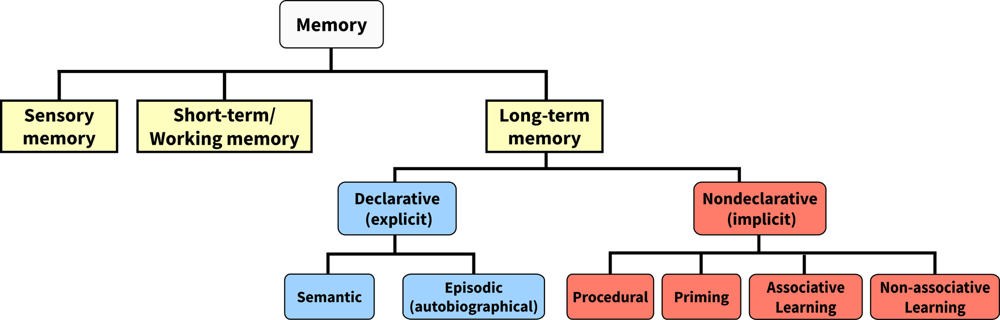
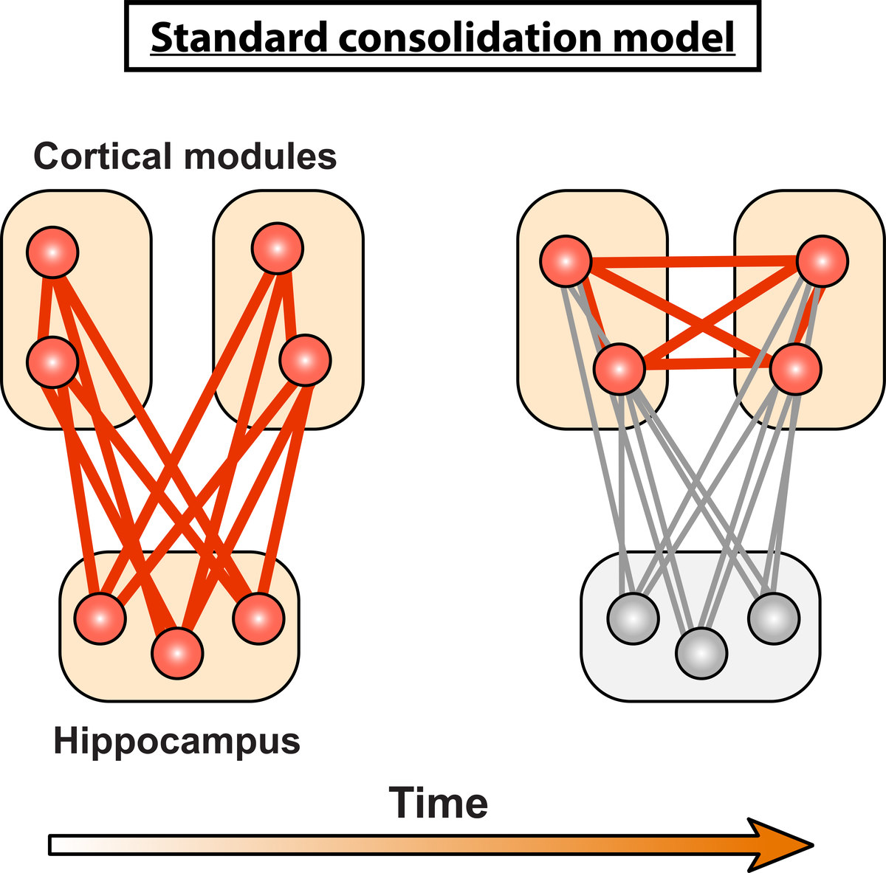
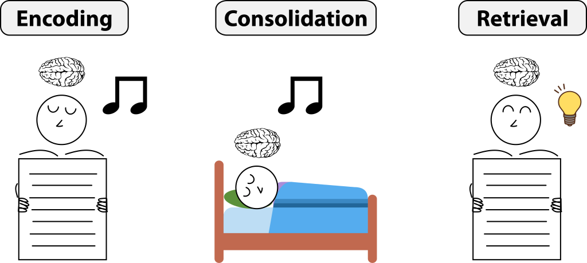
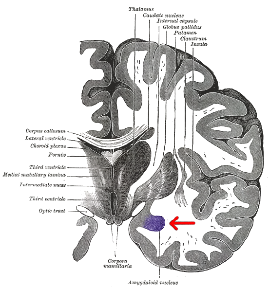
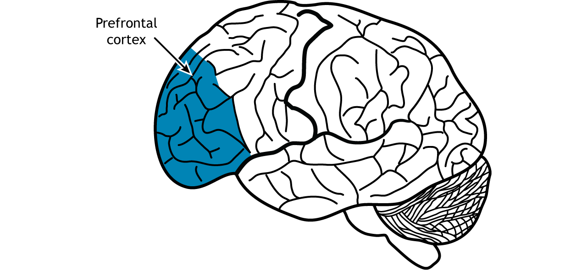

# Trí nhớ cảm xúc: hải mã, hạnh nhân và vỏ trước trán

## Tóm tắt

Vì sao bạn nhớ rõ một lần suýt tai nạn nhưng quên bữa trưa hôm qua? Và vì sao nhớ rõ chưa chắc là nhớ đúng? Bài này đi theo **đường đi của một ký ức**: được tạo, được giữ, được lấy ra, và (theo một số nghiên cứu) được viết lại một phần mỗi khi lấy ra, rồi xem cảm xúc chen vào bước nào.

Mỗi ý mang nhãn: **giáo khoa**, **giả thuyết hoặc đang tranh luận**, hoặc **Suy luận của người viết**; kết quả chỉ có ở động vật được ghi rõ.

- Một ký ức đi qua mã hóa (encoding), củng cố (consolidation) và truy xuất (retrieval) [S3]; trí nhớ có nhiều loại [S1].
- Hải mã (hippocampus) lúc đầu gắn các mảnh của một trải nghiệm lại, rồi ký ức dần ít phụ thuộc vào nó, theo một mô hình chiếm ưu thế [S3] [S8]; có mô hình khác (ý của người viết, chưa kiểm nguồn).
- Hạnh nhân (amygdala) chủ yếu điều biến độ mạnh củng cố ở nơi khác [S5] [S7]; với ký ức sợ ở chuột, nó có thể cũng giữ một phần [S2] [S12].
- Vỏ trước trán (prefrontal cortex) giữ thông tin tạm thời và liên quan đến nhớ điều đã dập tắt (extinction) [S2] [S10] [S11].
- Tái củng cố (reconsolidation): thí nghiệm gốc ở chuột [S12]; ở người còn tranh luận, chưa kết luận chắc [S13] [S14] [S15] [S18].
- Ký ức chói (flashbulb memory) sống động và khiến người ta tự tin, nhưng hai nghiên cứu 11/9 không thấy nó nhất quán hơn ký ức thường [S16] [S17].

Bài nói về cơ chế, không phải lời khuyên y tế; PTSD nằm ở L12.

## Các loại trí nhớ và ba giai đoạn của một ký ức

### Trí nhớ không phải một khối

Giáo trình *Biological Psychology* chia trí nhớ theo loại thông tin được giữ. Trí nhớ cảm giác (sensory memory) là bộ đệm rất ngắn cho thông tin vừa đến. Trí nhớ làm việc giữ và xử lý một lượng nhỏ thông tin trong thời gian ngắn. Trí nhớ dài hạn gồm hai nhánh chính: tường thuật (còn gọi là tường minh, explicit) và không tường thuật (ngầm, implicit) [S1].

*Hình 1. Các loại trí nhớ. Hove & Martinez, Hình 2 (chương 8.2), CC BY-NC-SA 4.0 theo mục Media Attributions; nguồn hình: [S1].*

**Trí nhớ tường thuật** là thông tin bạn có thể ý thức được và nói ra. Nó có hai loại: trí nhớ ngữ nghĩa (semantic memory) cho sự kiện và khái niệm chung, như "sao Mộc là hành tinh lớn nhất", và trí nhớ theo tình tiết (episodic memory) cho những việc đã xảy ra với bản thân, như "tối qua tôi gọi pizza". Giáo trình ví nó như "du hành thời gian tinh thần" [S1].

**Trí nhớ không tường thuật** hoạt động mà không cần ý thức. Giáo trình kể bốn dạng: trí nhớ thủ tục (procedural memory, "biết cách làm", như đi xe đạp), mồi (priming), học không liên kết (non-associative learning, gồm quen dần, habituation, và nhạy dần, sensitization) và học liên kết (associative learning, như điều kiện hóa kiểu Pavlov) [S1]. "Trí nhớ cơ bắp" chỉ là cách nói; cơ không lưu ký ức [S1].

Trong số trí nhớ theo tình tiết có một lớp quan trọng với bài này: ký ức cảm xúc. Giáo trình viết rằng ký ức cảm xúc thường được nhớ mạnh hơn ký ức trung tính, cả chuyện vui lẫn chuyện xấu hổ [S1].

Giáo trình mô tả nó là hệ thống tạm giữ và thao tác thông tin, cần cho học tập và suy luận. Một cách đo quen thuộc là nhắc lại dãy số: nhắc xuôi chủ yếu đo trí nhớ ngắn hạn, nhắc ngược đòi hỏi thao tác nên đo trí nhớ làm việc; hiệu suất nhắc ngược liên quan đến trí tuệ linh hoạt [S1].

### Ba giai đoạn: mã hóa, củng cố, truy xuất

Giáo trình 8.5 chia vòng đời của một ký ức thành ba bước [S3].

**Mã hóa** là chuyển thông tin đến thành một biểu diễn mà não có thể giữ. Lưu trữ tốn năng lượng và não không thể mã hóa mọi thứ giác quan đưa tới, nên hệ trí nhớ ưu tiên điều nổi bật, như dấu hiệu gắn với mối đe dọa hoặc phần thưởng [S3]. Cảm xúc can thiệp ngay ở bước này: giáo trình viết rằng ký ức cảm xúc được nhớ mạnh và sống động hơn ký ức trung tính, phần nào do sự ưu tiên khi mã hóa, với vai trò của kích thích từ hormone căng thẳng, noradrenaline và việc huy động hạnh nhân [S3].

**Củng cố** (memory consolidation) là quá trình ký ức ngắn hạn được biến thành ký ức dài hạn. Giáo trình nói thuyết củng cố hệ thống (systems consolidation) là quan điểm chiếm ưu thế, xem mục sau [S3].

**Truy xuất** là lấy lại điều đã mã hóa và lưu. Giáo trình lưu ý khi được gợi ý theo nhóm (ví dụ "hương vị thức ăn"), người ta nhớ lại các từ đã học tốt hơn so với khi tự nhớ, vì gợi ý kích hoạt bối cảnh và liên kết tạo lúc mã hóa [S3].

**Ví dụ của người viết.** Một chiếc xe máy lao ra từ ngõ, bạn phanh kịp. Bước mã hóa ưu tiên khoảnh khắc đó: bạn nhớ cả màu áo người lái. Bữa trưa hôm qua không có gì nổi bật để ưu tiên. Ví dụ này minh họa ý của giáo trình, không phải kết quả đo.

### Nhớ lại phụ thuộc trạng thái và bối cảnh

Giáo trình mô tả hai hiện tượng, chỉ ở mức hiện tượng. Trí nhớ phụ thuộc trạng thái (state-dependent memory): nhớ lại hiệu quả nhất khi người ta ở cùng trạng thái ý thức như lúc ký ức hình thành, kể cả trạng thái do chất tác động lên tâm thần hay do tâm trạng. Trí nhớ phụ thuộc bối cảnh (context-dependent memory): thay vì trạng thái bên trong, nó nói về môi trường bên ngoài; thông tin học trong một phòng được nhớ lại tốt nhất trong chính phòng đó [S3].

Cách giải thích sinh học của giáo trình: ký ức được mã hóa bằng thay đổi độ mạnh synapse và lưu thành mẫu hoạt động trải trên mạng nơron; ở cùng trạng thái hay bối cảnh, một phần của mẫu đó được kích hoạt, giúp cả dấu vết ký ức được kích hoạt [S3]. Bài không rút lời khuyên học tập từ đó.

Suy luận của người viết: vì cảm xúc là một trạng thái bên trong, nó có thể là một phần của bối cảnh lúc ký ức hình thành; nguồn chưa đo điều này.

## Củng cố: hải mã, vỏ não và giấc ngủ

### Hải mã làm gì trong quá trình

Vị trí và ca bệnh nhân H.M. đã ở L07; một câu đủ: sau khi bị cắt phần lớn hải mã hai bên, H.M. không tạo được ký ức tường thuật mới [S2]. Bài này quan tâm quá trình.

Theo giáo trình, các cấu trúc thùy thái dương trong (medial temporal lobe: hải mã, vỏ nội khứu, vỏ cạnh khứu, vỏ cạnh hải mã, tức entorhinal, perirhinal, parahippocampal) cùng quan trọng cho củng cố và lưu trữ ký ức tường thuật [S2]. Riêng hải mã gắn thông tin với bối cảnh không gian hoặc thời gian (relational binding, "gắn quan hệ"). Ví dụ giáo trình: vào tòa nhà mới tìm phòng học, hải mã gắn dãy tủ khóa với "tầng một"; gợi lại bối cảnh về sau có thể gợi ra ký ức [S2]. Khung mới hơn: hải mã có thể gắn một mục với nhiều dạng bối cảnh liên quan [S2].

### Củng cố hệ thống và "mô hình chuẩn"

Giáo trình 8.5 viết rằng thuyết củng cố hệ thống là quan điểm chiếm ưu thế: ký ức được ổn định nhờ tương tác giữa hải mã và nhiều vùng của tân vỏ (neocortex). Lúc đầu hải mã quan trọng để lưu và truy xuất; theo thời gian ký ức ít phụ thuộc vào hải mã hơn và chuyển sang lưu ở tân vỏ [S3]. Tổng quan của Frankland và Bontempi (2005) cũng mô tả ký ức đời thường lúc đầu phụ thuộc hệ thùy thái dương trong, và khi "chín" thì được cho là ngày càng phụ thuộc vỏ não; họ nói thẳng còn hiểu ít về cách chuyển đó [S8].

Giáo trình gọi cách mô tả này là **mô hình củng cố chuẩn** (standard consolidation model) và vẽ nó ở Hình 13. Trong hình đó, ký ức mới được mã hóa ở nhiều mô-đun vỏ não biểu diễn các đặc điểm (hình ảnh, âm thanh, liên kết giữa vật và bối cảnh); hải mã tích hợp và buộc chúng lại; theo thời gian các liên kết hải mã–vỏ não yếu đi và các liên kết vỏ não–vỏ não mạnh lên, cho đến khi ký ức được lưu ở vỏ não, độc lập với hải mã [S3].

*Hình 2. Mô hình củng cố chuẩn. Hove & Martinez, Hình 13 (chương 8.5), CC BY-NC-SA 4.0 theo mục Media Attributions; điều chỉnh từ Frankland & Bontempi (2005); nguồn hình: [S3].*

Giáo trình dùng ca H.M. làm bằng chứng: mất trí nhớ ngược chiều có phân bậc thời gian (temporally graded retrograde amnesia), tức mất ký ức của khoảng hai năm trước mổ nhưng giữ ký ức thơ ấu, được giải thích là ký ức gần còn phụ thuộc hải mã, ký ức xa đã chuyển sang vỏ não [S3] [S2].

**Nhãn mức chắc chắn.** Đây là *một mô hình*, được giáo trình gọi là chiếm ưu thế, không phải sự thật đã đóng. Có những mô hình khác về vai trò lâu dài của hải mã (ví dụ mô hình đa dấu vết); bài này không đi vào vì chưa tự kiểm nguồn cho chúng. Giáo trình còn kể thí nghiệm của Lashley những năm 1950 ở chuột: dù tổn thương vỏ não ở đâu, độ lớn của tổn thương mới quyết định mức hỏng trí nhớ, nghĩa là dấu vết ký ức (engram) trải rộng, không nằm ở một chỗ [S2].

### Giấc ngủ và tái hoạt hóa

Giáo trình 8.6 gắn củng cố với "tái hoạt hóa" (reactivation): mẫu phát xung của nơron lúc mã hóa được phát lại khi nghỉ sau đó, như ngủ [S4]. Ở **chuột**, các tế bào vị trí hoạt động khi khám phá được kích hoạt lại ưu tiên trong giấc ngủ sau [S4]. Ở người, một nghiên cứu fMRI (chụp cộng hưởng từ chức năng) giáo trình mô tả thấy hoạt động thùy thái dương trong lúc mã hóa và lúc nghỉ rất giống nhau với cặp vật–cảnh được nhớ, không giống với cặp bị quên [S4].

Theo giáo trình, tái hoạt hóa nổi rõ nhất ở sóng nhọn–gợn (sharp wave ripples) trên điện não đồ (EEG), chủ yếu trong giấc ngủ không REM (NREM); gây nhiễu chúng làm hỏng học và nhớ sau đó, nên tái hoạt hóa ngày càng được xem là cơ chế then chốt của củng cố ở người [S4].

**Tái hoạt hóa có đích** (targeted memory reactivation, TMR) là một kỹ thuật không xâm lấn. Trong lúc học, một gợi ý cảm giác (âm thanh, mùi) được ghép với mục cần nhớ; khi ngủ, gợi ý đó được phát lại để kích hoạt ký ức tương ứng; sau đó các mục được "nhắc" khi ngủ thường được nhớ tốt hơn các mục không được nhắc. Giáo trình dẫn một phân tích gộp (meta-analysis) 90 nghiên cứu TMR ủng hộ chung lợi ích này, mạnh nhất ở giấc ngủ NREM [S4]. Với ký ức cảm xúc, kết quả còn lẫn lộn: giáo trình nêu một nghiên cứu thấy lợi ích chỉ với ký ức trung tính và một nghiên cứu khác thấy TMR làm dịu ký ức cảm xúc [S4].

*Hình 3. Tái hoạt hóa có đích (TMR). Hove & Martinez, Hình 14 (chương 8.6); hình của Wikipedia, CC BY theo mục Media Attributions; nguồn hình: [S4].*

## Hạnh nhân: vì sao điều xúc động được nhớ lâu

### Hạnh nhân chủ yếu điều biến củng cố

Vị trí, các nhân và mạch sợ: xem L07, L09.

McGaugh (2004) tổng hợp bằng chứng từ động vật và người rằng hạnh nhân đóng vai trò then chốt giúp ta thu nhận và giữ lại ký ức dài hạn về trải nghiệm cảm xúc, và tập trung vào việc nó **điều biến sự củng cố** (modulate consolidation).

Theo bài tổng quan, các nghiên cứu động vật (tiêm hormone và thuốc sau huấn luyện, hoặc tổn thương chọn lọc từng nhân) cho thấy:

- hạnh nhân làm trung gian cho tác động lên trí nhớ của hormone căng thẳng thượng thận và vài nhóm chất dẫn truyền;
- tác động đó do phức hợp đáy bên (basolateral complex, BLA) làm trung gian chọn lọc;
- BLA điều biến củng cố qua các đường tới nhân đuôi, nhân accumbens và vỏ não (cấu trúc xem L07) [S5].

Ý quan trọng là hướng tác động: hạnh nhân điều chỉnh *độ mạnh* của củng cố ở các vùng khác khi có kích thích cảm xúc. Phelps (2004) tóm tắt tương tự: hạnh nhân có thể điều biến cả mã hóa lẫn lưu trữ của ký ức phụ thuộc hải mã; ngược lại hải mã, nhờ tạo biểu diễn tình tiết về ý nghĩa cảm xúc, có thể ảnh hưởng đáp ứng của hạnh nhân khi gặp kích thích cảm xúc; hai hệ này là độc lập nhưng phối hợp khi cảm xúc gặp trí nhớ [S7].

**Nhãn mức chắc chắn.** Ý "hạnh nhân điều biến củng cố" có nhiều bằng chứng ở động vật và bằng chứng nhất quán ở người trong các tổng quan [S5] [S7], nhưng cơ chế chi tiết chủ yếu từ động vật. Các nguồn này không nói hạnh nhân lưu mọi ký ức cảm xúc, nên bài không viết vậy.

Có một ngoại lệ cần nói: với ký ức sợ ở **chuột**, giáo trình dẫn thí nghiệm làm chết tế bào hạnh nhân bên khiến ký ức sợ mờ đi (Josselyn, 2010; chi tiết xem L07) [S2], và Nader và cộng sự nêu hạnh nhân bên và đáy "được cho là nơi lưu ký ức" trong học sợ [S12]. Suy luận của người viết: với ký ức sợ kiểu điều kiện hóa ở chuột, hạnh nhân có thể cũng giữ một phần dấu vết, còn với ký ức tình tiết cảm xúc các tổng quan nhấn mạnh vai trò điều biến; hai hướng chưa được đối chiếu trực tiếp.

*Hình 4. Lát cắt đứng ngang (coronal), hạnh nhân tô tím. Henry Gray, Anatomy of the Human Body (1918), Public Domain; Hove & Martinez, Hình 10 (chương 8.3); nguồn hình: [S2].*

### Noradrenaline: bằng chứng ở chuột và ở người

Giáo trình viết: ở phức hợp đáy bên, hormone căng thẳng và noradrenaline (hồ sơ ở L03) làm tăng củng cố ký ức cảm xúc; ở **chuột**, tiêm noradrenaline vào BLA, không vào phần kế cận, cho kết quả đó (chi tiết xem L07) [S2].

Ở **người**, Cahill và cộng sự (1994) thử trí nhớ dài hạn với một truyện ngắn gây xúc động hoặc một truyện trung tính tương đương, sau khi dùng propranolol, thuốc chẹn thụ thể beta-adrenergic. Thuốc làm giảm đáng kể trí nhớ của truyện xúc động nhưng không đổi trí nhớ của truyện trung tính; tác giả cho rằng đó không do phản ứng cảm xúc giảm hay an thần [S9]. Kết quả ủng hộ giả thuyết rằng ký ức cảm xúc được nhớ tốt hơn có liên quan đến hệ beta-adrenergic [S9].

Cũng theo McGaugh (2004), các nghiên cứu hình ảnh não ở người nhất quán với kết quả động vật: mức hạnh nhân được kích hoạt do cảm xúc lúc mã hóa (cả chất liệu dễ chịu lẫn khó chịu) tương quan chặt với việc nhớ lại về sau [S5]. Đó là tương quan, không phải nhân quả.

**Ví dụ của người viết.** Khi xe lao ra, cơ thể tiết hormone căng thẳng và noradrenaline; theo cách giải thích của [S5] và [S2], điều đó có thể làm khoảnh khắc ấy được củng cố mạnh hơn. Chưa ai đo trong chính tình huống này.

## Vỏ trước trán: giữ, điều khiển và kiềm chế ký ức

### Giữ thông tin: trí nhớ làm việc

Vỏ trước trán (prefrontal cortex) nằm ở phần trước của thùy trán; chức năng điều hành nói chung đã ở L04. Về trí nhớ, giáo trình viết rằng mạch của vỏ trước trán quan trọng cho trí nhớ ngắn hạn và trí nhớ làm việc [S2].

Bằng chứng gồm cả động vật và người. Ở **khỉ**, trong nhiệm vụ trì hoãn đáp ứng (delayed-response), khỉ thấy thức ăn được giấu vào một ngăn rồi phải tìm lại sau một quãng; khỉ bị tổn thương vỏ trước trán làm kém hơn khỉ bình thường. Ở **người**, bệnh nhân tổn thương vỏ trước trán sau đột quỵ, u hay phình mạch làm kém nhiều nhiệm vụ trí nhớ làm việc như nhắc ngược dãy số; người mắc sa sút trí tuệ trán–thái dương, nơi thùy trán thoái hóa, thường gặp khó khăn về trí nhớ làm việc [S2].

*Hình 5. Vỏ trước trán (màu xanh). Casey Henley, CC BY-NC-SA theo mục Media Attributions; Hove & Martinez, Hình 7 (chương 8.3); nguồn hình: [S2].*

Vỏ trước trán không phải nơi duy nhất: một ký ức có thể được lưu ở nhiều vùng, "như một bức tranh khảm"; vỏ trước ổ mắt (orbitofrontal cortex) có vai trò trong ký ức cảm xúc tích cực [S2].

### Điều khiển và kiềm chế: nhớ rằng đã hết nguy hiểm

Phần vỏ trước trán giữa-bụng (ventral medial prefrontal cortex, vmPFC) xuất hiện trong nghiên cứu về dập tắt nỗi sợ, xem mục sau. Ở **chuột**, Milad và Quirk (2002) ghi nơron vùng infralimbic (một phần của vỏ trước trán giữa-bụng):

- các nơron này chỉ phát xung với âm thanh khi chuột nhớ lại sự dập tắt vào ngày sau;
- chuột đứng sững ít nhất là chuột tăng đáp ứng infralimbic nhiều nhất;
- kích thích nhân tạo vùng này kèm âm thanh làm chuột chưa từng được dập tắt đứng sững ít.

Các tác giả đề xuất rằng củng cố của việc học dập tắt làm tăng hoạt động infralimbic, và hoạt động đó ức chế nỗi sợ ở những lần gặp kích thích sợ sau [S10].

Ở **người**, Phelps và cộng sự (2004) dùng chụp não để xem học dập tắt: hoạt động hạnh nhân tương quan giữa các đối tượng với đáp ứng sợ lúc tập sợ và đầu giai đoạn dập tắt, còn hoạt động vmPFC (hồi đai trước dưới gối, subgenual anterior cingulate) chủ yếu gắn với việc biểu hiện việc học này trong bài kiểm tra trễ về dập tắt. Các tác giả viết rằng cơ chế dập tắt "có thể được bảo tồn giữa các loài" [S11].

**Nhãn mức chắc chắn.** Vai trò của vỏ trước trán giữa-bụng trong nhớ lại sự dập tắt có kết quả ở cả chuột lẫn người [S10] [S11]. Bài không khái quát thành "vỏ trước trán kiềm chế mọi ký ức không mong muốn", vì nguồn đã đọc không nói vậy; "kiềm chế" ở đây chỉ nghĩa hẹp: ức chế biểu hiện của một nỗi sợ đã học.

## Ký ức sợ: học và dập tắt

### Học sợ trong một đoạn

Mạch sợ và điều kiện hóa sợ là của L09. Trong điều kiện hóa kiểu Pavlov, tiếng chuông ghép lặp lại với thức ăn thì về sau tiếng chuông một mình gây đáp ứng [S1]. Với sợ, chuột được ghép âm thanh với sốc điện ở chân rồi đứng sững khi nghe âm thanh, chứng tỏ chúng nhớ liên kết [S2].

### Dập tắt: một lần học mới

Dập tắt (extinction) là khi âm thanh được lặp lại không kèm sốc thì đáp ứng sợ giảm dần. Milad và Quirk viết rằng từ thời Pavlov người ta đã giả thuyết dập tắt không xóa điều kiện hóa ban đầu mà tạo ra một ký ức mới [S10].

**Nhãn mức chắc chắn.** Đây là giả thuyết có từ thời Pavlov, và bài báo năm 2002 ở chuột cung cấp bằng chứng thần kinh phù hợp với nó (nơron infralimbic chỉ phát xung khi nhớ lại sự dập tắt) [S10]. Bài này chỉ đọc abstract của các nghiên cứu đó, nên không khẳng định thêm về chi tiết thiết kế.

Ở chuột, trình tự là tập sợ, dập tắt, rồi hôm sau ghi nơron infralimbic lúc nhớ lại sự dập tắt [S10]. Ở người, hạnh nhân và vmPFC, hai vùng có nối với nhau, cùng liên quan [S11].

**Ví dụ của người viết.** Một người bị chó cắn rồi sợ chó; gặp nhiều con chó hiền, nỗi sợ nhạt dần. Theo cách nhìn "dập tắt là học mới", ký ức "chó nguy hiểm" không biến mất mà bị ký ức "con chó này an toàn" lấn át. Đây là Suy luận của người viết, chưa ai đo ở một người cụ thể.

### Dập tắt không phải xóa

Dập tắt là một lần học bổ sung (vmPFC có thể lưu ký ức dập tắt, gợi ý từ chuột); xóa là ký ức gốc không còn. Nguồn đã đọc ủng hộ cách nhìn thứ nhất như một giả thuyết có bằng chứng ở chuột [S10]. Vì thế khi nỗi sợ nhạt đi, chưa chắc ký ức ban đầu đã bị xóa; điều trị xem L12.

## Tái củng cố: nhớ lại là viết lại một phần

### Quan niệm cũ và thí nghiệm gốc ở chuột

Giáo trình 8.6 viết rằng quan niệm cũ coi lưu trữ ký ức là một quá trình đơn và tuyến tính, mỗi lần nhớ thì dấu vết gốc được lấy ra nguyên vẹn. Công trình gần đây gợi ý ký ức dễ bị đổi, nên có thể mỗi lần nhớ lại, ký ức thay đổi một chút; ký ức không phải bản ghi cố định mà là sự dựng lại năng động. Quá trình đó gọi là **tái củng cố** (reconsolidation): ký ức được kích hoạt lại tạm thời trở nên nhạy với sửa đổi [S4].

Thí nghiệm gốc là của Nader, Schafe và LeDoux (2000) ở **chuột**. Nhóm này dùng anisomycin, chất ức chế tổng hợp protein, tiêm vào nhân bên và nhân đáy của hạnh nhân. Tiêm ngay sau huấn luyện ngăn củng cố ký ức sợ. Khi ký ức đã củng cố được kích hoạt lại rồi tiêm anisomycin ngay sau đó, chuột mất trí nhớ khi thử lại, dù kích hoạt lại sau 1 hay 14 ngày kể từ điều kiện hóa. Không kích hoạt lại thì thuốc không làm mất ký ức; hoãn tiêm đến 6 giờ sau kích hoạt cũng không gây mất. Các tác giả kết luận ký ức sợ đã củng cố, khi được kích hoạt lại, trở lại trạng thái dễ sửa và cần tổng hợp protein mới để tái củng cố; điều này không do các lý thuyết củng cố truyền thống dự đoán [S12].

Sơ đồ: học → nhắc lại → can thiệp (tiêm thuốc trong cửa sổ ngắn) → kiểm tra sau. Đây là kết quả ở động vật, với thuốc tiêm thẳng vào não.

### Ở người: bằng chứng còn tranh luận

**Nhãn mức chắc chắn: đang tranh luận, chưa kết luận chắc.** Phần này đi từng bài một.

*Schiller và cộng sự (đăng trực tuyến tháng 12/2009; thường được dẫn là "2010").* Các tác giả giới thiệu một kỹ thuật không xâm lấn để nhắm vào tái củng cố ký ức sợ ở người: đưa thông tin không đáng sợ vào trong cửa sổ tái củng cố sau khi kích hoạt lại ký ức sợ cũ. Họ báo cáo rằng đáp ứng sợ không còn biểu hiện, hiệu ứng kéo dài ít nhất một năm và chỉ chọn lọc với ký ức đã được kích hoạt lại [S13].

*Addendum (Nature, 2018).* Chính nhóm tác giả đăng một phụ lục, nói rằng họ muốn mô tả đầy đủ và chi tiết hơn tiêu chí loại người tham gia. Tiêu chí nêu trong bài gốc chỉ bắt được một phần số người bị loại; việc loại hay giữ dựa trên đánh giá định tính từng lần thử của đáp ứng điện da (skin conductance response), xem nó có mẫu phù hợp với việc học và dập tắt thành công hay không [S13].

*Chalkia và cộng sự (2020, Cortex), báo cáo kiểm chứng.* Khi cố lặp lại điều kiện then chốt của bài Schiller, nhóm này nêu:

- tiêu chí loại người và số người bị loại bị khai sai; quyết định định tính của người làm thí nghiệm thực tế quyết định ai được giữ; phân tích thống kê không nhất quán;
- sau khi nhận dữ liệu gốc, ở Thí nghiệm 1, mọi khác biệt về sự trở lại của sợ giữa nhóm kích hoạt–dập tắt và nhóm dập tắt đều phụ thuộc vào các loại trừ định tính; với cách loại người có nguyên tắc, mức sợ trở lại gần như giống nhau;
- ở Thí nghiệm 2, kiểm chứng trên mẫu gốc không xác nhận khác biệt đã báo cáo;
- họ kết luận kết quả của Schiller "không đáng tin cậy và có lỗi" [S14].

*Kindt, Soeter và Vervliet (2009, Nature Neuroscience).* Đây là hướng khác dùng thuốc: uống propranolol, chất chẹn thụ thể beta-adrenergic, trước khi kích hoạt lại ký ức ở người đã xóa biểu hiện hành vi của ký ức sợ sau 24 giờ và ngăn sợ trở lại, theo các tác giả [S15]. Sau đó đã có thử lặp lại, với kết quả không đồng nhất:

- Pigeon và cộng sự (2022), phân tích gộp 14 nghiên cứu ở người khỏe mạnh (478 người), thấy propranolol trước nhắc lại làm giảm nhớ lại chất liệu khó chịu và phản ứng cảm xúc do tín hiệu (Hedges g = −0,51), và gọi đó là hiện tượng vững, lặp lại tốt. Tác giả cuối là Brunet; tôi chưa tự kiểm nhóm này có độc lập với hướng nghiên cứu hay không, nên đọc kết luận "vững" như quan điểm của chính họ [S18].
- Muravieva và Alberini (2010), ở **chuột**: propranolol phá tái củng cố điều kiện hóa sợ kiểu Pavlov nhưng không phá tái củng cố ký ức né tránh; họ kết luận hiệu quả bị hạn chế, và nhận xét bằng chứng ở người trước đó còn gây tranh cãi [S18].

**Ghi chú của người viết.** Chalkia và cộng sự kiểm chứng một nghiên cứu cụ thể; abstract của họ không tuyên bố tái củng cố không tồn tại ở người. Vì vậy cách đọc thận trọng là: kết quả của Schiller năm 2010 bị đặt dấu hỏi nghiêm trọng, hướng propranolol có thêm bằng chứng nhưng không đồng nhất, và câu hỏi tổng quát "tái củng cố có thể dùng để sửa ký ức sợ ở người hay không" chưa có đáp án chắc [S13] [S14] [S15]. Đây là Suy luận của người viết, rút từ các abstract và addendum nói trên.

## Ký ức chói: sống động không có nghĩa là chính xác

### Ba thứ cần tách

Thuật ngữ ký ức chói (flashbulb memory) thường được dẫn là do Brown và Kulik đặt trong bài "Flashbulb memories" (1977); tôi chỉ kiểm tiêu đề và năm, chưa đọc bài, nên không trích kết luận của họ. Ý nghĩa quen thuộc: ký ức rất sống động về hoàn cảnh mình nghe một tin sốc, như "tôi đang ở đâu, làm gì".

Khung ba thứ dưới đây là **của người viết**, để đọc hai nghiên cứu bên dưới (các nghiên cứu không tự gọi tên như vậy):

- **Sống động** (vividness): ký ức có vẻ rõ và giàu chi tiết;
- **Tự tin** (confidence): người ta tin chắc ký ức đúng;
- **Nhất quán** (consistency): ký ức khớp với điều chính người đó đã ghi sớm sau sự kiện, dùng làm thước đo thay cho độ chính xác (accuracy); riêng Hirst còn đo độ chính xác của dữ kiện sự kiện.

Cảm giác sống động và tự tin có thể có mặt khi tính nhất quán thì không.

### Talarico và Rubin (2003)

Ngày 12/9/2001, 54 sinh viên Duke ghi lại ký ức về lúc nghe tin vụ tấn công 11/9 và về một sự kiện đời thường gần đây, rồi được kiểm tra lại sau 1, 6 hoặc 32 tuần. Độ nhất quán của ký ức chói và ký ức đời thường không khác nhau, cả hai đều giảm theo thời gian. Nhưng điểm tự đánh giá về độ sống động, mức nhớ lại (recollection) và niềm tin ký ức là chính xác chỉ giảm với ký ức đời thường. Mức cảm xúc nội tạng (visceral emotion) ban đầu tương quan với niềm tin vào độ chính xác về sau, chứ không với độ nhất quán, ở ký ức chói. Các tác giả kết luận ký ức chói không đặc biệt về độ chính xác như từng được cho, mà chỉ đặc biệt về độ chính xác *cảm nhận* [S16].

### Hirst và cộng sự (2015)

Trong vòng một tuần sau 11/9, một liên nhóm nghiên cứu gửi bảng hỏi về hoàn cảnh người ta nghe tin (ký ức chói) và về sự kiện (ký ức sự kiện), rồi khảo sát lại sau 11, 25 và 119 tháng [S17]:

- cả hai loại ký ức bị quên nhanh trong năm đầu, rồi đường quên phẳng lại, không đổi đáng kể sau mười năm;
- dù quên nhanh ban đầu, sự tự tin vẫn cao suốt mười năm;
- năm yếu tố được xét (gồm chú ý đến truyền thông, thảo luận và cường độ cảm xúc) không dự báo độ nhất quán của ký ức chói sau mười năm; chú ý đến truyền thông và trò chuyện dự báo độ chính xác của ký ức sự kiện;
- ký ức chói không nhất quán có xu hướng được lặp lại hơn là được sửa; ký ức sự kiện sai dễ được sửa hơn.

### Đọc chung hai nghiên cứu

**Ghi chú của người viết.** Hai nghiên cứu đo ký ức về hoàn cảnh nghe tin, nên không suy ra ký ức cảm xúc *luôn* kém chính xác.

**Suy luận của người viết.** Cảm xúc làm tăng ưu tiên mã hóa và củng cố [S3] [S5], có thể giải thích vì sao ký ức đáng nhớ và có vẻ rõ hơn; nhưng sống động và tự tin không bảo đảm nhất quán [S16] [S17]. Không nguồn nào ở đây nói ký ức chói là "ghi hình chính xác".

## Căng thẳng và sang chấn trong trí nhớ

Trục HPA, cortisol và tác động của căng thẳng mãn tính nằm ở L05; ở đây chỉ nối vào cơ chế trí nhớ.

Roozendaal, McEwen và Chattarji (2009) viết rằng trải nghiệm có ý nghĩa cảm xúc thường được nhớ tốt và hạnh nhân đóng vai trò then chốt, nhưng việc mã hóa hiệu quả đó có thể thành bất lợi: căng thẳng nặng thường biến chúng thành nguồn lo âu mạn tính [S6]. Giáo trình nói tương tự: dưới căng thẳng sang chấn hoặc mãn tính, cơ chế noradrenaline có thể góp phần vào lo âu và việc giữ ký ức sang chấn như trong PTSD [S2]. McGaugh (2004) nêu hormone căng thẳng thượng thận là một trong những yếu tố mà hạnh nhân làm trung gian cho tác động lên trí nhớ (ở động vật) [S5].

Ở người, trong nghiên cứu sinh viên Duke, mức cảm xúc nội tạng ban đầu dự báo triệu chứng PTSD về sau [S16]; đó là tương quan trong một nhóm sinh viên, không phải nhân quả hay chẩn đoán.

Các hướng thay đổi ký ức sang chấn như tái củng cố và TMR còn tranh luận hoặc lẫn lộn ở người, như mục trước đã nêu [S4] [S14] [S15].

**Lưu ý:** bài này nhằm hiểu cơ chế, không phải lời khuyên y tế; PTSD và rối loạn lo âu ở L12.

## Những hiểu lầm thường gặp

1. **"Hạnh nhân là nơi lưu mọi ký ức cảm xúc."** Các tổng quan mô tả nó chủ yếu điều biến củng cố ở nơi khác; với ký ức sợ ở chuột có thể nó cũng giữ một phần [S5] [S7] [S12].
2. **"Hải mã giữ ký ức mãi mãi."** Theo mô hình chuẩn, ký ức dần dựa vào vỏ não; đây chỉ là một mô hình [S3] [S8].
3. **"Mỗi lần nhớ là phát lại một cuộn băng."** Giáo trình mô tả ký ức là sự dựng lại; ở chuột có thí nghiệm gốc, ở người còn tranh luận [S4] [S12] [S14].
4. **"Dập tắt nỗi sợ là xóa nó."** Giả thuyết có bằng chứng ở chuột: dập tắt tạo ký ức mới [S10].
5. **"Ký ức chói là ghi hình chính xác."** Talarico và Rubin: độ sống động tự đánh giá không giảm theo thời gian dù nhất quán giảm [S16]; Hirst: tự tin vẫn cao dù ký ức quên nhanh [S17].
6. **"Tái củng cố đã là cách chữa chắc chắn ở người."** Bài gốc bị kiểm chứng đặt dấu hỏi; hướng propranolol có thử lặp lại nhưng kết quả không đồng nhất [S13] [S14] [S15] [S18].

Hiểu lầm chung: coi mỗi cấu trúc là một việc, hoặc là nơi ký ức nằm; một ký ức có thể được lưu ở nhiều vùng như một bức tranh khảm [S2].

## Điều cần nhớ

- Một ký ức đi qua mã hóa, củng cố, truy xuất [S1] [S3] (giáo khoa).
- Hạnh nhân chủ yếu điều biến độ mạnh củng cố [S5] (tổng quan, chủ yếu từ động vật); thuốc chẹn thụ thể beta làm giảm nhớ truyện xúc động ở người [S9]; với ký ức sợ ở chuột, nó có thể cũng giữ một phần (suy luận của người viết).
- Mô hình chuẩn: hải mã buộc các mảnh lại lúc đầu, về sau ký ức dựa vào vỏ não [S3] [S8] (mô hình chiếm ưu thế, không phải sự thật cuối cùng).
- Tái hoạt hóa khi ngủ ngày càng được xem là cơ chế then chốt của củng cố ở người [S4] (theo giáo trình).
- Dập tắt là học thêm, không phải xóa [S10] (giả thuyết, bằng chứng ở chuột); vmPFC liên quan đến nhớ sự dập tắt ở chuột và người [S10] [S11].
- Tái củng cố: thí nghiệm gốc ở chuột [S12]; ở người đang tranh luận [S13] [S14] [S15] [S18].
- Ký ức chói: sống động (Talarico) và tự tin (Hirst) không đi kèm nhất quán hơn [S16] [S17] (hai nghiên cứu về 11/9).
- Bài nhằm hiểu cơ chế, không phải lời khuyên y tế; rối loạn ở L12.

## Nguồn tham khảo

- [S1] Hove & Martinez, Biological Psychology (Revised Edition), 2024, mục 8.2 Types of Memory, https://rotel.pressbooks.pub/biologicalpsychology/chapter/8-2-types-of-memory/
- [S2] Hove & Martinez, Biological Psychology (Revised Edition), 2024, mục 8.3 Brain Structures in Memory, https://rotel.pressbooks.pub/biologicalpsychology/chapter/8-3-brain-structures-in-memory/
- [S3] Hove & Martinez, Biological Psychology (Revised Edition), 2024, mục 8.5 Stages of Memory, https://rotel.pressbooks.pub/biologicalpsychology/chapter/8-5-stages-of-memory/
- [S4] Hove & Martinez, Biological Psychology (Revised Edition), 2024, mục 8.6 Memory Reconsolidation, https://rotel.pressbooks.pub/biologicalpsychology/chapter/8-6-memory-reconsolidation-new-views-and-applications/
- [S5] McGaugh, J. L., The amygdala modulates the consolidation of memories of emotionally arousing experiences, Annual Review of Neuroscience, 2004, https://doi.org/10.1146/annurev.neuro.27.070203.144157
- [S6] Roozendaal, B., McEwen, B. S., Chattarji, S., Stress, memory and the amygdala, Nature Reviews Neuroscience, 2009, https://doi.org/10.1038/nrn2651
- [S7] Phelps, E. A., Human emotion and memory: interactions of the amygdala and hippocampal complex, Current Opinion in Neurobiology, 2004, https://doi.org/10.1016/j.conb.2004.03.015
- [S8] Frankland, P. W., Bontempi, B., The organization of recent and remote memories, Nature Reviews Neuroscience, 2005, https://doi.org/10.1038/nrn1607
- [S9] Cahill, L. và cộng sự, β-adrenergic activation and memory for emotional events, Nature, 1994, https://doi.org/10.1038/371702a0
- [S10] Milad, M. R., Quirk, G. J., Neurons in medial prefrontal cortex signal memory for fear extinction, Nature, 2002, https://doi.org/10.1038/nature01138
- [S11] Phelps, E. A. và cộng sự, Extinction learning in humans, Neuron, 2004, https://doi.org/10.1016/j.neuron.2004.08.042
- [S12] Nader, K., Schafe, G. E., LeDoux, J. E., Fear memories require protein synthesis in the amygdala for reconsolidation after retrieval, Nature, 2000, https://doi.org/10.1038/35021052
- [S13] Schiller, D. và cộng sự, Preventing the return of fear in humans using reconsolidation update mechanisms, Nature, 2009 (trực tuyến; thường dẫn là 2010), https://doi.org/10.1038/nature08637 và Addendum 2018, https://doi.org/10.1038/s41586-018-0405-7
- [S14] Chalkia, A. và cộng sự, Preventing the return of fear in humans using reconsolidation update mechanisms: A verification report of Schiller et al. (2010), Cortex, 2020, https://doi.org/10.1016/j.cortex.2020.03.031
- [S15] Kindt, M., Soeter, M., Vervliet, B., Beyond extinction: erasing human fear responses and preventing the return of fear, Nature Neuroscience, 2009, https://doi.org/10.1038/nn.2271
- [S16] Talarico, J. M., Rubin, D. C., Confidence, not consistency, characterizes flashbulb memories, Psychological Science, 2003, https://doi.org/10.1111/1467-9280.02453
- [S17] Hirst, W. và cộng sự, A ten-year follow-up of a study of memory for the attack of September 11, 2001, Journal of Experimental Psychology: General, 2015, https://doi.org/10.1037/xge0000055
- [S18] Pigeon, S. và cộng sự, Impairing memory reconsolidation with propranolol in healthy and clinical samples: a meta-analysis, Journal of Psychiatry and Neuroscience, 2022, https://doi.org/10.1503/jpn.210057 và Muravieva, E. V., Alberini, C. M., Limited efficacy of propranolol on the reconsolidation of fear memories, Learning & Memory, 2010, https://doi.org/10.1101/lm.1794710
