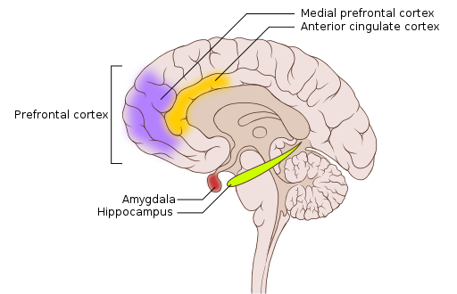

# Rối loạn tâm trạng, lo âu và PTSD ở mức cơ chế

## Tóm tắt

Khi nói não của người trầm cảm, lo âu hay sang chấn "khác", người ta thật sự đo được gì, và chưa đo được gì? Bài này đi qua bốn nhóm rối loạn theo cùng một câu hỏi: ở nhóm người đã có chẩn đoán, nghiên cứu thấy gì ở vùng não, ở chất dẫn truyền và ở gen, và điều đó chứng minh được đến đâu.

Ba ý đi suốt bài. Thứ nhất, hầu hết phát hiện về não là **đo được ở nhóm**: so sánh trung bình của nhóm có chẩn đoán với nhóm không có. Chúng không phải xét nghiệm cho một người, và phần lớn chưa cho biết cái gì có trước [S12]. Thứ hai, hạnh nhân (vùng cảm xúc nằm sâu) được báo cáo hoạt động mạnh hơn ở nhóm có chẩn đoán, và vỏ trước trán (vùng điều khiển) hoạt động yếu hơn: giáo trình nói vậy cho trầm cảm [S2] và lo âu [S3], các tổng quan nói vậy cho PTSD [S11] [S14]. Cách gộp ba rối loạn thành một mẫu là cách tóm tắt của người viết; phân tích gộp thấy vỏ trước trán giảm hoạt động chỉ ở PTSD, không ở lo âu xã hội hay ám sợ [S11]. Thứ ba, các giả thuyết hóa học như "thiếu serotonin" hay "ức chế GABA không đủ" vẫn là giả thuyết, và giả thuyết serotonin đang có tranh luận công khai [S5] [S6].

Bài dùng ba nhãn mức chắc chắn: **giáo khoa**, **giả thuyết hoặc đang tranh luận** (nói rõ ai tranh luận) và **Suy luận của người viết** (không gắn nguồn). Thuốc, liệu pháp tâm lý và kích thích não chỉ được nêu theo nhóm và cơ chế, không kèm khuyến nghị. Hãy đọc mục `## Lưu ý` ở cuối.

## Rối loạn tâm lý là gì và bài này không làm gì

Giáo trình *Biological Psychology* mở chương rối loạn bằng quan điểm "sinh học, tâm lý, xã hội" (biopsychosocial): sức khỏe tâm thần phụ thuộc vào yếu tố sinh học, tâm lý và xã hội cùng lúc, và cách chúng tác động lên từng người vẫn là câu hỏi khó [S1]. Cuốn sách tập trung vào mặt sinh học và chỉ giới thiệu sơ lược việc điều trị [S1]; bài này theo cùng giới hạn. Tổ chức Y tế Thế giới (WHO) cũng nêu trầm cảm là kết quả tương tác phức tạp của yếu tố xã hội, tâm lý và sinh học [S17].

**Định nghĩa làm việc.** Hội Tâm thần Hoa Kỳ (APA) mô tả rối loạn tâm lý (psychological disorder) bằng bốn điều kiện [S1]:

1. rối loạn đáng kể trong suy nghĩ, cảm xúc và hành vi;
2. phản ánh một sự trục trặc về sinh học, tâm lý hoặc phát triển;
3. gây đau khổ hoặc suy giảm chức năng đáng kể trong đời sống;
4. không phải phản ứng được mong đợi hay được văn hóa chấp nhận trước một sự kiện.

Điều kiện thứ tư có ví dụ trong giáo trình: buồn sâu và muốn ở một mình sau khi người thân qua đời là phản ứng được mong đợi, nên tự nó không báo hiệu một rối loạn [S1].

**Hệ thống phân loại.** Công cụ chẩn đoán chính trong sách là DSM-5-TR (bản sửa đổi thứ năm của sổ tay chẩn đoán và thống kê rối loạn tâm thần) của APA; một hệ khác là ICD-11 của WHO, chủ yếu dùng để so sánh số liệu bệnh tật trên toàn cầu [S1]. Giáo trình nêu một hạn chế: những người có triệu chứng rất khác nhau có thể nhận cùng một chẩn đoán, và ngược lại. Đó là một lý do các nhà khoa học xem yếu tố sinh học có giúp phân loại hay không [S1].

**Một vài con số, kèm quần thể.** Các số dưới đây là ước tính cho một quần thể, không phải xác suất của một cá nhân. Ở Hoa Kỳ, khảo sát quốc gia của Kessler và cộng sự cho tỷ lệ mắc trong đời ước tính là 28,8% với rối loạn lo âu và 20,8% với rối loạn khí sắc, tuổi khởi phát trung vị sớm hơn ở lo âu (11 tuổi) so với khí sắc (30 tuổi) [S16]. Trên toàn cầu, WHO ước tính năm 2023 có 5,2% người trưởng thành bị trầm cảm [S17].

**Bài này làm gì và không làm gì.** Bài mô tả những gì đã đo ở mức não và chất dẫn truyền, cùng mức bằng chứng. Bài không giúp tự đối chiếu bản thân với một rối loạn, không đưa lời khuyên chăm sóc, không so sánh phương pháp nào. Tâm thần phân liệt và rối loạn ám ảnh cưỡng chế nằm ngoài phạm vi.

**Quy tắc đọc ảnh chụp não.** Mỗi lần bài nói "vùng X hoạt động yếu hơn" hay "lớn hơn", hãy đọc thành: *ở nhóm người đã có chẩn đoán, trung bình, so với nhóm không có chẩn đoán, tại thời điểm đo.* Ví dụ của người viết: chiều cao trung bình của hai đội bóng có thể khác nhau, nhưng biết một người cao không cho biết người đó chơi đội nào. Phát hiện ở nhóm cũng vậy, và không cho biết vùng ấy là nguyên nhân, hậu quả hay chỉ đi kèm.

Các chất dẫn truyền xem ở L03; hạnh nhân, hải mã ở L07; hệ thưởng và căng thẳng ở L05; vỏ trước trán ở L04; ký ức sợ ở L11.

## Trầm cảm: những vùng não được đo thấy gì

**Định nghĩa làm việc.** DSM-5 có hai nhóm rối loạn khí sắc: rối loạn trầm cảm và rối loạn lưỡng cực. Bài dùng rối loạn trầm cảm chủ yếu (major depressive disorder, MDD, còn gọi trầm cảm đơn cực) mà giáo trình nhấn mạnh [S2]. Theo giáo trình, tiêu chí đòi hỏi triệu chứng nặng và kéo dài, gồm khí sắc trầm hoặc mất hứng thú với hoạt động, và gây đau khổ hoặc suy giảm chức năng [S2]. Việc áp dụng tiêu chí thuộc về người có chuyên môn. Ở Hoa Kỳ, khoảng 7% dân số mắc MDD mỗi năm theo giáo trình, nhóm 18–29 tuổi có tỷ lệ cao nhất, và nữ cao khoảng gấp đôi nam [S2].

**Vỏ trước trán hoạt động thấp.** Giáo trình viết rằng ở nhóm người trầm cảm, các nghiên cứu PET (chụp cắt lớp phát positron, đo chuyển hóa của não) cho thấy hoạt động thấp bất thường ở vỏ trước trán (prefrontal cortex), vùng liên quan đến kiểm soát nhận thức, ra quyết định, lập kế hoạch và điều hòa cảm xúc [S2]. Mức bất thường ở các phần bên, ổ mắt và giữa-dưới của vỏ trước trán thường tương quan với độ nặng của trầm cảm [S2]. Phần bên liên quan kiểm soát chú ý, phần ổ mắt liên quan quyết định và đánh giá phần thưởng, phần giữa-dưới liên quan điều hòa cảm xúc tiêu cực [S2]. "Tương quan" nghĩa là hai thứ cùng đổi, chưa phải một thứ gây ra thứ kia. Vỏ trước trán xem ở L04.

**Hạnh nhân hoạt động quá mức, và "bên trái" ức chế.** Giáo trình nói hoạt động của vỏ trước trán bên trái liên quan đến cảm xúc tích cực và được cho là ức chế cảm xúc tiêu cực do các cấu trúc viền như hạnh nhân tạo ra; hạnh nhân hoạt động quá mức ở người trầm cảm [S2]. Một phát hiện có hướng điều trị: những người đáp ứng với thuốc chống trầm cảm cho thấy hạnh nhân bớt hoạt động quá mức, còn hạnh nhân tiếp tục hoạt động quá mức dù đã điều trị thường dự báo tái phát [S2]. *Suy luận của người viết:* đây vẫn là quan hệ đi kèm và dự báo ở nhóm, chưa phải cơ chế đã chứng minh.

**Một mạch, không phải một vùng.** Tổng quan của Price và Drevets mô tả một hệ thống nối vỏ trước trán giữa với hạnh nhân, thể vân bụng (ventral striatum), đồi thị, vùng dưới đồi và thân não; theo họ, dữ liệu người từ chụp cấu trúc, chụp chức năng, tổn thương và mô học cho thấy hệ thống này "liên quan trung tâm" đến rối loạn khí sắc [S9].

*Một số cấu trúc tham gia xử lý cảm xúc trên mặt cắt giữa não: orbital frontal cortex (vỏ ổ mắt trán), nucleus accumbens, hypothalamus (vùng dưới đồi), amygdala (hạnh nhân), thalamus (đồi thị), periaqueductal gray (chất xám quanh cống não). Nguồn hình (chương khác của giáo trình, không nằm trong S1–S18): Noba, giấy phép theo sách CC BY-NC-SA; Hove & Martinez, Hình 2 (chương 10.1). https://rotel.pressbooks.pub/biologicalpsychology/chapter/affective-neuroscience-what-is-it/*

*Hệ viền trên mặt cắt giữa não: cingulate gyrus (hồi đai), thalamus (đồi thị), hypothalamus (vùng dưới đồi), amygdala (hạnh nhân), hippocampus (hải mã). Chi tiết cấu trúc xem L07. Nguồn hình (chương khác của giáo trình, không nằm trong S1–S18): Wikimedia, giấy phép theo sách CC BY-NC-SA; Hove & Martinez, Hình 19 (chương 2.6). https://rotel.pressbooks.pub/biologicalpsychology/chapter/the-brain/*

**Kích thước và khớp thần kinh.** Duman và Aghajanian tóm tắt rằng các nghiên cứu cơ bản (tiền lâm sàng, thường trên động vật) và lâm sàng cho thấy trầm cảm liên quan đến vùng não điều hòa khí sắc và nhận thức (vỏ trước trán, hải mã) nhỏ hơn và ít khớp thần kinh (synapse) hơn [S8]. Họ nói thêm rằng thuốc chống trầm cảm có thể chặn hoặc đảo ngược các thiếu hụt này, ở mức tổng quan [S8].  Phần tóm tắt không tách rõ dữ liệu người và động vật, nên cần đọc nguồn gốc trước khi áp cho người.

**Di truyền và môi trường.** Giáo trình ghi tính di truyền (heritability) của rối loạn trầm cảm khoảng 40%, và nguy cơ cao gấp 1,5–3 lần khi có người nhà từng bị, nhưng vẫn cho rằng rối loạn nảy sinh từ tương tác gen–môi trường phức tạp [S2]. Con số 40% là ước tính cho quần thể, không phải phần gen trong nguyên nhân của một người. WHO nêu thêm: người từng trải qua nghịch cảnh, mất mát nặng hay sự kiện căng thẳng có nguy cơ cao hơn [S17].

**Mức bằng chứng.** *Giáo khoa:* mô tả hoạt động trước trán thấp và hạnh nhân quá hoạt động ở nhóm [S2]. *Giả thuyết:* vỏ trước trán bên trái "ức chế" cảm xúc tiêu cực [S2]. *Chưa rõ:* các thay đổi là nguyên nhân, hệ quả hay thứ đi cùng.

## Trầm cảm và giả thuyết monoamine: bằng chứng và tranh luận

**Điều giáo trình nói.** Giáo trình viết rằng khí sắc rối loạn liên quan đến mức bất thường của vài chất dẫn truyền, nhất là serotonin và noradrenaline (hai chất thuộc nhóm monoamine), và rằng mức hoạt động thấp của hai chất này "từ lâu được ghi nhận" như yếu tố góp phần vào rối loạn trầm cảm [S2]. Giáo trình kể mối liên hệ được phát hiện tình cờ thập niên 1950: thuốc ức chế monoamine oxidase (MAOI) dùng cho bệnh nhân lao, và tâm trạng trầm của họ cũng cải thiện [S2]. Giáo trình nói luôn: "cơ chế chính xác vẫn đang được nghiên cứu" [S2]. Hồ sơ serotonin xem ở L03.

**Một điều giáo trình tự thừa nhận: độ trễ.** Nhóm thuốc chống trầm cảm SSRI chặn thu hồi serotonin; mức serotonin ở khe synapse có thể tăng trong vòng một giờ, nhưng triệu chứng thường phải mất vài tuần mới cải thiện, và giáo trình nói cơ chế tác dụng chính xác chưa rõ [S2] (cơ chế SSRI ở synapse xem L03). Harmer, Duman và Cowen viết rằng một cách giải thích chỉ dựa trên chất dẫn truyền bị thách thức bởi độ trễ lâm sàng của hầu hết thuốc, và bởi việc cần giải thích vì sao thay đổi hóa học đảo ngược được nhiều triệu chứng khác nhau [S7]. Họ nêu hai hướng, đều ở mức giả thuyết: thay đổi sớm trong xử lý cảm xúc và xã hội, và tính dẻo thần kinh (neural plasticity) [S7]. Duman và Aghajanian đề xuất "giả thuyết sinh khớp thần kinh" (synaptogenic hypothesis): một chất tác động lên một loại thụ thể glutamate cho đáp ứng trong vài giờ ở người không đáp ứng với thuốc điển hình, và thúc đẩy hình thành khớp thần kinh ở thí nghiệm tiền lâm sàng, thường trên động vật [S8].

**Điều tổng quan hệ thống 2022 báo cáo.** Moncrieff và cộng sự thực hiện một "umbrella review" (tổng quan của các tổng quan) về giả thuyết serotonin, tìm tài liệu đến tháng 12 năm 2020 [S5]. Họ hỏi: trầm cảm có gắn với nồng độ hay hoạt động serotonin thấp hơn không? Họ gộp 17 nghiên cứu về năm mảng bằng chứng, từ nồng độ serotonin và chất chuyển hóa trong dịch cơ thể, qua thụ thể và chất vận chuyển serotonin, đến thí nghiệm làm giảm nguyên liệu tạo serotonin ở người tình nguyện và các gen liên quan [S5]. Kết luận của họ: các mảng này "không cho thấy bằng chứng nhất quán" về mối liên hệ giữa serotonin và trầm cảm, và không ủng hộ giả thuyết rằng trầm cảm do serotonin hoạt động hay nồng độ thấp gây ra [S5]. Một vài bằng chứng yếu hướng về hoạt động serotonin tăng chứ không giảm; theo họ, điều đó chỉ khớp nếu đó là bất thường nguyên phát, và ảnh hưởng của thuốc dùng trước chưa được loại trừ [S5]. Họ cũng lưu ý nhiều nghiên cứu gộp có chất lượng thấp theo thang AMSTAR-2 [S5].

**Phạm vi kết luận của họ.** Câu hỏi của tổng quan là về giả thuyết "serotonin thấp"; bài báo không đặt câu hỏi liệu thuốc chống trầm cảm có tác dụng hay không, nên không nên suy diễn hộ điều đó [S5]. Tổng quan loại trầm cảm kèm bệnh thể chất và trầm cảm lưỡng cực [S5].

**Có tranh luận.** Đây là chỗ bài không phân xử. Một ví dụ là tổng quan tường thuật của Jauhar, Cowen và Browning, mở đầu bằng việc ghi nhận rằng gần đây "một số tác giả" nghi ngờ giá trị của giả thuyết, rồi tóm tắt bằng chứng về dược lý, chụp ảnh phân tử và thần kinh học ở mức hệ thống [S6]. Bài này chỉ đọc phần tóm tắt của tổng quan đó, mà tóm tắt không nêu kết luận, nên không thuật lại kết luận; ai cần chi tiết nên đọc nguồn gốc.

**Đặt hai phía cạnh nhau.** Giáo trình nói serotonin và noradrenaline thấp "từ lâu được ghi nhận" nhưng cơ chế chính xác vẫn đang nghiên cứu [S2]; Moncrieff nói bằng chứng cho "serotonin thấp" là không nhất quán [S5]; Harmer và cộng sự nói giải thích chỉ bằng chất dẫn truyền gặp thách thức [S7]. *Mức chắc chắn:* thuốc làm đổi hoạt động chất dẫn truyền là giáo khoa [S2]; "trầm cảm do thiếu serotonin" là giả thuyết đang tranh luận [S5] [S6].

## Rối loạn lưỡng cực: nhạy cảm với phần thưởng và mạch cảm xúc

**Định nghĩa làm việc.** Rối loạn lưỡng cực (bipolar disorder) là nhóm rối loạn lấy hưng cảm (mania) làm đặc trưng; hưng cảm là trạng thái phấn khích và kích động quá mức [S2]. Theo giáo trình, lưỡng cực I đòi hỏi ít nhất một giai đoạn hưng cảm kéo dài, với khí sắc tăng cao hoặc dễ cáu; lưỡng cực II có giai đoạn hưng cảm nhẹ (hypomanic) thay vì hưng cảm đầy đủ; ở cả hai thể, giai đoạn hưng cảm (hoặc hưng cảm nhẹ) đi cùng giai đoạn trầm cảm nặng, đi trước hoặc sau nó, nên trầm cảm nặng là một phần của bệnh cảnh chứ không phải phần phụ [S2]. Việc áp dụng tiêu chí thuộc về người có chuyên môn. Ở Hoa Kỳ, giáo trình ghi lưỡng cực I ảnh hưởng 1,5% và lưỡng cực II 0,8% dân số [S2].

**Di truyền cao, diễn biến thay đổi.** Giáo trình nói lưỡng cực có tính di truyền cao, nhưng diễn biến thay đổi nhiều, và với người có nhạy cảm di truyền thì yếu tố tâm lý xã hội có thể khởi phát giai đoạn [S2].

**Kết quả fMRI: không nhất quán, và vì sao.** Nhiều nghiên cứu fMRI (chụp cộng hưởng từ chức năng, đo hoạt động não qua lưu lượng máu) ở lưỡng cực tập trung vào xử lý cảm xúc; giáo trình báo rằng các vùng xử lý cảm xúc được kích hoạt khác với nhóm khỏe mạnh, nhưng kết quả "không nhất quán" [S2]. Giáo trình nêu ba lý do: người tham gia được thử ở các giai đoạn bệnh khác nhau (hưng cảm, trầm cảm, giữa các giai đoạn), mẫu nhỏ, và kích thích trong phòng thí nghiệm có thể không đủ mạnh để gây đáp ứng não rõ [S2].

**Mô hình mạch của Phillips và Swartz.** Trong tổng quan phê bình, Phillips và Swartz đề xuất nhìn lưỡng cực như rối loạn song song ở mạch xử lý và điều hòa cảm xúc (vỏ trước trán, nhất là phần bụng-bên, hải mã, hạnh nhân, hai bên) cùng mạch thưởng bên trái "quá hoạt động" (thể vân bụng, vỏ bụng-bên và vỏ ổ mắt), dẫn đến lệch cảm xúc và tăng nhạy cảm với phần thưởng [S10]. Về cấu trúc, họ nêu chất xám giảm ở vỏ trước trán, vỏ thái dương, hạnh nhân, hải mã và chất trắng nối trước trán với vùng dưới vỏ giảm chỉ số nguyên vẹn [S10]. Họ nhận có nhiều hạn chế ở các nghiên cứu này [S10]. *Mức chắc chắn:* đây là mô hình tổng hợp, ở mức giả thuyết.

**Ý "nhạy cảm với phần thưởng".** Giáo trình viết rằng sự kiện căng thẳng nặng làm tăng nguy cơ tái phát; sự kiện tích cực cũng có thể làm xấu diễn biến, vì sau khi đạt một mục tiêu mong muốn, người có lưỡng cực có thể có thêm triệu chứng hưng cảm (nguồn gốc là các nghiên cứu của Johnson và cộng sự); các phát hiện này gợi ý rằng họ có thể quá nhạy với phần thưởng [S2]. Đây là **giả thuyết giáo trình nêu**, không phải điều đã chứng minh. Hệ thưởng xem ở L05.

**Chất dẫn truyền: giả thuyết điều chỉnh.** Giáo trình kể rằng ban đầu các nhà nghiên cứu nghĩ lưỡng cực liên quan đến noradrenaline và serotonin thấp, nhưng hiện nay người ta tin rằng serotonin thấp và noradrenaline cao có thể giải thích các giai đoạn hưng cảm (Soreff và McInnes) [S2]. *Mức chắc chắn:* giả thuyết, giáo trình dùng "có thể".

## Lo âu: hạnh nhân, vỏ trước trán và GABA

**Định nghĩa làm việc.** Giáo trình định nghĩa lo âu (anxiety) là trạng thái khí sắc tiêu cực kèm triệu chứng cơ thể như tim đập nhanh, căng cơ, cảm giác bất an và lo về tương lai; ai cũng có lo âu hằng ngày [S3]. Rối loạn lo âu (anxiety disorder) là lo sợ quá mức và dai dẳng cùng các rối loạn hành vi liên quan [S3]. Các dạng thường gặp được giáo trình kể tên: lo âu lan tỏa, ám sợ cụ thể, sợ khoảng trống (agoraphobia), lo âu xã hội và rối loạn hoảng sợ; chúng khác nhau ở loại đối tượng hay tình huống gây phản ứng [S3].

**Gen.** Các nghiên cứu gia đình và sinh đôi cho thấy tính di truyền vừa phải, khoảng 30–40%, thấp hơn tâm thần phân liệt hay lưỡng cực [S3]. Đây là ước tính cho quần thể.

**Mô hình của giáo trình.** Mạch của lo âu có hai chiều: tín hiệu từ dưới lên của hạnh nhân báo có kích thích có thể đe dọa, và kiểm soát từ trên xuống của vỏ trước trán báo mức nổi bật cảm xúc của kích thích [S3] [S13]. Nhân trung tâm (central nucleus) của hạnh nhân nối với cấu trúc thân não điều khiển hoạt động tự động như hô hấp và nhịp tim, và được cho là tham gia kích hoạt cơn hoảng loạn [S3]. Các nghiên cứu **trên động vật** cho thấy kích thích nhân trung tâm bằng điện hay thuốc tạo ra hành vi liên quan đến hoảng loạn [S3].

*Sơ đồ hệ giao cảm và đối giao cảm, hai nhánh của hệ thần kinh tự chủ, đến tim, phổi và các cơ quan khác; dùng để hình dung đường mà tín hiệu từ thân não đi ra cơ thể. Nguồn hình (chương khác của giáo trình, không nằm trong S1–S18): OpenStax, giấy phép theo sách CC BY-NC-SA; Hove & Martinez, Hình 4 (chương 2). https://rotel.pressbooks.pub/biologicalpsychology/chapter/the-peripheral-nervous-system/*

**Điều đo được ở nhóm.** Etkin và Wager gộp các nghiên cứu fMRI và PET về PTSD, lo âu xã hội và ám sợ cụ thể. Ở cả ba nhóm, hạnh nhân và thùy đảo (insula) hoạt động mạnh hơn nhóm so sánh khi xử lý kích thích cảm xúc tiêu cực; hình mẫu tương tự cũng thấy ở người khỏe mạnh khi học sợ có điều kiện [S11]. Mức tăng này thấy thường hơn ở lo âu xã hội và ám sợ cụ thể so với PTSD [S11]. Shin và Liberzon tổng hợp tương tự, và nêu rõ điều chưa biết: các bất thường chức năng này là dấu hiệu mắc phải của rối loạn hay là yếu tố dễ tổn thương có từ trước [S12]. Riêng về vỏ trước trán, giáo trình ghi nhóm lo âu cho thấy hoạt hóa giảm [S3]. *Mức chắc chắn:* đo được ở nhóm; hướng nhân quả chưa rõ [S12].

**GABA: một giả thuyết.** Nghiên cứu chất dẫn truyền trong mạch lo âu tập trung nhiều vào GABA, chất ức chế chính của não [S3]. Giả thuyết giáo trình nêu: ức chế GABA không đủ có thể làm hạnh nhân hoạt động quá mức [S3]. Bằng chứng giáo trình dẫn là từ **động vật**: tiêm chất kích hoạt thụ thể GABA vào hạnh nhân giảm các thước đo sợ và lo âu [S3]. Gauthier và Nuss mô tả mạng hạnh nhân là mạng nơron trung gian ức chế dùng GABA [S13]. Họ đề xuất rằng thay đổi chất điều biến nội sinh hay thành phần của thụ thể GABA-A có thể làm giảm ức chế trong trạng thái lo âu bệnh lý, và nêu neurosteroid, chất điều biến thụ thể GABA-A được tổng hợp trong não và bị căng thẳng điều hòa [S13]. Hồ sơ GABA xem ở L03.

**Mức bằng chứng.** *Đo được ở nhóm (giáo trình và phân tích gộp):* hạnh nhân mạnh hơn [S3] [S11]; vỏ trước trán yếu hơn theo giáo trình [S3]. *Giả thuyết:* GABA ức chế không đủ [S3] [S13]. *Đừng hiểu nhầm:* hạnh nhân không phải "nút lo âu"; mạch gồm nhiều vùng.

## PTSD: ký ức sang chấn, hải mã và noradrenaline

**Định nghĩa làm việc.** Chẩn đoán rối loạn căng thẳng sau sang chấn (post-traumatic stress disorder, PTSD) đòi hỏi người đó đã bị phơi nhiễm với việc chết hoặc đe dọa chết, chấn thương nặng, hoặc bạo lực tình dục [S4]. Tiêu chí chặt này khác quan niệm sai rằng căng thẳng nhẹ hơn, như một lần chia tay không bạo lực, cũng gây PTSD [S4]. Triệu chứng thuộc vài nhóm và phải kéo dài; việc áp dụng tiêu chí thuộc về người có chuyên môn [S4]. Viện Sức khỏe Tâm thần Quốc gia Hoa Kỳ (NIMH) nêu: nhiều người có phản ứng ban đầu, nhưng hầu hết hồi phục và hầu hết không phát triển PTSD [S18]. Ở Hoa Kỳ, giáo trình ghi khoảng 6% người lớn mắc PTSD trong đời, nữ cao gấp đôi nam [S4].

**Hải mã: quan hệ đi kèm, không phải nguyên nhân.** Giáo trình ghi nhóm có PTSD có thể tích một số phần của hải mã nhỏ hơn, điều có thể liên quan đến giảm sinh nơron và nhánh sợi nhánh; và sau điều trị hiệu quả bằng thuốc hay liệu pháp nhận thức hành vi, kích thước hải mã tăng [S4]. Shin, Rauch và Pitman tổng hợp thêm: ở PTSD, hạnh nhân đáp ứng mạnh hơn khi có triệu chứng, và mức đáp ứng tương quan thuận với độ nặng; vỏ trước trán giữa nhỏ hơn và đáp ứng yếu hơn, tương quan nghịch với độ nặng; hải mã giảm thể tích, tính nguyên vẹn nơron và chức năng [S14]. Trong ba rối loạn được so sánh, Etkin và Wager thấy riêng ở PTSD có giảm hoạt động ở vỏ vòng đai trước và vỏ trước trán giữa-dưới [S11]. Giáo trình không nói hải mã nhỏ gây PTSD. Shin và Liberzon nêu câu hỏi tương tự cho các bất thường chức năng nói chung: dấu hiệu mắc phải hay yếu tố có từ trước [S12]. Hải mã, hạnh nhân, hồi đai xem ở L07.

*Brain regions typically associated with PTSD (các vùng thường liên quan đến PTSD): prefrontal cortex (vỏ trước trán), hippocampus (hải mã), cingulate cortex (vỏ vòng đai), amygdala (hạnh nhân). Đây là vùng thường được liên hệ, không phải chứng minh nguyên nhân. Nguồn hình: Wikipedia, giấy phép theo sách CC BY; Hove & Martinez, Hình 9 (chương 12.6). https://rotel.pressbooks.pub/biologicalpsychology/chapter/post-traumatic-stress-disorder/ [S4]*

**Mô hình mạch.** Rauch, Shin và Phelps đề xuất, dựa trên nghiên cứu học sợ ở loài gặm nhấm, rằng PTSD đặc trưng bởi hạnh nhân đáp ứng quá mức (học liên kết sợ và biểu hiện sợ nhiều), chức năng vỏ trước trán yếu (khó dập tắt sợ, khó kìm sự chú ý tới kích thích sang chấn) và chức năng hải mã yếu (khó nhận biết bối cảnh an toàn, khó học và nhớ tường thuật) [S15]. Họ ghi các nghiên cứu hình ảnh chưa chủ yếu dùng bài học sợ và dập tắt trực tiếp [S15]. *Mức chắc chắn:* mô hình đề xuất, ở mức giả thuyết có ủng hộ. Ký ức sợ, dập tắt, tái củng cố xem L11.

**Noradrenaline và hải mã.** Theo giáo trình, nghiên cứu ở động vật lẫn người cho thấy noradrenaline, chất được giải phóng khi căng thẳng, liên quan đến phản ứng đe dọa bất thường ở PTSD; một dấu hiệu thần kinh đáng tin là hoạt động hải mã giảm khi bị đe dọa [S4]. Một tổng quan gần đây (Clewett và Murty) đề xuất rằng kích thích do đe dọa làm tăng noradrenaline, chuyển xử lý thông tin khỏi hải mã sang các cấu trúc ký ức cảm xúc như hạnh nhân [S4]. Noradrenaline xem ở L03.

**Nghiên cứu AURORA.** AURORA là nghiên cứu nhiều trung tâm, theo dõi não và nhận thức của bệnh nhân chấn thương trong một năm sau khi đến khoa cấp cứu [S4]. Trong một nghiên cứu (Tanriverdi và cộng sự, 2022), người có triệu chứng PTSD nặng hơn cho thấy đáp ứng hải mã với đe dọa yếu hơn, mạnh nhất ở người có phản xạ giật mình do sợ lớn hơn, dấu hiệu của giải phóng noradrenaline do kích thích [S4]. Giáo trình viết rằng điều này "gợi ý" kích thích do đe dọa quá mức có thể chuyển hướng xử lý khỏi hải mã [S4].

**Gen và môi trường.** Giáo trình nói gen đóng vai trò trong mạch sợ và căng thẳng nên ảnh hưởng đến việc PTSD có xuất hiện sau sang chấn hay không [S4]; NIMH nêu thêm nghịch cảnh trước đó, nhất là thời thơ ấu, có thể làm tăng khả năng mắc [S18].

**Mức bằng chứng.** *Giáo khoa:* tiêu chí chẩn đoán [S4]. *Đo được ở nhóm, đi kèm (giáo trình và tổng quan):* hải mã nhỏ hơn và hoạt động hải mã giảm khi bị đe dọa [S4] [S14]. *Giả thuyết:* mô hình noradrenaline [S4]. *Đừng hiểu nhầm:* không phải biến cố buồn nào cũng gây PTSD [S4] [S18].

## Các cách điều trị tác động vào mạch nào

Mục này chỉ nói mỗi nhóm tác động vào đâu trong mạch và mức bằng chứng; nó không so sánh hay khuyến nghị phương pháp nào, và không bàn liều hay thuốc cụ thể.

**Thuốc tác động lên chất dẫn truyền.** Mỗi nhóm một cơ chế, theo giáo trình:

- SSRI chặn thu hồi serotonin, giữ chất ở khe synapse cao hơn [S2].
- Thuốc ba vòng (tricyclic) chặn thu hồi cả serotonin và noradrenaline [S2].
- MAOI chặn enzyme monoamine oxidase, vốn dọn bớt noradrenaline, serotonin và dopamine, nên các chất này tăng lên [S2].
- Benzodiazepine (cho lo âu) gắn vào thụ thể GABA-A, làm ion chloride vào nơron; màng tế bào tăng phân cực nên nơron khó phát xung hơn, và đáp ứng của hạnh nhân với kích thích khó chịu giảm [S3].
- Nhóm ức chế thu hồi serotonin và noradrenaline (SNRI) cũng được giáo trình nhắc trong lo âu [S3].
- Nhóm "ổn định khí sắc" (mood stabilizer, cho lưỡng cực) làm giảm dẫn truyền kích thích (dopamine, glutamate) và tăng dẫn truyền ức chế (GABA), cùng các thay đổi bù trừ khác [S2].

Độ trễ vài tuần của nhóm ức chế thu hồi vẫn chưa được giải thích hết [S2] [S7].

**Liệu pháp tâm lý.** Liệu pháp nhận thức hành vi (CBT) tập trung vào "tam giác" suy nghĩ, hành vi, cảm xúc và nhằm cải thiện khí sắc bằng cách sửa các suy nghĩ và hành vi không thích nghi [S2]. Giáo trình dẫn một nghiên cứu cho thấy CBT có thể giảm hoạt hóa quá mức của hạnh nhân ở lo âu [S3]. Liệu pháp phơi nhiễm (exposure therapy) cho người tiếp xúc với dấu hiệu gắn với ký ức sang chấn, mục đích là dập tắt các liên kết sợ [S4]. Giáo trình thêm rằng một số nghiên cứu kết hợp phơi nhiễm với một loại thuốc dùng ngay lúc nhắc lại ký ức, nhằm làm yếu phần cảm xúc của ký ức ("can thiệp tái củng cố"; bài không nêu tên thuốc) [S4]. Phần này còn đang nghiên cứu (mức bằng chứng ở người: xem L11). Giáo trình ghi thêm, dẫn nghiên cứu của Petrovic và cộng sự: giả dược cũng làm giảm lo âu ở một số người, đi kèm giảm hoạt hóa hạnh nhân và tăng hoạt hóa vỏ vòng đai trước, vỏ trước trán [S3]. *Suy luận của người viết:* vì kỳ vọng cũng đi cùng thay đổi ở mạch, thấy hạnh nhân đổi khi điều trị chưa đủ để kết luận về cơ chế riêng của một phương pháp.

**Kích thích não.** Với trầm cảm kháng điều trị (giáo trình định nghĩa là ít nhất hai lần thử thuốc thất bại), giáo trình mô tả liệu pháp sốc điện (ECT): dòng điện qua não người được gây mê để gây một cơn co giật; giáo trình dẫn một phân tích gộp ghi giảm triệu chứng đáng kể; cơ chế "chưa được hiểu rõ", nhưng ECT đổi nồng độ chất dẫn truyền (như tăng glutamate) và có thể làm gián đoạn rồi nối lại mạch thần kinh [S2]. Kích thích não sâu (DBS) cấy điện cực vào não để làm gián đoạn mạch viền–vỏ; kích thích từ xuyên sọ lặp lại (rTMS) dùng xung từ trên da đầu để khử cực nơron ở vỏ trước trán, điều biến mạch điều hòa cảm xúc [S2].

**Chất gây ảo giác kết hợp liệu pháp tâm lý.** Giáo trình nêu hướng này đang được nghiên cứu cho trầm cảm kháng điều trị và PTSD [S2] [S4]. Bài không nêu kết quả hay tình trạng của chúng.

| Nhóm tác động | Đích trong mạch | Rối loạn được nghiên cứu |
|---|---|---|
| Ức chế thu hồi serotonin hoặc cả serotonin và noradrenaline | chất dẫn truyền ở synapse | trầm cảm, lo âu [S2] [S3] |
| Ức chế enzyme phân hủy monoamine | tăng serotonin, noradrenaline, dopamine | trầm cảm [S2] |
| Tăng ức chế GABA-A | giảm đáp ứng hạnh nhân | lo âu [S3] |
| Ổn định khí sắc | giảm kích thích, tăng ức chế | lưỡng cực [S2] |
| CBT và phơi nhiễm | nhận thức, hạnh nhân, dập tắt sợ | trầm cảm, lo âu, PTSD [S2] [S3] [S4] |
| Liệu pháp sốc điện (ECT), kích thích não sâu (DBS), kích thích từ xuyên sọ (rTMS) | mạch viền–vỏ, trước trán | trầm cảm kháng điều trị [S2] |

## Những hiểu lầm thường gặp

Mỗi hiểu lầm dưới đây có một phần đúng, và chỗ sai nằm ở bước nhảy từ đi kèm sang nguyên nhân, hoặc từ nhóm sang cá nhân (suy luận của người viết). Hạnh nhân quả thật hoạt động mạnh hơn ở nhóm lo âu [S11]; hải mã quả thật nhỏ hơn ở nhóm PTSD [S4]; phơi nhiễm sang chấn nặng quả thật là điều kiện của chẩn đoán PTSD [S4].

**"Ảnh chụp não chẩn đoán được bệnh."** Phát hiện về não là trung bình của nhóm; ở lưỡng cực, kết quả fMRI về xử lý cảm xúc còn không nhất quán [S2].

**"Trầm cảm là do thiếu serotonin."** Giáo trình nói cơ chế chính xác còn nghiên cứu [S2]; tổng quan 2022 không thấy bằng chứng nhất quán cho serotonin thấp [S5]; có tranh luận [S6]. 

**"Hạnh nhân hoạt động quá mức gây lo âu."** Nhóm có lo âu có hạnh nhân hoạt động mạnh hơn [S11], nhưng chưa rõ đó là hậu quả hay yếu tố có từ trước [S12].

**"Hải mã nhỏ gây PTSD."** Hải mã nhỏ hơn đi kèm PTSD; giáo trình không nói nó gây PTSD [S4].

**"Mọi biến cố buồn đều gây PTSD."** Tiêu chí đòi hỏi phơi nhiễm với đe dọa tử vong, chấn thương nặng hoặc bạo lực tình dục [S4]; hầu hết người trải qua điều nguy hiểm không phát triển PTSD [S18].

## Điều cần nhớ

- Phát hiện về não là **đo ở nhóm** có chẩn đoán, không phải chẩn đoán cá nhân, và thường chưa tách được nguyên nhân khỏi hậu quả [S12].
- Mẫu chung (cách tóm tắt của người viết): hạnh nhân hoạt động mạnh hơn, vỏ trước trán yếu hơn ở nhóm có chẩn đoán, với PTSD thêm hải mã [S2] [S3] [S11] [S14].
- Giả thuyết serotonin thấp đang có tranh luận; giáo trình nói cơ chế chưa rõ [S2] [S5] [S6].
- Ở lưỡng cực, fMRI cảm xúc chưa nhất quán; "nhạy cảm với phần thưởng" là giả thuyết [S2]. GABA ức chế không đủ là giả thuyết với bằng chứng từ động vật [S3] [S13].
- PTSD cần phơi nhiễm theo tiêu chí; hải mã nhỏ hơn là quan hệ đi kèm [S4] [S18].

## Lưu ý

Bài này nhằm hiểu cơ chế, không phải lời khuyên y tế hay tâm lý, và không dùng để tự chẩn đoán. Phần lớn phát hiện nêu ở đây là đo ở nhóm người, một số đến từ động vật, nên không áp trực tiếp cho một người cụ thể. Các nhóm thuốc và liệu pháp chỉ được nêu để mô tả mạch; không tự dùng, tự đổi hay tự ngừng thuốc. Nếu có triệu chứng kéo dài, hoặc có ý nghĩ tự làm hại mình hay người khác, hãy tìm trợ giúp từ bác sĩ, chuyên gia tâm lý hoặc đường dây hỗ trợ khẩn cấp tại nơi bạn sống. Nếu đang gặp nguy hiểm ngay lập tức, hãy gọi số cấp cứu tại nơi bạn sống.

## Nguồn tham khảo

- [S1] Hove & Martinez, Biological Psychology (bản sửa đổi), mục 12.1 Biopsychology of Psychological Disorders Overview, 2024, https://rotel.pressbooks.pub/biologicalpsychology/chapter/biopsychology-of-psychological-disorders-overview/
- [S2] Hove & Martinez, Biological Psychology, mục 12.3 Mood Disorders: Depression and Bipolar Disorder, 2024, https://rotel.pressbooks.pub/biologicalpsychology/chapter/mood-disorders-depression-and-bipolar-disorder/
- [S3] Hove & Martinez, Biological Psychology, mục 12.4 Anxiety, 2024, https://rotel.pressbooks.pub/biologicalpsychology/chapter/anxiety/
- [S4] Hove & Martinez, Biological Psychology, mục 12.6 Post-Traumatic Stress Disorder, 2024, https://rotel.pressbooks.pub/biologicalpsychology/chapter/post-traumatic-stress-disorder/
- [S5] Moncrieff, Cooper, Stockmann, Amendola và cộng sự, The serotonin theory of depression: a systematic umbrella review of the evidence, Molecular Psychiatry, 2022, https://doi.org/10.1038/s41380-022-01661-0
- [S6] Jauhar, Cowen, Browning, Fifty years on: Serotonin and depression, Journal of Psychopharmacology, 2023, https://doi.org/10.1177/02698811231161813
- [S7] Harmer, Duman, Cowen, How do antidepressants work? New perspectives for refining future treatment approaches, The Lancet Psychiatry, 2017, https://doi.org/10.1016/S2215-0366(17)30015-9
- [S8] Duman, Aghajanian, Synaptic dysfunction in depression: potential therapeutic targets, Science, 2012, https://doi.org/10.1126/science.1222939
- [S9] Price, Drevets, Neurocircuitry of mood disorders, Neuropsychopharmacology, 2010, https://doi.org/10.1038/npp.2009.104
- [S10] Phillips, Swartz, A critical appraisal of neuroimaging studies of bipolar disorder, American Journal of Psychiatry, 2014, https://doi.org/10.1176/appi.ajp.2014.13081008
- [S11] Etkin, Wager, Functional neuroimaging of anxiety: a meta-analysis of emotional processing in PTSD, social anxiety disorder, and specific phobia, American Journal of Psychiatry, 2007, https://doi.org/10.1176/appi.ajp.2007.07030504
- [S12] Shin, Liberzon, The neurocircuitry of fear, stress, and anxiety disorders, Neuropsychopharmacology, 2010, https://doi.org/10.1038/npp.2009.83
- [S13] Gauthier, Nuss, Anxiety disorders and GABA neurotransmission: a disturbance of modulation, Neuropsychiatric Disease and Treatment, 2015, https://doi.org/10.2147/NDT.S58841
- [S14] Shin, Rauch, Pitman, Amygdala, medial prefrontal cortex, and hippocampal function in PTSD, Annals of the New York Academy of Sciences, 2006, https://doi.org/10.1196/annals.1364.007
- [S15] Rauch, Shin, Phelps, Neurocircuitry models of posttraumatic stress disorder and extinction: human neuroimaging research, Biological Psychiatry, 2006, https://doi.org/10.1016/j.biopsych.2006.06.004
- [S16] Kessler, Berglund, Demler, Jin và cộng sự, Lifetime prevalence and age-of-onset distributions of DSM-IV disorders in the National Comorbidity Survey Replication, Archives of General Psychiatry, 2005, https://doi.org/10.1001/archpsyc.62.6.593
- [S17] World Health Organization, Depressive disorder (depression), trang thông tin, https://www.who.int/news-room/fact-sheets/detail/depression
- [S18] National Institute of Mental Health, Post-Traumatic Stress Disorder (PTSD), trang thông tin, https://www.nimh.nih.gov/health/topics/post-traumatic-stress-disorder-ptsd
