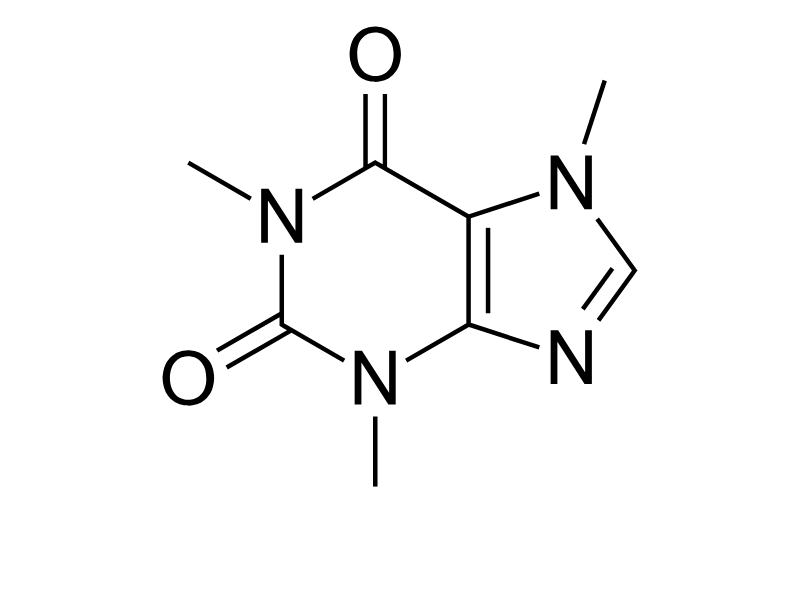

# Thuốc và chất tác động lên chất dẫn truyền

## Tóm tắt

Cùng một synapse, vì sao rượu làm buồn ngủ, cà phê làm tỉnh, còn cần sa và thuốc phiện lại đổi tín hiệu theo những đường khác hẳn? Bài này trả lời bằng cơ chế: mỗi chất "khớp" vào một chỗ khác nhau của hệ chất dẫn truyền (neurotransmitter), rồi não tự chỉnh lại khi bị tác động lâu ngày.

Synapse là chỗ hai nơron (neuron) nói chuyện bằng chất hóa học (L02); L03 đã nêu ngắn bốn chất này trong một mục về thuốc. Bài này mở rộng: mỗi chất một thẻ hồ sơ bảy ý, thêm đường vào cơ thể, sự thích nghi khi dùng lâu và mạch thưởng chung. Bốn chất là bốn chất của mục 5.5 trong giáo trình *Biological Psychology* (Hove & Martinez), gọi tắt là giáo trình: rượu (alcohol), caffeine, cần sa (cannabis) và nhóm opioid [S1]. Nicotine, cocaine, amphetamine, MDMA hay benzodiazepine chỉ được nhắc một dòng: giáo trình nói trang gốc có hoạt hình riêng cho chúng [S1].

Ba ý đi suốt bài:

1. Bốn chất, bốn "ổ khóa" khác nhau. Rượu gắn vào thụ thể GABA và NMDA, caffeine chiếm chỗ của adenosine, THC của cần sa gắn vào thụ thể CB1, còn opioid gắn vào chính các thụ thể của opioid nội sinh [S1].
2. Mạch thưởng là chung nhưng không giống hệt nhau. Ở chuột, các chất người hay lạm dụng làm dopamine ngoại bào (dopamine ở khoảng giữa các tế bào) tăng, nhất là ở nhân accumbens (một nhân của hệ thưởng, xem L05 và L07) [S15]; với caffeine thì bằng chứng giữa chuột và người không khớp nhau [S5] [S6].
3. Dùng lâu thì não thích nghi, và bốn khái niệm thường bị lẫn là khác nhau: dung nạp (tolerance), lệ thuộc thể chất (physical dependence), hội chứng cai (withdrawal) và rối loạn sử dụng chất (substance use disorder) [S12] [S13].

Quy ước của bài: chỉ nêu nhóm chất và cơ chế; không nêu liều, cách dùng, tình trạng pháp lý, và không xếp chất nào nguy hiểm hơn chất nào. Mỗi khẳng định mang một nhãn: **giáo khoa**, **giả thuyết/đang tranh luận**, hoặc **Suy luận của người viết**.

## Chất đến được synapse thế nào và tác động ra sao

### Từ miệng, phổi hay mạch máu đến thụ thể

Dược động học (pharmacokinetics) là cách cơ thể xử lý một chất ta đưa vào. Giáo trình dùng chữ viết tắt ADME: hấp thu (Absorption), phân bố (Distribution), chuyển hóa (Metabolism), đào thải (Excretion) [S2]. Phần lớn chất tác động lên tâm thần đến não theo đường máu [S2].

Đường vào quyết định tốc độ. Đường uống là đường phổ biến nhất nhưng chậm và hay thay đổi, vì thức ăn trong dạ dày làm tốc độ hấp thu đổi theo [S2]. Hít và tiêm vào tĩnh mạch là hai đường nhanh nhất, đưa chất lên não trong chưa đến 10 giây [S2]. Tốc độ quan trọng vì chất vừa kích hoạt mạch thưởng vừa lên não rất nhanh thì nguy cơ lạm dụng cao hơn, và cả những tín hiệu đi kèm (cue) cũng trở thành thứ gây thèm [S2]; NIDA nêu ý tương tự [S13]. Mức bằng chứng: giáo khoa.

Rượu là ví dụ dễ hình dung: nó đi thẳng từ đường tiêu hóa vào mạch máu và trong vài phút theo máu tới mọi nơi, kể cả não [S1].

### Gan dọn dẹp, và vì sao đó cũng là một dạng "dung nạp"

Chuyển hóa chủ yếu diễn ra ở gan. Gan tạo enzyme, và nhiều chất tác động lên tâm thần được phân giải bởi cùng một họ enzyme, siêu họ cytochrome P450; không có một enzyme riêng cho mỗi chất [S2]. Một số chất, trong đó có rượu, gây cảm ứng enzyme (enzyme induction): gan tạo thêm enzyme nên chất bị phân giải nhanh hơn. Đó là dung nạp chuyển hóa (metabolic tolerance), một kiểu dung nạp xảy ra ở gan chứ chưa phải ở não [S2]. Mức bằng chứng: giáo khoa. Phần còn lại nói về dung nạp ở chính nơron.

### Năm cách một chất chen vào synapse

Mọi bước trong vòng đời chất dẫn truyền đều có thể bị can thiệp. Từ vựng đầy đủ (chủ vận, đối kháng, điều biến, ức chế thu hồi) nằm ở L03; ở đây chỉ dùng để xếp bốn chất vào đúng chỗ:

- chủ vận (agonist): opioid với thụ thể opioid [S1];
- đối kháng (antagonist): caffeine với thụ thể adenosine [S1];
- điều biến (modulator): rượu với thụ thể GABA, theo mô tả của giáo trình [S1];
- chặn thu hồi (reuptake) hoặc chặn enzyme: nhóm thuốc điều trị ở L12, không phải bốn chất của bài này;
- gián tiếp, làm đổi hoạt động của một nơron lân cận rồi mới đổi dopamine (cách xếp của người viết): cần sa và opioid ở mạch thưởng (mục "Điểm chung" ở dưới).

Suy luận của người viết: THC cũng nên xếp vào nhóm gắn thụ thể và mô phỏng chất tự nhiên (anandamide); giáo trình chỉ nói THC gắn vào CB1 và "can thiệp" các chức năng mà anandamide điều hòa [S1], không dùng chữ "chủ vận".

*Một synapse với nơron trước (presynaptic cell), nơron sau (postsynaptic cell), chất dẫn truyền và thụ thể. Hình vẽ một chất ức chế thu hồi (reuptake inhibitor), thuộc nhóm thuốc điều trị ở L12; ở đây chỉ dùng để chỉ ra các chỗ trên synapse mà một chất có thể chen vào. Nguồn hình: OpenStax Psychology 2e, giấy phép CC BY-NC-SA theo mục Media Attributions của sách; Hove & Martinez, Hình 3 (chương 12). https://rotel.pressbooks.pub/biologicalpsychology/chapter/mood-disorders-depression-and-bipolar-disorder/*

## Rượu (alcohol)

Giáo trình nêu rượu tác động lên nhiều đích cùng lúc: màng nơron, kênh ion, enzyme và thụ thể [S1]. Bài chỉ theo đường rõ nhất: GABA và glutamate (xem L03).

### Thẻ hồ sơ: rượu

- **Là gì (nhóm):** chất có tác dụng an thần theo giáo trình; một tổng quan nêu thêm rằng giai đoạn đầu có tác dụng kích thích hành vi rồi mới đến tác dụng ức chế [S1] [S3].
- **Đích phân tử:** gắn trực tiếp vào thụ thể của acetylcholine, serotonin, GABA và thụ thể NMDA của glutamate; ngoài ra đổi màng, kênh ion và enzyme [S1].
- **Mạch/vùng liên quan:** giáo trình không nêu vùng cụ thể cho tác dụng an thần; rượu làm tăng giải phóng dopamine ở mạch thưởng, cơ chế còn chưa rõ nhưng có vẻ liên quan đến làm giảm hoạt động của enzyme phân giải dopamine [S1].
- **Tác dụng cấp:** ở synapse GABA, rượu có lẽ làm kênh clorua (chloride, Cl⁻) mở lâu hơn (giáo trình viết "probably") nên nơron nhận thêm điện tích âm và khó bị kích thích hơn; đồng thời rượu giảm tác dụng kích thích của glutamate ở thụ thể NMDA; hai việc cộng lại giải thích tác dụng an thần [S1].
- **Dùng lâu: dung nạp, lệ thuộc, cai:** thụ thể NMDA trở nên quá nhạy với glutamate còn thụ thể GABA kém nhạy đi; khi ngừng, sự thích nghi này gây trạng thái kích thích của hội chứng cai [S1]. Chuyển hóa ở gan cũng nhanh hơn do cảm ứng enzyme [S2].
- **Mức bằng chứng:** giáo khoa ở mức tổng quát (rượu gắn GABA và NMDA, thích nghi khi dùng lâu); giả thuyết ở chi tiết "kênh mở lâu hơn" (giáo trình viết "probably") và ở cơ chế tăng dopamine (giáo trình viết "chưa rõ"). Kết quả về glutamate khi cai có cả người lẫn chuột [S4].
- **Đừng hiểu nhầm:** "rượu là chất kích thích" chỉ đúng ở giai đoạn đầu theo một tổng quan [S3]; mô tả của giáo trình là cơ chế an thần.

### GABA khi có và khi không có rượu

Giáo trình dẫn một hoạt hình trên trang *The Brain from Top to Bottom* (McGill) so sánh hai tình huống. Không có rượu: GABA gắn vào thụ thể của nó, kênh mở cho ion clorua mang điện âm đi vào nơron sau, nơron khó phát xung hơn. Có rượu: rượu cũng gắn vào thụ thể GABA, và theo giáo trình "có lẽ" làm kênh mở lâu hơn, nên nhiều Cl⁻ vào hơn và nơron bị ức chế thêm [S1].

Ví dụ của người viết: GABA là nút giảm âm lượng; rượu không tự bấm nút mà làm nút nhạy hơn, còn NMDA là nút tăng âm lượng bị bớt nhạy đi, nên hệ thần kinh "nhỏ tiếng lại".

*Synapse điển hình: túi chứa chất dẫn truyền (vesicle), khe synapse (synaptic cleft) và thụ thể (receptor) trên nơron sau. Ở synapse GABA, thụ thể ấy là kênh Cl⁻. Nguồn hình: Noba, giấy phép CC BY-NC-SA theo sách; Hove & Martinez, Hình 3 (chương 3). https://rotel.pressbooks.pub/biologicalpsychology/chapter/the-structure-of-the-neuron/*

### Nhiều tầng bằng chứng

Một tổng quan trên tạp chí *Neuron* nêu rằng chính các tác động của rượu trong não giải thích cả tác dụng cấp (kích thích rồi ức chế) lẫn những thay đổi hành vi về lâu dài: dùng nhiều hơn, dung nạp, tìm rượu cưỡng bức, lệ thuộc. Các tác giả cũng viết rằng hướng nghiên cứu hiện nay là chỉ ra tác động phân tử nào, ở nơron nào, góp phần vào từng thay đổi hành vi [S3]. Câu chuyện GABA và NMDA của giáo trình vì thế là bản vẽ đúng hướng, chưa phải toàn bộ.

Về hội chứng cai, giả thuyết glutamate (glutamate hypothesis) cho rằng truyền tin kích thích quá mức là nền của giai đoạn cai cấp. Một nghiên cứu đo glutamate bằng cộng hưởng từ phổ ở 47 bệnh nhân phụ thuộc rượu đang giải độc và 57 người đối chứng, cùng một mô hình ở chuột. Glutamate ở vùng vỏ trước trán (prefrontal cortex) tăng trong lúc cai ở cả người lẫn chuột, rồi trở về bình thường sau vài tuần kiêng. Các tác giả gọi đây là bằng chứng đầu tiên từ người ủng hộ giả thuyết ấy [S4].

NIAAA, viện nghiên cứu rượu của Hoa Kỳ, coi rối loạn sử dụng rượu (alcohol use disorder, AUD) là một rối loạn não, những thay đổi lâu dài trong não do dùng rượu sai cách làm bệnh dai dẳng và dễ tái phát. Một trong các tiêu chí là dung nạp: phải dùng nhiều hơn trước mới có tác dụng như cũ [S14]. NIAAA cũng nói rằng hội chứng cai rượu có thể đe dọa tính mạng, nên người dùng nhiều và lâu cần sự theo dõi của y tế khi ngừng [S14]. Đó là một mô tả về nguy cơ, không phải hướng dẫn.

## Caffeine

Giáo trình viết một câu cần kiểm: "như hầu hết thuốc, caffeine làm tăng dopamine ở mạch khoái cảm" [S1]. Phần dưới tách điều chắc chắn khỏi điều đang tranh luận.

### Thẻ hồ sơ: caffeine

- **Là gì (nhóm):** chất kích thích hệ thần kinh trung ương, tác động như một chất đối kháng thụ thể adenosine [S1].
- **Đích phân tử:** thụ thể adenosine trên màng nơron; adenosine là chất điều biến thần kinh (neuromodulator) làm hoạt động thần kinh chậm lại [S1].
- **Mạch/vùng liên quan:** giáo trình nói caffeine kích hoạt nhiều mạch thần kinh, khiến tuyến yên tiết hormone làm tuyến thượng thận tạo thêm adrenaline [S1]; xem L10 cho hormone.
- **Tác dụng cấp:** chiếm chỗ adenosine nên "phanh tự nhiên" yếu đi, hoạt động nơron nhanh lên [S1]; adrenaline tăng thêm chú ý và năng lượng [S1].
- **Dùng lâu: dung nạp, lệ thuộc, cai:** giáo trình nêu dung nạp tối thiểu nhưng có lệ thuộc thể chất; triệu chứng cai (đau đầu, buồn nôn, buồn ngủ) bắt đầu trong một đến hai ngày sau khi ngừng và gặp ở khoảng một trong hai người [S1].
- **Mức bằng chứng:** giáo khoa cho cơ chế đối kháng adenosine; **đang tranh luận** cho việc caffeine có làm tăng dopamine hay không (mục dưới). Con số "90% người lớn Mỹ dùng caffeine mỗi ngày" của giáo trình là số cũ, của riêng Hoa Kỳ, không kèm năm; bài này bỏ.
- **Đừng hiểu nhầm:** "caffeine không phải thuốc": caffeine là chất tác động lên tâm thần (psychoactive) có đích phân tử rõ ràng, có lệ thuộc thể chất và có hội chứng cai [S1].

### Chiếc phanh bị chiếm chỗ

*Công thức cấu tạo của phân tử caffeine (C, N, O là carbon, nitơ, oxy). Hình chỉ cho thấy phân tử, không nói về cơ chế. Tác giả: Vaccinationist, giấy phép Public domain theo trang tệp Wikimedia Commons (đối chiếu 2026-10-21). https://commons.wikimedia.org/wiki/File:Caffeine_structure.svg*

Adenosine gắn vào thụ thể của nó thì hoạt động thần kinh chậm lại và ta thấy buồn ngủ; nó còn làm giãn mạch máu, giáo trình cho rằng có lẽ để bảo đảm đủ oxy khi ngủ [S1]. Caffeine gắn vào chính các thụ thể ấy nhưng không làm chậm hoạt động nơron, nên ít thụ thể trống cho adenosine hơn và "phanh" yếu đi [S1]. Đây là mô hình đối kháng (antagonist) tiêu biểu, đã nói ở L03.

Ví dụ của người viết: caffeine không đuổi người gác cổng adenosine đi, chỉ đứng chắn trước ổ khóa nên lời nhắc "đến giờ ngủ" không tới nơi. Theo giáo trình, tác dụng gồm hai phần: "bớt phanh" ở thụ thể adenosine và "thêm ga" qua hormone adrenaline, hormone "chiến hay chạy" do thượng thận tạo thêm sau khi tuyến yên tiết hormone [S1].

### Caffeine và dopamine: giáo trình nói gì và nguồn khác nói gì

Giáo trình viết caffeine tăng sản xuất dopamine ở mạch khoái cảm, "như hầu hết thuốc" [S1]. Hai nghiên cứu độc lập, đã đọc phần tóm tắt, cho kết quả không trùng nhau:

- Ở chuột (đo vi thấu phân, microdialysis, trên con vật tự do di chuyển), caffeine ở mức gây tác dụng hành vi làm dopamine và glutamate ngoại bào tăng một cách ưu tiên ở vỏ (shell) nhân accumbens. Tác dụng này tái hiện được bằng chất chặn thụ thể adenosine A1, nhưng không bằng chất chặn A2A [S5].
- Ở người (chụp PET, positron emission tomography, với chất đánh dấu thụ thể dopamine D2/D3), caffeine làm tăng khả năng gắn của thụ thể D2/D3 ở bèo sẫm (putamen) và thể vân bụng (ventral striatum), không tăng ở nhân đuôi. Nhóm tác giả diễn giải rằng nếu caffeine làm dopamine tăng thì khả năng gắn ấy phải giảm. Vì vậy họ kết luận caffeine, ở mức thường dùng, không làm dopamine tăng ở thể vân; thay vào đó có thể là tăng số thụ thể D2/D3 hoặc đổi ái lực (affinity, độ bám của thụ thể với chất gắn). Phần mở đầu của nghiên cứu này nêu rằng caffeine tăng tín hiệu dopamine chủ yếu bằng cách chặn thụ thể adenosine A2A [S6].

Hai nghiên cứu khác loài, khác phương pháp, và bất đồng cả về loại thụ thể adenosine. Suy luận của người viết từ hai tóm tắt này: câu "caffeine làm tăng dopamine như hầu hết thuốc" là **giả thuyết/đang tranh luận**, đúng ở chuột trong một nghiên cứu, còn nghiên cứu PET ở người lại kết luận ngược lại. Điều chắc chắn hơn là cơ chế đối kháng adenosine. Cũng nên nhớ rằng dopamine không đồng nghĩa với "thưởng": xem L05.

## Cần sa (cannabis) và hệ endocannabinoid

Cơ thể có sẵn một hệ tín hiệu cho thụ thể CB1, và cần sa "mượn" hệ ấy [S1] [S8].

### Hệ endocannabinoid trước khi có THC

Thụ thể cannabinoid có ở gần như khắp não, và một phân tử cơ thể tự tạo gắn được vào chúng đã được xác định: anandamide [S1]. Năm 1992, Devane và cộng sự tách từ não lợn một chất mới, đặt tên là anandamide, xác định cấu trúc bằng khối phổ và cộng hưởng từ hạt nhân, rồi xác nhận bằng tổng hợp; chất này cạnh tranh gắn với thụ thể cannabinoid [S7]. Một tổng quan về sau nhắc rằng THC được tách vào giữa thập niên 1960, còn các thụ thể CB1 và CB2 cùng các cannabinoid nội sinh chính (anandamide và 2-arachidonoyl glycerol) chỉ được xác định sau đó khoảng 20 đến 25 năm [S8].

Ở một số synapse đã nghiên cứu, hệ này truyền tín hiệu ngược chiều. Trong các lát cắt tiểu não chuột nhắt, nơron sau bị khử cực phát ra một "tín hiệu ngược" làm nơron trước giảm giải phóng chất dẫn truyền ở đầu vào ức chế, và thụ thể CB1 làm trung gian cho tín hiệu đó. Các tác giả nhắc rằng nghiên cứu ở hải mã đã cho thấy cannabinoid nội sinh là sứ giả ngược (retrograde messenger) [S9]. Ví dụ của người viết: chất dẫn truyền thông thường là thư gửi từ trước ra sau; endocannabinoid là cú gọi lại, bảo nơron trước "nhỏ tiếng lại".

### Thẻ hồ sơ: cần sa

- **Là gì (nhóm):** cannabinoid; hoạt chất chính là delta-9-tetrahydrocannabinol (THC) [S1].
- **Đích phân tử:** thụ thể CB1, vốn dành cho anandamide; gắn vào CB1 làm giảm cAMP (chất truyền tin thứ hai, second messenger, trong tế bào) nên giảm protein kinase A (một enzyme), ảnh hưởng kênh kali và canxi, và kết quả là giảm lượng chất dẫn truyền được giải phóng [S1].
- **Mạch/vùng liên quan:** theo giáo trình, thụ thể CB1 có gần như khắp não; ở mạch thưởng, nơron dopamine không có CB1 nhưng bị nơron GABA có CB1 kìm hãm, trong vùng mái bụng (VTA, ventral tegmental area) [S1].
- **Tác dụng cấp:** giảm tính dễ kích thích chung của mạng nơron; riêng ở mạch thưởng, theo giáo trình, cần sa gỡ cái hãm của nơron GABA nên nơron dopamine được kích hoạt [S1].
- **Dùng lâu: dung nạp, lệ thuộc, cai:** NIDA nêu dùng nặng và thường xuyên liên quan đến rối loạn sử dụng cần sa, trong đó dung nạp và hội chứng cai là hai tiêu chí; hội chứng cai có thể xảy ra ngay cả ở người không có rối loạn [S11].
- **Mức bằng chứng:** giáo khoa cho sự tồn tại của thụ thể CB1 và của anandamide, phân tử nội sinh gắn vào chúng [S7] [S8]; "THC gắn CB1" và chuỗi "nơron GABA có CB1 kìm dopamine" là điều giáo trình nêu [S1], chưa kiểm nguồn gốc độc lập; câu về động mạch não xem mục dưới.
- **Đừng hiểu nhầm:** "cần sa không gây lệ thuộc": NIDA nêu rối loạn sử dụng cần sa là một dạng rối loạn sử dụng chất và có hội chứng cai [S11].

### Câu giáo trình nêu về mạch máu não: kiểm đến đâu

Giáo trình viết: ở người dùng cần sa mạn tính, mất thụ thể CB1 ở động mạch não làm giảm lưu lượng máu, glucose và oxy tới não, dẫn đến thiếu chú ý, mất trí nhớ và học kém [S1]. Câu này gồm ba mắt xích, và bài kiểm từng mắt:

1. **Lưu lượng máu não giảm khi dùng mạn tính.** Một tổng quan hệ thống (34 nghiên cứu, 1.259 người và 28 động vật) kết luận rằng tác động cấp và mạn của THC lên lưu lượng máu não trái ngược nhau và khác nhau theo vùng: cấp thì tăng ở vài vùng, còn dùng mạn thì nhìn chung giảm, nhất là ở vỏ trước trán, và có thể đảo ngược khi kiêng lâu [S10]. Mắt xích này được ủng hộ ở mức tương quan.
2. **Nguyên nhân là mất CB1 ở động mạch.** Tóm tắt của tổng quan nói trên không nêu cơ chế này; bài không tìm được nguồn đọc được xác nhận nó. Mức bằng chứng: giáo trình nêu, chưa kiểm nguồn gốc.
3. **Giảm lưu lượng máu dẫn đến thiếu chú ý, mất trí nhớ, học kém.** NIDA nêu dùng cần sa nặng ở tuổi vị thành niên có liên quan đến trí nhớ làm việc, tốc độ xử lý, trí nhớ lời nói và thành tích học tập kém hơn [S11]. Đó là mối liên quan, không chứng minh rằng giảm lưu lượng máu là nguyên nhân.

Bài chỉ giữ điều kiểm được: dùng mạn tính có liên quan đến lưu lượng máu não giảm ở vài vùng và nhận thức kém hơn; chuỗi nhân quả qua CB1 ở động mạch là điều giáo trình nêu, chưa kiểm.

Hệ endocannabinoid liên quan đến lo âu, trầm cảm, sinh nơron mới, thưởng, nhận thức, học tập và trí nhớ, và tác dụng đôi khi hai pha, ngược chiều nhau [S8]; vì thế "một chất, một tác dụng" không đúng với cần sa.

## Opioid (nhóm thuốc phiện)

Cơ thể tự tạo các chất giống thuốc phiện (endorphin, enkephalin, dynorphin; opioid nội sinh, xem L03), điều hòa phản ứng với đau, đói, khát, khí sắc và miễn dịch [S1]. Bài dùng "opioid" cho cả nhóm; giáo trình gọi các opioid từ ngoài như heroin và morphine là opiate. Chúng tác động mạnh vì gắn vào đúng các thụ thể ấy [S1].

### Thẻ hồ sơ: opioid

- **Là gì (nhóm):** opioid, một nhóm gồm chất tự nhiên, bán tổng hợp và tổng hợp; gồm cả thuốc giảm đau dùng trong y khoa lẫn chất bị lạm dụng [S12].
- **Đích phân tử:** ba loại thụ thể opioid, mu, delta và kappa, có rải rác khắp não, tủy sống và cơ thể [S1] [S12].
- **Mạch/vùng liên quan:** thụ thể opioid có trên các nơron truyền tín hiệu đau, ở các trung tâm điều khiển hô hấp, và ở các vùng của hệ thưởng [S12]; ở VTA có các nơron GABA ức chế mang thụ thể mu [S1] [S16].
- **Tác dụng cấp:** qua chất truyền tin thứ hai, thụ thể ảnh hưởng khả năng mở của kênh ion và trong một số trường hợp làm giảm tính dễ kích thích nơron [S1]; giảm truyền tín hiệu đau ở tủy sống và làm cảm nhận đau bớt đi trong não [S1] [S12]. Ở VTA, opioid làm giảm GABA nên nơron dopamine bớt bị hãm [S1] [S16].
- **Dùng lâu: dung nạp, lệ thuộc, cai:** sản xuất cAMP bị ức chế nhưng được bù lại về lâu dài; khi thiếu opioid thì khả năng bù ấy lộ ra thành tăng hoạt động thần kinh và cơn thèm [S1]. NIDA mô tả tương tự bằng ba khái niệm: dung nạp, lệ thuộc và hội chứng cai [S12].
- **Mức bằng chứng:** giáo khoa ở mức thụ thể và hệ thống nội sinh [S1] [S12]; cơ chế "ức chế cái hãm" ở VTA có bằng chứng ở chuột trong lát cắt não, ngoài cơ thể [S16]; chi tiết cAMP là mô tả của giáo trình.
- **Đừng hiểu nhầm:** "opioid chỉ gây khoái cảm": cùng các thụ thể ấy điều hòa đau, hô hấp và đáp ứng với căng thẳng [S12]; NIDA nêu rằng opioid ở mức tác động quá lớn làm chậm hô hấp đến mức đe dọa tính mạng, vì tác động lên các trung tâm điều khiển thở [S12].

### Ức chế cái hãm: một chuỗi hai bước

Giáo trình mô tả một chuỗi hai bước ở VTA. Opioid gắn vào thụ thể mu của các nơron GABA ức chế ở VTA, làm các nơron này giải phóng ít GABA hơn. Bình thường GABA làm giảm lượng dopamine được giải phóng ở nhân accumbens; hãm cái hãm ấy thì dopamine tăng [S1].

Nguồn gốc của mô hình là một nghiên cứu năm 1992 trên lát cắt não chuột. Opioid không tác động lên chính các nơron dopamine. Chúng làm các nơron GABA trung gian phân cực quá mức (hyperpolarization, khó phát xung hơn) qua thụ thể mu, nên đầu vào GABA vào nơron dopamine giảm. Các tác giả kết luận rằng ở cơ thể sống điều đó sẽ dẫn tới kích thích nơron dopamine bằng cách gỡ ức chế (disinhibition) [S16]. Mức bằng chứng: động vật, ngoài cơ thể; bước "ở cơ thể sống" là dự đoán của tác giả.

## Điểm chung: mạch thưởng, dung nạp, lệ thuộc và cai

### Bốn "ổ khóa" nhưng một ngã ba

Bốn chất khác nhau ở đích, nhưng ít nhất ba chất dẫn đến cùng một chỗ: dopamine ở mạch thưởng, nơi VTA gửi dopamine đến nhân accumbens (xem L05, L03, L07).

Bằng chứng kinh điển là một nghiên cứu năm 1988 trên chuột tự do di chuyển. Các chất người hay lạm dụng (opioid, rượu, nicotine, amphetamine, cocaine) làm nồng độ dopamine ngoại bào tăng ở nhân accumbens và nhân đuôi, nhưng ưu tiên ở nhân accumbens. Chất có tác dụng khó chịu (chất kích hoạt thụ thể kappa) làm dopamine giảm; các thuốc người không lạm dụng (một thuốc chống trầm cảm, một thuốc kháng histamine, một thuốc kháng muscarinic) không làm nồng độ dopamine đổi. Các tác giả viết rằng đây là bằng chứng sinh hóa ủng hộ giả thuyết kích thích truyền dopamine ở hệ viền có thể là tính chất cơ bản của các chất bị lạm dụng [S15]. Mức bằng chứng: giáo khoa ở mức "nhiều chất lạm dụng", nhưng là kết quả ở chuột.

Không giống hệt nhau: opioid tăng dopamine gián tiếp qua GABA ở VTA [S1] [S16]; cần sa theo giáo trình cũng vậy nhưng qua CB1 [S1]; rượu có cơ chế chưa rõ, có vẻ liên quan đến enzyme phân giải dopamine [S1]; caffeine đang tranh luận [S5] [S6]. Hình dưới chỉ vị trí nhân accumbens trên mặt cắt giữa não.

*Mặt cắt giữa não với nhân accumbens (nucleus accumbens), hạnh nhân (amygdala), vỏ trán ổ mắt (orbital frontal cortex); VTA không có trên hình. Nguồn hình: Noba, giấy phép CC BY-NC-SA theo sách; Hove & Martinez, Hình 2 (chương 10). https://rotel.pressbooks.pub/biologicalpsychology/chapter/affective-neuroscience-what-is-it/*

### Bốn khái niệm dễ lẫn

NIDA phân biệt:

- **Dung nạp (tolerance):** cơ thể thích nghi với chất, đáp ứng giảm dần, nên cần tác động lớn hơn để có cùng hiệu quả [S12].
- **Lệ thuộc thể chất (physical dependence):** cơ thể thích nghi đến mức chỉ hoạt động bình thường khi có chất [S12].
- **Hội chứng cai (withdrawal):** các triệu chứng xuất hiện khi ngừng chất sau một thời gian dùng; NIDA liệt kê ví dụ ở opioid và cần sa [S12] [S11].
- **Rối loạn sử dụng chất (substance use disorder):** một kiểu hình dùng chất, đo bằng hai hay nhiều triệu chứng và hành vi theo tiêu chuẩn DSM-5; dung nạp và hội chứng cai chỉ là hai trong nhiều tiêu chí [S12] [S11] [S14]. NIDA dùng chữ nghiện (addiction) cho dạng nặng của rối loạn này: rối loạn mạn tính, hay tái phát, đặc trưng bởi tìm và dùng chất cưỡng bức dù có hậu quả xấu [S13].

Nghĩa là có thể lệ thuộc thể chất mà không có rối loạn sử dụng chất: NIDA nêu hội chứng cai cần sa có thể xảy ra ngay cả khi không có rối loạn sử dụng cần sa [S11]. Ví dụ của người viết: người uống cà phê mỗi sáng rồi thử bỏ có thể thấy đau đầu hay buồn ngủ; giáo trình nêu triệu chứng cai ấy gặp ở khoảng một trong hai người [S1]. Đó là một dạng lệ thuộc thể chất, khác hẳn hành vi tìm chất bất chấp hậu quả.

### Mô hình ba giai đoạn của nghiện

Koob và Volkow mô tả nghiện như một vòng lặp ba giai đoạn: say/hưng phấn (binge/intoxication), cai/cảm xúc âm tính (withdrawal/negative affect), và bận tâm/mong đợi (preoccupation/anticipation), tức thèm. Dựa trên ảnh chụp não người và nghiên cứu động vật, các tác giả gán VTA và thể vân bụng cho giai đoạn đầu, hạnh nhân mở rộng (extended amygdala) cho giai đoạn cai, và một mạng rộng cho giai đoạn thèm. Sự chuyển sang nghiện kéo theo tính dẻo thần kinh (neuroplasticity) ở các cấu trúc ấy, có thể bắt đầu từ hệ dopamine trung limbic [S17]. Danh sách vùng của mạng thèm có trong bài gốc; bài này không cần liệt kê.

Kalivas và Volkow bổ sung rằng dopamine quan trọng cho phần thưởng cấp và cho khởi đầu nghiện. Nghiện giai đoạn muộn, theo họ, chủ yếu do thích nghi tế bào ở các đường glutamate từ vỏ não trước trán tới nhân accumbens. Các thích nghi này giảm khả năng của vỏ trước trán khởi động hành vi vì phần thưởng tự nhiên và kiểm soát việc tìm chất, trong khi vỏ trước trán lại phản ứng quá mạnh với tín hiệu báo trước có chất [S18]. Đây là mô hình tổng hợp từ người và động vật, không phải lời giải cuối cùng.

NIDA mô tả cùng ý ở mức đại chúng: nghiện liên quan đến thay đổi chức năng mạch thưởng, căng thẳng và tự kiểm soát, có thể kéo dài sau khi ngừng; quyết định dùng lần đầu thường là tự nguyện, nhưng dùng tiếp thì khả năng tự kiểm soát có thể suy giảm [S13].

### Dùng, thích nghi, cai: một đường thời gian

Suy luận của người viết, ghép các nguồn trên thành một trình tự (không phải một nghiên cứu đơn lẻ):

1. **Tác dụng cấp:** chất gắn vào đích và đổi tín hiệu [S1].
2. **Thích nghi:** nơron tự chỉnh để giữ cân bằng, ví dụ NMDA nhạy hơn khi dùng rượu lâu; với opioid, sản xuất cAMP bị ức chế rồi được bù lại [S1].
3. **Dung nạp:** cùng một tác động cho ít hiệu quả hơn [S12].
4. **Cai:** khi chất vắng mặt, phần thích nghi lộ ra, ví dụ glutamate tăng ở người cai rượu hay khả năng sản xuất cAMP của opioid [S1] [S4].
5. **Về lâu dài:** thay đổi ở mạch thưởng, căng thẳng và kiểm soát có thể bền sau khi ngừng [S13] [S17] [S18].

## Những hiểu lầm thường gặp

Bảy hiểu lầm mà nguồn đã đọc cho phép sửa (sáu về từng chất, một về khái niệm):

1. **"Rượu là chất kích thích."** Tổng quan nêu kích thích rồi ức chế; giáo trình mô tả cơ chế an thần [S3] [S1].
2. **"Caffeine không phải thuốc."** Có đích phân tử, lệ thuộc thể chất và hội chứng cai [S1].
3. **"Caffeine tăng dopamine như mọi chất khác."** Đúng ở chuột trong một nghiên cứu; nghiên cứu PET ở người kết luận ngược lại, nên còn tranh luận [S5] [S6].
4. **"Cần sa không gây lệ thuộc."** NIDA nêu rối loạn sử dụng cần sa và hội chứng cai [S11].
5. **"Cần sa làm hỏng mạch máu não nên mất trí nhớ."** Chuỗi nhân quả chưa kiểm; chỉ có tương quan [S10] [S11].
6. **"Opioid chỉ gây khoái cảm."** Cùng thụ thể điều hòa đau, hô hấp, căng thẳng [S12].
7. **"Lệ thuộc là nghiện."** Dung nạp, lệ thuộc thể chất, hội chứng cai và rối loạn sử dụng chất là các khái niệm khác nhau [S12] [S13].

## Điều cần nhớ

1. Bốn chất, bốn đích: rượu (GABA và NMDA), caffeine (thụ thể adenosine), cần sa (CB1), opioid (thụ thể mu, delta, kappa) [S1].
2. Đường vào quyết định tốc độ lên não; gan gây dung nạp chuyển hóa [S2].
3. Hệ endocannabinoid, ở một số synapse đã nghiên cứu, truyền ngược chiều; theo giáo trình THC gắn vào CB1 của hệ ấy [S1] [S7] [S8] [S9].
4. Mạch thưởng là chung nhưng không giống hệt nhau: opioid ức chế "cái hãm", caffeine còn tranh luận [S15] [S16] [S5] [S6].
5. Dung nạp, lệ thuộc thể chất, hội chứng cai và rối loạn sử dụng chất là bốn khái niệm khác nhau [S12] [S13] [S14].
6. Nghiện là vòng lặp ba giai đoạn với thay đổi ở nhiều mạch, không chỉ dopamine [S17] [S18].
7. Hai câu của giáo trình cần thận trọng: caffeine tăng dopamine (đang tranh luận) và mất CB1 ở động mạch não (chưa kiểm) [S1] [S5] [S6] [S10].

Nối bài: L02 (synapse), L03 (chất dẫn truyền, từ vựng thuốc), L05 (hệ thưởng), L07 (nhân accumbens), L12 (nhóm thuốc điều trị).

## Lưu ý

Bài này nhằm hiểu cơ chế, không phải lời khuyên y tế. Bài không nêu liều, không hướng dẫn dùng, ngừng, pha trộn hay mua bất kỳ chất nào, không nêu tên thương hiệu thuốc, không so sánh chất nào nguy hiểm hơn, và không nói về tình trạng pháp lý. Rượu, caffeine, cần sa và opioid được nêu chỉ vì giáo trình dùng chúng để giải thích cơ chế, không có nghĩa là khuyến khích dùng.

Nếu bạn hoặc người thân dùng một chất gây hại, hoặc có ý nghĩ tự làm hại mình, hãy tìm trợ giúp từ bác sĩ, chuyên gia tâm lý hoặc đường dây hỗ trợ tại nơi mình sống. Hội chứng cai của một số chất, trong đó có rượu, có thể nguy hiểm về y tế, nên ngừng sau một thời gian dùng nhiều cần được chuyên gia theo dõi [S14]; đây là một mô tả, không phải hướng dẫn hành động. Không tự ý đổi hay ngừng thuốc đang được bác sĩ kê đơn.

## Nguồn tham khảo

- [S1] Hove & Martinez, Biological Psychology, mục 5.5 "How Drugs Affect Neurotransmitters", 2024 https://rotel.pressbooks.pub/biologicalpsychology/chapter/how-drugs-affect-neurotransmitters/
- [S2] Hove & Martinez, Biological Psychology, mục 5.2 "Pharmacokinetics: What Is It and Why Is It Important?", 2024 https://rotel.pressbooks.pub/biologicalpsychology/chapter/pharmacokinetics-what-is-it-and-why-is-it-important/
- [S3] Abrahao K. P., Salinas A. G., Lovinger D. M., Alcohol and the brain: neuronal molecular targets, synapses, and circuits, Neuron 96(6): 1223–1238, 2017 https://doi.org/10.1016/j.neuron.2017.10.032
- [S4] Hermann D. và cộng sự, Translational magnetic resonance spectroscopy reveals excessive central glutamate levels during alcohol withdrawal in humans and rats, Biological Psychiatry 71(11): 1015–1021, 2012 https://doi.org/10.1016/j.biopsych.2011.07.034
- [S5] Solinas M. và cộng sự, Caffeine induces dopamine and glutamate release in the shell of the nucleus accumbens, Journal of Neuroscience 22(15): 6321–6324, 2002 https://doi.org/10.1523/JNEUROSCI.22-15-06321.2002
- [S6] Volkow N. D. và cộng sự, Caffeine increases striatal dopamine D2/D3 receptor availability in the human brain, Translational Psychiatry 5(4): e549, 2015 https://doi.org/10.1038/tp.2015.46
- [S7] Devane W. A. và cộng sự, Isolation and structure of a brain constituent that binds to the cannabinoid receptor, Science 258(5090): 1946–1949, 1992 https://doi.org/10.1126/science.1470919
- [S8] Mechoulam R. & Parker L. A., The endocannabinoid system and the brain, Annual Review of Psychology 64: 21–47, 2013 https://doi.org/10.1146/annurev-psych-113011-143739
- [S9] Yoshida T. và cộng sự, The cannabinoid CB1 receptor mediates retrograde signals for depolarization-induced suppression of inhibition in cerebellar Purkinje cells, Journal of Neuroscience 22(5): 1690–1697, 2002 https://doi.org/10.1523/JNEUROSCI.22-05-01690.2002
- [S10] Ogunbiyi M. O., Hindocha C., Freeman T. P., Bloomfield M. A. P., Acute and chronic effects of Δ9-tetrahydrocannabinol (THC) on cerebral blood flow: a systematic review, Progress in Neuro-Psychopharmacology and Biological Psychiatry 101: 109900, 2020 https://doi.org/10.1016/j.pnpbp.2020.109900
- [S11] NIDA, Cannabis (Marijuana), trang chủ đề nghiên cứu, truy cập 2026-10-21 https://nida.nih.gov/research-topics/cannabis-marijuana
- [S12] NIDA, Opioids, trang chủ đề nghiên cứu, truy cập 2026-10-21 https://nida.nih.gov/research-topics/opioids
- [S13] NIDA, Drug Misuse and Addiction, trong Drugs, Brains, and Behavior: The Science of Addiction, 2020 https://nida.nih.gov/publications/drugs-brains-behavior-science-addiction/drug-misuse-addiction
- [S14] NIAAA, Understanding Alcohol Use Disorder, cập nhật tháng 1/2025 https://www.niaaa.nih.gov/publications/brochures-and-fact-sheets/understanding-alcohol-use-disorder
- [S15] Di Chiara G. & Imperato A., Drugs abused by humans preferentially increase synaptic dopamine concentrations in the mesolimbic system of freely moving rats, PNAS 85(14): 5274–5278, 1988 https://doi.org/10.1073/pnas.85.14.5274
- [S16] Johnson S. W. & North R. A., Opioids excite dopamine neurons by hyperpolarization of local interneurons, Journal of Neuroscience 12(2): 483–488, 1992 https://doi.org/10.1523/JNEUROSCI.12-02-00483.1992
- [S17] Koob G. F. & Volkow N. D., Neurocircuitry of addiction, Neuropsychopharmacology 35(1): 217–238, 2010 https://doi.org/10.1038/npp.2009.110
- [S18] Kalivas P. W. & Volkow N. D., The neural basis of addiction: a pathology of motivation and choice, American Journal of Psychiatry 162(8): 1403–1413, 2005 https://doi.org/10.1176/appi.ajp.162.8.1403
