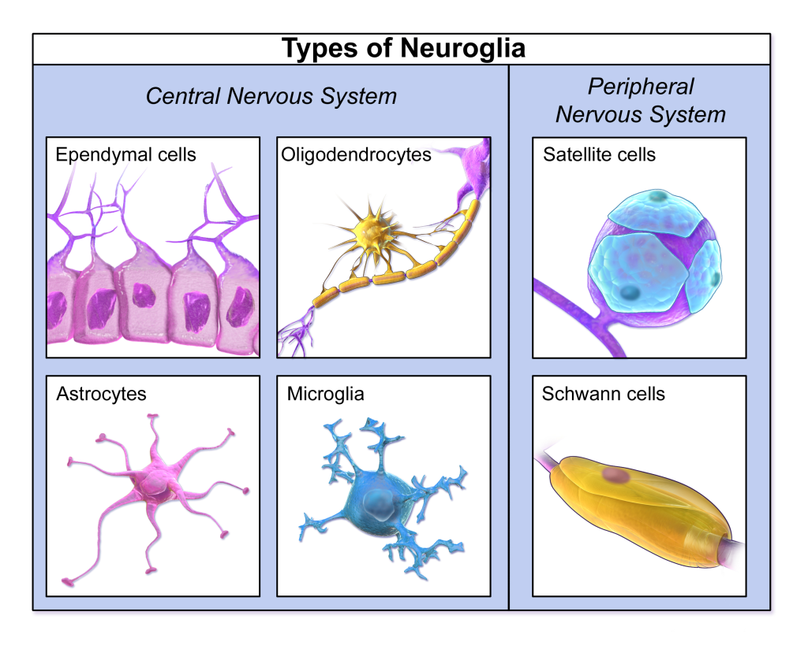
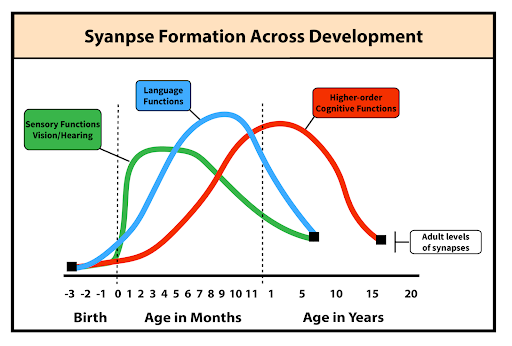
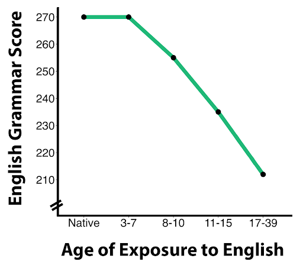
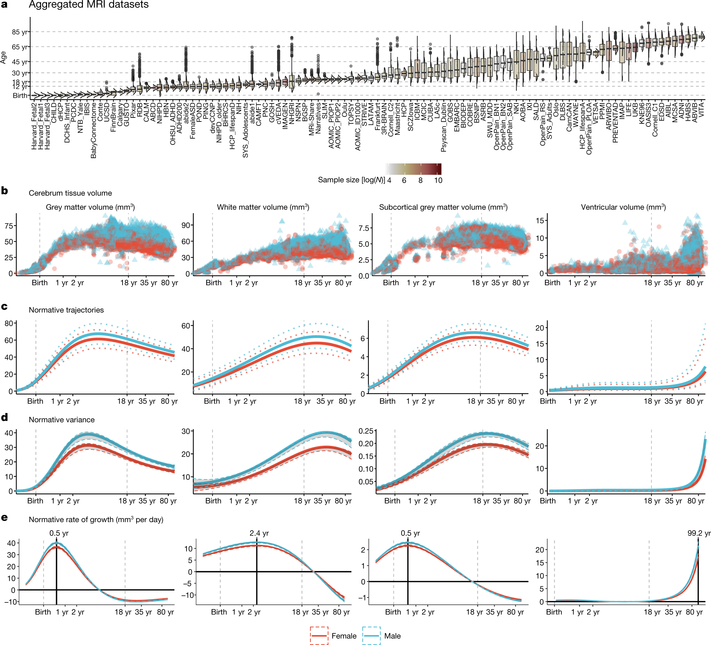

# Não thay đổi theo tuổi và kinh nghiệm

## Tóm tắt

Nếu não thay đổi suốt đời, vì sao tuổi dậy thì lại được gọi là "giai đoạn nhạy cảm", và câu "não chưa chín đến 25 tuổi" có đúng không? Bài này trả lời theo những nguồn đã đọc: não được dựng thế nào, thừa rồi tỉa ra sao, kinh nghiệm làm đổi cấu trúc ở mức nào, và thanh thiếu niên khác người lớn ở đâu.

Năm ý đi suốt bài.

1. **Não được dựng theo trình tự:** tế bào gốc sinh nơron, nơron di cư, kết nhóm, và một phần chết theo chương trình. Phần lớn nơron của đại não có trước khi sinh [S1].
2. **Thừa rồi tỉa:** synapse (khớp thần kinh) được tạo quá nhiều rồi giảm về mức người lớn, vùng giác quan đạt đỉnh trước, vùng trước trán sau cùng; sợi thần kinh được bọc myelin (chất cách điện quanh sợi trục) nên truyền nhanh hơn [S4].
3. **Tính dẻo (neuroplasticity) không đồng đều:** dẻo nhiều thì kém ổn định và kém hiệu quả, và ngược lại [S4].
4. **Có "cửa sổ" nhạy cảm:** giai đoạn nhạy cảm (sensitive period) là lúc trải nghiệm tác động mạnh; giai đoạn tới hạn (critical period) là tập con có thể không đảo ngược [S3].
5. **"Chín ở 25 tuổi" là cách nói gộp:** biểu đồ não toàn đời của Bethlehem và cộng sự cho đỉnh của từng chỉ số từ khoảng 1,7 đến khoảng 28,7 tuổi [S7].

Có hai tranh luận mở, bài trình bày cả hai phía và không phân xử: mô hình "hệ kép" ở tuổi vị thành niên (mục 7) và sinh nơron ở người lớn (mục 9).

Bài dùng ba nhãn mức chắc chắn: **giáo khoa** (nguồn đồng thuận), **giả thuyết** hoặc **đang tranh luận** (nói rõ ai tranh luận), và **Suy luận của người viết** (không gắn nguồn). Kết quả từ động vật được ghi rõ. Với nghèo, bỏ bê và hành vi mạo hiểm của thiếu niên, bài giữ giọng trung tính: dữ liệu là của nhóm, không tiên đoán một đứa trẻ cụ thể, và không nhằm đổ lỗi cho ai.

## Dựng não: từ ống thần kinh đến mạng lưới

Não gồm nơron (neuron) và tế bào thần kinh đệm (glia). Giáo trình kể sáu loại tế bào đệm; oligodendrocyte (ở não và tủy) và tế bào Schwann (ở ngoại biên) làm nhiệm vụ cách điện, tức tạo myelin [S1].

*Các loại tế bào thần kinh đệm. Oligodendrocytes tạo myelin ở hệ trung ương, Schwann cells ở ngoại biên. Nguồn hình: Blausen.com staff / BruceBlaus, Wikimedia Commons, CC BY 3.0 (giáo trình ghi 4.0); Hove & Martinez, Hình 3 (chương 7.3). https://rotel.pressbooks.pub/biologicalpsychology/chapter/stages-of-neuronal-development/ [S1]*

Giáo trình chia sự phát triển của nơron thành bốn giai đoạn nối nhau. Đây là mức **giáo khoa** [S1].

**Tăng sinh (neural proliferation).** Sau khi ống thần kinh đóng, nơron được tạo ở vùng thất (ventricular zone) của ống. Sinh nơron (neurogenesis) bắt đầu khoảng bốn tuần sau thụ thai. Tế bào gốc thần kinh cho ra tế bào đệm hình tia (radial glial cell), và chúng biệt hóa thành nơron và tế bào đệm. Phần lớn nơron của đoan não (vỏ não, hải mã, hạch nền) được tạo trước khi sinh; tiểu não còn sinh nơron sau sinh. Giáo trình, dẫn Silbereis và cộng sự 2016, nêu tổng 86 tỷ nơron được tạo từ tuần thứ tư sau thụ thai đến 18 tháng sau sinh, khoảng 4,6 triệu nơron mỗi giờ [S1]. Đây là số của giáo trình, bài không kiểm số gốc.

**Di cư (neuronal migration).** Nơron mới sinh có thể ở lại phân chia hoặc di chuyển đi. Khi di cư chúng còn non, chưa có sợi trục (axon) và sợi nhánh (dendrite). Nhìn chung chúng đi "từ trong ra ngoài" (inside-out). Có di cư tia (radial migration), nơron men theo tế bào đệm hình tia ra bề mặt và dựng nên các lớp vỏ não; và di cư tiếp tuyến (tangential migration), vuông góc với hướng tia; một số nơron đổi kiểu giữa đường. Tới đích, nơron mọc sợi trục và sợi nhánh để nối với nhau [S1]. Ví dụ của người viết: công nhân đến công trường rồi mới dựng tường, nối dây điện.

**Kết nhóm (aggregation).** Nơron xếp hàng và nối với nhau để tạo mạch, nhờ phân tử bám dính tế bào (cell-adhesion molecule) và khớp nối khe (gap junction), kênh trao đổi ion và chất chuyển hóa giữa hai tế bào kề nhau [S1].

**Chết tế bào (neuron death).** Chết theo chương trình (apoptosis) loại bỏ nơron thừa và non sau giai đoạn tăng sinh để mạng được nối đúng; hoại tử (necrosis) là cái chết thụ động do tổn thương, như sau đột quỵ, và để lại mảnh vụn gây rối loạn mô xung quanh [S1]. Suy luận của người viết: apoptosis giống việc điêu khắc, bỏ bớt để hình dạng rõ ra; đó là cách hình dung, không phải câu của nguồn.

Ba túi phôi xem L01; ở đây chỉ cần nhớ bốn giai đoạn trên là bước tiếp theo sau ba túi: tăng sinh, di cư, kết nhóm, chết có chương trình.

## Dư thừa rồi cắt tỉa: synapse và myelin

Não không cứ thêm synapse mãi. Giáo trình, dẫn Huttenlocher 1979, Huttenlocher và Dabholkar 1997, mô tả hai pha: sản xuất synapse quá nhiều, rồi loại bỏ có chương trình các synapse không hoạt động để xuống mức người lớn. Thời điểm đỉnh khác nhau theo mạng: giác quan trước, rồi ngôn ngữ, rồi chức năng nhận thức bậc cao [S4]. Đây là **giáo khoa** ở dạng khái quát.

*Số synapse mới liên quan đến chức năng giác quan, ngôn ngữ và nhận thức bậc cao theo tuổi. Xanh lá: vỏ thị giác và thính giác; xanh dương: vùng Broca; đỏ: vỏ trước trán. Nguồn hình: National Library of Medicine, CC BY-NC-SA theo Media Attributions của giáo trình (chuyển thể từ *The Developing Brain*, NBK225562); Hove & Martinez, Hình 6 (chương 7.6). https://rotel.pressbooks.pub/biologicalpsychology/chapter/trade-off-between-plasticity-and-efficiency/ [S4]*

"Cắt tỉa synapse" (synaptic pruning) dễ bị hiểu là não "mất" thứ quý. Giáo trình đặt nó trong phép đánh đổi giữa tính dẻo và hiệu quả: mạng nào dẻo nhiều thì ổn định và hiệu quả thấp. Hiệu quả thần kinh (neural efficiency) là khả năng đáp ứng một việc với ít năng lượng nhất và dễ liên lạc giữa các vùng [S4]. Giáo trình, dẫn Blakemore 2012, nêu **giả thuyết**: synapse còn thừa ở thùy trán trong tuổi vị thành niên có thể làm xử lý ở đó kém hiệu quả; khi kết nối được tinh chỉnh, não có thể cần ít synapse hơn cho cùng một việc [S4]. Cơ chế phân tử của việc mạnh lên, yếu đi (LTP, LTD) xem L02; một câu là đủ: giáo trình ghi việc tỉa các synapse ít dùng làm các synapse đã tăng cường nổi bật hơn [S2].

**Myelin hóa.** Giáo trình, dẫn Spear 2013, ghi rằng hiệu quả truyền thông tin giữa các vùng tăng nhanh trong tuổi vị thành niên khi sợi trục được bọc myelin, vì myelin tăng tốc độ truyền và giảm tiêu thụ năng lượng [S4]. Bethlehem và cộng sự cho thấy thể tích chất trắng (nơi có nhiều sợi trục bọc myelin) tăng nhanh từ giữa thai kỳ, đạt đỉnh khoảng 28,7 tuổi rồi giảm nhanh hơn sau 50 tuổi; thể tích chất xám toàn vỏ đạt đỉnh khoảng 5,9 tuổi rồi giảm gần như tuyến tính. Họ nhận xét giai đoạn tách chất xám và chất trắng ở những năm đầu "có thể phản ánh" thay đổi myelin hóa và tăng synapse [S7]. Suy luận của người viết: ảnh cộng hưởng từ không thấy từng synapse, nên không nên đọc đường cong chất xám là "đồ thị cắt tỉa"; bài không có nguồn khẳng định mối quan hệ đó.

**Thẻ hồ sơ: cắt tỉa synapse**

- **Là gì:** sau khi tạo thừa, các synapse không hoạt động bị loại có chương trình để về mức người lớn [S4].
- **Khi nào (giai đoạn tuổi):** khác nhau theo mạng: giác quan đỉnh sớm nhất, rồi ngôn ngữ, rồi chức năng bậc cao; tinh chỉnh ở vùng trán kéo dài đến tuổi vị thành niên [S4].
- **Cơ chế được đề xuất:** giữ lại kết nối hiệu quả, bỏ kết nối ít dùng; myelin hóa tăng tốc truyền [S2] [S4].
- **Bằng chứng (người / động vật; loại nghiên cứu):** giáo trình dẫn nghiên cứu mô học ở người (Huttenlocher) và tổng quan; bài không đọc nguyên văn các nghiên cứu gốc [S4].
- **Điều chưa rõ:** việc synapse thừa ở thùy trán làm kém hiệu quả còn là giả thuyết [S4]; quan hệ giữa thể tích chất xám và số synapse chưa có nguồn ở bài này.
- **Đừng hiểu nhầm:** cắt tỉa không phải "thoái hóa"; nó làm mạng chuyên biệt và ổn định hơn [S4].

## Tính dẻo: học làm đổi cấu trúc

Tính dẻo (neuroplasticity) là khả năng não tổ chức lại các kết nối để đáp ứng trải nghiệm. Giáo trình mô tả: mỗi khi học điều mới, cấu trúc não thay đổi về vật chất; học dựa vào tính dẻo của mạch và khả năng thay đổi bền vững việc truyền ở synapse [S2]. Nền tảng là quy tắc Hebb, "nơron nào cùng phát xung thì cùng nối dây", với LTP (tăng cường dài hạn) và LTD (suy giảm dài hạn); giáo trình cho rằng LTD có thể quan trọng không kém LTP với học và nhớ [S2]. Cơ chế NMDA, AMPA đã ở L02.

Điều đáng nói ở mức **hệ thống và phát triển** là tính dẻo thay đổi theo mạng và theo tuổi: mạch giác quan cơ bản đạt đỉnh dẻo ở giai đoạn sơ sinh và ổn định từ thơ ấu sớm (nhờ đó ta không phải học lại cách nhìn); còn mạch cho chức năng điều hành như tự điều chỉnh phát triển muộn và dẻo nhiều trong tuổi vị thành niên [S4].

Hai ví dụ trong giáo trình:

- **Từ động vật:** bịt một mắt ở động vật non trong giai đoạn quan trọng làm vĩnh viễn giảm đáp ứng của nơron vỏ não với mắt đó, và não ưu tiên mắt còn lại [S3].
- **Ở người:** ở người mù sớm, vỏ chẩm vốn xử lý thị giác chuyển sang xử lý xúc giác và thính giác, gọi là tính dẻo xuyên giác quan (cross-modal plasticity); nghiên cứu gần đây cho thấy nó có thể còn khi thị lực được phục hồi [S3]. 

**Mở lại cửa sổ dẻo?** Giáo trình nêu hai kết quả còn rất sớm: ở người trưởng thành, một loại thuốc (valproate) giúp học nhận biết tên các nốt nhạc, kỹ năng thường chỉ học được lúc nhỏ; và chất gây ảo giác mở lại giai đoạn tới hạn ở chuột. Giáo trình cảnh báo giai đoạn tới hạn tiến hóa có lý do, mở lại có thể làm mất ổn định các mạch đã xây [S4]. Đây không phải khuyến nghị dùng chất nào.

Suy luận của người viết: tính dẻo không phải "càng nhiều càng tốt"; não luôn mềm khó giữ điều đã học, não quá cứng khó học điều mới.

## Giai đoạn nhạy cảm và giai đoạn tới hạn

Giáo trình định nghĩa (theo Knudsen 2004) [S3]:

- **Giai đoạn nhạy cảm:** khoảng thời gian trải nghiệm tác động đặc biệt mạnh lên tổ chức não. Ngoài khoảng đó trải nghiệm tương tự vẫn tác động, nhưng yếu hơn.
- **Giai đoạn tới hạn:** khoảng thời gian có hạn mà trải nghiệm, hoặc việc thiếu trải nghiệm, để lại tác động lâu dài; rối loạn trong đó có thể gây thay đổi không đảo ngược.

Cả hai đều liên quan tính dẻo tăng cao; nhạy cảm là cửa sổ rộng, tới hạn là tập con [S3]. Ví dụ của người viết: nhạy cảm giống mùa gieo hạt dễ nhất; tới hạn giống mùa mà bỏ lỡ thì khó bù.

**Ví dụ ngôn ngữ thứ hai.** Johnson và Newport 1989 đo trình độ tiếng Anh của 46 người nói tiếng Hàn hoặc Trung bản ngữ, đến Mỹ ở tuổi 3–39 và sống ở đó 3–26 năm, bằng bài phán đoán đúng sai về ngữ pháp. Điểm có quan hệ tuyến tính với tuổi đến Mỹ cho đến dậy thì; sau dậy thì điểm thấp, biến thiên lớn và không còn liên quan đến tuổi đến. Các tác giả cho rằng hiệu ứng tuổi không do khác biệt thời gian tiếp xúc, động cơ hay cảm giác bản sắc, và kết luận giai đoạn tới hạn cho ngôn ngữ kéo dài sang ngôn ngữ thứ hai [S13].

*Điểm ngữ pháp tiếng Anh (English Grammar Score) theo tuổi bắt đầu tiếp xúc (age of exposure to English): bản ngữ (native), 3–7, 8–10, 11–15, 17–39 tuổi. Nguồn hình: National Library of Medicine, CC BY-NC-SA theo Media Attributions của giáo trình; Hove & Martinez, Hình 5 (chương 7.5). https://rotel.pressbooks.pub/biologicalpsychology/chapter/sensitive-and-critical-periods-of-development/ [S3]*

Nhãn **tương quan với tuổi**: điều đo được là điểm ngữ pháp liên quan với tuổi bắt đầu học trong một mẫu 46 người, không phải ngưỡng "sau 7 tuổi không học được". Giáo trình tóm tắt: trẻ bắt đầu trước 7 tuổi đạt trình độ gần bản ngữ, trẻ đến từ 7 đến dậy thì kém hơn, sau dậy thì nhìn chung vẫn thấp; học ngôn ngữ thứ hai suốt đời, chỉ chậm hơn, nên giáo trình xếp đây là giai đoạn **nhạy cảm**, không phải tới hạn [S3]. Khác biệt về nhãn: bài gốc kết luận về "giai đoạn tới hạn" [S13], giáo trình xếp là nhạy cảm [S3]; đây là khác biệt cách gọi, không phải số liệu.

**Ngôn ngữ thứ nhất và trường hợp "Genie".** Giáo trình kể về Genie, một cô gái sống nhiều năm trong cô lập và bị bỏ bê nặng; dù tiến bộ ban đầu về nói và ngữ pháp, ngôn ngữ về sau vẫn kém nặng (Curtiss 1974). Giáo trình cũng dẫn nghiên cứu gần đây về trẻ thiếu đầu vào ngôn ngữ trong năm đầu, về sau có khiếm khuyết cú pháp nặng [S3]. Đây là một ca đơn lẻ, và bỏ bê nặng kéo theo nhiều yếu tố cùng lúc. Suy luận của người viết: không thể tách riêng "thiếu ngôn ngữ" làm nguyên nhân duy nhất từ ca này.

**Thẻ hồ sơ: giai đoạn nhạy cảm và tới hạn**

- **Là gì:** nhạy cảm là cửa sổ phát triển mà trải nghiệm tác động đặc biệt mạnh; tới hạn là tập con mà thiếu trải nghiệm có thể để lại hệ quả lâu dài, có thể không đảo ngược [S3].
- **Khi nào (giai đoạn tuổi):** chủ yếu thời thơ ấu sớm (giác quan, ngôn ngữ); tuổi vị thành niên cũng được xem là nhạy cảm, xem mục 6 [S3].
- **Cơ chế được đề xuất:** tính dẻo tăng cao trong cửa sổ, sau đó mạch ổn định và hiệu quả hơn [S3] [S4].
- **Bằng chứng (người / động vật; loại nghiên cứu):** người: nghiên cứu tương quan về tuổi học ngôn ngữ thứ hai [S13], ca đơn lẻ Genie [S3]; động vật: thí nghiệm bịt một mắt [S3].
- **Điều chưa rõ:** ranh giới nhạy cảm/tới hạn và việc mở lại cửa sổ ở người lớn còn sớm: một nghiên cứu ở người, một ở chuột [S4].
- **Đừng hiểu nhầm:** không có câu "sau 7 tuổi không thể học"; ngôn ngữ thứ hai học được suốt đời, chậm hơn [S3].

## Tuổi vị thành niên: não đang tái cấu trúc

**Bao nhiêu tuổi?** Giáo trình viết tuổi vị thành niên (adolescence) là giai đoạn giữa thơ ấu và trưởng thành, thường coi là 10–24 tuổi [S3]. Sawyer và cộng sự 2018 bàn chính câu hỏi này: định nghĩa luôn là một bài toán vì nó gồm cả tăng trưởng sinh học lẫn chuyển đổi vai trò xã hội, và cả hai đã đổi trong thế kỷ qua. Dậy thì sớm hơn đẩy điểm bắt đầu lên; hiểu biết về tăng trưởng kéo dài đẩy điểm kết thúc "vào tuổi 20"; học xong, kết hôn, làm cha mẹ đều muộn hơn. Họ đề nghị mở rộng từ 10–19 lên 10–24 [S6]. Vậy 24 là một cách xác định rộng, có lý do, không phải ranh giới sinh học.

**Thùy trán trưởng thành muộn.** Giáo trình, dẫn nhiều nghiên cứu hình ảnh, ghi rằng thùy trán, gồm vỏ trước trán liên quan chức năng điều hành, phát triển muộn và tiếp tục trưởng thành đáng kể trong tuổi vị thành niên [S3]. Chức năng của vỏ trước trán xem L04.

**Mỗi chỉ số một đỉnh.** Bethlehem và cộng sự 2022 tập hợp 123.984 ảnh cộng hưởng từ của 101.457 người, từ 115 ngày sau thụ thai đến 100 tuổi, và dựng đường cong chuẩn (normative) theo tuổi [S7]. Tuổi đỉnh của từng chỉ số [S7]:

- độ dày vỏ não trung bình: khoảng 1,7 tuổi;
- thể tích chất xám toàn vỏ: khoảng 5,9 tuổi (muộn hơn 2–3 năm so với các báo cáo trước dùng mẫu nhỏ, hẹp tuổi hơn);
- diện tích bề mặt vỏ: khoảng 11 tuổi; thể tích đại não: khoảng 12,5 tuổi;
- thể tích chất xám dưới vỏ: khoảng 14,4 tuổi;
- thể tích chất trắng: khoảng 28,7 tuổi.

Ở mức vùng, tuổi đỉnh thể tích chất xám của 34 vùng vỏ trải từ khoảng 2 đến 10 tuổi; các vùng liên hợp trán–thái dương đỉnh muộn hơn và giảm chậm hơn, theo gradient từ vỏ cảm giác đến vỏ liên hợp [S7].

*Hình 1 của Bethlehem và cộng sự 2022: dữ liệu cộng gộp (a), thể tích chất xám, chất trắng, chất xám dưới vỏ, dịch não thất (b), đường cong chuẩn (c), phương sai (d), tốc độ tăng (e) theo tuổi; đỏ: nữ, xanh: nam. Nguồn hình: Bethlehem và cộng sự, Nature 2022, CC BY 4.0. https://doi.org/10.1038/s41586-022-04554-y [S7]*

Vì thế câu "não chưa chín đến 25 tuổi" cần đọc lại. Đây là kích thước đo bằng ảnh cộng hưởng từ ở mức nhóm; chúng không phải "độ chín" chức năng và không cho biết một người cụ thể ở đâu trên đường cong [S7]. Trang NIMH (Viện Sức khỏe Tâm thần Mỹ) viết rằng não ngừng lớn về kích thước ở đầu tuổi vị thành niên, "hoàn thành phát triển và trưởng thành vào giữa đến cuối tuổi 20", và vỏ trước trán là một trong những phần chín muộn nhất [S18]. Hai nguồn không mâu thuẫn: một là câu tóm tắt cho công chúng, một là số liệu theo từng chỉ số; không nguồn nào nêu con số 25. Suy luận của người viết: "25" là số tròn dễ nhớ của câu tóm tắt, không phải một phát hiện riêng.

**Giai đoạn nhạy cảm?** Giáo trình viết tuổi này "hiện được coi rộng rãi là giai đoạn nhạy cảm" vì những thay đổi xã hội, nhận thức, cảm xúc [S3]. Fuhrmann, Knoll và Blakemore 2015 xét ba lĩnh vực ứng viên: trí nhớ, căng thẳng xã hội và dùng chất. Dữ liệu từ chuột, hình ảnh học và nghiên cứu hành vi ở người phù hợp với tính dẻo tăng, nhưng bằng chứng cụ thể cho giai đoạn nhạy cảm ở tuổi này phần lớn còn thiếu; cần thí nghiệm thao tác trực tiếp môi trường rồi so sánh trẻ em, thiếu niên, người lớn [S12]. Mức: **giả thuyết đang được kiểm chứng**; giáo trình thiên về "được coi là", Fuhrmann và cộng sự thận trọng hơn về bằng chứng.

NIMH còn nêu, ở mức tóm tắt cho công chúng, rằng nhịp melatonin của thiếu niên lệch muộn hơn và nhiều em ngủ không đủ [S18]. Bệnh khởi phát tuổi trẻ xem L12.

**Thẻ hồ sơ: tuổi vị thành niên như giai đoạn nhạy cảm**

- **Là gì:** giai đoạn giữa thơ ấu và trưởng thành, thường coi là 10–24 tuổi; được coi là nhạy cảm vì nhiều thay đổi về não và hành vi [S3] [S6].
- **Khi nào (giai đoạn tuổi):** theo định nghĩa rộng, từ khoảng 10 đến 24 tuổi; đầu gắn với dậy thì, cuối gắn với cả sinh học lẫn vai trò xã hội [S6].
- **Cơ chế được đề xuất:** thùy trán trưởng thành muộn, myelin hóa và tinh chỉnh synapse tiếp diễn, xử lý xã hội–cảm xúc đổi từ lúc dậy thì [S3] [S4] [S11].
- **Bằng chứng (người / động vật; loại nghiên cứu):** hình ảnh học ở người, tổng quan, dữ liệu từ chuột; chưa có thí nghiệm thao tác môi trường trực tiếp so sánh các nhóm tuổi [S12].
- **Điều chưa rõ:** bằng chứng cụ thể cho giai đoạn nhạy cảm ở tuổi này phần lớn còn thiếu [S12].
- **Đừng hiểu nhầm:** "10–24" không phải ranh giới sinh học [S6]; "não chín ở 25" không phải kết quả của nguồn đã đọc [S7].

## Hệ thưởng và kiểm soát ở tuổi vị thành niên: bức tranh còn tranh luận

Vì sao thiếu niên hay mạo hiểm hơn? Giáo trình nêu rằng tuổi này đi cùng tăng tìm cảm giác mạnh và mạo hiểm; có nhà thần kinh học gợi ý nguyên nhân là tự điều chỉnh chưa đầy đủ và hệ điều hành chưa chín không kìm được ham muốn tìm thưởng [S3]. Đó là gốc của **mô hình hệ kép** (dual-systems model). Đây là tranh luận đang mở; bài trình bày cả hai phía, không phân xử.

**Phía thứ nhất: hệ kép.** Casey, Jones và Hare 2008, dựa trên hình ảnh não ở người và nghiên cứu động vật, đề xuất rằng đáp ứng với phần thưởng và bối cảnh xã hội–cảm xúc tăng vào lúc kiểm soát xung động còn tương đối chưa chín: hệ viền "từ dưới lên" phát triển khác nhịp với hệ kiểm soát "từ trên xuống", và có thể nặng hơn ở thiếu niên dễ phản ứng cảm xúc [S8]. Steinberg 2008 đưa khung tương tự: mạo hiểm tăng từ thơ ấu sang tuổi vị thành niên vì thay đổi quanh dậy thì của hệ xã hội–cảm xúc, tăng tìm thưởng, nhất là khi có bạn bè, do hệ dopamine tái cấu trúc mạnh; và giảm sau đó vì hệ kiểm soát nhận thức cải thiện khả năng tự điều chỉnh. Hai hệ lệch nhịp nên giữa tuổi vị thành niên là lúc dễ tổn thương trước hành vi liều lĩnh [S9].

**Phía thứ hai: cách nhìn khác.** Pfeifer và Allen 2012 gọi mô hình hệ kép là cách giải thích trực quan, lan rộng ở nhiều lĩnh vực, nhưng bằng chứng gần đây không phù hợp với nó và cho thấy sự phức tạp của biến thiên phát triển và lâm sàng; họ kêu gọi mô hình mới dựa trên mạng lưới, nối cấu trúc với chức năng và não với hành vi theo thời gian [S10]. Crone và Dahl 2012 nhận xét các nghiên cứu hình ảnh phát triển không ủng hộ mô hình đơn giản "vỏ trán chưa chín" để giải thích mạo hiểm; thay vào đó họ nhấn mạnh thay đổi xử lý xã hội–cảm xúc bắt đầu quanh dậy thì, và những thay đổi ấy có thể mang lợi thế thích nghi, như linh hoạt hơn khi điều chỉnh động cơ và thứ tự ưu tiên mục tiêu trong bối cảnh xã hội đổi thay [S11].

| | Mô hình hệ kép | Cách nhìn khác |
|---|---|---|
| Ai | Casey, Jones & Hare 2008; Steinberg 2008 [S8] [S9] | Pfeifer & Allen 2012; Crone & Dahl 2012 [S10] [S11] |
| Ý chính | hệ xã hội–cảm xúc đổi sớm, hệ kiểm soát chín muộn hơn | mô hình quá đơn giản; cần nhìn mạng lưới, và thay đổi xã hội–cảm xúc có mặt thích nghi |

Hai phía cùng thấy não đổi nhiều trong tuổi này; họ khác nhau ở chỗ cách giải thích đó có đủ để nói về hành vi hay không. Nhãn: giả thuyết đang tranh luận.

**Quan điểm giáo trình về rủi ro.** Giáo trình lưu ý rủi ro thường bị nhìn tiêu cực nhưng có vai trò trong phát triển: khám phá và thử nghiệm giúp hình thành bản sắc, kỹ năng ra quyết định và tự chủ [S3] (nhãn: quan điểm giáo trình). NIMH cũng nói rủi ro có thể tích cực, như làm quen bạn học mới [S18].

Cả hai phía nói về xu hướng nhóm, không cho phép đoán một thiếu niên sẽ làm gì. Đặc điểm hệ thưởng ở tuổi dậy thì là một lý do người ta lo về mạng xã hội, xem L06.

## Môi trường và nghịch cảnh sớm

Giáo trình viết rằng nghịch cảnh sớm có hệ quả lâu dài đến phát triển não và hành vi: nghèo thuở nhỏ gắn với kết quả học tập, học vấn và thu nhập người lớn thấp hơn, còn thu nhập gia đình cao hơn gắn với ngôn ngữ, trí nhớ và tự điều chỉnh tốt hơn. Thu nhập cao hơn **tương quan** với diện tích bề mặt vỏ lớn hơn ở vùng điều khiển ngôn ngữ và chức năng điều hành (Noble và cộng sự 2015); còn nhiều điều chưa biết về việc những tác động đó hình thành ra sao [S5].

Nghiên cứu cắt ngang chỉ cho thấy hai thứ đi cùng nhau. Suy luận của người viết: thu nhập đại diện cho rất nhiều điều (nhà ở, dinh dưỡng, thời gian của cha mẹ, căng thẳng, di truyền...), nên không kết luận được "tiền làm lớn vỏ não". Đây cũng không phải lời trách cha mẹ: hoàn cảnh kinh tế là điều nhiều gia đình khó tự quyết.

**Thử nghiệm ngẫu nhiên: Baby's First Years (BFY).** Đây là thử nghiệm ngẫu nhiên đối chứng đầu tiên về giảm nghèo thuở đầu đời nhằm xem tác động lên phát triển não: 1.000 bà mẹ thu nhập thấp ở bốn vùng đô thị Mỹ được chia ngẫu nhiên nhận khoản lớn (333 đô la) hay tượng trưng (20 đô la) mỗi tháng [S5]. Troller-Renfree và cộng sự 2022 báo cáo kết quả đầu: đo điện não đồ lúc nghỉ ở khoảng 1 tuổi, tại nhà của trẻ (n = 435), nhóm nhận nhiều tiền có công suất lớn hơn ở các dải tần cao, kích thước hiệu ứng tương đương nhiều can thiệp giáo dục quy mô lớn, dù mức ý nghĩa thay đổi theo cách phân tích. Các tác giả viết khoản chuyển tiền "có thể làm thay đổi" hoạt động não, theo kiểu từng được gắn với phát triển kỹ năng nhận thức về sau [S16]. Đó là bằng chứng nhân quả mạnh hơn cắt ngang, nhưng chỉ là một chỉ số điện não ở một mốc tuổi, ở một mẫu ở Mỹ; nó không nói gì về tương lai của một đứa trẻ [S16].

**Theo dõi đến 4 tuổi.** Bản thảo NBER (chưa qua phản biện) báo cáo rằng sau bốn năm đầu (n = 891) không thấy tác động có ý nghĩa thống kê của khoản chuyển tiền lên bốn kết quả chính đã đăng ký trước (ngôn ngữ, chức năng điều hành, vấn đề xã hội–cảm xúc, hoạt động não tần số cao) hay ba kết quả phụ; bản thảo thảo luận các cách giải thích khả dĩ, phần này bài chưa đọc [S17]. Kết quả ở các tuổi lớn hơn: chưa kiểm.

**ABCD.** Giáo trình giới thiệu nghiên cứu Adolescent Brain Cognitive Development (ABCD): 21 địa điểm ở Mỹ theo dõi hơn 11.000 trẻ từ 9 tuổi đến đầu tuổi trưởng thành trong khoảng một thập kỷ [S5]. Bài chưa đọc kết quả nào của ABCD.

Có thể nói: môi trường liên quan đến phát triển não ở mức nhóm [S5]; một thử nghiệm ngẫu nhiên gợi ý khoản chuyển tiền có thể đổi hoạt động não ở 1 tuổi [S16], nhưng ở 4 tuổi không thấy khác biệt rõ [S17]. Không nên nói một đứa trẻ lớn lên trong nghèo khó "chắc chắn" có não khác, hay cha mẹ "gây ra" điều đó.

## Não sau tuổi trưởng thành: tế bào mới và sự lão hóa

Giáo trình nói đến khoảng 25 năm trước người ta cho rằng não người không sinh nơron mới sau khi chào đời; một nghiên cứu mốc cho thấy hải mã có thể sinh nơron suốt tuổi trưởng thành, gọi là sinh nơron ở người lớn (adult neurogenesis) [S1]. Giáo trình ghi nghiên cứu đó là Eriksson và cộng sự 1997; bản ghi Crossref của bài *Neurogenesis in the adult human hippocampus* (Nature Medicine) là 1998, nên bài dùng 1998 (ghi chú của người viết sau khi kiểm). Theo giáo trình, sinh nơron ở người lớn nhất quán nhất ở vùng dưới thất của não thất bên và vùng dưới hạt của hồi răng cưa ở hải mã; nhiều nơron mới không sống sót hoặc không hòa vào mạch; và chủ đề "khá gây tranh cãi": có nghiên cứu gợi ý khoảng 700 nơron mới mỗi ngày ở hải mã, nghiên cứu khác cho rằng không phát hiện được hoặc có thể không tồn tại [S1].

**Phía thứ nhất: không phát hiện ở người lớn.** Sorrells và cộng sự 2018 (*Nature*) báo cáo số tế bào đang phân chia và nơron non ở hồi răng cưa giảm mạnh trong năm đầu đời, chỉ còn vài nơron non lẻ tẻ ở 7 và 13 tuổi. Ở người trưởng thành (18–77 tuổi; 17 mẫu tử thiết ở người đối chứng, 12 mẫu phẫu thuật ở bệnh nhân động kinh) không phát hiện nơron non ở hồi răng cưa. Ở khỉ, tăng sinh có lúc sơ sinh rồi giảm. Kết luận: nơron non vào hải mã linh trưởng giảm nhanh trong những năm đầu, và sinh nơron ở hồi răng cưa không tiếp tục hoặc cực hiếm ở người lớn [S14].

**Phía thứ hai: vẫn tiếp diễn suốt tuổi già.** Boldrini và cộng sự 2018 (*Cell Stem Cell*) phân tích toàn bộ hải mã tử thiết của người khỏe mạnh từ 14 đến 79 tuổi. Họ thấy số tế bào tiền thân thần kinh trung gian tương tự và hàng nghìn nơron non ở hồi răng cưa, thể tích hồi răng cưa tương đương giữa các độ tuổi; nhưng người cao tuổi có ít hình thành mạch máu và tính dẻo hơn, và bể tế bào gốc ngủ nhỏ hơn ở phần trước–giữa. Họ kết luận người cao tuổi khỏe mạnh vẫn giữ sinh nơron, và nói "có thể" sinh nơron hải mã liên tục duy trì chức năng nhận thức đặc trưng của người suốt đời [S15].

Hai bài kết luận ngược nhau, cùng năm 2018, đều trên mô người sau khi chết. Bài chỉ đọc phần tóm tắt của cả hai, chưa đọc phần phương pháp, nên không nêu lý do khác nhau và không phân xử; giáo trình cũng đặt hai phía cạnh nhau như một vấn đề còn tranh luận [S1].

**Thẻ hồ sơ: sinh nơron ở người lớn**

- **Là gì:** việc tạo nơron mới trong não trưởng thành [S1].
- **Khi nào (giai đoạn tuổi):** sinh nơron chủ yếu từ trước sinh đến khoảng 18 tháng sau sinh [S1]; ở người lớn là điều đang tranh luận, nhất là ở hồi răng cưa [S14] [S15].
- **Cơ chế được đề xuất:** tế bào tiền thân ở vùng dưới hạt hồi răng cưa và vùng dưới thất sinh nơron non; nhiều nơron mới không sống sót [S1].
- **Bằng chứng (người / động vật; loại nghiên cứu):** người: mô sau khi chết và mô phẫu thuật, hai bài 2018 kết luận ngược nhau [S14] [S15]; khỉ: giảm theo tuổi [S14].
- **Điều chưa rõ:** có hay không và bao nhiêu nơron mới ở người lớn; vai trò chức năng nếu có [S1] [S14] [S15].
- **Đừng hiểu nhầm:** chưa có câu trả lời "đã chốt" ở cả hai chiều.

**Lão hóa: chỉ ở mức đường cong nhóm.** Giáo trình Chương 7 không có mục lão hóa. Bethlehem và cộng sự cho biết chất xám giảm gần như tuyến tính sau đỉnh, chất trắng giảm nhanh hơn sau 50 tuổi, và thể tích dịch não thất tăng đến 2 tuổi, đi ngang đến khoảng 30 tuổi, rồi tăng chậm và đến thập niên thứ sáu tăng theo cấp số nhân [S7]. Đó là hình dạng trung bình của nhóm, không dự đoán một người; bài không đưa lời khuyên "giữ não khỏe".

## Những hiểu lầm thường gặp

**"Não chín ở 25 tuổi."** Không nguồn đã đọc nào nêu số 25 cho "độ chín": đỉnh theo chỉ số từ khoảng 1,7 đến 28,7 tuổi [S7], NIMH nói "giữa đến cuối tuổi 20" ở mức tóm tắt [S18], Sawyer đề nghị tuổi vị thành niên kéo đến 24 [S6]. Đỉnh thể tích không đồng nghĩa "chín" chức năng.

**"Sau 7 tuổi không học được ngôn ngữ."** Điều đo được là điểm ngữ pháp liên quan đến tuổi bắt đầu học [S13]; ngôn ngữ thứ hai học được suốt đời, chậm hơn [S3].

**"Thiếu niên liều vì não chưa phát triển."** Mô hình hệ kép là một cách giải thích có bằng chứng [S8] [S9], nhưng bị đặt lại câu hỏi [S10] [S11]; giáo trình lưu ý rủi ro có phần tích cực [S3]. Đó là xu hướng nhóm, không tiên đoán một đứa trẻ.

**"Thu nhập thấp làm não nhỏ đi, và đó là số phận."** Cắt ngang chỉ cho tương quan [S5]; thử nghiệm ngẫu nhiên cho tín hiệu ở 1 tuổi [S16] nhưng không thấy khác biệt có ý nghĩa ở 4 tuổi trong bản thảo [S17].

**"Người lớn không sinh nơron mới" hoặc "chắc chắn có".** Cả hai chưa đúng với tình trạng hiện nay: hai bài 2018 kết luận ngược nhau [S14] [S15].

**"Tính dẻo càng nhiều càng tốt."** Giáo trình nêu phép đánh đổi giữa dẻo và hiệu quả [S4]; giai đoạn tới hạn chỉ là tập con của giai đoạn nhạy cảm [S3].

## Điều cần nhớ

1. Não dựng theo trình tự tăng sinh, di cư, kết nhóm, chết có chương trình [S1]; synapse tạo thừa rồi tỉa, đỉnh khác nhau theo mạng, còn myelin hóa tăng hiệu quả truyền [S4].
2. Tính dẻo thay đổi theo mạng và tuổi; dẻo nhiều đi cùng ổn định ít [S4]. Giai đoạn nhạy cảm là cửa sổ rộng, giai đoạn tới hạn là tập con có thể không đảo ngược [S3]; điểm ngữ pháp liên quan với tuổi bắt đầu học, không có ngưỡng 7 tuổi cứng [S13].
3. Tuổi vị thành niên thường coi là 10–24 [S6]; bằng chứng cụ thể cho giai đoạn nhạy cảm ở tuổi này phần lớn còn thiếu [S12]. Không nguồn đã đọc nêu "não chín ở 25"; mỗi chỉ số có đỉnh riêng [S7].
4. Hệ kép và cách nhìn khác là tranh luận mở [S8] [S9] [S10] [S11]; sinh nơron ở người lớn cũng vậy [S14] [S15].
5. Tương quan thu nhập–não không phải nhân quả [S5]; tín hiệu ở 1 tuổi [S16], không khác biệt có ý nghĩa ở 4 tuổi [S17]; dữ liệu nhóm không tiên đoán một đứa trẻ.

Nối bài: L01 (ba túi phôi), L02 (LTP, LTD), L04 (vỏ trước trán), L06 (mạng xã hội), L07 (hải mã), L12 (rối loạn khởi phát tuổi trẻ).

## Nguồn tham khảo

- [S1] Hove & Martinez, Biological Psychology, mục 7.3 "Stages of Neuronal Development", 2024 https://rotel.pressbooks.pub/biologicalpsychology/chapter/stages-of-neuronal-development/
- [S2] Hove & Martinez, Biological Psychology, mục 7.4 "Neuroplasticity", 2024 https://rotel.pressbooks.pub/biologicalpsychology/chapter/neuroplasticity/
- [S3] Hove & Martinez, Biological Psychology, mục 7.5 "Sensitive and Critical Periods of Development", 2024 https://rotel.pressbooks.pub/biologicalpsychology/chapter/sensitive-and-critical-periods-of-development/
- [S4] Hove & Martinez, Biological Psychology, mục 7.6 "Trade-off between Plasticity and Efficiency", 2024 https://rotel.pressbooks.pub/biologicalpsychology/chapter/trade-off-between-plasticity-and-efficiency/
- [S5] Hove & Martinez, Biological Psychology, mục 7.7 "Characterizing Brain Development from Infancy through Young Adulthood", 2024 https://rotel.pressbooks.pub/biologicalpsychology/chapter/characterizing-brain-development-from-infancy-through-young-adulthood/
- [S6] Sawyer S. M., Azzopardi P. S., Wickremarathne D., Patton G. C., The age of adolescence, The Lancet Child & Adolescent Health 2(3): 223–228, 2018 https://doi.org/10.1016/S2352-4642(18)30022-1
- [S7] Bethlehem R. A. I. và cộng sự, Brain charts for the human lifespan, Nature 604: 525–533, 2022 https://doi.org/10.1038/s41586-022-04554-y
- [S8] Casey B. J., Jones R. M., Hare T. A., The adolescent brain, Annals of the New York Academy of Sciences 1124: 111–126, 2008 https://doi.org/10.1196/annals.1440.010
- [S9] Steinberg L., A social neuroscience perspective on adolescent risk-taking, Developmental Review 28: 78–106, 2008 https://doi.org/10.1016/j.dr.2007.08.002
- [S10] Pfeifer J. H., Allen N. B., Arrested development? Reconsidering dual-systems models of brain function in adolescence and disorders, Trends in Cognitive Sciences 16: 322–329, 2012 https://doi.org/10.1016/j.tics.2012.04.011
- [S11] Crone E. A., Dahl R. E., Understanding adolescence as a period of social–affective engagement and goal flexibility, Nature Reviews Neuroscience 13: 636–650, 2012 https://doi.org/10.1038/nrn3313
- [S12] Fuhrmann D., Knoll L. J., Blakemore S.-J., Adolescence as a sensitive period of brain development, Trends in Cognitive Sciences 19: 558–566, 2015 https://doi.org/10.1016/j.tics.2015.07.008
- [S13] Johnson J. S., Newport E. L., Critical period effects in second language learning: the influence of maturational state on the acquisition of English as a second language, Cognitive Psychology 21(1): 60–99, 1989 https://doi.org/10.1016/0010-0285(89)90003-0
- [S14] Sorrells S. F. và cộng sự, Human hippocampal neurogenesis drops sharply in children to undetectable levels in adults, Nature 555: 377–381, 2018 https://doi.org/10.1038/nature25975
- [S15] Boldrini M. và cộng sự, Human hippocampal neurogenesis persists throughout aging, Cell Stem Cell 22: 589–599, 2018 https://doi.org/10.1016/j.stem.2018.03.015
- [S16] Troller-Renfree S. V. và cộng sự, The impact of a poverty reduction intervention on infant brain activity, PNAS 119(5), 2022 https://doi.org/10.1073/pnas.2115649119
- [S17] Noble K., Magnuson K., Duncan G., Gennetian L. A. và cộng sự, The effect of a monthly unconditional cash transfer on children's development at four years of age: a randomized controlled trial in the U.S., NBER Working Paper 33844, 2025 (bản thảo, chưa qua phản biện) https://doi.org/10.3386/w33844
- [S18] National Institute of Mental Health, The Teen Brain: 7 Things to Know (trang web, đọc ngày 2026-10-21) https://www.nimh.nih.gov/health/publications/the-teen-brain-7-things-to-know
