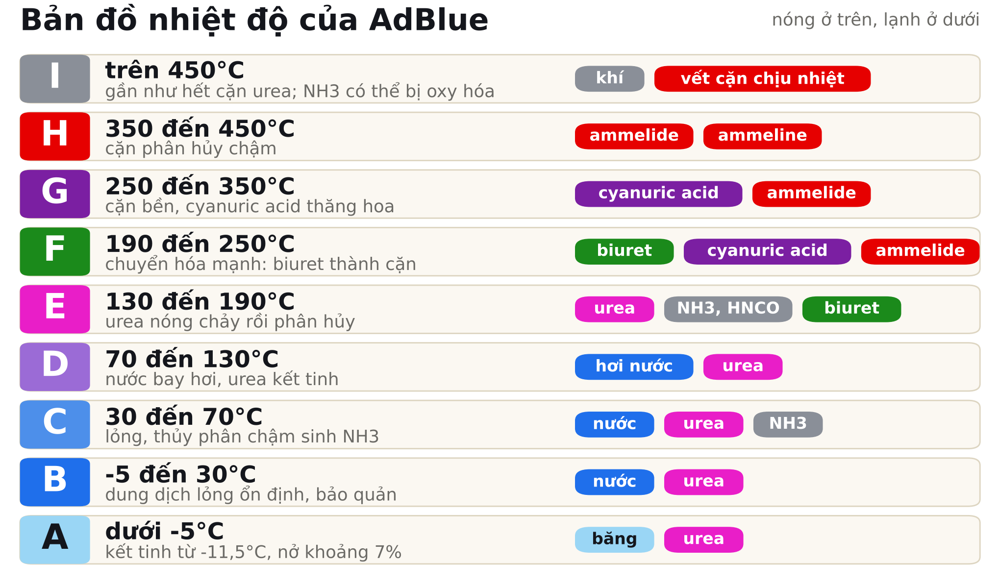
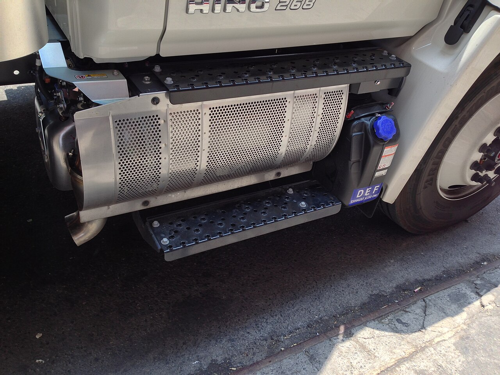
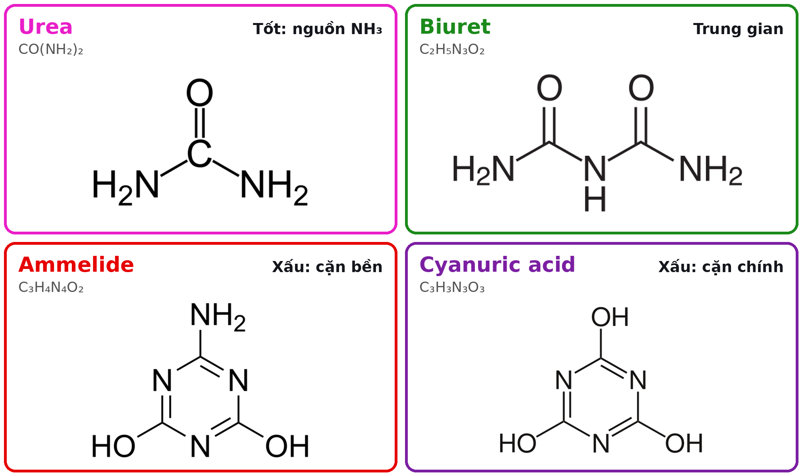
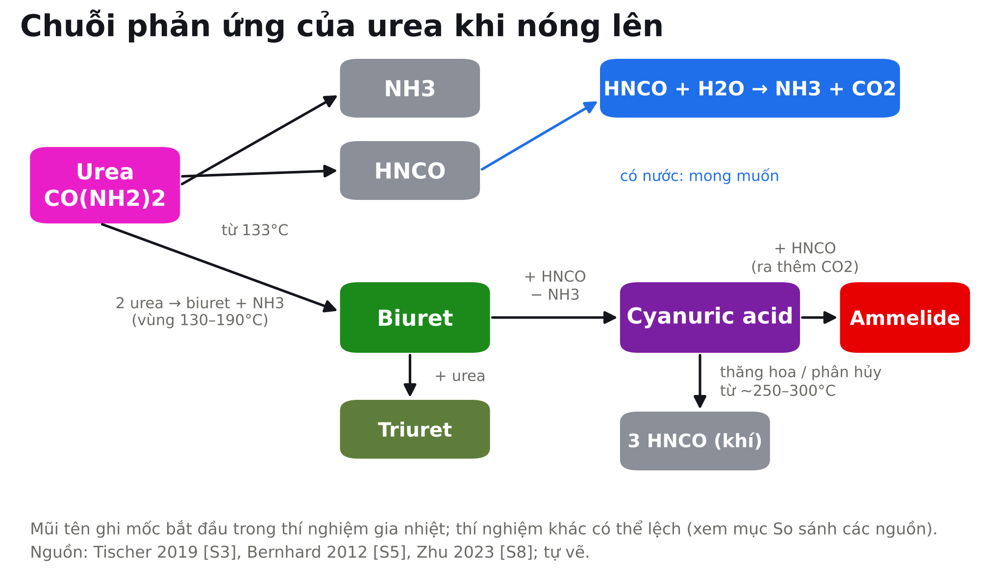
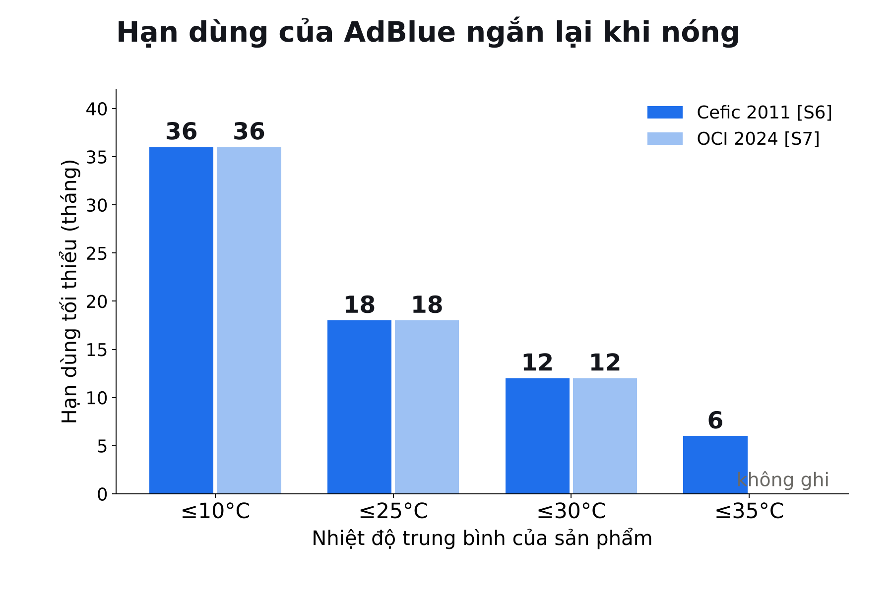
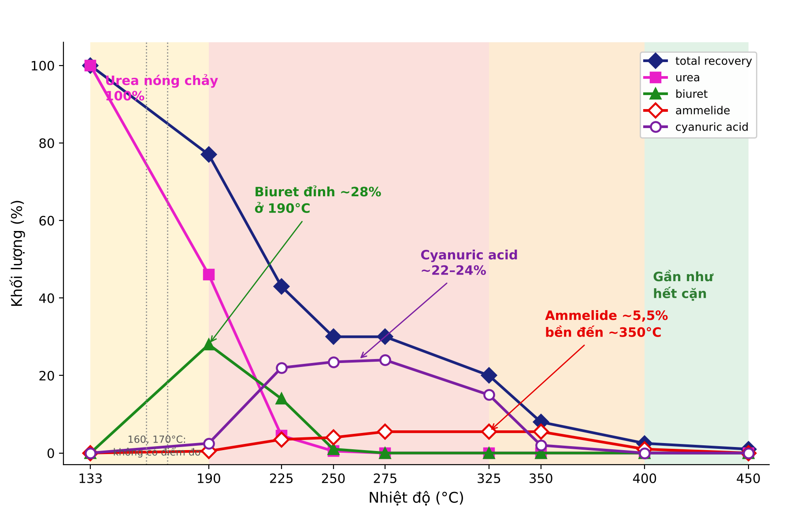
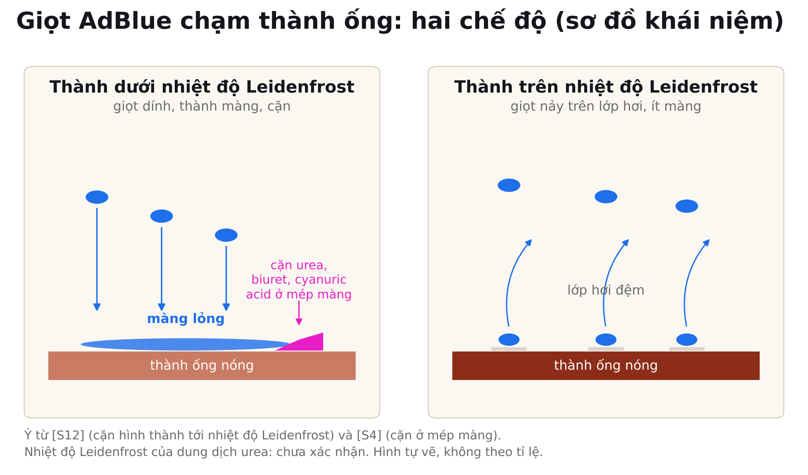
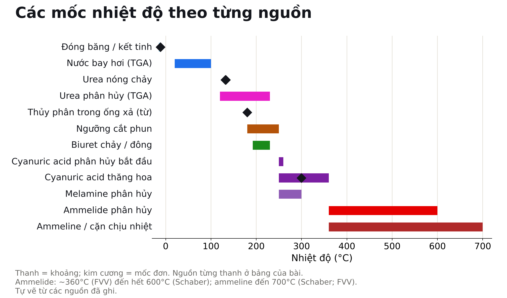
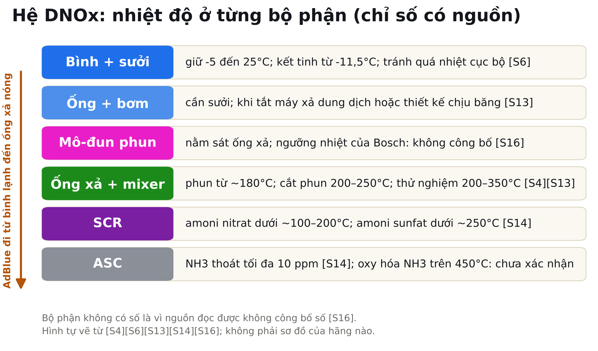

# AdBlue từ lạnh đến nóng: các pha và biến đổi từ -5°C đến 450°C

Câu hỏi của bài: AdBlue ở từng nhiệt độ từ -5°C đến trên 450°C đang ở trạng thái nào, biến thành chất gì, và điều đó có lợi hay có hại cho hệ DNOx (hệ xử lý NOx của động cơ diesel)?

Bài dành cho kỹ sư cơ khí và ô tô không chuyên hóa. Câu ngắn, thuật ngữ có tiếng Anh ở lần đầu. Mọi con số quan trọng mang một trong ba nhãn: **[SỐ LIỆU TỪ NGUỒN]** (có nguồn, đã đọc), **[SUY LUẬN]** (của người viết, không gắn như thể nguồn đã nói) và **[CHƯA XÁC NHẬN]** (không tìm được nguồn đọc được; bài không điền số). Bài này là bản mở rộng của L17: L17 đọc kỹ từng điểm đo của biểu đồ gia nhiệt urea "Source number 3" [S1] từ 133 đến 450°C; L18 đặt biểu đồ đó vào bức tranh đầy đủ, từ vùng lạnh dưới điểm đóng băng đến vùng trên 450°C.

## Tóm tắt điều hành

1. **AdBlue là nước có 32,5% urea.** Đặc tả của nhà cung cấp cho urea 31,8–33,2% khối lượng [S7]. Hướng dẫn ngành của Cefic cho biết urea bắt đầu kết tinh ở khoảng -11,5°C và thể tích đá lớn hơn thể tích lỏng khoảng 7% [S6]. **[SỐ LIỆU TỪ NGUỒN]**
2. **Bảo quản có hai giới hạn:** không để lâu trên 25°C vì urea thủy phân chậm, sinh NH3 (amoniac) và tăng áp; và giữ trên -5°C để tránh kết tinh [S6]. Hạn dùng tối thiểu là 36, 18, 12 và 6 tháng ở nhiệt độ trung bình ≤10, ≤25, ≤30 và ≤35°C [S6]. **[SỐ LIỆU TỪ NGUỒN]**
3. **Khi nóng lên, nước bay hơi trước** (phân tích nhiệt TGA cho nước bay hơi trong khoảng 20–100°C) và urea phân hủy trong khoảng 120–230°C [S11]. Urea nóng chảy ở khoảng 132–133°C [S3][S5]. **[SỐ LIỆU TỪ NGUỒN]**
4. **Từ khoảng 133°C trở lên urea tách thành NH3 và HNCO (isocyanic acid), đồng thời sinh biuret.** Từ khoảng 190°C biuret chuyển thành cyanuric acid và ammelide; cyanuric acid thăng hoa và phân hủy trong khoảng 250–360°C; ammelide bền hơn và bắt đầu phân hủy ở khoảng 360°C [S3][S4]. **[SỐ LIỆU TỪ NGUỒN]**
5. **Cặn hình thành khi giọt chạm thành ống và tạo màng lỏng, không phải khi còn lơ lửng trong khí.** Nghiên cứu quang học cho thấy cặn có thể hình thành tới nhiệt độ Leidenfrost [S12]. Cặn tạo ở nhiệt độ cao cần nhiệt độ cao hơn để phân hủy, và báo cáo FVV tìm thấy phần cặn chịu nhiệt tới 700°C, nên "nóng trên 400°C là sạch" chỉ đúng một phần [S4]. **[SỐ LIỆU TỪ NGUỒN]**
6. **Với DNOx:** tài liệu ngành cho ngưỡng cắt phun thường nằm trong khoảng 200–250°C, hệ thiết kế tốt có thể phun từ khoảng 180°C [S13]; giọt nhỏ, mixer tốt, sưởi và xả (purge) bình khi tắt máy là các biện pháp chung của ngành [S13][S4]. **[SỐ LIỆU TỪ NGUỒN]** cho các con số, **[SUY LUẬN]** cho cách ghép chúng thành chiến lược.
7. **Hạn chế:** tôi không đọc được bản gốc ISO 22241; không có nguồn đọc được cho nhiệt độ Leidenfrost của dung dịch urea, nhiệt độ NH3 bị oxy hóa mạnh trên 450°C, thời gian rã đông và ngưỡng phun của một hãng cụ thể. Những chỗ đó ghi **[CHƯA XÁC NHẬN]**.

## Bản đồ nhiệt độ từ -5°C đến 450°C

Bản đồ dưới đây là cách chia của bài. Các nguồn đặt mốc hơi khác nhau, nên bài nêu từng chỗ lệch ở các vùng và ở mục "So sánh các nguồn". Màu: nước và dung dịch lỏng xanh dương, băng xanh nhạt, urea hồng, biuret xanh lá, ammelide đỏ, cyanuric acid tím, khí (NH3, HNCO) xám.

*Bản đồ nhiệt độ chín vùng A–I. Mỗi vùng ghi pha, chất chính và ý nghĩa với DNOx. Ranh giới vùng là quy ước của bài; số liệu từ [S3][S4][S5][S6][S11]. Nguồn hình: tự vẽ, dựa trên các nguồn đó.*

| Vùng | Khoảng nhiệt độ | Trạng thái | Chất chính | Ý nghĩa với DNOx |
|---|---|---|---|---|
| A | dưới -5°C | lỏng lạnh, kết tinh từ khoảng -11,5°C, rắn khi sâu hơn | nước, urea, băng | hại: đóng băng, giãn nở, cần sưởi [S6] |
| B | -5 đến 30°C | dung dịch lỏng ổn định | nước, urea | lợi: bảo quản [S6] |
| C | 30 đến 70°C | lỏng, thủy phân chậm | nước, urea, NH3 hòa tan | hại nhẹ: giảm hạn dùng, tăng áp [S6] |
| D | 70 đến 130°C | nước bay hơi, urea cô đặc và kết tinh | hơi nước, urea | hại nếu xảy ra trên thành: cặn urea [S4][S11] |
| E | 130 đến 190°C | urea nóng chảy rồi phân hủy | urea, NH3, HNCO, biuret | vừa lợi vừa hại [S3] |
| F | 190 đến 250°C | hỗn hợp nóng chảy rồi rắn dần | biuret, cyanuric acid, ammelide | hại: cặn hình thành nhanh [S3][S4] |
| G | 250 đến 350°C | rắn bền, một phần thăng hoa | cyanuric acid, ammelide, ít melamine | hại vì độ bền của cặn, không vì khối lượng lớn nhất [S1][S4] |
| H | 350 đến 450°C | cặn phân hủy chậm | ammelide, ammeline, cặn chịu nhiệt | hại còn lại: phần cặn khó bỏ [S4] |
| I | trên 450°C | gần như hết cặn urea | khí; vết cặn chịu nhiệt | lợi, nhưng NH3 có thể bị oxy hóa [S14] |

## Nền tảng: AdBlue và các chất

**AdBlue** (còn gọi AUS 32, diesel exhaust fluid hay DEF) là dung dịch urea 32,5% trong nước, theo chuẩn ISO 22241; tiêu chuẩn Đức DIN 70070 có trước nó [S6]. AdBlue là nhãn hiệu đã đăng ký của hiệp hội ô tô Đức VDA [S7]. Phun vào ống xả nóng, nó cung cấp NH3 để khử NOx trong bộ **SCR** (selective catalytic reduction, khử xúc tác chọn lọc). Hình thật của một cụm SCR có ở Wikimedia Commons [S18].

*Một cụm SCR thật (Hino Standardized SCR Unit). Nguồn hình: z22, CC BY-SA 3.0, Wikimedia Commons [S18]. https://commons.wikimedia.org/wiki/File:Hino_Standardized_SCR_Unit.jpg*

**Hai bước tạo NH3.** Urea không tự khử NOx; nó là kho chứa NH3. Phản ứng mong muốn gồm hai bước [S5]:

- Nhiệt phân (thermolysis): CO(NH2)2 → NH3 + HNCO
- Thủy phân HNCO (hydrolysis): HNCO + H2O → NH3 + CO2

Gộp lại: (NH2)2CO + H2O → 2 NH3 + CO2 [S6]. Hướng dẫn Cefic nói quá trình này xảy ra trong khí xả nóng từ khoảng 180°C trở lên [S6]. Ở dạng khí tinh khiết, nhiệt phân urea thu nhiệt: ở 150°C nó có ΔH° = 87,9 kJ/mol và ΔG° = 18,5 kJ/mol, và chỉ trên 260°C ΔG° mới âm; nhưng trong SCR các chất rất loãng, áp suất riêng thấp đẩy cân bằng về phía sản phẩm nên phản ứng không bị chặn bởi cân bằng [S5]. HNCO bền trong pha khí nhưng rất hoạt động khi ở trạng thái ngưng tụ, nơi nó tạo ra sản phẩm phụ [S5]. Sự có mặt của nước giảm tạo sản phẩm phụ vì HNCO bị thủy phân [S3]. **[SỐ LIỆU TỪ NGUỒN]**

**Các chất, bằng ví dụ đời thường.** Các ví dụ là ví dụ của người viết **[SUY LUẬN]**, không thay số liệu.

- **Urea (ure)**, màu hồng trên mọi hình của bài: nguyên liệu, giống một cục pin chứa NH3. Công thức CH4N2O.
- **NH3 (amoniac)** và **HNCO (isocyanic acid, axit isocyanic)**, màu xám: hai chất khí do urea tách ra. NH3 là chất khử cần có. HNCO là chất trung gian rất hoạt động, giống một mảnh ghép lego dễ dính vào mọi thứ.
- **Biuret (biuret)**, màu xanh lá: sinh ra khi hai phân tử urea ghép nhau và nhả một NH3: 2 CO(NH2)2 → biuret + NH3 [S3]. Giống bột nhào chưa thành bánh: không còn là urea, chưa phải cặn cuối.
- **Cyanuric acid (axit cyanuric)**, màu tím: vòng sáu cạnh ba carbon, ba nitơ; hình thành khi biuret hoặc ba phân tử HNCO ghép lại [S5]. Chất rắn bền; giống vữa khô bám thành ống.
- **Ammelide**, màu đỏ: vòng tương tự cyanuric acid nhưng có thêm nhóm amino; hình thành chậm và bền hơn cyanuric acid [S4].
- **Ammeline** và **melamine (melamin)**: hai thành viên cuối của dãy, có thêm nhóm amino. Trong thí nghiệm chúng chỉ xuất hiện ít; melamine được ghi nhận khoảng 250°C với lượng nhỏ [S4][S9].
- **Triuret**: chất trung gian ít người biết, sinh ra từ biuret cộng urea: biuret + urea → triuret + NH3 [S3].

*Cấu trúc phân tử bốn chất chính. Nhãn: urea, biuret, ammelide, cyanuric acid. Nguồn hình: Wikimedia Commons, public domain (Urea-2D.png; Biuret_struct.svg, Odysseus1479; Ammelide.png, Tsiaojian lee; Cyanuric_acid.svg, Leyo) [S18]. https://commons.wikimedia.org/wiki/File:Cyanuric_acid.svg*

**Chuỗi phản ứng.** Sơ đồ dưới ghép các bước theo nguồn [S3][S5][S8]. Bậc nhiệt độ ghi trên mũi tên là mốc bắt đầu trong thí nghiệm gia nhiệt; thí nghiệm khác có thể lệch.

*Chuỗi phản ứng của urea. Urea cho NH3 và HNCO; HNCO bị thủy phân (mong muốn) hoặc ghép thành biuret, cyanuric acid, ammelide (sản phẩm phụ). Nguồn hình: tự vẽ từ [S3][S5][S8].*

Các phản ứng đã cân bằng, dùng xuyên suốt bài: (1) CO(NH2)2 → NH3 + HNCO. (2) HNCO + H2O → NH3 + CO2. (3) 2 CO(NH2)2 → biuret + NH3 (C2H8N4O2 = C2H5N3O2 + NH3). (4) biuret + CO(NH2)2 → triuret + NH3 [S3]. (5) biuret + HNCO → cyanuric acid + NH3 [S8]. (6) 3 HNCO → cyanuric acid, và chiều ngược lại khi cyanuric acid thăng hoa hoặc phân hủy [S3]. (7) cyanuric acid + HNCO → ammelide + CO2 [S8].

## Vùng A: dưới -5°C, đóng băng và rã đông

### Trạng thái và chất có mặt

Từ -5°C đến khoảng -11,5°C dung dịch **vẫn lỏng nhưng đã lạnh**: nước và urea hòa tan [S6]. Cefic khuyên giữ nhiệt độ bảo quản trên -5°C để tránh kết tinh urea, còn kết tinh thật sự bắt đầu ở khoảng -11,5°C [S6]. Bosch ghi AdBlue đóng băng và giãn nở ở -11,5°C [S16]; DieselNet và một bài SAE về rã đông ghi -11°C [S13][S15]. Hai con số chỉ lệch 0,5°C và có thể do cách đo hoặc làm tròn; bài dùng -11,5°C làm giá trị chính và ghi -11°C khi nguồn ghi vậy. Bảng đặc tả của OCI (2024) ghi khoảng rộng hơn: -11°C đến -15°C [S7]; bài không giải thích được độ rộng này từ nguồn (có thể là dải dung sai theo nồng độ **[SUY LUẬN]**). **[SỐ LIỆU TỪ NGUỒN]**

Dưới điểm đó có **đá** (nước đóng băng) và **tinh thể urea**. Thể tích sau khi đông đặc lớn hơn thể tích lỏng khoảng 7% [S6]. Chính hướng dẫn Cefic cũng ghi ở bảng đặc tính "volume increase ... by 1.05" mà không giải thích; bài không dung hòa được hai con số và dùng khoảng 7% theo đoạn khuyến cáo bảo quản [S6]. **[CHƯA XÁC NHẬN]** cho giá trị chính xác.

### Vì sao 32,5%: eutectic

Một bài SAE về rã đông gọi AdBlue là dung dịch **eutectic** (cộng tinh) urea–nước [S15]. **[SUY LUẬN, kiến thức nhiệt động học]**: ở đúng thành phần eutectic, hỗn hợp đông đặc ở một nhiệt độ duy nhất thành hỗn hợp đá và tinh thể urea, và dưới nhiệt độ eutectic không còn pha lỏng. Nếu nồng độ lệch khỏi thành phần đó, một loại tinh thể (đá hoặc urea) tách ra trước và dung dịch còn lại đổi nồng độ. Đây là lý do tiêu chuẩn đặt dải hẹp 31,8–33,2% [S7]. Tôi không mở được giản đồ pha thực nghiệm urea–nước để xác nhận nhiệt độ eutectic chính xác, nên số -11,5°C ở trên là điểm kết tinh theo Cefic chứ không phải kết quả từ giản đồ pha **[CHƯA XÁC NHẬN]**.

### Rã đông và sưởi

- **Phản ứng:** không có phản ứng hóa học đáng kể; chỉ đổi pha. Rủi ro là cơ học: giãn nở có thể phá bình, đường ống, bộ lọc và mô-đun cấp nếu không có thiết kế chống băng.
- **Biện pháp ngành:** DieselNet nói bình, ống, bơm đều cần được sưởi, và khi tắt máy cần bảo vệ khỏi băng giãn nở, hoặc bằng cách xả hết dung dịch (purge), hoặc bằng thiết kế chịu băng [S13]. Bosch nêu bộ lọc Denoxtronic chịu băng nhờ phần tử bù có thể nén; bảng cấu hình của brochure ghi "electric" và "through cooling water circuit" cho các mô-đun cấp và mô-đun phun, nhưng cột tiêu đề không rõ trong bản tôi đọc nên bài không suy ra thêm [S16]. Brochure là tài liệu hậu mãi, không ghi ngưỡng nhiệt độ, nên bài không suy đoán thông số hiệu chỉnh nào của Bosch [S16].
- **Tránh quá nhiệt cục bộ:** cuộn sưởi điện hoặc bộ trao đổi nhiệt tiếp xúc trực tiếp với AdBlue có thể gây quá nhiệt cục bộ, làm tăng sinh NH3 và CO2 [S6].
- **Thời gian rã đông:** các quy định của EU buộc phải ước lượng thời gian sưởi tan một thể tích AdBlue cho trước; bài của Daimler Trucks dùng mô phỏng CFD đã kiểm chứng bằng hai thử nghiệm buồng khí hậu [S15]. Tôi không có trong tay số phút hay nhiệt độ thử nghiệm: **[CHƯA XÁC NHẬN]**.
- **Dưới -11,5°C xuống -20°C, -30°C hay thấp hơn:** các nguồn tôi đọc được không cho số cụ thể về hành vi của dung dịch hay chiến lược sưởi ở các mức đó **[CHƯA XÁC NHẬN]**. **[SUY LUẬN]**: về nguyên tắc, dưới nhiệt độ eutectic toàn bộ đã rắn; việc quan trọng là thời gian và công suất sưởi để có lại một phần lỏng đủ cho vòi phun.

### Ý nghĩa với DNOx

**Hại.** Đóng băng làm hệ không phun được: không có AdBlue lỏng thì không có NH3 và NOx không được xử lý. Rã đông chậm, nồng độ lệch sau khi tan một phần và phá hỏng phần cứng do giãn nở là các rủi ro; hệ thống cần cả sưởi lẫn thiết kế chống băng [S13][S6].

## Vùng B: -5°C đến 30°C, bảo quản

### Trạng thái và chất có mặt

Dung dịch lỏng trong suốt không màu, tan trong nước không giới hạn, mùi không hoặc nhẹ như amoniac; độ nhớt khoảng 1,4 mPa·s, nhiệt dung riêng khoảng 3,40 kJ/(kg·K) (cả hai ở 25°C), sức căng bề mặt tối thiểu 65 mN/m [S6]. Chất có mặt: nước và urea; lượng nhỏ biuret và NH3 hòa tan do quá trình sản xuất và bảo quản. **[SỐ LIỆU TỪ NGUỒN]**

### Giới hạn chất lượng

Đặc tả của nhà cung cấp theo ISO 22241-2:2019 [S7]: urea 31,8–33,2%, chiết suất 1,3814–1,3843, độ kiềm tính theo NH3 tối đa 0,2%, biuret tối đa 0,3%, aldehyde tối đa 5 mg/kg, chất không tan tối đa 20 mg/kg, kèm giới hạn photphat, nhôm, canxi, kali, magiê và natri tối đa 0,5 mg/kg mỗi chất, crom, đồng, niken và kẽm tối đa 0,2 mg/kg mỗi chất [S7]. Đặc tả này còn ghi nhiệt độ phân hủy 100°C [S7], một mốc rất thấp so với các phép đo khác trong bài; nguồn không nói đây là mốc theo phương pháp nào **[CHƯA XÁC NHẬN]**. Biuret có mặt trong danh sách này vì nó là sản phẩm phụ của urea nóng. **[SỐ LIỆU TỪ NGUỒN]**

### Hạn dùng theo nhiệt độ

Cefic công bố bảng hạn dùng tối thiểu theo nhiệt độ trung bình của sản phẩm [S6]; bảng của OCI chỉ có ba cột đầu (36, 18, 12 tháng ở ≤10, ≤25, ≤30°C) [S7]:

| Nhiệt độ trung bình | ≤10°C | ≤25°C | ≤30°C | ≤35°C |
|---|---|---|---|---|
| Hạn dùng tối thiểu | 36 tháng | 18 tháng | 12 tháng | 6 tháng |

Các yếu tố chính ảnh hưởng đến hạn dùng: nhiệt độ trung bình, độ kiềm ban đầu của sản phẩm và chênh lệch bay hơi giữa thùng có và không có lỗ thông; hết hạn thì lô hàng phải được thử nghiệm trước khi quyết định có dùng tiếp không [S6]. Cefic cũng nói chỉ tiếp xúc nhiệt độ cao tạm thời thì không làm giảm chất lượng [S6]. **[SỐ LIỆU TỪ NGUỒN]**

*Hạn dùng tối thiểu theo nhiệt độ trung bình, vẽ lại từ bảng của hướng dẫn Cefic [S6]. Nguồn hình: tự vẽ từ [S6].*

### Vật liệu và sạch sẽ

Cefic liệt kê vật liệu không dùng được khi tiếp xúc trực tiếp: thép carbon, thép mạ kẽm, đồng và hợp kim đồng, kẽm, chì, nhôm, magiê, vì chúng phản ứng với NH3 và có thể làm hỏng hệ SCR; vật liệu dùng được gồm thép không gỉ, titan, một số hợp kim niken và nhựa không phụ gia như polyetylen và PTFE [S6]. Bề mặt tiếp xúc phải sạch dầu mỡ, chất tẩy và bụi, và nên rửa bằng nước khử khoáng; dùng nước máy thì kim loại kiềm và kiềm thổ làm hỏng chất lượng [S6].

### Ý nghĩa với DNOx

**Lợi.** Đây là vùng "bình yên": không có phản ứng đáng kể, chất lượng giữ nguyên. Việc của kỹ sư là giữ bình nằm trong vùng này khi có thể: bóng râm, cách nhiệt, ống dẫn vật liệu phù hợp [S6]. Cefic nói khi bảo quản ngoài trời cần cách nhiệt, và tùy khí hậu phải có sưởi hoặc làm mát, tránh bức xạ mặt trời trực tiếp [S6].

## Vùng C: 30°C đến 70°C, nóng nhẹ

### Trạng thái và chất có mặt

Vẫn là dung dịch lỏng. Chất có mặt: nước, urea, và lượng NH3 hòa tan tăng dần vì urea thủy phân chậm. Hướng dẫn Cefic nói bảo quản kéo dài trên 25°C khiến thủy phân xảy ra, kèm tạo NH3 và tăng áp, đồng thời làm giảm hạn dùng [S6]. **[SỐ LIỆU TỪ NGUỒN]**

### Phản ứng chính

(NH2)2CO + H2O → 2 NH3 + CO2 [S6]. Ở nhiệt độ này nó rất chậm: chính bảng hạn dùng cho thấy cả khi trung bình 30–35°C dung dịch vẫn còn dùng được 6–12 tháng [S6]. CO2 và NH3 sinh ra trong thùng kín làm tăng áp; thùng có lỗ thông cho khí thoát nhưng cũng cho nước bay hơi, làm nồng độ tăng [S6].

### Biuret và mốc 70°C

Một số tài liệu nhà cung cấp gắn nhiệt độ trên khoảng 70°C với tạo biuret. Tôi không tìm được nguồn đọc được cho mốc đó, nên bài **không** dùng nó như số liệu: **[CHƯA XÁC NHẬN]**. Con số chắc chắn là giới hạn biuret trong đặc tả (tối đa 0,3%) [S7] và quan sát rằng ở vùng 130–190°C urea bắt đầu tạo biuret [S3].

### Ý nghĩa với DNOx

**Hại nhẹ.** Nguy cơ chính không phải hóa học mà là quản lý: bình đặt gần nguồn nóng, nắng trực tiếp hoặc cuộn sưởi quá nóng làm hạn dùng ngắn đi và tăng áp trong bình kín [S6]. Cũng cần chú ý: Cefic cảnh báo tránh quá nhiệt cục bộ ở cuộn sưởi vì tăng tạo NH3 và CO2 [S6]. Trong xe, nơi thường gặp vùng C là bình trong xe đậu nắng, đường ống sưởi và gần mô-đun cấp **[SUY LUẬN]**.

## Vùng D: 70°C đến 130°C, nước bay hơi và urea nóng chảy

### Trạng thái và chất có mặt

Ở vùng này nước rời dung dịch. Phân tích nhiệt (TGA) của dung dịch urea–nước cho thấy nước bay hơi trong khoảng 20–100°C và urea phân hủy trong khoảng 120–230°C [S11]. Khi nước bay đi, nồng độ urea tăng, urea đạt quá bão hòa và **kết tinh**; urea tinh thể nóng chảy ở khoảng 132°C (theo phân tích nhiệt của Tischer) hoặc 133°C (điểm nóng chảy trong phép đo DSC mà luận án Bernhard dẫn) [S3][S5]. Nghiên cứu giọt UWS (urea water solution) ở nhiệt độ cao còn báo rằng dưới 400°C, nước bay hơi nhanh làm urea dồn vào lõi giọt và tạo tinh thể rắn; trên mức đó urea hòa tan nhanh và tinh thể không kịp hình thành [S11]. **[SỐ LIỆU TỪ NGUỒN]**

### Phản ứng chính

Chưa có phản ứng hóa học đáng kể; chủ yếu là đổi pha: nước lỏng → hơi nước; urea hòa tan → urea rắn → urea lỏng (nóng chảy). Luận án Bernhard tính rằng ở nồng độ NOx điển hình của động cơ diesel (200–300 ppm thô), chỉ cần khoảng 120°C là đủ để urea cần thiết thăng hoa hoàn toàn nếu giả định phân hủy và khử NOx hoàn toàn; nhưng SCR ở 120°C không khả thi vì động học phân hủy urea và phản ứng SCR quá chậm, nên một phần urea có thể tới xúc tác dưới dạng hơi urea [S5]. **[SỐ LIỆU TỪ NGUỒN]** (phép tính trong [S5]).

### Ý nghĩa với DNOx

**Hại nếu xảy ra trên thành ống.** Trong thử nghiệm ở điểm vận hành "OP 0" (khí khoảng 150°C) của báo cáo FVV, cặn có thể tích và khối lượng lớn nhất; phân tích HPLC cho 96,6% urea cùng lượng rất nhỏ biuret và triuret [S4]. Báo cáo ghi rõ 150°C không nằm trong vùng ứng dụng SCR vì AdBlue thường không được phun dưới 180°C, nhưng nó cho thấy rủi ro cặn nặng khi khởi động và tắt máy [S4]. Trong các thử nghiệm đó cặn thường hình cánh cung ở mép màng lỏng phía hạ lưu, nơi tốc độ bay hơi lớn nhất [S4].

Điểm xuất phát của biểu đồ L17 là 133°C, đúng lúc urea vừa nóng chảy [S1]. Vùng D là lý do biểu đồ đó không bắt đầu sớm hơn: trước 133°C chưa có gì "hóa học" để vẽ.

## Vùng E: 130°C đến 190°C, urea bắt đầu phân hủy

Vùng này L17 đã đọc kỹ từng điểm đo [S1]. Ở đây chỉ tóm tắt và bổ sung nguồn mới. **Chi tiết điểm đo xem L17.**

### Trạng thái và chất có mặt

Urea lỏng (đã nóng chảy), NH3 và HNCO khí, biuret và một ít triuret. Tischer ghi sự khởi đầu phân hủy urea đi cùng với nóng chảy ở 132°C; trong khoảng 140–180°C tốc độ phản ứng biểu kiến tăng gần như tuyến tính [S3]. Phân hủy xảy ra ở mặt phân cách khí–lỏng, nên kích thước chén thí nghiệm ảnh hưởng đến tốc độ [S3]. Schaber [S2] (theo tóm tắt trong [S3]) chia quá trình thành bốn vùng; vùng thứ nhất, từ nhiệt độ phòng đến 190°C, gồm urea nóng chảy và bay hơi từ 133°C, urea tách thành NH3 và HNCO, HNCO dẫn đến biuret, cyanuric acid và ammelide [S3]. **[SỐ LIỆU TỪ NGUỒN]**

### Phản ứng chính

CO(NH2)2 → NH3 + HNCO, và 2 CO(NH2)2 → biuret + NH3 [S3]. Luận án Bernhard vẽ cùng chuỗi và chỉ ra HNCO cộng thêm vào urea để thành biuret [S5]. Ở khoảng 150–200°C, một nghiên cứu khác dẫn trong [S8] thấy khí chính là NH3 và HNCO còn chất rắn còn lại là cyanuric acid. Hướng dẫn Cefic đặt ngưỡng thủy phân trong ống xả ở khoảng 180°C [S6].

### Biểu đồ của chủ repo ở vùng này

Biểu đồ S1 cho ở 190°C: urea còn ~46%, biuret ~28% (đỉnh), cyanuric acid ~2,5%, ammelide ~0,5%, tổng thu hồi ~77% [S1]. **[SỐ LIỆU TỪ NGUỒN]**, sai số đọc hình ±2%. Đối chiếu: báo cáo FVV ghi cặn tạo dưới 200°C chủ yếu là urea và tỷ lệ urea giảm khi nhiệt độ tăng [S4]; một mô phỏng trong cùng báo cáo thấy ở 185°C urea thành biuret rồi thành cyanuric acid [S4]. Hai kết quả cùng chiều với biểu đồ.

*Biểu đồ gia nhiệt urea vẽ lại từ số đọc của S1 (sai số ±2%). Nguồn hình: tự vẽ lại từ [S1]; xem L17.*

### Ý nghĩa với DNOx

**Vừa lợi vừa hại.** Lợi: đây là nơi NH3 bắt đầu sinh ra trên thành ống nóng. Hại: ngay lúc đó biuret hình thành và nếu không có đủ nhiệt, nước và dòng khí để cuốn HNCO đi thì chất rắn kẹt lại [S3][S5]. **[SUY LUẬN]**: vì vậy ngưỡng cắt phun thường đặt quanh vùng này hoặc cao hơn một chút [S13].

## Vùng F: 190°C đến 250°C, chuyển hóa mạnh

### Trạng thái và chất có mặt

Vùng chuyển hóa mạnh nhất. Tischer giải thích hiện tượng "chảy rồi đông lại" của biuret trong khoảng 193–230°C: ở 192,5°C một hỗn hợp eutectic của biuret lỏng và urea (kèm ít triuret và HNCO khí) trở nên thuận lợi về nhiệt động, và đây chính là điểm "nóng chảy biểu kiến" của biuret trong tài liệu [S3]. Ở 225°C mẫu của Schaber biến từ chất lỏng thành chất rắn dính [S3]. Triuret đứng yên đến khoảng 230°C rồi phân hủy hoàn toàn [S3]. Cyanuric acid là thành phần chính ở 250°C, kèm ít ammelide, ammeline và melamine [S3]. **[SỐ LIỆU TỪ NGUỒN]**

### Phản ứng chính

biuret + HNCO → cyanuric acid + NH3 [S8], 3 HNCO → cyanuric acid [S3] và cyanuric acid + HNCO → ammelide + CO2 [S8]. Biuret và triuret phân hủy tạo cyanuric acid và ammelide [S4]. Nhiệt phân biuret có thể bắt đầu sớm tới 170°C nếu khí quét mạnh vì cân bằng phụ thuộc độ loãng HNCO trong khí [S3].

### Cặn thực tế ở vùng này

Báo cáo FVV: cặn tạo ở nhiệt độ khoảng 200°C (điểm vận hành OP 4b) không còn urea; mẫu chứa nhiều biuret, cyanuric acid và lượng đáng kể ammelide. Phần còn lại sau TGA ở 600°C là 10%, cao hơn 6% của biuret nguyên chất, và tỷ lệ thu hồi HPLC thấp nhất, gợi ý còn chất khác không nằm trong phương pháp [S4]. Tổng kết của báo cáo: cặn tạo ở 200–250°C chủ yếu là biuret và cyanuric acid [S4]. Một nghiên cứu động cơ cho 200–250°C ra urea chưa phản ứng, biuret và cyanuric acid, tỷ lệ thay đổi nhiều giữa các thử nghiệm [S10]. **[SỐ LIỆU TỪ NGUỒN]**

Biểu đồ S1: ở 225°C urea còn ~4,5%, biuret ~14%, cyanuric acid ~22%, ammelide ~3,5%, tổng ~43%; ở 250°C urea ~0,5%, biuret ~1%, cyanuric acid ~23,5%, ammelide ~4%, tổng ~30% [S1]. Đối chiếu một nghiên cứu khác: Dong và cs. (qua [S8]) ghi phần khối lượng còn lại 46,2% ở 193°C, 39,5% ở 250°C và 9,2% ở 400°C; số của họ khác biểu đồ S1 (tổng ~77% ở 190°C và ~30% ở 250°C) vì điều kiện gia nhiệt khác nhau [S8][S1]. **[SỐ LIỆU TỪ NGUỒN]**

### Ý nghĩa với DNOx

**Hại.** Cặn dính và nhiều biuret/cyanuric acid hình thành nhanh nếu giọt đọng trên thành ở nhiệt độ này. Cặn tạo ở nhiệt độ cao cần nhiệt độ cao hơn để phân hủy [S4]. Với kỹ sư không chuyên hóa: vùng F là nơi "bột nhào" biuret đông thành "vữa" cyanuric acid.

## Vùng G: 250°C đến 350°C, cặn bền

### Trạng thái và chất có mặt

Cặn rắn bền: cyanuric acid là chất chính, ammelide là chất bền thứ hai, melamine rất ít. Melamine bắt đầu phân hủy khoảng 250°C và phân hủy hết trên 300°C [S4]. Cyanuric acid bắt đầu phân hủy khoảng 250°C [S4]; trong TGA của các mẫu cặn, một đợt mất khối lượng lớn bắt đầu quanh 260°C, trùng với nhiệt độ phân hủy của cyanuric acid, và HPLC cho thấy các mẫu này chứa hơn 80% cyanuric acid cùng lượng đáng kể ammelide [S4]. Cyanuric acid thăng hoa trên 300°C [S3]. Schaber xếp vùng 250–360°C là vùng thăng hoa và phân hủy cyanuric acid [S3]. Trên 300°C, khí quan sát được chủ yếu là HNCO do cyanuric acid phân hủy [S5]. **[SỐ LIỆU TỪ NGUỒN]**

### Phản ứng chính

(HNCO)3 (cyanuric acid, rắn) ⇌ 3 HNCO (khí), tức thăng hoa/phân hủy; HNCO sau đó bị thủy phân thành NH3 và CO2 nếu có nước [S3][S5]. Tischer mô tả thăng hoa như một quá trình bề mặt không thuận nghịch và chỉ ra nó dịch chuyển khoảng 40 K về nhiệt độ thấp hơn khi dùng chén phẳng thay cho chén hình trụ; với lớp cặn mỏng thì tốc độ thăng hoa tỷ lệ với kích thước lớp cặn [S3]. Nghĩa là nhiệt độ "cặn bay đi" không phải hằng số vật liệu. **[SỐ LIỆU TỪ NGUỒN]**

### Đối chiếu biểu đồ và cặn thực tế

Biểu đồ S1: cyanuric acid ~24% ở 275°C, ~15% ở 325°C, ~2% ở 350°C; ammelide ~5,5% ở 275–325°C; tổng ~30%, ~20%, ~8% [S1]. Trong động cơ, ở khí xả 335–425°C cặn gồm chủ yếu cyanuric acid [S10]. Hai kết quả có vẻ lệch: biểu đồ cho cyanuric acid gần hết ở 350°C, cặn động cơ vẫn chủ yếu là cyanuric acid ở 335–425°C. **[SUY LUẬN]** nguyên nhân: biểu đồ là gia nhiệt chậm trong bình hở, còn cặn động cơ lấy từ ống xả với lớp màng, tốc độ gia nhiệt, dòng khí và thời gian lưu khác. Mô hình Ebrahimian cũng sai lớn từ khoảng 600 K (327°C), nơi Zhu và cộng sự xác định cyanuric acid bắt đầu phân hủy [S8].

### Ý nghĩa với DNOx

**Hại vì độ bền của cặn, không vì khối lượng cặn lớn nhất.** Theo biểu đồ S1, tổng chất rắn còn lại ở vùng này (~30% ở 275°C, ~20% ở 325°C, ~8% ở 350°C) thấp hơn ở vùng F (~77% ở 190°C, ~43% ở 225°C) [S1]. Cái làm vùng G đáng ngại là thành phần: phần chất rắn còn lại chủ yếu là cyanuric acid (~15–24% đến 325°C) và ammelide (~5,5%), những chất bền cần nhiệt độ cao hơn để phân hủy, và cặn lấy từ thử nghiệm ở 260°C trở lên chứa trên 80% cyanuric acid cùng lượng đáng kể ammelide [S1][S4]. Khối lượng cặn thật trong hệ thống còn tùy lượng AdBlue đọng lại trên thành, mà các số trên không cho biết. Phân biệt chuyện vật liệu (cặn bền) và chuyện nguy cơ vận hành (màng lỏng chỉ hình thành khi thành đủ lạnh, mục "Giọt phun").

## Vùng H: 350°C đến 450°C, cặn phân hủy chậm

Vùng này L17 đã đọc kỹ từng điểm đo [S1]. Ở đây chỉ tóm tắt và bổ sung phản biện từ nguồn mới.

### Trạng thái và chất có mặt

Còn ammelide, ammeline và một phần cặn chịu nhiệt. Schaber [S2] (theo [S3]) cho ammelide, ammeline và melamine phân hủy dần trên 360°C; ammelide hết ở 600°C và ammeline ở 700°C [S3]. Báo cáo FVV: ammelide bắt đầu phân hủy ở 360°C, ammeline đi theo sau [S4]. KIT đã làm TGA riêng cho ammelide và ammeline vì đây là cặn "không phân hủy tới nhiệt độ cao" và khó với kỹ thuật SCR [S9]. **[SỐ LIỆU TỪ NGUỒN]**

### Số liệu chéo

| Nguồn | Khối lượng còn lại gần 400°C | Điều kiện |
|---|---|---|
| Biểu đồ S1 | tổng ~2,5% | gia nhiệt urea, đọc hình ±2% [S1] |
| Mazari và cs. | 1,67% còn lại ở 400°C | TGA dung dịch urea–nước (mất 98,33%) [S11] |
| Dong và cs. (qua [S8]) | 9,2% ở 400°C | nhiệt phân urea |
| FVV | tới 10% thành phần chịu nhiệt | cặn lấy từ thử nghiệm, TGA [S4] |

Các số khác nhau vì chất liệu (urea nguyên chất hay dung dịch hay cặn đã tạo trong thiết bị), tốc độ gia nhiệt, khối lượng mẫu và hình học chén [S3][S8]. **[SỐ LIỆU TỪ NGUỒN]**

### Phản biện: "trên 400°C là sạch"

Biểu đồ S1 gợi ý trên 400°C gần như hết cặn. Báo cáo FVV nói ngược lại một phần: biuret, triuret và ammelide khi phân hủy tạo ra phần dư bền tới 700°C; "trái với tài liệu cho rằng vận hành nhiệt độ cao ít nguy hiểm, các thành phần này là rủi ro tích lũy cặn không thể tái sinh" [S4]. Một thí nghiệm trong báo cáo: sau khi ngừng phun và tăng mạnh lưu lượng khí xả, nhiệt độ tấm tăng thêm khoảng 140°C và cặn phân hủy nhanh, nhưng phần còn lại gồm 64% ammelide và 30% ammeline [S4]. **[SỐ LIỆU TỪ NGUỒN]**

### Ý nghĩa với DNOx

**Hại còn lại.** Làm sạch bằng nhiệt (regeneration) xử lý được phần lớn cyanuric acid và biuret nhưng không xử lý hết phần ammelide, ammeline và chất chịu nhiệt; nên phòng ngừa tốt hơn chữa [S4]. **[SUY LUẬN]**: kỹ sư nên coi 400°C là nhiệt độ làm giảm cặn, không phải nhiệt độ xóa cặn.

## Vùng I: trên 450°C

### Trạng thái và chất có mặt

Biểu đồ S1 cho tổng thu hồi ~1% ở 450°C, các chất về 0 [S1]. Schaber [S2] (qua [S3]) ghi ammelide hết ở 600°C và ammeline ở 700°C; Eichelbaum (qua [S3]) ghi phân hủy hoàn toàn trên 625°C [S3]. Báo cáo FVV: phần dư chịu nhiệt bền tới 700°C [S4]. Vậy "gần như không còn cặn urea" ở 450°C đúng cho khối lượng chính, nhưng một lượng nhỏ cặn chịu nhiệt vẫn tồn tại trên 450°C. **[SỐ LIỆU TỪ NGUỒN]**

### Các hiện tượng khác

- **NH3 bị oxy hóa:** phản ứng phụ không mong muốn 4 NH3 + 5 O2 → 4 NO + 6 H2O biến chất khử thành chính chất ô nhiễm; các đường oxy hóa một phần cho N2O hoặc N2 [S14]. DieselNet không đưa nhiệt độ cho các phản ứng này; tôi cũng không tìm được nguồn đọc được cho nhiệt độ bắt đầu oxy hóa mạnh trên 450°C: **[CHƯA XÁC NHẬN]**.
- **Xúc tác SCR:** khoảng nhiệt độ làm việc và nhiệt độ lão hóa của từng loại xúc tác không có số trong phần xem trước của nguồn tôi đọc: **[CHƯA XÁC NHẬN]**. DieselNet có nêu ở đầu lạnh: amoni nitrat hình thành ở nhiệt độ thấp, "dưới khoảng 100–200°C", và amoni sunfat có thể làm xúc tác mất hoạt tính khi khí xả "nói chung dưới 250°C" [S14].
- **Bộ xúc tác chặn NH3 (ASC, ammonia slip catalyst):** đặt sau SCR để oxy hóa NH3 dư; DieselNet nêu giới hạn NH3 thoát 10 ppm cho một số ứng dụng di động và tỷ lệ NH3/NOx tốt khoảng 0,9–1 [S14].

### Ý nghĩa với DNOx

**Lợi cho cặn, cần cẩn thận cho NH3.** Trên 450°C cặn urea không còn là vấn đề chính; vấn đề chuyển sang hiệu suất: NH3 có thể bị oxy hóa thay vì khử NOx **[SUY LUẬN]**, chỗ cần số liệu của chính xúc tác đang dùng.

## Giọt phun, bám tường và Leidenfrost

### Điều gì xảy ra với một giọt

**Ví dụ của người viết:** giọt AdBlue như một giọt nước muối rơi lên chảo nóng. Nếu chảo hơi ấm, giọt dính, lan thành màng, nước bay đi, muối còn lại. Nếu chảo rất nóng, giọt nảy và trượt trên một lớp hơi, ít dính hơn. Đó là **hiệu ứng Leidenfrost** (Leidenfrost effect). **[SUY LUẬN]**

Cơ sở trong nguồn:
- Nước bay hơi trước; urea còn lại nóng chảy rồi phân hủy; chưa rõ urea phân hủy trong giọt lỏng hay hạt rắn, và hai nhóm nghiên cứu mô hình cho rằng urea bay hơi từ giọt lỏng rồi nhiệt phân trong pha khí, trong khi một nghiên cứu khác cho rằng phản ứng diễn ra trong hạt urea rắn sau khi nước bay [S5].
- Cặn có thể hình thành tới nhiệt độ Leidenfrost; tăng lượng phun chỉ làm dịch chỗ cặn; số Weber của giọt và tải diện tích phun ảnh hưởng mạnh tới nhiệt độ thành tới hạn để tạo màng [S12].
- Dưới 400°C, nước bay nhanh làm urea dồn vào lõi giọt, tạo tinh thể rắn [S11].
- DieselNet: kích thước giọt dưới 10 µm có thể cần để giảm cặn; bộ phun hiện nay cho giọt khoảng 100 đến 30 µm (SMD); nguồn cũng nêu mục tiêu khử NOx bền vững ở 150–200°C [S13]. **[SỐ LIỆU TỪ NGUỒN]**

*Sơ đồ khái niệm hai chế độ: thành dưới Leidenfrost (giọt dính, thành màng, cặn) và thành trên Leidenfrost (giọt nảy, ít màng). Nhiệt độ Leidenfrost của dung dịch urea phụ thuộc điều kiện phun và **[CHƯA XÁC NHẬN]** bằng nguồn tôi đọc. Nguồn hình: tự vẽ, ý từ [S12][S4].*

### Số liệu từ thử nghiệm FVV

- Màng lỏng kết tinh bắt đầu ở mép phía hạ lưu, nơi bay hơi mạnh nhất; không có cặn rắn ngay ở vùng tia phun trong thời gian phun [S4].
- Với tấm va đập có nhiệt độ ban đầu khoảng 360°C, cần tốc độ phun cao để làm nguội tấm xuống dưới nhiệt độ thành tới hạn: màng lỏng đầu tiên xuất hiện sau 120 giây phun, cặn đầu tiên sau 190 giây [S4].
- Điểm vận hành 200–350°C của thử nghiệm động cơ "bao phủ từ ngưỡng phun trong ứng dụng chuỗi đến chế độ Leidenfrost" [S4].
- Mô phỏng cho cặn chủ yếu là biuret, trong khi cặn thật chủ yếu là cyanuric acid; báo cáo cho rằng có thể do mô hình động học chưa chính xác và thời gian mô phỏng ngắn (216 giây) [S4]. **[SỐ LIỆU TỪ NGUỒN]**

### Ý nghĩa

Nguy cơ cặn là tích của hóa học (chất nào bền) và vật lý (giọt có thành màng không). Vùng G có nhiều chất bền nhất, nhưng nếu thành đã trên Leidenfrost thì không có màng để tạo cặn; ngược lại vùng E–F có thể nguy hiểm nếu thành lạnh và tia phun mạnh [S12][S4]. **[SUY LUẬN]**

## So sánh các nguồn

Bảng dưới gom các mốc đã đọc. Mọi hàng là **[SỐ LIỆU TỪ NGUỒN]**; cột "Vì sao khác" là **[SUY LUẬN]** trừ khi nguồn tự nói.

| Mốc | Giá trị | Nguồn (năm, điều kiện) | Vì sao khác |
|---|---|---|---|
| Kết tinh/đóng băng | -11,5°C | Cefic 2011, hướng dẫn ngành [S6]; Bosch [S16] | số liệu làm tròn khác nhau |
| Kết tinh/đóng băng | -11°C | DieselNet [S13]; Daimler/SAE 2024 [S15] | làm tròn |
| Kết tinh/đóng băng | -11°C đến -15°C | OCI 2024, đặc tả nhà cung cấp [S7] | khoảng dung sai, nguồn không giải thích |
| Giãn nở khi đông | ~7% (1,05 ở bảng khác) | Cefic 2011 [S6] | chính Cefic ghi hai dạng |
| Nước bay hơi | 20–100°C | Mazari 2025, TGA [S11] | TGA, không phải giọt thật |
| Urea nóng chảy | 132–133°C | Tischer 2019 [S3]; Bernhard 2012 [S5] | DSC và TG khác nhau |
| Urea phân hủy | 120–230°C | Mazari 2025 [S11] | TGA của dung dịch |
| "Nhiệt độ phân hủy" | 100°C | OCI 2024 [S7] | nguồn không nêu phương pháp |
| Thủy phân trong ống xả | từ ~180°C | Cefic 2011 [S6] | điều kiện ống xả, có nước |
| Rate tăng tuyến tính | 140–180°C | Tischer 2019 [S3] | chén hình trụ, 2 K/phút |
| Biuret "nóng chảy" | 192,5°C; 193–230°C | Tischer 2019 [S3] | eutectic với urea, không phải điểm nóng chảy tinh khiết |
| Biuret phân hủy sớm | từ ~170°C | Tischer 2019 [S3] | khí quét mạnh làm loãng HNCO |
| Cyanuric acid bắt đầu phân hủy | ~250°C; ~260°C | FVV 2019, TGA cặn [S4] | lấy từ cặn, không phải chất nguyên |
| Cyanuric acid thăng hoa | trên 300°C | Tischer 2019 [S3] | lệch ~40 K tùy hình học chén |
| Vùng thăng hoa/phân hủy | 250–360°C | Schaber 2004, qua [S3] | điều kiện bình hở |
| Melamine | bắt đầu ~250°C, hết trên 300°C | FVV 2019 [S4] | TGA 2 K/phút |
| Ammelide bắt đầu phân hủy | ~360°C | FVV 2019 [S4]; Schaber qua [S3] | |
| Ammelide hết | 600°C (ammeline 700°C) | Schaber 2004, qua [S3] | điều kiện bình hở |
| Cặn 200–250°C | urea, biuret, cyanuric acid | Weeks 2015 [S10]; FVV [S4] | thử nghiệm động cơ và băng thử |
| Cặn 335–425°C | chủ yếu cyanuric acid | Weeks 2015, động cơ dyno [S10] | màng lỏng, thời gian lưu dài |
| Khối lượng còn lại ở 400°C | ~2,5% / 1,67% / 9,2% | S1 / Mazari [S11] / Dong qua [S8] | khác chất liệu và tốc độ gia nhiệt |
| Ngưỡng phun | 180°C (tốt) đến 200–250°C (thông thường) | DieselNet [S13]; FVV "không phun dưới 180°C" [S4] | khác hệ thống và chiến lược |

*Các mốc nhiệt độ từ nhiều nguồn trên một trục; thanh dài cho khoảng, chấm cho mốc đơn. Nguồn hình: tự vẽ từ [S3][S4][S5][S6][S10][S11][S13].*

**Vì sao nguồn lệch nhau.** Ba nhóm lý do được chính các nguồn nêu: tốc độ gia nhiệt và khối lượng mẫu; hình học chén và độ loãng của HNCO trong khí (cân bằng biuret và cyanuric acid phụ thuộc điều này); và có hay không có nước (nước thủy phân HNCO nên giảm sản phẩm phụ) [S3][S5]. Thêm vào đó có chuyện chất đầu vào khác nhau: urea nguyên chất, dung dịch AdBlue hay cặn đã tạo trong thiết bị [S4][S11]. Thử nghiệm trên động cơ thêm màng lỏng, dòng khí và thời gian lưu [S10].

## Ứng dụng vào thiết kế và vận hành DNOx

Phân biệt rõ: phần có nguồn ngành chung ghi **[SỐ LIỆU TỪ NGUỒN]**, phần ghép chiến lược là **[SUY LUẬN]**, và không có thông số nội bộ của Bosch hay hãng nào.

### Bản đồ rủi ro theo bộ phận

- **Bình và đường sưởi:** vùng A–C. Cefic: giữ trên -5°C và không quá 25°C kéo dài; cuộn sưởi tránh quá nhiệt cục bộ [S6]. DieselNet: bình, ống, bơm cần sưởi, chống băng bằng xả hoặc thiết kế chịu băng [S13].
- **Mô-đun phun (dosing module) và mô-đun cấp (supply module):** brochure Bosch có bảng cấu hình ghi sưởi điện và mạch nước làm mát cho các mô-đun [S16]; ngưỡng nhiệt không công bố **[CHƯA XÁC NHẬN]**. **[SUY LUẬN]**: nhiệt dư của ống xả sau khi tắt máy là rủi ro cho vòi phun còn nóng; chu kỳ xả hồi dung dịch giúp tránh urea đọng và đóng cặn trong vòi, một số hệ thống có chu kỳ này sau tắt máy.
- **Ống xả, mixer:** vùng D–H, nơi cặn hình thành. Điểm vận hành 200–350°C của FVV nằm đúng ở đây [S4].
- **SCR và ASC:** vùng nhiệt độ làm việc của xúc tác **[CHƯA XÁC NHẬN]** theo nguồn tôi đọc; tránh NH4NO3 và NH4 sunfat ở thấp [S14].

*Vị trí các bộ phận và rủi ro nhiệt độ, chỉ ghi số có nguồn. Nguồn hình: tự vẽ từ [S4][S6][S13][S14][S16].*

### Khởi động lạnh và vùng lạnh

Khởi động lạnh có hai rủi ro cùng lúc: AdBlue có thể còn đông hoặc chưa đủ lỏng, và khí xả còn thấp. FVV nói điểm vận hành thấp làm tăng rủi ro cặn nặng ở khởi động và tắt máy [S4]. DieselNet: ngưỡng cắt phun thường 200–250°C, hệ tốt có thể phun từ ~180°C [S13]. Trong khi chờ, NOx không được xử lý bằng AdBlue; các giải pháp như nâng nhiệt khí xả hoặc nạp sẵn NH3 thuộc kỹ thuật riêng của từng hãng và bài không mô tả **[CHƯA XÁC NHẬN]**.

### Điều kiện dosing

- **Nhiệt độ tối thiểu:** 200–250°C là phổ biến, 180°C là mức hệ thiết kế tốt có thể đạt [S13]; FVV nói UWS thường không được phun dưới 180°C [S4]. Lý do: dưới đó urea thủy phân quá chậm và đọng thành cặn urea (xem vùng D) [S4][S3].
- **Giọt nhỏ:** DieselNet nói giọt dưới 10 µm có thể cần để giảm cặn; bộ phun hiện nay tạo giọt khoảng 100 đến 30 µm [S13].
- **Màng lỏng và mixer:** cặn kết tinh ở mép màng, nên mixer cần giúp giọt bay hơi nhanh và không để màng đứng yên [S4][S12] **[SUY LUẬN]** cho cách thiết kế.
- **Tái sinh/làm sạch nhiệt:** FVV cho thấy tăng lưu lượng khí xả làm tấm nóng thêm khoảng 140°C và cặn phân hủy nhanh, nhưng còn ammelide và ammeline [S4]; nên coi tái sinh là giảm cặn, không xóa cặn.

### Lỗi thực tế liên quan nhiệt độ

- **Đóng băng:** không phun được; hỏng phần cứng nếu không chống băng [S13][S6].
- **Cặn và tắc:** cặn urea, biuret, cyanuric acid, ammelide trên mixer, thành ống và vòi; cặn tạo ở nhiệt cao khó tái sinh [S4].
- **NH3 thoát (NH3 slip):** DieselNet nêu giới hạn 10 ppm cho một số ứng dụng di động, tỷ lệ NH3/NOx tốt 0,9–1; ASC dùng khi cần ≥1 [S14].
- **Hết hạn dùng hoặc bình quá nóng:** NH3 và áp suất tăng, hạn dùng ngắn đi [S6].

## Điểm chưa chắc chắn và hạn chế của dữ liệu

1. **Tiêu chuẩn.** ISO 22241 và DIN 70070 là tài liệu trả phí; bài dùng hướng dẫn ngành của Cefic dựa trên ISO 22241 (bản 2011, đã cũ hơn ISO 22241-2:2019 trong đặc tả của OCI) [S6][S7]. Có thể một số giá trị đã thay đổi.
2. **Biểu đồ S1.** Chưa rõ tác giả và năm; số đọc ±2%; bốn vùng nhiệt độ khớp mô tả của Schaber 2004 nhưng **chưa xác nhận** nó là nguồn [S1][S3]. Bài chưa đối chiếu từng con số với bài gốc Schaber (bản gốc chưa đọc).
3. **Nguồn chỉ đọc tóm tắt.** Kuntz 2021, Weeks 2015, Mazari 2025, Smith 2014, Govindarajan 2024, Obuchi 2021 chỉ đọc trang tóm tắt [S9][S10][S11][S12][S15][S17]; DieselNet chỉ đọc phần xem trước công khai [S13][S14]. Con số trích từ phần đó đúng với những gì trang hiển thị, nhưng điều kiện thí nghiệm không có.
4. **Điều kiện thí nghiệm khác nhau.** Gia nhiệt chậm trong bình hở, TGA, DSC, băng thử, động cơ dyno và mô phỏng không so trực tiếp được [S3][S4][S5][S10][S11].
5. **Không có nguồn đọc được cho:** nhiệt độ Leidenfrost của dung dịch urea, nhiệt độ NH3 bị oxy hóa mạnh, vùng làm việc của xúc tác SCR, thời gian rã đông, mốc 70°C tạo biuret, giản đồ pha urea–nước thực nghiệm, ngưỡng phun hay chiến lược của một hãng cụ thể, và hành vi dưới -11,5°C. Bài ghi **[CHƯA XÁC NHẬN]** thay vì điền số.
6. **Mâu thuẫn trong cùng một nguồn.** Cefic ghi giãn nở ~7% ở một chỗ và "1,05" ở chỗ khác [S6].
7. **Ngôn ngữ nguồn.** Tiếng Anh là chính. Có một báo cáo song ngữ Đức–Anh (FVV) [S4] và một bài tiếng Nhật chỉ đọc tóm tắt [S17]; ba luận án tiếng Đức (Brack 2016, Schütte 2010, Herr 2004) xuất hiện trong tìm kiếm nhưng chưa mở đọc nên chưa dùng.
8. **Phân loại tốt hay xấu và bản đồ rủi ro** là suy luận của bài, ghi nhãn ở từng chỗ.

## Điều cần nhớ

1. AdBlue là eutectic urea 32,5%: kết tinh từ khoảng -11,5°C, nở khoảng 7%; giữ bình trong -5°C đến 25°C [S6][S15].
2. Hạn dùng giảm khi nóng: 36, 18, 12, 6 tháng ở ≤10, ≤25, ≤30, ≤35°C [S6].
3. Nước bay hơi 20–100°C; urea nóng chảy 132–133°C; urea phân hủy 120–230°C [S3][S5][S11].
4. Biuret đỉnh quanh 190°C; cyanuric acid chiếm ưu thế ở 225–325°C; ammelide bền tới ~360°C [S1][S3][S4].
5. Cặn là chuyện của màng lỏng trên thành: có thể hình thành tới nhiệt độ Leidenfrost [S12].
6. Trên 400°C cặn giảm mạnh nhưng không biến mất: còn phần dư chịu nhiệt tới 700°C [S4].
7. Ngưỡng phun thường 200–250°C, hệ tốt có thể từ ~180°C [S13].

## Lưu ý

Đây là bài học kỹ thuật tổng hợp từ nguồn công khai, không phải tài liệu sửa chữa, thiết kế hay an toàn cho một hãng xe cụ thể; luôn theo tài liệu của nhà sản xuất. Con số lấy từ các thí nghiệm khác nhau và không thay được thử nghiệm trên hệ thống thật. Các phần ghi **[SUY LUẬN]** và **[CHƯA XÁC NHẬN]** chưa được nguồn nào xác nhận. NH3 và các sản phẩm phân hủy của urea có thể gây kích ứng; xử lý theo phiếu an toàn của nhà cung cấp.

## Thuật ngữ Việt-Anh-Nhật

Bảng này là bảng tra của người viết; các thuật ngữ tiếng Nhật chưa được người bản ngữ kiểm tra **[CHƯA XÁC NHẬN]**, chỉ シアヌル酸, ビウレット và 高沸点副生物 có xuất hiện trong tóm tắt của bài JSAE [S17].

| Tiếng Việt | English | 日本語 |
|---|---|---|
| ure | urea | 尿素 |
| dung dịch urea (AdBlue) | urea water solution (UWS), DEF | 尿素水 |
| biuret | biuret | ビウレット |
| axit cyanuric | cyanuric acid | シアヌル酸 |
| ammelide | ammelide | アンメリド |
| ammeline | ammeline | アンメリン |
| melamin | melamine | メラミン |
| amoniac | ammonia (NH3) | アンモニア |
| axit isocyanic | isocyanic acid (HNCO) | イソシアン酸 |
| nhiệt phân | thermolysis | 熱分解 |
| thủy phân | hydrolysis | 加水分解 |
| cộng tinh | eutectic | 共晶 |
| thăng hoa | sublimation | 昇華 |
| cặn | deposit | 堆積物 |
| hiệu ứng Leidenfrost | Leidenfrost effect | ライデンフロスト効果 |
| khử xúc tác chọn lọc | selective catalytic reduction (SCR) | 選択的触媒還元 |

## Nguồn tham khảo

- [S1] Biểu đồ "Source number 3": gia nhiệt urea, % khối lượng theo nhiệt độ; do chủ repo cung cấp 2026-10-27, tác giả và năm chưa rõ; bản vẽ lại ở https://github.com/vohoailinh90/Multiple-report/tree/main/lessons/L17/images
- [S2] Schaber P.M. và cs., 2004, Thermal decomposition (pyrolysis) of urea in an open reaction vessel, Thermochimica Acta 424, 131–142, https://doi.org/10.1016/j.tca.2004.05.018 (chưa đọc bản gốc; trích qua tóm tắt trong S3)
- [S3] Tischer S., Börnhorst M., Amsler J., Schoch G., Deutschmann O., 2019, Thermodynamics and reaction mechanism of urea decomposition, Phys. Chem. Chem. Phys., https://doi.org/10.1039/C9CP01529A
- [S4] Börnhorst M., Kuntz C., Budziankou U. (Bearbeiter); Deutschmann O., Geringer B. (Projektleiter), 2019, Grundlegende experimentelle und numerische Untersuchungen zur Ablagerungsbildung und -zersetzung aus AdBlue in SCR-Systemen (AdBlue Deposits, Abschlussbericht FVV Nr. 1262 / IGF 177 EN), KIT và TU Wien, https://www.itcp.kit.edu/deutschmann/download/research-projects/FVV_AdBlueDeposits_Homepage_ITCP_AiF_final.pdf
- [S5] Bernhard A.M., 2012, Catalytic urea decomposition, side-reactions and urea evaporation in the selective catalytic reduction of NOx, ETH Zürich Diss. No. 20813 (Paul Scherrer Institut), https://www.psi.ch/ceg/PublicationsEN/Dissertation_Andreas_Bernhard.pdf
- [S6] Cefic Automotive Grade Urea Sector Group, 2011, 32.5% Automotive Grade Urea Solution (AUS 32) according to ISO 22241: Quality Assurance Guidance Document, version 3.0, 20 September 2011 (bản đặt trên máy chủ của một nhà cung cấp), https://www.petrom.ro/downloads/2025/11/2e2faaeb-30bf-0d53-e345-e51cdf676303/adblue-cefic-guideline.pdf
- [S7] OCI Nitrogen B.V., 2024, Product Specification Urea Solution 32,5% (theo ISO 22241-2:2019), bản sửa đổi 2024-04-22, https://documentation.oci-global.com/wp-content/uploads/2024/05/OCI-Product-Data-Sheet-AdBlue-EN-1.pdf
- [S8] Zhu N., Hong Y., Qian F., Xu X., 2023, Kinetic Model of Urea-Related Deposit Reactions, Molecules 28(5), 2340, https://doi.org/10.3390/molecules28052340
- [S9] Kuntz C., Kuhn C., Weickenmeier H., Tischer S., Börnhorst M., Deutschmann O., 2021, Kinetic modeling and simulation of high-temperature by-product formation from urea decomposition, Chem. Eng. Sci. 246, 116876, https://doi.org/10.1016/j.ces.2021.116876 (chỉ đọc tóm tắt)
- [S10] Weeks C.L., Ibeling D.R., Han S., Ludwig L., Ayyappan P., 2015, Analytical Investigation Of Urea Deposits In SCR System, SAE Int. J. Engines 8(3), 1219–1239, https://doi.org/10.4271/2015-01-1037 (chỉ đọc tóm tắt)
- [S11] Mazari F., Ganippa L., Megaritis T., 2025, Characterisation of deposits formed from urea-water-solution droplets under high temperature engine environment, Fuel 402, 135987, https://doi.org/10.1016/j.fuel.2025.135987 (chỉ đọc tóm tắt)
- [S12] Smith H., Lauer T., Mayer M., Pierson S., 2014, Optical and Numerical Investigations on the Mechanisms of Deposit Formation in SCR Systems, SAE Int. J. Fuels Lubr. 7(2), 525–542, https://doi.org/10.4271/2014-01-1563 (chỉ đọc tóm tắt)
- [S13] Majewski W.A., Urea Dosing and Injection Systems, DieselNet Technology Guide, bản 2025.07, https://www.dieselnet.com/tech/cat_scr_mobile_urea_dosing.php (chỉ đọc phần xem trước công khai)
- [S14] Majewski W.A., Selective Catalytic Reduction, DieselNet Technology Guide, bản 2026.05, https://dieselnet.com/tech/cat_scr.php (chỉ đọc phần xem trước công khai)
- [S15] Govindarajan V., Varughese S., Banik S., R V., 2024, Numerical Analyses of AdBlue Thawing Performance According to EU Norms, SAE Technical Paper 2024-26-0263, https://saemobilus.sae.org/content/2024-26-0263/ (chỉ đọc tóm tắt)
- [S16] Robert Bosch GmbH, Denoxtronic from Bosch: Denoxtronic diagnosis, replacement and service (brochure hậu mãi, không ghi năm), https://www.boschaftermarket.com/xrm/media/images/services/downloads/commercial_vehicles/denoxtronic_cv/denoxtronic_brochure_en.pdf
- [S17] Obuchi A., Uchisawa J., Suzuki S., 2021, Emission Behavior of Unreacted Urea and High Boiling Point Byproducts in Urea SCR (尿素SCRにおける未反応尿素および高沸点副生物の排出挙動), JSAE Annual Congress (Autumn) 2021, Paper No. 122-21, https://tech.jsae.or.jp/paperinfo/en/content/p202102.188/ (chỉ đọc tóm tắt)
- [S18] Wikimedia Commons: cấu trúc urea, biuret (Odysseus1479), ammelide (Tsiaojian lee), cyanuric acid (Leyo), đều public domain; ảnh Hino SCR Unit (z22, CC BY-SA 3.0), https://commons.wikimedia.org/wiki/File:Hino_Standardized_SCR_Unit.jpg
