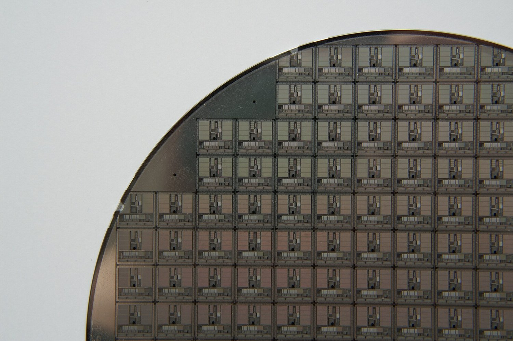
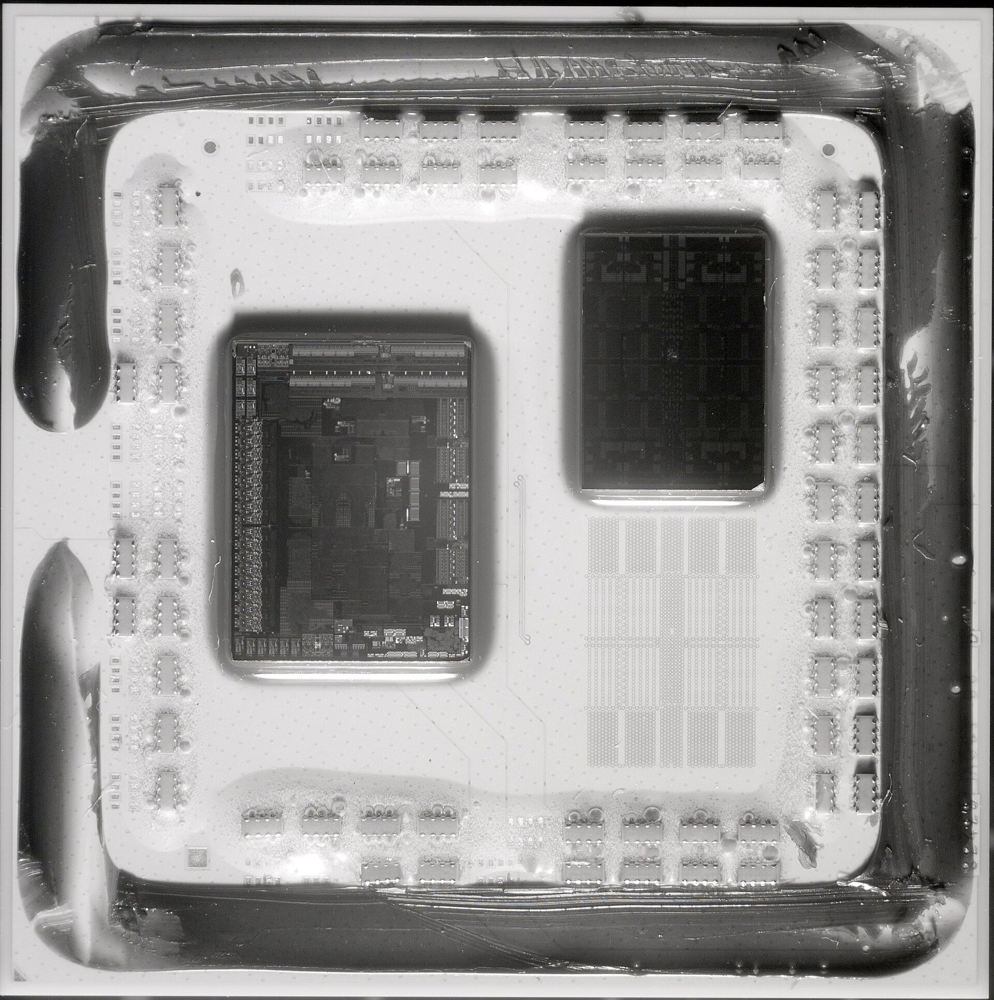
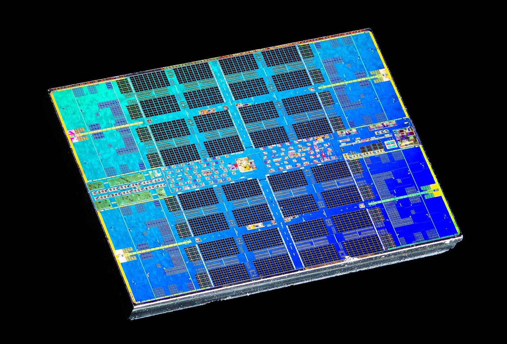
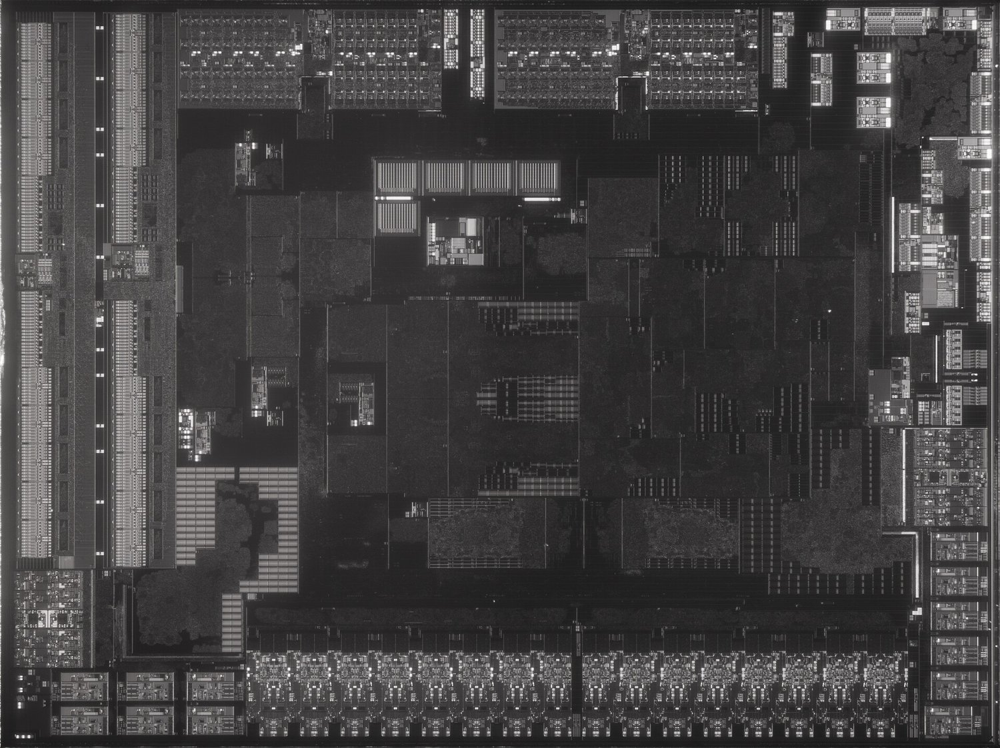
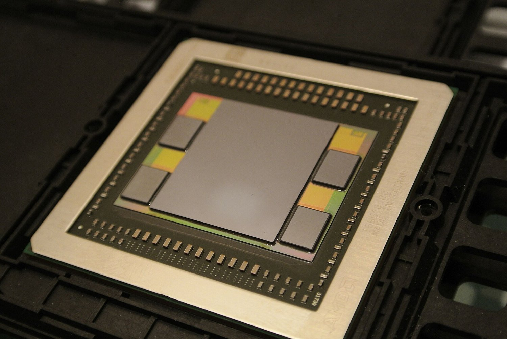
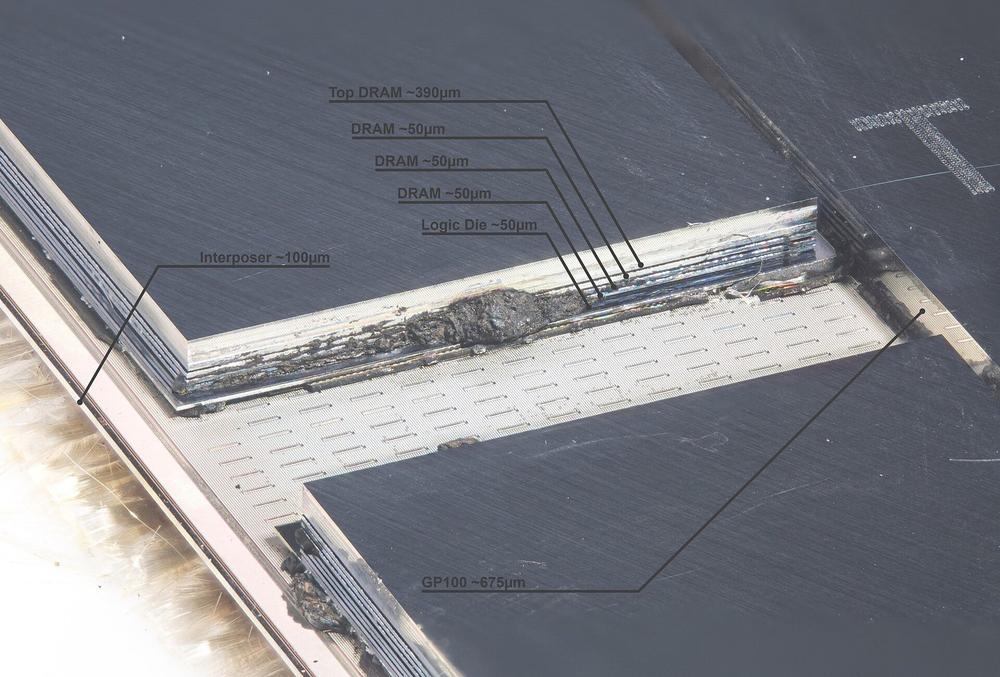

# Chiplet là gì: những mảnh chip nhỏ ghép thành một bộ xử lý lớn

Câu hỏi của bài: vì sao các hãng chip ngừng làm một con chip nguyên khối khổng lồ mà chuyển sang ghép nhiều mảnh nhỏ gọi là chiplet, và điều đó đổi gì cho máy tính, laptop, điện thoại và trí tuệ nhân tạo (AI)?

Bài viết cho người **không học điện**. Mọi thuật ngữ kỹ thuật kèm tiếng Anh ở lần đầu. Bài dùng ba nhãn để bạn biết mức chắc chắn: câu có `[Sn]` là điều nguồn đã nói; **"Ví dụ của người viết"** là hình ảnh so sánh cho dễ hiểu, không phải số liệu; **"Suy luận của người viết"** là kết luận của bài, không phải điều nguồn khẳng định. Các hình trong bài là ảnh thật (chụp chip, wafer, gói chip) lấy từ Wikimedia Commons với giấy phép cho phép dùng lại; tác giả và giấy phép ghi dưới từng hình.

## Tóm tắt nhanh

Chiplet là một mảnh chip nhỏ, mỗi mảnh làm một nhóm việc rõ ràng; nhiều chiplet được ghép trên một tấm nền trong cùng một vỏ để cùng hoạt động như một bộ xử lý lớn [S2]. Hãy hình dung **một khu phố thay vì một tòa nhà chọc trời** (Ví dụ của người viết): thay vì xây mọi thứ vào một khối duy nhất, người ta xây nhiều công trình chuyên dụng rồi nối chúng bằng đường lớn và cầu.

Vì sao làm vậy? Có bốn lý do chính. Một, máy in mạch của nhà máy chip chỉ phơi sáng được một vùng tối đa khoảng 858 mm² mỗi lần, nên chip nguyên khối không thể lớn hơn mức đó [S12]. Hai, chip càng lớn thì càng dễ dính một lỗi chế tạo làm hỏng cả con, nên tỷ lệ chip dùng được (yield) giảm [S11]. Ba, bài báo của AMD năm 2021 cho biết tiến bộ về công nghệ chế tạo đã chậm lại còn chi phí tăng, nên chia nhỏ là cách tiếp tục tăng sức mạnh [S13]. Bốn, không phải phần nào của chip cũng cần công nghệ mới nhất và đắt nhất; phần vào ra dữ liệu có thể làm bằng công nghệ cũ hơn, rẻ hơn [S3].

Chiplet đã có mặt khắp nơi. Vi xử lý AMD Ryzen 3000 (tháng 7 năm 2019) ghép các mảnh lõi với một mảnh vào ra [S3]. Intel Core Ultra thế hệ Meteor Lake (tháng 12 năm 2023) có bốn "tile" chế tạo ở hai hãng khác nhau [S5]. Apple M1 Ultra (2022) ghép hai chip M1 Max thành một [S7]. GPU Blackwell của NVIDIA (2024) ghép hai die cỡ giới hạn máy in mạch, tổng 208 tỷ transistor [S8]. Cái giá phải trả là nhiệt, độ phức tạp khi nối các mảnh và nhu cầu có chuẩn chung cho mảnh của nhiều hãng khác nhau [S2]; chuẩn UCIe sinh ra để giải bài toán cuối [S1].

## Nền tảng: chip, wafer và die

Trước khi nói về chiplet, ta cần ba từ nền: transistor, wafer và die. Phần này là kiến thức nền của người viết, không kèm nguồn riêng ngoài các số liệu ghi rõ.

**Transistor** là công tắc điện cực nhỏ: bật là "1", tắt là "0". Mọi phép tính của máy tính là hàng loạt công tắc bật tắt. Một chip hiện đại chứa hàng tỷ công tắc: M1 Ultra của Apple có 114 tỷ transistor [S7], GPU Blackwell của NVIDIA có 208 tỷ [S8].

**Wafer** (tấm bán dẫn) là một tấm silicon tròn, phẳng, mỏng. Nhà máy không làm từng chip riêng lẻ. Họ in cùng lúc hàng loạt bản sao giống hệt nhau lên một tấm wafer, mỗi bản nằm trong một ô vuông nhỏ. Hình dưới là một tấm wafer thật: bạn thấy lưới các ô giống nhau, mỗi ô là một mạch hoàn chỉnh [S18].

*Hình 1. Một phần tấm wafer chứa nhiều vi xử lý giống nhau (loại SPARC, không phải chip hiện đại). Mỗi ô là một die. Nguồn hình: Ploum's (Wikipedia tiếng Pháp), phạm vi công cộng, Wikimedia Commons [S18].*

**Die** là một ô như vậy sau khi cắt khỏi wafer: một mảnh silicon nhỏ chứa mạch điện. Vì một wafer có kích thước cố định mà một die lớn thì chiếm nhiều chỗ, nên die càng nhỏ thì một wafer cho ra càng nhiều die [S11]. Tiếng Việt thường gọi tắt cả die lẫn chip là "chip", nhưng bài này phân biệt: **die là mảnh silicon trần, chip hay bộ xử lý là sản phẩm đã đóng gói hoàn chỉnh**.

**Package** (gói chip, đóng gói) là phần vỏ và tấm nền cứng bao quanh và nối die với bo mạch. Khi mở nắp tản nhiệt một bộ xử lý, bạn thấy die nằm trên một tấm nền xanh hoặc trắng; đó là package.

**Node** (nút công nghệ) là tên thương mại của một thế hệ công nghệ chế tạo, ví dụ "7 nm" hay "5 nm". Tên càng nhỏ thường là thế hệ càng mới, mạch càng dày đặc và càng đắt; con số là cách đặt tên của ngành, không phải kích thước đo thẳng được. Ví dụ AMD dùng công nghệ 7 nm của hãng TSMC cho mảnh lõi, còn mảnh vào ra dùng 12 nm của GlobalFoundries [S3].

Ví dụ của người viết: tấm wafer giống một khay bánh quy lớn, mỗi ô là một chiếc bánh. Nếu khay có vài hạt tro rơi vào, chiếc bánh nào dính tro thì bỏ. Bánh càng to thì càng dễ dính. Điều này dẫn thẳng đến lý do ra đời của chiplet.

## Vì sao phải chia chip thành nhiều mảnh

**Lý do 1: giới hạn kích thước của máy in mạch.** Mạch được in lên wafer bằng ánh sáng đi qua một khuôn gọi là reticle (mặt nạ quang khắc). Máy chỉ phơi sáng được một vùng giới hạn trong mỗi lần: mức trần này gọi là **reticle limit** (giới hạn khuôn), khoảng 858 mm² [S12]. Nếu muốn mạch lớn hơn, nhà sản xuất phải chia mạch thành nhiều die nhỏ hơn, gọi là chiplet, rồi đóng gói chúng chung với nhau [S12]. NVIDIA cho biết GPU Blackwell có hai die, mỗi die ở sát giới hạn này, ghép thành một GPU duy nhất [S8]. Chuẩn UCIe cũng nêu từ phiên bản 1.0 rằng nó cho phép tạo bộ xử lý lớn hơn kích thước reticle tối đa [S1].

**Lý do 2: yield, tỷ lệ chip dùng được.** Yield là phần trăm die chạy đúng trên mỗi wafer. Một "lỗi sát thủ" (killer defect) là một hạt bụi hay khuyết tật đủ nhỏ để làm hỏng hoàn toàn die mà nó rơi vào [S11]. Die nhỏ có diện tích bé hơn nên ít khả năng dính lỗi hơn; một wafer cho ra nhiều die nhỏ hơn, mà cả wafer được xử lý và tính giá như nhau, nên die nhỏ rẻ hơn [S11]. Nguồn nêu ví dụ từ các chip thử nghiệm 5 nm của TSMC: yield trung bình khoảng 80% với die 17,92 mm², nhưng chỉ còn 32% khi die 100 mm² [S11]. Đây là chip thử nghiệm, không phải con số của một sản phẩm bán ra, nhưng nó cho thấy chiều hướng rất rõ: tăng diện tích thì yield giảm nhanh.

*Ví dụ của người viết, dùng số giả định để hình dung.* Giả sử một wafer bị rơi 6 hạt bụi. Nếu wafer được cắt thành 12 die lớn, trường hợp xấu nhất là 6 die hỏng, chỉ còn 6 trên 12 dùng được (50%). Nếu cắt thành 48 die nhỏ, 6 hạt bụi vẫn chỉ làm hỏng tối đa 6 die, còn ít nhất 42 trên 48 dùng được (87,5%). Một bộ xử lý ghép từ bốn die nhỏ chỉ bỏ đi die bị hỏng, không phải bỏ cả khối lớn. Các con số này là giả định để minh họa, không phải số đo của hãng nào.

**Lý do 3: tiến bộ chậm lại và chi phí tăng.** Bài báo của nhóm kỹ sư AMD tại hội nghị ISCA 2021 nói rằng mật độ transistor từng tăng gấp đôi sau mỗi 18 đến 24 tháng (cái người ta gọi là định luật Moore, Moore's Law), nhưng nhịp cải tiến công nghệ gần đây đã chậm lại, trong khi chi phí sản xuất tăng; ngành vì thế chuyển hướng khỏi tích hợp ngày càng nhiều thứ vào một die [S13]. Bài này chỉ đọc được phần tóm tắt của bài báo (xem mục chưa chắc chắn).

**Lý do 4: không phải phần nào cũng cần công nghệ mới nhất.** Lõi tính toán hưởng lợi nhiều nhất từ công nghệ mới, còn các mạch vào ra dữ liệu (nói chuyện với bộ nhớ, ổ cứng, cổng USB) thì kém lợi hơn, nên làm ở công nghệ cũ hơn cho rẻ. AMD làm đúng như vậy: mảnh lõi 7 nm, mảnh vào ra 12 nm hoặc 14 nm [S3][S4]. Intel cũng dùng cho tấm nền Foveros của Meteor Lake một công nghệ cũ giá rẻ vì tấm này chỉ cần dẫn tín hiệu giữa các mảnh, không chạy logic phức tạp [S5].

Suy luận của người viết: bốn lý do cộng hưởng. Một mình giới hạn 858 mm² đã buộc chip cực lớn như GPU cho AI phải chia nhỏ; một mình yield và chi phí đã đủ khiến chip máy tính thông thường nên chia nhỏ.

## Chiplet là gì

**Định nghĩa.** Chiplet là một mạch tích hợp rất nhỏ với một nhóm chức năng được xác định rõ; nhiều chiplet được ghép trên một tấm nền gọi là interposer (tấm trung gian) trong cùng một package để tạo thành một linh kiện phức tạp như bộ xử lý [S2]. Từ "chiplet" do giáo sư John Wawrzynek của Đại học California, Berkeley đặt năm 2006 trong dự án RAMP [S2].

Ví dụ của người viết: nếu chip nguyên khối là một tòa nhà chọc trời, nơi bếp, kho, phòng họp và thang máy đều phải xây cùng một lúc bằng cùng một vật liệu, thì chiplet là một khu phố. Mỗi công trình chuyên dụng được xây ở xưởng phù hợp rồi nối bằng đường đi. Muốn thêm kho thì thêm một công trình, không phải đập xây lại cả tòa nhà.

**Chiplet khác "chip" thường ở chỗ nào?** Chiplet không dùng được một mình: nó thiếu phần liên lạc với bên ngoài hoặc thiếu một phần chức năng, nên cần được đóng gói cùng các chiplet khác. Các hãng có tên gọi riêng: AMD gọi mảnh lõi là CCD (Core Complex Die) và mảnh vào ra là IOD (I/O Die) [S3]; Intel gọi là **tile** (ô) [S5]. Bài này dùng "chiplet" và "tile" như nhau khi nói chung.

**Chip nguyên khối và chip chiplet.** Chip nguyên khối (monolithic die) đặt mọi chức năng lên một die duy nhất: đơn giản để ghép nối bên trong nhưng bị giới hạn kích thước và chịu yield thấp nếu lớn. Chip chiplet chia chức năng ra nhiều die, mỗi die chọn công nghệ riêng và được kiểm tra trước khi ghép; đổi lại, phải nối các die bằng các đường rất dày và nhanh [S2].

**Ba điều chiplet mang lại, theo nguồn.** Thứ nhất là dùng lại thiết kế (reusable IP, tài sản thiết kế): cùng một chiplet có thể dùng trong nhiều sản phẩm. Thứ hai là tích hợp không đồng nhất (heterogeneous integration): các chiplet có thể dùng quy trình, vật liệu và node khác nhau, mỗi cái tối ưu cho việc của nó. Thứ ba là **known good die** (die đã kiểm tra tốt): chiplet được thử trước khi ráp, nên cải thiện tỷ lệ sản phẩm cuối dùng được [S2].

**Mốc thời gian.** Từ "chiplet" ra đời năm 2006 [S2]. Chuẩn bộ nhớ HBM được JEDEC thông qua tháng 10 năm 2013 [S10]. GPU AMD Fiji, cạnh bộ nhớ HBM trên một interposer, ra mắt tháng 6 năm 2015 [S10]. Cầu nối EMIB của Intel sản xuất hàng loạt từ 2017 và công nghệ xếp tầng Foveros từ 2019 [S6]. AMD Ryzen 3000 và EPYC Rome ra mắt tháng 7 và tháng 8 năm 2019 [S3]. Chuẩn UCIe được một nhóm doanh nghiệp công bố vào tháng 3 năm 2022 [S15], cùng tháng Apple giới thiệu M1 Ultra [S7]. Tháng 12 năm 2023 có Meteor Lake [S5] và AMD MI300A [S9]. NVIDIA công bố Blackwell ngày 18 tháng 3 năm 2024 [S8].

## Chiplet gồm những mảnh nào

Một bộ xử lý chiplet không phải một khối đồng nhất; nó là một tập các mảnh với vai trò khác nhau, cộng với phần nối chúng lại. Dưới đây là các loại mảnh thường gặp.

**Mảnh tính toán (compute die).** Chứa các lõi CPU, nơi thực thi chương trình. Ở AMD Zen 2, mảnh lõi CCD làm bằng công nghệ 7 nm của TSMC, diện tích khoảng 74 đến 80 mm², chứa 8 lõi chia thành hai nhóm bốn lõi (CCX) và khoảng 3,8 tỷ transistor [S3]. Ở Meteor Lake, tile tính toán của Intel làm bằng công nghệ Intel 4 và có tối đa 6 lõi hiệu năng cao cùng 8 lõi tiết kiệm điện [S5].

**Mảnh vào ra (I/O die hoặc SoC tile).** Lo việc nói chuyện với thế giới bên ngoài: bộ nhớ, đường PCIe, cổng kết nối. Mảnh I/O của Ryzen 3000 rộng khoảng 125 mm², có 2,09 tỷ transistor, làm bằng công nghệ 12 nm của GlobalFoundries; EPYC Rome dùng bản 14 nm [S3][S4]. Ở Meteor Lake, tile SoC (system on chip, hệ thống trên một chip) là trung tâm luôn bật chứa bộ điều khiển bộ nhớ, màn hình, bộ xử lý đa phương tiện và lõi tiết kiệm điện; tile IOE bổ sung thêm đường PCIe 5.0 [S5].

**Mảnh đồ họa (graphics tile, GPU die).** Tính toán hình ảnh và song song. Meteor Lake có tile đồ họa với tối đa 8 lõi Xe-LPG, làm bằng công nghệ N5 của TSMC [S5]. Ở GPU AI AMD Instinct MI300X, tám mảnh XCD làm nhiệm vụ này [S9].

**Mảnh nhớ đệm (cache die).** Bộ nhớ đệm là nơi chứa dữ liệu dùng gần đây để lấy cho nhanh. Ryzen 7 5800X3D có 96 MB bộ nhớ đệm L3, gồm 32 MB sẵn trên mảnh lõi cộng một mảnh SRAM 64 MB xếp chồng lên trên [S14].

**Chồng bộ nhớ HBM.** Nhiều lớp bộ nhớ DRAM xếp thẳng đứng, nối nhau bằng các lỗ dẫn xuyên silicon, đặt ngay cạnh GPU hoặc CPU [S10]. Có một mục riêng ở phần sau.

**Tấm nối: interposer, cầu nối và tile nền.** Interposer là tấm silicon mỏng nằm dưới các mảnh và chứa đường dây dày đặc nối chúng [S2]. Intel có tile nền làm bằng công nghệ cũ chỉ để dẫn tín hiệu [S5], và cầu EMIB là một mẩu silicon nhúng trong tấm nền để nối mép của hai die kề nhau [S6].

**Tấm nền và đầu nối ra ngoài.** Dưới cùng là substrate (đế gói chip) nối cả cụm ra bo mạch chủ. Phần này là kiến thức nền của người viết.

*Hình 2. Gói bộ xử lý AMD Ryzen 5 3600 (Zen 2, Matisse) chụp bằng hồng ngoại, nhìn xuyên lớp keo: die lớn bên trái là die I/O, mảnh nhỏ phía trên bên phải là chiplet lõi (CCD) 7 nm, theo mô tả của tác giả ảnh. Các chấm nhỏ xung quanh là linh kiện trên tấm nền. Nguồn hình: Fritzchens Fritz, CC0, Wikimedia Commons [S16].*

*Hình 3a. Die lõi CCD của Zen 2 (Matisse) 7 nm, ảnh phóng đại màu: các khối đều đặn là bộ nhớ đệm và lõi. Nguồn hình: Fritzchens Fritz, CC0, Wikimedia Commons (Zen2 Matisse Ryzen 7nm Core Die shot).*

*Hình 3b. Die I/O (IOD) của Ryzen 5 3600 chụp hồng ngoại: nhiều khối kích thước khác nhau (bộ điều khiển bộ nhớ, cổng) chứ không phải các lõi giống nhau. Tác giả ghi diện tích khoảng 124,94 mm². Nguồn hình: Fritzchens Fritz, CC0, Wikimedia Commons (IOD Infrared).*

Điểm đáng chú ý khi xem hai hình trên: hai die trông hoàn toàn khác nhau. Mảnh lõi có cấu trúc lặp đều đặn vì là các lõi giống nhau; mảnh I/O là hỗn hợp nhiều loại mạch. Chiplet cho phép tách riêng hai loại mạch khác tính chất này.

## Cách ghép các mảnh: đóng gói 2D, 2.5D và 3D

Các mảnh phải được nối với nhau. Cách nối gọi là **advanced packaging** (đóng gói tiên tiến). Có ba kiểu chính.

**Đóng gói 2D (đặt cạnh nhau trên tấm nền hữu cơ).** Các die nằm cạnh nhau trên cùng một tấm nền, tín hiệu đi qua các đường dây trong tấm nền. Đây là cách AMD Zen 2 dùng trong ảnh hồng ngoại ở Hình 2: hai die kề nhau trên một tấm nền. Nguồn tổng quan nêu hai công nghệ đóng gói thường gặp là 2.5D trên tấm nền hữu cơ và xếp chồng 3D, với bước chân tiếp xúc (bump pitch) từ 25 µm đến 130 µm [S2]. Chuẩn UCIe nêu cả ba kiểu đóng gói 2D, 2.5D và 3D [S1].

**Đóng gói 2.5D (đặt cạnh nhau trên tấm silicon hoặc cầu nối).** Các die vẫn nằm cạnh nhau, nhưng bên dưới có một interposer bằng silicon, tức một tấm silicon có đường dây rất mịn và dày, hoặc một cầu nối silicon nhỏ nằm chôn trong tấm nền. Vì đường dây trong silicon mịn hơn nhiều so với trong tấm nền hữu cơ nên số tín hiệu nhiều hơn và đi gần hơn. Gói GPU AMD Fiji ở Hình 4 là ví dụ thật: một GPU ở giữa và bốn chồng HBM quanh nó cùng đặt trên một interposer [S10]. Intel nêu hai nhánh: **EMIB** (Embedded Multi-die Interconnect Bridge) là cầu nối silicon nhúng trong tấm nền nối mép với mép các die, sản xuất hàng loạt từ 2017; **Foveros-S** dùng interposer silicon cỡ 4 lần reticle đặt trên một die nền chủ động, sản xuất hàng loạt từ 2019 [S6]. Apple UltraFusion nối hai die M1 Max bằng một interposer silicon với hơn 10.000 tín hiệu [S7]. AMD Instinct MI300 dùng công nghệ CoWoS và InFO của TSMC để ghép nhiều chiplet lên một interposer [S9].

*Hình 4. Gói GPU AMD Fiji (Radeon R9 Fury X): GPU ở giữa, bốn chồng bộ nhớ HBM xung quanh, tất cả trên một interposer. Nguồn hình: C. Spille/pcgameshardware.de, CC BY-SA 4.0, Wikimedia Commons (https://commons.wikimedia.org/wiki/File:AMD_Fiji_GPU_package_with_GPU,_HBM_memory_and_interposer.jpg). Việc Fiji là GPU đầu tiên dùng HBM, ra mắt tháng 6 năm 2015, lấy từ [S10].*

**Đóng gói 3D (xếp chồng).** Các die được chồng lên nhau theo chiều dọc như tầng nhà. Đường dây xuyên qua die bằng các lỗ dẫn xuyên silicon gọi là **TSV** (through-silicon via) [S10]. Intel **Foveros Direct 3D** xếp chiplet lên một die nền chủ động bằng liên kết đồng với đồng (Cu-to-Cu **hybrid bonding**, liên kết lai), được hãng nói là cho băng thông rất cao với điện năng thấp [S6]. Ví dụ ở thị trường máy tính cá nhân: AMD 3D V-Cache đặt một mảnh bộ nhớ đệm lên trên mảnh lõi, nối bằng liên kết đồng trực tiếp và TSV, và hệ điều hành thấy 96 MB L3 như một khối bộ nhớ duy nhất [S14]. Chuẩn UCIe-3D được tối ưu cho hybrid bonding, bước chân từ 10 đến 25 µm xuống còn 1 µm hoặc nhỏ hơn [S1].

**Kết hợp: EMIB 3.5D.** Intel ghép cầu nối EMIB với xếp chồng Foveros trong một gói; ví dụ là Intel Data Center GPU Max, với hơn 100 tỷ transistor, 47 tile hoạt động và 5 công nghệ chế tạo khác nhau [S6].

Ví dụ của người viết: 2D là các cửa hàng nằm cạnh nhau trên cùng một con phố; 2.5D là các cửa hàng đó đứng trên một vỉa hè chung được lát tinh xảo để đi lại giữa chúng thật nhanh; 3D là một trung tâm thương mại nhiều tầng có thang máy xuyên các tầng.

## Cách các mảnh nói chuyện: UCIe và các chuẩn nối

Khi các mảnh do một hãng làm, hãng đó tự quy ước cách nối (như Apple UltraFusion [S7] hay NVIDIA nêu liên kết 10 TB/s giữa hai die Blackwell [S8]). Nhưng nếu mảnh của nhiều hãng khác nhau muốn chung một gói, họ cần một "ngôn ngữ chung". Nguồn tổng quan nói rằng việc liên lạc băng thông cao đáng tin cậy giữa die của các nhà sản xuất khác nhau vẫn là một bài toán kỹ thuật chưa giải xong [S2].

**UCIe (Universal Chiplet Interconnect Express)** là chuẩn mở để giải bài toán đó. Nó định nghĩa lớp vật lý của đường nối giữa các die, các giao thức và bộ phần mềm, xây trên nền PCIe và CXL, kèm kiểm thử tuân thủ để mảnh của nhiều hãng có thể ráp chung vào một SoC [S1]. Một nhóm doanh nghiệp công bố chuẩn này tháng 3 năm 2022 [S15].

Ví dụ của người viết: UCIe giống ổ cắm điện chuẩn. Nhờ ổ chuẩn, thiết bị của nhiều hãng cùng cắm được vào một ổ; nếu mỗi hãng một đầu cắm riêng thì chỉ bộ sản phẩm cùng hãng dùng được với nhau.

**Các phiên bản UCIe, theo trang của chuẩn** [S1]. Phiên bản 1.0 là nền tảng: lớp vật lý, giao thức, mô hình phần mềm, kiểm thử tuân thủ, cho phép bộ xử lý lớn hơn kích thước reticle tối đa. Phiên bản 1.1 mở rộng cơ chế tin cậy sang nhiều giao thức hơn, bổ sung giám sát và sửa lỗi lúc chạy cho xe cộ và hệ thống đòi hỏi độ tin cậy cao, và thêm sơ đồ chân mới cho đóng gói chi phí thấp hơn. Phiên bản 2.0 thêm các tính năng quản lý, kiến trúc kiểm thử, đo từ xa và gỡ lỗi (UDA), và hỗ trợ đóng gói 3D (UCIe-3D). Phiên bản 3.0 thêm tốc độ 48 GT/s và 64 GT/s (gấp đôi 32 GT/s của 2.0) và mở rộng kênh phụ lên 100 mm; trang chuẩn nêu 3.0 tương thích ngược với mọi phiên bản trước [S1]. GT/s (gigatransfer mỗi giây) là số tỷ lần truyền dữ liệu trên mỗi đường trong một giây.

**Các chuẩn khác.** Ngoài UCIe, nguồn tổng quan còn nêu Bunch of Wires (BoW), AIB (Advanced Interface Bus), OpenHBI và OIF XSR [S2]. Các hãng lớn cũng có liên kết riêng không công khai như UltraFusion của Apple [S7].

Suy luận của người viết: chuẩn chung chỉ phát huy tác dụng khi nhiều hãng chịu ráp mảnh của nhau. Đến nay, các sản phẩm phổ biến nhất mà bài này đọc được (Ryzen, EPYC, Meteor Lake, M1 Ultra) đều ghép các mảnh do chính một hãng thiết kế [S3][S5][S7]; bài không có nguồn về tỷ lệ sản phẩm dùng UCIe ngoài thị trường.

## Công dụng: chiplet giúp được gì

**1. Chip lớn hơn giới hạn của máy in mạch.** Ghép nhiều die lại cho phép tổng diện tích silicon vượt xa mức 858 mm² của một die [S12]. Blackwell dùng hai die ở sát giới hạn và nói chuyện với nhau ở 10 TB/s [S8].

**2. Giảm rủi ro hỏng và tiết kiệm.** Die nhỏ ít dính lỗi hơn, rẻ hơn mỗi die [S11], và die đã kiểm tra mới được ráp (known good die) [S2].

**3. Mỗi phần dùng công nghệ phù hợp.** AMD đặt mảnh lõi trên công nghệ 7 nm của TSMC và mảnh vào ra trên công nghệ cũ hơn của GlobalFoundries [S3]. Meteor Lake dùng bốn công nghệ: Intel 4 cho tile tính toán, N5 của TSMC cho đồ họa, N6 của TSMC cho SoC và IOE, và công nghệ Intel 22FFL (Intel 16) cho tile nền [S5].

**4. Dùng lại cùng một mảnh để tạo nhiều sản phẩm.** EPYC Rome dùng tối đa 8 chiplet lõi cộng một mảnh I/O để có tối đa 64 lõi [S4]; EPYC Genoa dùng 12 chiplet lõi 8 lõi để có tối đa 96 lõi [S4]. Cùng kiểu "viên gạch", chỉ đổi số lượng. Chiplet cho phép tái dùng thiết kế trong nhiều thiết bị [S2]. Suy luận của người viết: nhờ vậy việc ra sản phẩm mới nhanh và rẻ hơn thiết kế lại một chip lớn từ đầu; bài không có nguồn đo mức tiết kiệm cụ thể.

**5. Nối gần nên nhanh và tiết kiệm điện.** Apple nói nối hai die trên cùng một interposer cho độ trễ thấp, băng thông cao, công suất tiêu thụ thấp hơn so với nối chip qua bo mạch chủ; UltraFusion đạt 2,5 TB/s, và Apple cho rằng cao hơn hơn 4 lần so với công nghệ kết nối nhiều chip hàng đầu [S7]. Đây là phát biểu của nhà sản xuất, chưa có đối chiếu độc lập trong bài.

**6. Phần mềm không phải viết lại.** Apple cho biết UltraFusion cho phép phần mềm coi hai die như một chip, nên nhà phát triển không cần sửa mã [S7]. Tương tự, trên 5800X3D hệ điều hành thấy 96 MB L3 trong suốt, không cần cấu hình đặc biệt [S14].

**7. Bộ nhớ ở ngay sát bộ xử lý.** HBM đặt cạnh GPU hoặc CPU trên interposer rút ngắn đường dữ liệu và cho phép bus rất rộng [S10].

## HBM: bộ nhớ xếp tầng cạnh chip

HBM (High Bandwidth Memory, bộ nhớ băng thông cao) là một loại bộ nhớ DRAM xếp nhiều lớp theo chiều thẳng đứng, phát triển bởi Samsung, AMD và SK Hynix; các lớp nối nhau bằng TSV và các chân tiếp xúc cực nhỏ (microbump), và cả chồng thường nối với GPU hay CPU qua một interposer silicon [S10].

**Vì sao cần HBM.** Bộ xử lý mạnh mà bộ nhớ trả dữ liệu chậm thì phải chờ. Xếp bộ nhớ thành tầng và đặt sát bộ xử lý rút ngắn đường đi, đồng thời cho phép một bus rất rộng: mỗi chồng HBM có giao diện 1024 bit (HBM4 gấp đôi, 2048 bit), băng thông HBM3 khoảng 819 GB/s mỗi chồng với tốc độ 6,4 Gb/s mỗi chân [S10]. Nguồn nhận định HBM cho băng thông cao hơn DDR4 hay GDDR5 với điện năng thấp hơn trong hình dạng nhỏ gọn hơn nhiều [S10].

Ví dụ của người viết: bộ nhớ thường giống kho ở ngoại ô, xe tải chạy đường dài mỗi lần chở được ít; HBM giống kho cao tầng xây ngay cạnh nhà máy, với con đường cực rộng nối thẳng vào cổng.

**Mặt cắt thật của một chồng HBM.** Hình dưới là một Tesla P100 của NVIDIA bị mài để lộ mặt cắt. Tác giả ghi nhãn: một đế logic (Logic Die, khoảng 50 µm) và các lớp DRAM mỏng khoảng 50 µm, lớp DRAM trên cùng dày khoảng 390 µm; interposer dày khoảng 100 µm, còn die GPU GP100 dày khoảng 675 µm [S17]. Phần ghi chú của tác giả cũng nêu interposer rộng khoảng 1166 mm², còn die GP100 khoảng 618 mm² [S17]. Nghĩa là mỗi lớp DRAM mỏng cỡ một sợi tóc (so sánh theo kiến thức nền của người viết), và cả cụm nằm trên một interposer có diện tích gần gấp đôi die GPU.

*Hình 5. Mặt cắt một chồng HBM cạnh die GP100 trên NVIDIA Tesla P100, có ghi độ dày từng lớp. Nguồn hình: Fritzchens Fritz, CC0, Wikimedia Commons [S17].*

**HBM trong sản phẩm hiện nay.** AMD Instinct MI300X có 192 GB HBM3 với bus 8192 bit và băng thông 5300 GB/s; MI300A có 128 GB [S9].

## Ứng dụng thực tế: máy tính và laptop

**AMD Ryzen và EPYC: nhà tiên phong đại chúng.** Dòng Ryzen 3000 trên nền Zen 2 (ra mắt 7 tháng 7 năm 2019) có bản 16 lõi (Ryzen 9 3950X, tháng 11 năm 2019), và EPYC Rome (7 tháng 8 năm 2019) có tối đa 64 lõi mỗi ổ cắm [S3]. Mỗi CCD có 8 lõi chia hai nhóm bốn lõi, cùng một mảnh vào ra [S3]. EPYC Rome có tối đa 8 chiplet lõi 7 nm cộng một die I/O 14 nm; thế hệ Genoa (Zen 4) tối đa 96 lõi với 12 chiplet [S4]. Nguồn tổng quan cũng nêu Ryzen dòng Zen 2 trở đi (không kể APU) là ví dụ chiplet [S2]. Ví dụ ảnh thật ở Hình 2 và 3 ở phần trước.

**Intel Meteor Lake (Core Ultra, 2023): bốn tile, hai nhà máy.** Intel công bố Meteor Lake ngày 19 tháng 9 và chính thức ra mắt ngày 14 tháng 12 năm 2023. Chip gồm tile tính toán (Intel 4, công nghệ Intel đầu tiên dùng quang khắc cực tím EUV), tile đồ họa (TSMC N5), tile SoC (TSMC N6) và tile IOE (TSMC N6), tất cả đặt trên một tile nền Foveros làm bằng công nghệ Intel 22FFL [S5]. Nghĩa là chip của Intel được làm ở hai hãng khác nhau, điều khó nếu là chip nguyên khối.

**AMD 3D V-Cache (Ryzen 7 5800X3D).** Mảnh SRAM 64 MB xếp lên trên mảnh lõi, cộng 32 MB có sẵn thành 96 MB L3; hai mảnh nối bằng liên kết đồng trực tiếp và TSV, còn phần trống bên cạnh được lấp bằng silicon cấu trúc để dẫn nhiệt lên tản nhiệt [S14]. Ví dụ của người viết: thay vì mở rộng ngôi nhà ra sân, họ xây thêm một tầng.

**Apple M1 Ultra (2022).** UltraFusion nối hai die M1 Max qua một interposer silicon với hơn 10.000 tín hiệu, băng thông 2,5 TB/s, thành SoC 114 tỷ transistor mà phần mềm coi như một chip [S7]. Đây là ví dụ cho thấy chiplet không chỉ có ở máy chủ mà còn ở máy tính cá nhân cao cấp.

## Ứng dụng thực tế: AI và trung tâm dữ liệu

**Vì sao AI cần chiplet.** Suy luận của người viết: huấn luyện và chạy mô hình AI cần rất nhiều phép tính song song và lượng dữ liệu lớn chuyển qua lại liên tục; vì thế chip AI vừa cần diện tích silicon lớn vừa cần bộ nhớ rất lớn và rất nhanh. Cả hai đều là thế mạnh của chiplet cộng HBM [S8][S9][S10]. Phần dưới nêu các sản phẩm thật.

**NVIDIA Blackwell (công bố 18 tháng 3 năm 2024).** NVIDIA nói GPU Blackwell có 208 tỷ transistor, chế tạo bằng quy trình TSMC 4NP tùy chỉnh, gồm hai die đạt giới hạn reticle ghép thành một GPU duy nhất, nối nhau bằng liên kết chip-to-chip 10 TB/s [S8].

**AMD Instinct MI300.** MI300A có 6 chiplet đồ họa XCD và 3 chiplet CPU Zen 4 (CCD); MI300X có 8 chiplet XCD. Hai bản có khoảng 146 tỷ và 153 tỷ transistor, bộ nhớ HBM3 128 GB và 192 GB, ghép bằng công nghệ CoWoS và InFO của TSMC trên một interposer; MI300A ra mắt ngày 6 tháng 12 năm 2023 [S9].

**Intel Data Center GPU Max.** Kết hợp EMIB và Foveros (EMIB 3.5D), có hơn 100 tỷ transistor, 47 tile hoạt động và 5 công nghệ chế tạo [S6].

**Máy chủ đám mây.** EPYC với nhiều chiplet lõi mỗi ổ cắm, tới 64 lõi ở Rome và 96 lõi ở Genoa [S4]. Nguồn tổng quan nêu thị trường chính của chiplet hiện là máy tính hiệu năng cao và trung tâm dữ liệu [S2].

Suy luận của người viết: tất cả các ví dụ có chung công thức "nhiều die tính toán + HBM trên một interposer hoặc cầu nối". Bài không có nguồn so sánh trực tiếp hiệu năng các chip này với chip nguyên khối giả định.

## Thách thức và cái giá của chiplet

**1. Nhiệt.** Đặt nhiều die sát nhau trên một gói tạo mật độ công suất rất cao, đòi hỏi làm mát tiên tiến [S2]. Xếp chồng 3D làm khó hơn vì die dưới bị che; AMD lấp chỗ trống cạnh mảnh cache bằng silicon cấu trúc để dẫn nhiệt [S14].

**2. Ghép nối giữa các hãng.** Liên lạc băng thông cao, tin cậy giữa die của các nhà sản xuất khác nhau là bài toán chưa giải xong [S2]. UCIe nhắm giải bài toán này nhưng chuẩn mới đi vào bản 3.0 [S1].

**3. Phải trả thêm cho phần nối.** Suy luận của người viết: các mảnh phải có mạch giao tiếp ở rìa và đường dây giữa chúng, nên một chip chiplet tốn thêm diện tích silicon và điện so với một die nguyên khối cùng chức năng. Bài không có số đo đã kiểm của mức chi phí này.

**4. Đóng gói phức tạp.** Có nhiều biến thể công nghệ: EMIB, Foveros-S, Foveros-R, Foveros Direct, EMIB 3.5D chỉ riêng Intel [S6], chưa kể CoWoS và InFO của TSMC [S9]. Mỗi biến thể có yêu cầu thiết kế riêng. Bước chân tiếp xúc nhỏ (25 đến 130 µm, hay 1 µm trở xuống ở UCIe-3D) đòi hỏi độ chính xác cực cao [S2][S1].

**5. Phụ thuộc vào năng lực đóng gói.** Suy luận của người viết: vì tiến bộ nằm ở khâu đóng gói, khâu này có thể trở thành điểm nghẽn của chuỗi cung ứng; bài không đọc nguồn nào đo được độ nghẽn đó.

Cân nhắc tổng thể: chiplet đổi các khó khăn của việc làm một die khổng lồ lấy các khó khăn của việc nối nhiều die. Ngành chọn cách thứ hai vì với các chip lớn nhất, cách đầu tiên không còn khả thi [S12][S8].

## Tương lai của chiplet

**Nối nhanh hơn và chuẩn hóa hơn.** UCIe 3.0 đã nâng tốc độ lên 48 và 64 GT/s và thêm cải tiến tiết kiệm điện; một bản bổ sung riêng (ECN) thêm tính năng bảo mật và quản lý [S1]. HBM4 nhân đôi độ rộng bus lên 2048 bit [S10].

**Xếp chồng ngày càng mịn.** UCIe-3D nhắm bước chân 1 µm hoặc nhỏ hơn bằng hybrid bonding [S1]; Intel nêu Foveros Direct 3D dùng liên kết Cu-to-Cu và có thể kết hợp với EMIB thành 3.5D [S6]; Foveros-R dùng lớp đi dây thay cho interposer silicon để rẻ hơn cho mảng máy tính cá nhân và các phân khúc nhạy giá [S6].

**Từ sản phẩm một hãng sang hệ sinh thái.** Mục tiêu của UCIe là cho phép chiplet của nhiều nhà cung cấp cùng ráp vào một SoC [S1]. Suy luận của người viết: nếu mục tiêu này thành hiện thực, một nhà thiết kế nhỏ có thể mua sẵn chiplet kiểm tra tốt (đồ họa, bộ nhớ, truyền thông) thay vì tự thiết kế cả chip, như cách người ta mua sẵn linh kiện để lắp máy. Điều này chưa được nguồn nào của bài xác nhận là đã xảy ra rộng rãi.

**Ranh giới của việc dự báo.** Các nguồn của bài chỉ nêu những gì đã công bố; bài không dự đoán thị phần hay thời điểm một công nghệ phổ biến.

## Điểm chưa chắc chắn và hạn chế của dữ liệu

- **Số liệu sản phẩm** (số lõi, transistor, băng thông, diện tích) lấy từ trang nhà sản xuất hoặc Wikipedia, không đối chiếu với tài liệu kỹ thuật gốc. Apple và NVIDIA nêu băng thông và so sánh về sản phẩm của chính họ; bài không kiểm chứng độc lập.
- **S13** (bài ISCA 2021 của AMD): bài chỉ đọc được thông tin thư mục và phần tóm tắt qua kết quả tìm kiếm, chưa đọc toàn văn. Các ý về động cơ (tiến bộ chậm, chi phí tăng) là từ tóm tắt.
- **S14** (đánh giá Ryzen 7 5800X3D) và **S15** (tin HPCwire về UCIe) chỉ đọc được đoạn trích trong kết quả tìm kiếm; trang UCIe đã đọc đầy đủ là S1. Bài không liệt kê danh sách thành viên sáng lập UCIe vì chưa đọc từ nguồn gốc.
- **Ví dụ yield** với 6 hạt bụi và 12 hay 48 die là số giả định của người viết. Con số 80% và 32% của TSMC 5 nm là chip thử nghiệm theo mô tả của Wikipedia [S11], không phải yield của sản phẩm bán ra.
- **Nút công nghệ của die I/O.** Wikipedia ghi Ryzen 3000 dùng die I/O 12 nm của GlobalFoundries, EPYC Rome dùng bản 14 nm [S3][S4]; ảnh hồng ngoại Ryzen 5 3600 trên Commons có tên tệp ghi 12 nm nhưng mô tả ghi 14 nm [S16]. Bài dùng số của Wikipedia và không khẳng định thêm.
- **Meteor Lake:** nguồn lệch nhau về vị trí bộ xử lý thần kinh (NPU) nên bài không nêu. Wikipedia ghi kích thước tile tính toán 69,67 mm² ở bảng và 73,87 mm² ở phần chữ [S5]; bài không dùng số này.
- **Không có nguồn đọc được** cho: yield thật của sản phẩm cụ thể, chi phí đóng gói, mức hao thêm diện tích do phần nối, chuỗi cung ứng đóng gói. Các ý này nếu có là Suy luận của người viết.
- **Ảnh minh họa:** ảnh wafer là loại vi xử lý SPARC cũ [S18], dùng để minh họa khái niệm wafer và die, không phải wafer của chip hiện đại. Các ảnh Ryzen, Fiji và Tesla P100 là sản phẩm thật nhưng thuộc các thế hệ khác nhau.

## Điều cần nhớ

1. Chiplet là mảnh chip nhỏ, mỗi mảnh một nhóm việc, ghép chung trong một gói thành bộ xử lý lớn [S2].
2. Lý do chính: máy in mạch giới hạn khoảng 858 mm² [S12], die lớn thì yield thấp [S11], và mỗi phần của chip nên dùng công nghệ riêng [S3].
3. Các mảnh thường gặp: mảnh tính toán, mảnh vào ra, mảnh đồ họa, mảnh nhớ đệm, chồng HBM và tấm nối [S3][S5][S10][S14].
4. Ba kiểu ghép: 2D (cạnh nhau trên tấm nền), 2.5D (trên interposer hoặc cầu nối) và 3D (xếp chồng bằng TSV và hybrid bonding) [S2][S6].
5. UCIe là chuẩn mở để mảnh của nhiều hãng nói chuyện với nhau; hiện ở phiên bản 3.0 [S1].
6. Ứng dụng thật: AMD Ryzen/EPYC [S3][S4], Intel Meteor Lake [S5], Apple M1 Ultra [S7], NVIDIA Blackwell [S8], AMD MI300 [S9]; cái giá là nhiệt, nối giữa các hãng và đóng gói phức tạp [S2][S6].

## Thuật ngữ Việt-Anh

- Chiplet, tile (mảnh chip, ô): mảnh chip nhỏ một chức năng, ghép trong gói chung [S2][S5].
- Die (mảnh silicon trần): một ô cắt khỏi wafer, chứa mạch [S11].
- Wafer (tấm bán dẫn): tấm silicon tròn mỏng để in hàng loạt die [S18].
- Package (gói chip, đóng gói): vỏ và tấm nền bao quanh, nối die ra bo mạch [S2].
- Yield (tỷ lệ chip dùng được): phần trăm die chạy đúng trên một wafer [S11].
- Reticle limit (giới hạn khuôn): diện tích tối đa máy quang khắc phơi sáng một lần, khoảng 858 mm² [S12].
- Interposer (tấm trung gian): tấm silicon có đường dây mịn nằm dưới các chiplet [S2].
- EMIB: cầu nối silicon nhúng trong tấm nền của Intel [S6].
- Foveros: công nghệ xếp tầng và nối die của Intel [S6].
- CoWoS, InFO: công nghệ đóng gói của TSMC [S9].
- TSV (lỗ dẫn xuyên silicon): đường dây xuyên qua die theo chiều dọc [S10].
- Hybrid bonding (liên kết lai): nối đồng với đồng giữa hai die xếp chồng [S6].
- HBM (bộ nhớ băng thông cao): DRAM xếp tầng đặt cạnh bộ xử lý [S10].
- UCIe: chuẩn mở cho kết nối giữa các chiplet [S1].
- Known good die (die đã kiểm tra tốt): chiplet được thử trước khi ráp [S2].

## Nguồn tham khảo

- [S1] UCIe Consortium, UCIe Specification (các phiên bản 1.0 đến 3.0), trang thông số chuẩn, đọc 2026-11-04, https://www.uciexpress.org/specification
- [S2] Wikipedia, Chiplet, đọc 2026-11-04, https://en.wikipedia.org/wiki/Chiplet
- [S3] Wikipedia, Zen 2 (AMD), đọc 2026-11-04, https://en.wikipedia.org/wiki/Zen_2
- [S4] Wikipedia, Epyc (AMD), đọc 2026-11-04, https://en.wikipedia.org/wiki/Epyc
- [S5] Wikipedia, Meteor Lake (Intel), đọc 2026-11-04, https://en.wikipedia.org/wiki/Meteor_Lake
- [S6] Intel Foundry, Advanced Packaging (EMIB, Foveros), đọc 2026-11-04, https://www.intel.com/content/www/us/en/foundry/packaging.html
- [S7] Apple Newsroom, Apple unveils M1 Ultra, 2022, https://www.apple.com/newsroom/2022/03/apple-unveils-m1-ultra-the-worlds-most-powerful-chip-for-a-personal-computer/
- [S8] NVIDIA Newsroom, NVIDIA Blackwell Platform Arrives to Power a New Era of Computing, 2024-03-18, https://nvidianews.nvidia.com/news/nvidia-blackwell-platform-arrives-to-power-a-new-era-of-computing
- [S9] Wikipedia, AMD Instinct (dòng MI300), đọc 2026-11-04, https://en.wikipedia.org/wiki/AMD_Instinct
- [S10] Wikipedia, High Bandwidth Memory, đọc 2026-11-04, https://en.wikipedia.org/wiki/High_Bandwidth_Memory
- [S11] Wikipedia, Semiconductor device fabrication yield (mục yield), đọc 2026-11-04, https://en.wikipedia.org/wiki/Yield_(semiconductor)
- [S12] EngineerFix, What Are the Key Dimensions of a Semiconductor Die? (reticle limit), đọc 2026-11-04, https://engineerfix.com/what-are-the-key-dimensions-of-a-semiconductor-die/
- [S13] Naffziger và cộng sự, Pioneering Chiplet Technology and Design for the AMD EPYC and Ryzen Processor Families, ISCA 2021, https://doi.org/10.1109/ISCA52012.2021.00014
- [S14] Tom's Hardware, AMD Ryzen 7 5800X3D Review: 3D V-Cache Powers a New Gaming Champion, 2022, https://tomshardware.com/reviews/amd-ryzen-7-5800x3d-review
- [S15] HPCwire, Universal Chiplet Interconnect Express industry consortium forms to drive chiplet ecosystem, 2022-03-02, https://www.hpcwire.com/2022/03/02/universal-chiplet-interconnect-express-industry-consortium-forms-to-drive-chiplet-ecosystem/
- [S16] Fritzchens Fritz, AMD Ryzen 5 3600 (Matisse) package, ảnh hồng ngoại, CC0, Wikimedia Commons (cùng loạt ảnh gồm die CCD và die IOD), https://commons.wikimedia.org/wiki/File:AMD@7nm(12nmIO)@Zen2@Matisse@Ryzen_5_3600@100-000000031_BF_1923SUT_9HM6935R90062_DSCx2@Infrared.jpg
- [S17] Fritzchens Fritz, Nvidia Tesla P100 (GP100) HBM stack, mặt cắt có ghi chú, CC0, Wikimedia Commons, https://commons.wikimedia.org/wiki/File:Nvidia@16nm@Pascal@GP100@Tesla_P100@T_Taiwan_1912A1_PN9G70.S6W_GP100-897-A1_DSCx11_HBM-Stack_notes.jpg
- [S18] Ploum's (Wikipedia tiếng Pháp), Microprocesseurs sur une tranche de silicium, phạm vi công cộng, Wikimedia Commons, https://commons.wikimedia.org/wiki/File:Microprocesseurs_sur_une_tranche_de_silicium.JPG
