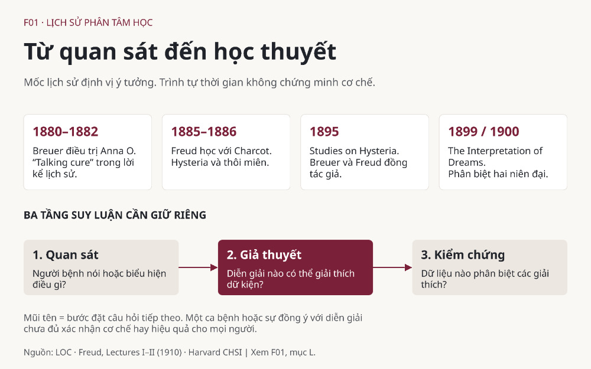

# F01 — Cuộc đời Freud và lịch sử ra đời phân tâm học

**Bài mẫu của chương trình, đã review có giới hạn; chờ người dùng xem.** [Biên bản review](../references/f01-review.md). Đọc trước các bài về vô thức, id–ego–superego và phòng vệ. Câu hỏi trung tâm: một cách lắng nghe người bệnh đã trở thành một học thuyết về tâm trí như thế nào, và điều gì còn phải kiểm chứng?

## Lưu ý

Đây là tài liệu giáo dục lịch sử và lý thuyết. Không dùng ví dụ để tự chẩn đoán, suy ra sang chấn bị quên hoặc thay thế đánh giá chuyên môn. “Hysteria” là thuật ngữ lịch sử trong các nguồn, không phải nhãn để gán cho một người hôm nay. Không suy triệu chứng cơ thể là “do tâm lý” chỉ vì chưa có lời giải thích.

## A. Learning Objectives — Mục tiêu học tập

Sau bài này, bạn có thể:

1. Giải thích vì sao vấn đề lâm sàng cuối thế kỷ XIX tạo điều kiện cho phân tâm học (psychoanalysis).
2. Phân biệt vai trò của Charcot, Breuer và Freud, tránh chuyện kể một thiên tài phát minh mọi thứ từ đầu.
3. Mô tả bước chuyển từ thôi miên (hypnosis), phương pháp thanh tẩy (cathartic method) sang liên tưởng tự do (free association).
4. Tách dữ kiện quan sát, giả thuyết cơ chế và kết luận về hiệu quả điều trị khi đọc một ca bệnh.
5. Nêu được đóng góp lịch sử và giới hạn khoa học mà không cần phủ nhận hoặc chấp nhận toàn bộ Freud.

## B. Historical Background — Con người và bối cảnh

### Bắt đầu từ một vấn đề của y học

Sigmund Freud (1856–1939) có nền đào tạo y khoa và thần kinh học. Từ cuối thế kỷ XIX, ông chuyển dần sang tìm ý nghĩa tâm lý của những hiện tượng không dễ giải thích bằng cách nhìn tổn thương thần kinh lúc đó. Freud không sáng tạo khái niệm vô thức từ con số không; chính tư liệu lịch sử của Library of Congress đặt ông giữa nhiều bác sĩ, nhà văn và triết gia quan tâm tới đời sống ngoài ý thức. [S1, phần mở đầu; S5, “Who was Sigmund Freud?”]

Vấn đề đáng chú ý là khoảng cách giữa sự đau khổ được người bệnh trải nghiệm và khả năng giải thích của bác sĩ. Một người có triệu chứng khó hiểu vẫn có thể đau khổ thật. Từ đó có ít nhất hai câu hỏi khác nhau: **“Có thể lắng nghe điều gì từ trải nghiệm người bệnh?”** và **“Cơ chế nào gây ra triệu chứng?”** Câu thứ nhất là định hướng tìm hiểu; câu thứ hai cần dữ liệu để phân biệt các giả thuyết. Không được dùng giá trị của việc lắng nghe làm bằng chứng đủ cho một cơ chế cụ thể.

### Các bước ngoặt cần nhớ

| Mốc | Sự kiện và ý nghĩa | Nguồn |
|---|---|---|
| 1880–1882 | Breuer điều trị người bệnh được gọi là Anna O.; ca này trở thành tư liệu quan trọng trong câu chuyện nguồn gốc | S2, Lecture I, đoạn mở đầu |
| 1885–1886 | Freud học với Charcot tại Paris, tiếp xúc nghiên cứu hysteria và thôi miên | S3, Lecture II, đoạn về Charcot |
| 1895 | Breuer và Freud xuất bản *Studies on Hysteria* | S1, “Studies on Hysteria — First edition” |
| 1899/1900 | *The Interpretation of Dreams* hoàn thành năm 1899, mang niên đại xuất bản 1900; nên phân biệt niên đại thư mục và diễn biến thực tế | S6 |
| 1909/1910 | Các bài giảng Clark được trình bày năm 1909, xuất bản tiếng Anh năm 1910 | S7; S2–S4 |
| 1933–1939 | Sách Freud bị Đức Quốc xã đốt năm 1933; nhà ông bị lục soát sau khi Áo bị sáp nhập năm 1938; ông mất năm 1939 | S5, phần tiểu sử |

Bảng này là bản đồ định hướng, không phải toàn bộ tiểu sử. Các khái niệm về xung năng, mô hình cấu trúc và lo âu thuộc những lần phát triển sau, được nghiên cứu riêng ở F03, F11 và F16. Đọc một bài giảng năm 1910 như thể nó đã chứa toàn bộ Freud sẽ xóa mất quá trình thay đổi học thuyết.

### Ba đóng góp khác nhau

Charcot tạo một bối cảnh nghiên cứu về hysteria và thôi miên mà Freud tiếp xúc. Breuer đem lại một kinh nghiệm điều trị quan trọng và đồng tác giả công trình năm 1895. Freud phát triển một hệ thống khái niệm và kỹ thuật tiếp theo. Đây là phân biệt đóng góp theo tư liệu, không phải cuộc thi ai “sở hữu” tâm lý học chiều sâu. [S1; S2; S3]

Lịch sử còn có người bệnh, người phiên dịch, người biên tập và các tổ chức truyền bá tư tưởng. Nguồn do tác giả kể lại thường lựa chọn sự kiện để làm sáng tỏ đường đi của chính mình. Vì vậy, tự thuật là tư liệu cần đọc, nhưng không đủ để quyết định mọi tranh luận lịch sử.

## C. Core Theory — Cái mới nằm ở đâu?

### Từ sự kiện cơ thể sang ý nghĩa chủ quan

Trong hệ thống Freud đang hình thành, một biểu hiện không chỉ được xem theo hình thức bề ngoài mà còn được hỏi về quan hệ của nó với cảm xúc, ký ức và xung đột của người trải nghiệm. “Có ý nghĩa” ở đây là một đề xuất diễn giải, không tự đồng nghĩa “nguyên nhân đã được chứng minh”. Chẳng hạn, một người cảm thấy khó nói trước cấp trên có thể kể một lịch sử bị phê bình; sự liên hệ ấy đáng khám phá nhưng chưa chứng minh lịch sử đó là nguyên nhân duy nhất.

Cách đọc hữu ích là phân biệt ba công việc của phân tâm học: **tạo giả thuyết về tâm trí**, **thu thập và diễn giải chất liệu trải nghiệm**, **can thiệp trong quan hệ trị liệu**. Chúng liên quan nhưng có tiêu chuẩn đánh giá khác nhau. Một cách diễn giải có thể giàu ý nghĩa với người bệnh mà chưa được kiểm nghiệm như một cơ chế phổ quát. Việc người bệnh cải thiện cũng chưa cho biết thành tố nào của cuộc trị liệu tạo ra thay đổi. Đây là khung phân tích của bài, không phải một trích dẫn định nghĩa nguyên văn Freud.

### Từ catharsis đến câu hỏi về resistance

Trong Lecture I, Freud kể lại việc Breuer sử dụng thôi miên và lời kể gắn với cảm xúc. Đến Lecture II, ông mô tả khó khăn khi không thôi miên được mọi người và sự chuyển sang làm việc trong trạng thái thức. Từ các trở ngại khi nói hoặc nhớ, ông suy ra sự chống cự (resistance) và dồn nén (repression). Lecture III tiếp tục trình bày kỹ thuật để người bệnh nói ra những ý nghĩ xuất hiện thay vì chỉ lựa chọn điều có vẻ hợp lý. [S2–S4]

Điều cần hiểu sâu không phải “nói ra là khỏi”, mà là sự đổi loại câu hỏi: từ tìm cách làm triệu chứng biến mất sang hỏi điều gì khiến một chất liệu khó được nhận biết hoặc nói ra. Tuy nhiên, bước suy từ một trở ngại quan sát được sang một lực vô thức là bước lý thuyết. Nó cần được kiểm tra bằng cách giải thích cạnh tranh, không thể được bảo đảm chỉ bằng sự tự tin của người diễn giải.

## D. Psychological Mechanism — Cơ chế được đề xuất

Chuỗi dưới đây là **tái dựng để giảng dạy mô hình xung đột ban đầu**, dựa trên Lecture II–III; không phải cơ chế sinh học đã được xác nhận. [S3; S4]

1. **Xuất hiện chất liệu khó chấp nhận:** một mong muốn, cảm xúc hoặc ý nghĩ xung đột với điều người ấy cho phép mình cảm thấy.
2. **Nảy sinh sức ép né tránh:** việc nhận biết hoặc biểu lộ chất liệu được hình dung là gây khó chịu. Trong mô hình, việc loại khỏi ý thức không nhất thiết là quyết định có chủ ý.
3. **Chất liệu tiếp tục có ảnh hưởng:** mô hình giả định nó chưa mất đi, dù không được nhận biết trực tiếp.
4. **Biểu hiện gián tiếp:** người phân tích tìm liên hệ qua lời kể, sự lặp lại hoặc những chỗ nói khó khăn. Việc chọn liên hệ nào là một phần của diễn giải, không phải quan sát thuần túy.
5. **Khám phá và kiểm tra ý nghĩa:** đối thoại được kỳ vọng làm rõ mối liên hệ. Một cách hiểu được chấp nhận không tự chứng minh ký ức là chính xác hoặc cơ chế đã đúng.

Có một nguy cơ suy luận vòng tròn: nếu người bệnh đồng ý thì bảo “đã tìm đúng”, còn nếu không đồng ý lại bảo “đang chống cự”, diễn giải gần như không thể sai. Muốn tránh điều này, người nghiên cứu phải nói trước dữ liệu nào sẽ khiến mình sửa giả thuyết. **Sự không đồng ý là dữ kiện cần hiểu, không phải giấy phép phủ nhận tiếng nói người bệnh.** Nhận xét này là phản biện phương pháp của bài đối với chuỗi suy luận trên.

## E. Real-Life Examples — Ba tình huống giả định

### 1. Quên trả lời một tin nhắn

Mai chưa trả lời lời mời họp của một người từng chê mình. Có thể đặt giả thuyết Mai vừa muốn tham gia vừa ngại bị đánh giá. Nhưng cũng có thể điện thoại tắt thông báo hoặc công việc quá tải.

- **Điều quan sát được:** tin nhắn chưa được trả lời.
- **Điều chưa biết:** Mai có đọc chưa, đang bận hay không, cảm xúc thế nào.
- **Vận dụng hợp lý:** hỏi về hoàn cảnh và cảm giác bằng câu mở.
- **Suy quá mức:** khẳng định Mai dồn nén thù ghét chỉ từ một tin nhắn.

Ví dụ cho thấy một hành vi có nhiều đường giải thích. Bài học lịch sử của Freud khuyến khích hỏi về ý nghĩa; kỷ luật khoa học yêu cầu giữ các giải thích thay thế.

### 2. Đổi chủ đề khi nhắc tới thất bại

Nam nói dài về kỹ thuật nhưng chuyển chủ đề khi được hỏi về lần thuyết trình không thành công. Người quan sát có thể nghĩ tới sự tránh né cảm giác xấu hổ. Tuy nhiên, Nam cũng có thể không muốn nói chuyện riêng trong môi trường công việc, hoặc cho rằng câu hỏi không liên quan.

Để phân biệt, cần xem người đối thoại có được quyền từ chối không, chủ đề này có thực sự quan trọng với mục tiêu cuộc nói chuyện không và mẫu hình có lặp lại trong bối cảnh phù hợp không. Gọi ngay đó là resistance sẽ đưa thuật ngữ lâm sàng vào quan hệ thường ngày và dễ gây áp đặt. “Bạn có muốn nói thêm về chuyện đó không?” tôn trọng người nói hơn “Bạn đang chống cự”.

### 3. Kể chuyện giúp nhẹ nhõm nhưng chưa rõ vì sao

Sau khi kể về một giai đoạn chăm sóc người thân, Lan cảm thấy nhẹ nhõm. Một cách hiểu là Lan đã có dịp nhận diện cảm xúc vốn khó nói. Những khả năng khác gồm có người lắng nghe, có thêm hỗ trợ thực tế hoặc sự căng thẳng tự giảm theo thời gian.

Đây là các giả thuyết minh họa, không phải kết quả của một thí nghiệm về Lan. Muốn biết cơ chế nào quan trọng, phải quan sát có hệ thống và có cách so sánh. Một trải nghiệm có ích đáng được trân trọng ngay cả khi ta chưa biết cơ chế. Nó không là lý do để ép người khác kể chuyện đau buồn hoặc truy tìm một biến cố được cho là đã quên.

## F. Case Study — Đọc ca Anna O. như một người nghiên cứu

### Dữ liệu và nguồn trung gian

Anna O. là tên ca bệnh của Bertha Pappenheim, người do Breuer điều trị, không phải người bệnh Freud trực tiếp điều trị trong ca này. Lecture I là **Freud kể lại** điều trị của Breuer. Vì thế, dữ liệu đến với ta qua một câu chuyện lâm sàng đã được tác giả chọn và tổ chức. Library of Congress cũng lưu ý kết quả điều trị không thành công như lời kể của Breuer và Freud từng trình bày. [S1, “Anna O. and Free Association”; S2]

### Phân tích từng bước

1. **Xác định câu hỏi:** ca này giúp giải thích nguồn gốc của một cách điều trị và một giả thuyết, hay chứng minh hiệu quả của toàn bộ phân tâm học? Chỉ câu hỏi thứ nhất phù hợp với phạm vi tư liệu đang đọc.
2. **Tách mô tả và cơ chế:** lời kể về triệu chứng và việc nói chuyện là dữ kiện được báo cáo. Ý tưởng một kinh nghiệm cảm xúc bị ngăn cản gây ra triệu chứng là diễn giải nhân quả của tác giả. [S2]
3. **Kiểm mối quan hệ thời gian:** một biểu hiện thay đổi sau một cuộc trò chuyện có thể gợi giả thuyết. Nó chưa loại trừ ảnh hưởng của thôi miên, kỳ vọng, quan hệ chăm sóc hoặc những thay đổi khác. Các khả năng ở đây là câu hỏi phương pháp, không phải chẩn đoán hồi cứu Pappenheim.
4. **Đối chiếu nguồn:** khác biệt giữa chuyện kể khởi nguyên và đánh giá lịch sử của Library of Congress khiến ta phải thận trọng với lời khẳng định “chữa khỏi”. Không chọn phiên bản hấp dẫn nhất rồi bỏ qua phần trái chiều. [S1]
5. **Giữ kết luận trong phạm vi:** ca có giá trị lịch sử lớn đối với sự phát triển talking cure. Chỉ từ ca này không thể xác nhận một cơ chế phổ quát hay hiệu quả cho mọi người bệnh.

### Điều ta không biết đủ để kết luận

Bài này không tái lập toàn bộ hồ sơ điều trị và không đưa chẩn đoán hiện đại cho Pappenheim. Thiếu một phép so sánh đáng tin cậy, dữ liệu theo dõi được chuẩn hóa và đánh giá độc lập, ta không tính được điều gì sẽ xảy ra nếu không có can thiệp. Đây là giới hạn của **suy luận từ ca đang đọc**, không phủ nhận trải nghiệm đau khổ của người bệnh.

## G. Modern Scientific Perspective — Đọc Freud hôm nay

### Bốn loại khẳng định, bốn phép kiểm

| Khẳng định | Bằng chứng phù hợp | Điều không thể suy ra |
|---|---|---|
| Freud đã trình bày ý tưởng X ở một tác phẩm | Văn bản gốc, đúng ấn bản và đoạn | X là cơ chế đúng |
| Một người có vẻ thay đổi sau trò chuyện | Báo cáo ca, theo dõi đáng tin | Trò chuyện gây ra thay đổi và ta đã biết thành tố tác động |
| Một can thiệp giúp một nhóm người | Nghiên cứu so sánh và tổng hợp có đánh giá chất lượng | Toàn bộ lý thuyết nền đã được xác nhận |
| Một cơ chế giải thích thay đổi | Đo cơ chế độc lập, thứ tự thời gian và phép kiểm giả thuyết cạnh tranh | Chỉ cần người bệnh đồng ý với diễn giải là đủ |

Bảng là hướng dẫn suy luận của bài, không phải kết quả tổng quan hệ thống mới.

### Phần có nguồn hiện đại và giới hạn truy cập

Leichsenring và cộng sự (2023) công bố một umbrella review đánh giá trị liệu tâm động học đối với các rối loạn tâm thần thường gặp. Sự tồn tại và phạm vi của review này đã được kiểm qua metadata và trích đoạn abstract; toàn văn chưa truy cập thành công trong phiên này. Vì vậy, bài **không đưa effect size, không kết luận mức chắc chắn hay chỉ định điều trị từ review đó**. Nguồn được đưa để chỉ đường đọc tiếp về bằng chứng điều trị, không làm chứng nhận cho Freud cổ điển. [S8]

Phần hỗ trợ trực tiếp trong bài mẫu là tư liệu lịch sử về sự phát triển phương pháp. Phần trái chiều cụ thể là lưu ý của Library of Congress về kết quả ca Anna O. và câu hỏi về ảnh hưởng ám thị ngay cả sau khi bỏ thôi miên. [S1] Còn các vấn đề rộng như tính chính xác ký ức, vô thức nhận thức hoặc cơ chế phòng vệ cần nghiên cứu riêng ở F02, F05–F06 và F15; bài này không coi chúng đã được giải quyết.

### Một kết quả tổng hợp thực nghiệm có thể đọc được

Bản tóm tắt chính thức của Cochrane cho review Abbass và cộng sự (2014) đã được đọc, gồm phương pháp, kết quả và kết luận. Review tổng hợp 33 nghiên cứu với 2.173 người trưởng thành, so sánh trị liệu tâm động học ngắn hạn với chờ điều trị, chăm sóc thông thường hoặc tiếp xúc tối thiểu. Nhiều nhóm kết quả cải thiện hơn ở ngắn và trung hạn; một số kết quả dài hạn không còn có ý nghĩa thống kê. [S9]

Mức hỗ trợ cần đọc cùng giới hạn: chất lượng nghiên cứu không đồng đều, dị biệt giữa nghiên cứu đáng kể, khác nhau về cách thực hiện và chất lượng trị liệu. Review này không chứng minh vượt trội so với mọi trị liệu tích cực, cũng không phải phép kiểm trực tiếp dồn nén. Đây là dữ liệu cũ, không phải tổng quan cập nhật tới 2026; bài chưa đọc toàn bộ báo cáo hoặc tái kiểm từng thử nghiệm. Kết quả minh họa vì sao cần tách bằng chứng điều trị hiện đại khỏi câu chuyện nguồn gốc. [S9]

### Vì sao vẫn học lịch sử?

Một ý tưởng có thể định hình ngôn ngữ, câu hỏi nghiên cứu và cách tổ chức thực hành mà không đúng ở mọi phần. Học lịch sử giúp nhận diện nguồn gốc của từ ngữ và các bước suy luận đã trở nên quen thuộc. Nhưng ảnh hưởng văn hóa là một câu hỏi khác với tính đúng của cơ chế. Ta có thể ghi nhận tầm quan trọng của Freud, yêu cầu bằng chứng cho từng khẳng định và tôn trọng người bệnh cùng một lúc.

## H. Practical Applications — Vận dụng có điều kiện

1. **Khi đọc một khẳng định tâm lý phổ thông:** viết lại thành câu có thể kiểm tra. “Mọi quên lãng đều có động cơ” quá rộng; hãy hỏi hành vi nào, trong điều kiện nào và dữ liệu gì phân biệt với thiếu chú ý. Đây là bài tập tư duy, không công cụ tự phân tích bệnh lý.
2. **Khi giao tiếp:** dùng câu hỏi mở về bối cảnh và ý nghĩa; cho phép người khác không trả lời. Không gắn nhãn repression/resistance để giành quyền diễn giải trải nghiệm của họ.
3. **Khi dạy học:** đặt một cột “nguồn nói gì” cạnh cột “ta kết luận gì”. Cho học viên tìm chỗ một chuyện kể chuyển thành tuyên bố nhân quả.
4. **Khi đọc nghiên cứu trị liệu:** phân biệt mô hình cổ điển, phương pháp trị liệu được nghiên cứu và nhóm người thực sự tham gia. Không suy từ tên trường phái sang hiệu quả cho một cá nhân.
5. **Khi tự phản tư:** có thể ghi lại điều mình nhận thấy và vài giải thích thay thế. Không cần ép tìm ký ức gốc hay một động cơ bí mật cho mọi hành vi.

## I. Visual Explanation — Từ quan sát đến học thuyết

Sơ đồ Moda đi kèm có hai lớp: các mốc nguồn gốc và ba tầng suy luận. Dòng thời gian chỉ biểu thị thứ tự lịch sử, không biểu thị học thuyết được xác nhận ngày càng đúng. Mũi tên ở lớp suy luận nghĩa là “đặt câu hỏi tiếp theo”, không phải quan hệ nhân quả đã chứng minh.

*Bản xem trước JPEG do Moda trả về, không phải bản xuất PNG. PNG đã được Moda xuất nhưng chưa tải được vào workspace vì lỗi kết nối proxy. [Mở canvas chỉnh sửa](https://moda.app/canvas/4b926d10-1a4b-4e4f-b261-e7121dbfe493?source=agent).*

Hình và URL canvas được ghi trong [hồ sơ Moda F01](../moda/f01-visual.json); trạng thái xuất và kiểm tra phải được đọc cùng hồ sơ. Nguồn nội dung hình: S1, S2, S3, S6, S7. Caption này giới hạn ý nghĩa của hình; phần kiểm chứng là khung giảng dạy do bài xây dựng.

## J. Key Takeaways — Những điểm cần nhớ

1. Freud xuất phát từ y học và thần kinh học; phân tâm học hình thành qua một quá trình, không một khoảnh khắc duy nhất.
2. Charcot, Breuer và người bệnh có vị trí riêng trong lịch sử này.
3. Anna O. là ca do Breuer điều trị, được Freud kể lại; không được đổi vai tác giả thành bác sĩ trực tiếp.
4. Bỏ thôi miên và phát triển liên tưởng tự do làm thay đổi cách thu thập chất liệu, nhưng không tự loại bỏ ảnh hưởng của người hỏi.
5. Quan sát, diễn giải và kiểm chứng là ba công việc khác nhau.
6. Sự đồng ý hoặc phản đối của người được diễn giải không tự quyết định một cơ chế là đúng.
7. Bằng chứng về một trị liệu hiện đại không tự xác nhận mọi giả thuyết Freud.
8. Học lịch sử giúp đặt câu hỏi tốt hơn; nó không trao quyền tự chẩn đoán mình hoặc người khác.

## K. Knowledge Check — Năm câu hỏi và giải thích

**1. Ai trực tiếp điều trị Anna O. trong ca đang học?**

**Đáp án:** Josef Breuer. Freud là đồng tác giả công trình và người kể lại ca trong bài giảng đang đọc. Nhầm người kể với người trực tiếp quan sát sẽ khiến ta đánh giá sai khoảng cách giữa nguồn và dữ kiện. [S1; S2]

**2. Vì sao không nên viết đơn giản “Freud phát hiện vô thức năm 1900”?**

**Đáp án:** Câu ấy gộp lịch sử một khái niệm rộng vào một tác giả và một mốc sách. Tư liệu đặt Freud trong một truyền thống quan tâm tới vô thức; sách về giấc mơ là một bước phát triển cụ thể. Nên nêu tác phẩm, phiên bản ý tưởng và phạm vi khẳng định. [S1; S6]

**3. Một người thấy nhẹ nhõm sau khi nói chuyện. Kết luận nào chắc hơn: “người ấy báo thấy nhẹ nhõm” hay “ký ức dồn nén đã được giải phóng”?**

**Đáp án:** Câu đầu mô tả báo cáo; câu sau thêm một cơ chế chưa đo. Cần thông tin khác để phân biệt cơ chế được đề xuất với những khả năng như hỗ trợ xã hội hoặc thay đổi hoàn cảnh. Ví dụ không phủ nhận lợi ích được người ấy trải nghiệm.

**4. Nếu mọi phản đối đều bị gọi là resistance, vấn đề phương pháp là gì?**

**Đáp án:** Giả thuyết có thể trở nên không sửa được: đồng ý hay phản đối đều bị dùng làm bằng chứng ủng hộ. Người nghiên cứu cần xác định dữ kiện nào sẽ khiến mình đổi cách giải thích, đồng thời tôn trọng quyền không đồng ý của người bệnh.

**5. Một review cho thấy một loại trị liệu tâm động học có lợi. Điều đó đã đủ chứng minh Oedipus complex chưa?**

**Đáp án:** Chưa. Kết quả của một gói can thiệp và tính đúng của một cơ chế cụ thể là hai đối tượng kiểm tra khác nhau. Cũng cần đọc thiết kế, nhóm người, đối chứng và độ chắc chắn trước khi nói review thực sự kết luận điều gì. Bài này chưa đọc được toàn văn S8 nên không tự đưa kết luận hiệu quả từ nguồn đó.

## L. References — Nguồn tham khảo

Các locator dưới là tên phần và câu mở đoạn trên bản HTML đã đọc, không giả làm số trang của bản in. Ngày kiểm: 2026-10-24. [Search log và claim ledger](../references/f01-research.md) ghi rõ mức truy cập.

- [S1] Library of Congress. *Sigmund Freud: Conflict & Culture — The Individual: Therapy*, triển lãm lịch sử, không ghi năm trên trang được đọc. https://www.loc.gov/exhibits/freud/freud02.html. Đã đọc phần mở đầu và các mục “Neurology and Hypnosis”, “Anna O. and Free Association”, “Studies on Hysteria — First edition”, “Abandoning Hypnosis and Suggestion”.
- [S2] Freud, S. (1910). *The Origin and Development of Psychoanalysis*, Lecture I, American Journal of Psychology, 21, 181–218 (toàn bộ chuỗi bài), bản HTML York University. https://psychclassics.yorku.ca/Freud/Origin/origin1.htm. Đã đọc các đoạn từ “Granted that it is a merit…” đến phần trình bày cathartic treatment; tên talking cure ở đoạn “The patient herself…”.
- [S3] Freud, S. (1910). Cùng tác phẩm, Lecture II. https://psychclassics.yorku.ca/Freud/Origin/origin2.htm. Đã đọc các đoạn “The great French observer…”, “Now hypnosis…” và phần “I called this hypothetical process…”.
- [S4] Freud, S. (1910). Cùng tác phẩm, Lecture III. https://psychclassics.yorku.ca/Freud/Origin/origin3.htm. Đã đọc phần mở đầu tự đính chính và các đoạn về resistance, nói ra ý nghĩ, liên tưởng. Không coi tuyên bố “proved” trong tác phẩm là xác nhận hiện đại.
- [S5] United States Holocaust Memorial Museum. *Sigmund Freud*, Holocaust Encyclopedia, không ghi năm trên phần đã đọc. https://encyclopedia.ushmm.org/content/en/article/sigmund-freud. Đã đọc phần “Who was Sigmund Freud?” và lịch sử đốt sách; lần mở lại có lỗi 502, không phải chưa từng đọc được.
- [S6] Harvard University, Collection of Historical Scientific Instruments. *The Interpretation of Dreams*, không ghi năm trên trang được đọc. https://chsi.harvard.edu/current_exhibitions/freud-interp-drawings/interpretation-dreams. Đã đọc đoạn mở đầu về 1899/1900; không dùng nhận xét “scandalized” của trang để khái quát tiếp nhận toàn xã hội.
- [S7] Fancher, R. E. *Introduction to Freud (1910)*, Classics in the History of Psychology, York University, không ghi năm trên phần đã đọc. https://psychclassics.yorku.ca/Freud/Origin/intro.htm. Đã đọc phần lời mời và hội nghị Clark; metadata chuỗi bài đối chiếu https://commons.clarku.edu/conferencematerials1909/2/ (trích đoạn tìm kiếm).
- [S8] Leichsenring, F., Abbass, A., Heim, N., Keefe, J. R., Kisely, S., Luyten, P., Rabung, S., & Steinert, C. (2023). *The status of psychodynamic psychotherapy as an empirically supported treatment for common mental disorders – an umbrella review based on updated criteria*. World Psychiatry, 22(2), 286–304. https://doi.org/10.1002/wps.21104. Chỉ metadata/trích đoạn abstract đã kiểm; toàn văn bị chặn. Nguồn đọc tiếp, không dùng để tuyên bố hiệu quả định lượng hoặc cơ chế trong bài.

- [S9] Abbass, A. A., và cộng sự (2014). *Short-term psychodynamic psychotherapies for common mental disorders*. Cochrane Database of Systematic Reviews, Issue 7, CD004687. DOI: https://doi.org/10.1002/14651858.CD004687.pub4. Đã đọc bản tóm tắt chính thức tại https://www.cochrane.org/evidence/CD004687_short-term-psychodynamic-psychotherapies-common-mental-disorders, các mục “Study characteristics”, “Key results”, “Quality of the evidence”, abstract “Selection criteria”, “Main results”, “Authors’ conclusions”. Chưa đọc toàn bộ báo cáo review.
